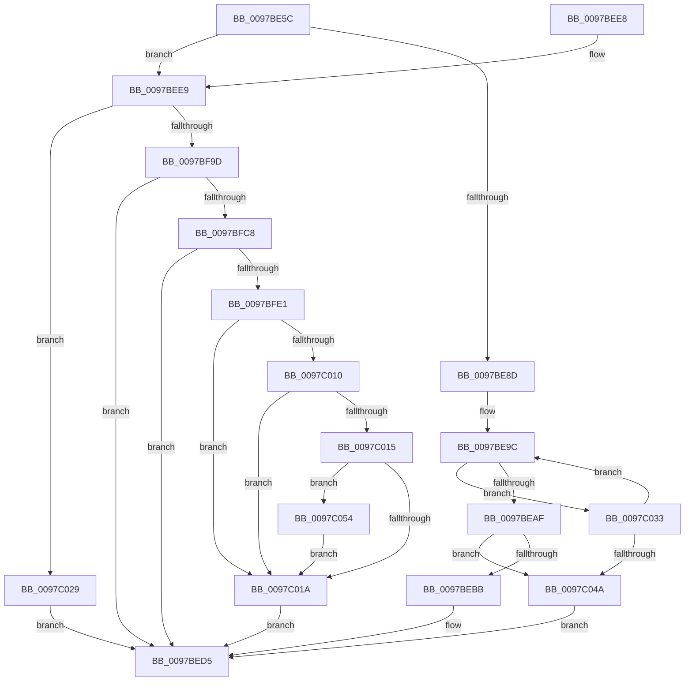

# PfpCopyEvent

- RVA: `0x0097BE5C`–`0x0097C09A` (길이 `574` bytes)
- VA: `0x000000014097BE5C`
- 실행 섹션: `PAGE`
- PDB 이름 있음: `예`; PDB Function 태그: `아니요`
- unwind 정보 RVA: `0x00096E20`
- 디코드: `142`개 명령, `574/574` bytes 표시
- 미해석 바이트: `0` (있으면 어셈블리에 `.byte`로 보존)

> 이 문서는 커널 이미지의 기계어와 PDB 기호를 분석해 생성했습니다. 4번과 5번은 함수 원형과 자료형을 바이너리 사용 방식에서 추정한 C 해석이며 원본 소스 복구 결과는 아닙니다.

## 1. Dependencies

- 직접 호출 지점: **5**; 고유 호출 대상: **5**
- 직접 호출자로 확인된 함수: **3**
- RIP 상대 이미지 참조: **0**

### Outgoing calls
- `0x0097BED0` → [memcpy](../../text/6C/memcpy_function_006C6840.md) (function, `0x006C6840`)
- `0x0097BF8C` → [PfpLogPageAccess](PfpLogPageAccess_function_0097C450.md) (function, `0x0097C450`)
- `0x0097BFD4` → [PsLookupProcessByProcessId](../8A/PsLookupProcessByProcessId_function_008A2AA0.md) (function, `0x008A2AA0`)
- `0x0097C01F` → [ObfDereferenceObjectWithTag](../../text/2F/ObfDereferenceObjectWithTag_function_002F78E0.md) (function, `0x002F78E0`)
- `0x0097C03A` → [PfTReplaceCurrentBuffer](PfTReplaceCurrentBuffer_function_0097CB14.md) (function, `0x0097CB14`)

### Direct callers
- [PfpFlushEventBuffers](PfpFlushEventBuffers_function_0097BD4C.md) at `0x0097BDC2`
- [sub_0097C0F8](Unknown_function_0097C0F8.md) at `0x0097C1D5`
- [sub_0097C0F8](Unknown_function_0097C0F8.md) at `0x0097C202`
- [sub_0097C2ED](Unknown_function_0097C2ED.md) at `0x0097C3A5`

### Static image references
- 디코드된 RIP-relative 메모리 참조가 없습니다.

## 2. Other-region calls and transfers

- 다른 실행 섹션으로 향하는 call: **2**
  - `0x0097BED0` → [memcpy](../../text/6C/memcpy_function_006C6840.md) (`PAGE` → `.text`)
  - `0x0097C01F` → [ObfDereferenceObjectWithTag](../../text/2F/ObfDereferenceObjectWithTag_function_002F78E0.md) (`PAGE` → `.text`)
- 별도 외부 분기/꼬리 이동을 확인하지 못했습니다.

## 3. Assembly (complete function range)

```asm
0097BE5C  48 8B C4                        mov rax, rsp
0097BE5F  48 89 58 08                     mov qword ptr [rax + 8], rbx
0097BE63  55                              push rbp
0097BE64  56                              push rsi
0097BE65  57                              push rdi
0097BE66  41 56                           push r14
0097BE68  41 57                           push r15
0097BE6A  48 83 EC 40                     sub rsp, 0x40
0097BE6E  48 8B 3A                        mov rdi, qword ptr [rdx]
0097BE71  33 DB                           xor ebx, ebx
0097BE73  48 89 58 18                     mov qword ptr [rax + 0x18], rbx
0097BE77  4C 8B F2                        mov r14, rdx
0097BE7A  48 8B C7                        mov rax, rdi
0097BE7D  48 8B F1                        mov rsi, rcx
0097BE80  25 00 F0 01 00                  and eax, 0x1f000
0097BE85  48 3D 00 A0 00 00               cmp rax, 0xa000
0097BE8B  74 5C                           je 0x14097bee9
0097BE8D  48 C1 EF 02                     shr rdi, 2
0097BE91  81 E7 FF 03 00 00               and edi, 0x3ff
0097BE97  8B EF                           mov ebp, edi
0097BE99  C1 E5 04                        shl ebp, 4
0097BE9C  48 8B 56 70                     mov rdx, qword ptr [rsi + 0x70]
0097BEA0  8B 4A 10                        mov ecx, dword ptr [rdx + 0x10]
0097BEA3  8D 04 39                        lea eax, [rcx + rdi]
0097BEA6  3B 42 14                        cmp eax, dword ptr [rdx + 0x14]
0097BEA9  0F 87 84 01 00 00               ja 0x14097c033
0097BEAF  89 42 10                        mov dword ptr [rdx + 0x10], eax
0097BEB2  48 85 D2                        test rdx, rdx
0097BEB5  0F 84 8F 01 00 00               je 0x14097c04a
0097BEBB  48 83 C2 1F                     add rdx, 0x1f
0097BEBF  48 C1 E1 04                     shl rcx, 4
0097BEC3  48 83 E2 F8                     and rdx, 0xfffffffffffffff8
0097BEC7  44 8B C5                        mov r8d, ebp
0097BECA  48 03 CA                        add rcx, rdx
0097BECD  49 8B D6                        mov rdx, r14
0097BED0  E8 6B A9 D4 FF                  call 0x1406c6840
0097BED5  8B C3                           mov eax, ebx
0097BED7  48 8B 5C 24 70                  mov rbx, qword ptr [rsp + 0x70]
0097BEDC  48 83 C4 40                     add rsp, 0x40
0097BEE0  41 5F                           pop r15
0097BEE2  41 5E                           pop r14
0097BEE4  5F                              pop rdi
0097BEE5  5E                              pop rsi
0097BEE6  5D                              pop rbp
0097BEE7  C3                              ret
0097BEE8  CC                              int3
0097BEE9  4C 8B 42 20                     mov r8, qword ptr [rdx + 0x20]
0097BEED  48 B9 FF FF FF FF FF FF FF 7F   movabs rcx, 0x7fffffffffffffff
0097BEF7  8B 52 30                        mov edx, dword ptr [rdx + 0x30]
0097BEFA  49 8B C0                        mov rax, r8
0097BEFD  48 23 C1                        and rax, rcx
0097BF00  C7 44 24 28 01 00 00 00         mov dword ptr [rsp + 0x28], 1
0097BF08  8B CA                           mov ecx, edx
0097BF0A  41 B9 FF 00 00 00               mov r9d, 0xff
0097BF10  49 3B C1                        cmp rax, r9
0097BF13  0F 57 C0                        xorps xmm0, xmm0
0097BF16  0F 11 44 24 30                  movups xmmword ptr [rsp + 0x30], xmm0
0097BF1B  4C 0F 42 C8                     cmovb r9, rax
0097BF1F  41 BA 02 00 00 00               mov r10d, 2
0097BF25  4D 85 C0                        test r8, r8
0097BF28  B8 02 10 00 00                  mov eax, 0x1002
0097BF2D  4C 8D 44 24 78                  lea r8, [rsp + 0x78]
0097BF32  44 0F 49 D0                     cmovns r10d, eax
0097BF36  C1 E1 08                        shl ecx, 8
0097BF39  41 0F B6 C1                     movzx eax, r9b
0097BF3D  48 81 E2 00 00 00 FF            and rdx, 0xffffffffff000000
0097BF44  0B C8                           or ecx, eax
0097BF46  4C 8D 4C 24 30                  lea r9, [rsp + 0x30]
0097BF4B  89 4C 24 38                     mov dword ptr [rsp + 0x38], ecx
0097BF4F  48 B8 FF FF FF 00 FF FF FF FF   movabs rax, 0xffffffff00ffffff
0097BF59  4C 23 D0                        and r10, rax
0097BF5C  49 8D 4E 18                     lea rcx, [r14 + 0x18]
0097BF60  48 8B 01                        mov rax, qword ptr [rcx]
0097BF63  49 0B D2                        or rdx, r10
0097BF66  48 C1 E0 0C                     shl rax, 0xc
0097BF6A  48 89 44 24 78                  mov qword ptr [rsp + 0x78], rax
0097BF6F  25 01 FE FF FF                  and eax, 0xfffffe01
0097BF74  83 C8 01                        or eax, 1
0097BF77  48 89 54 24 30                  mov qword ptr [rsp + 0x30], rdx
0097BF7C  49 8B 56 28                     mov rdx, qword ptr [r14 + 0x28]
0097BF80  48 89 4C 24 20                  mov qword ptr [rsp + 0x20], rcx
0097BF85  48 8B CE                        mov rcx, rsi
0097BF88  89 44 24 78                     mov dword ptr [rsp + 0x78], eax
0097BF8C  E8 BF 04 00 00                  call 0x14097c450
0097BF91  48 8B C8                        mov rcx, rax
0097BF94  48 85 C0                        test rax, rax
0097BF97  0F 84 8C 00 00 00               je 0x14097c029
0097BF9D  48 8B 96 98 00 00 00            mov rdx, qword ptr [rsi + 0x98]
0097BFA4  0F B7 49 0A                     movzx ecx, word ptr [rcx + 0xa]
0097BFA8  0F B7 42 24                     movzx eax, word ptr [rdx + 0x24]
0097BFAC  48 8D 7A 2F                     lea rdi, [rdx + 0x2f]
0097BFB0  48 2B C8                        sub rcx, rax
0097BFB3  48 83 E7 F8                     and rdi, 0xfffffffffffffff8
0097BFB7  8B C1                           mov eax, ecx
0097BFB9  48 8D 34 80                     lea rsi, [rax + rax*4]
0097BFBD  F6 44 F7 08 04                  test byte ptr [rdi + rsi*8 + 8], 4
0097BFC2  0F 84 0D FF FF FF               je 0x14097bed5
0097BFC8  41 8B 4E 34                     mov ecx, dword ptr [r14 + 0x34]
0097BFCC  48 8D 94 24 80 00 00 00         lea rdx, [rsp + 0x80]
0097BFD4  E8 C7 6A F2 FF                  call 0x1408a2aa0
0097BFD9  85 C0                           test eax, eax
0097BFDB  0F 88 F4 FE FF FF               js 0x14097bed5
0097BFE1  48 8B 8C 24 80 00 00 00         mov rcx, qword ptr [rsp + 0x80]
0097BFE9  49 B9 FF FF FF FF FF FF FF 1F   movabs r9, 0x1fffffffffffffff
0097BFF3  4C 8B 81 D0 01 00 00            mov r8, qword ptr [rcx + 0x1d0]
0097BFFA  48 8B 91 F8 01 00 00            mov rdx, qword ptr [rcx + 0x1f8]
0097C001  49 8B C0                        mov rax, r8
0097C004  48 33 C2                        xor rax, rdx
0097C007  49 23 C1                        and rax, r9
0097C00A  49 3B 46 28                     cmp rax, qword ptr [r14 + 0x28]
0097C00E  75 0A                           jne 0x14097c01a
0097C010  4D 85 C0                        test r8, r8
0097C013  74 05                           je 0x14097c01a
0097C015  48 85 D2                        test rdx, rdx
0097C018  75 3A                           jne 0x14097c054
0097C01A  BA 44 66 6C 74                  mov edx, 0x746c6644
0097C01F  E8 BC B8 97 FF                  call 0x1402f78e0
0097C024  E9 AC FE FF FF                  jmp 0x14097bed5
0097C029  BB 88 01 00 C0                  mov ebx, 0xc0000188
0097C02E  E9 A2 FE FF FF                  jmp 0x14097bed5
0097C033  48 8D 56 58                     lea rdx, [rsi + 0x58]
0097C037  48 8B CE                        mov rcx, rsi
0097C03A  E8 D5 0A 00 00                  call 0x14097cb14
0097C03F  3D 01 00 00 C0                  cmp eax, 0xc0000001
0097C044  0F 85 52 FE FF FF               jne 0x14097be9c
0097C04A  BB 9A 00 00 C0                  mov ebx, 0xc000009a
0097C04F  E9 81 FE FF FF                  jmp 0x14097bed5
0097C054  4C 8B 44 F7 08                  mov r8, qword ptr [rdi + rsi*8 + 8]
0097C059  49 83 E0 F9                     and r8, 0xfffffffffffffff9
0097C05D  49 83 C8 01                     or r8, 1
0097C061  4C 89 44 F7 08                  mov qword ptr [rdi + rsi*8 + 8], r8
0097C066  41 83 E0 07                     and r8d, 7
0097C06A  48 8B 91 F8 01 00 00            mov rdx, qword ptr [rcx + 0x1f8]
0097C071  48 33 91 D0 01 00 00            xor rdx, qword ptr [rcx + 0x1d0]
0097C078  48 C1 E2 03                     shl rdx, 3
0097C07C  49 0B D0                        or rdx, r8
0097C07F  48 89 54 F7 08                  mov qword ptr [rdi + rsi*8 + 8], rdx
0097C084  8B 81 84 03 00 00               mov eax, dword ptr [rcx + 0x384]
0097C08A  89 44 F7 14                     mov dword ptr [rdi + rsi*8 + 0x14], eax
0097C08E  8B 81 D0 01 00 00               mov eax, dword ptr [rcx + 0x1d0]
0097C094  89 44 F7 10                     mov dword ptr [rdi + rsi*8 + 0x10], eax
0097C098  EB 80                           jmp 0x14097c01a
```

## 4. C-style interpretation (structured pseudocode)

```c
__int64 __fastcall PfpCopyEvent(__int64 a1, __int64 a2)
{
    __int64 result;
    __int64 v_r10;
    __int64 v_rbp;
    __int64 v_rbx;
    __int64 v_rdi;
    __int64 v_rsp;
    unsigned __int64 v_stack_p20;
    unsigned int v_stack_p28;
    unsigned __int64 v_stack_p30;
    unsigned int v_stack_p38;
    unsigned __int64 v_stack_p78;
    unsigned __int64 v_stack_p8;
    unsigned __int64 v_stack_p80;

    *(unsigned __int64 *)(v_rsp + 8) = v_rbx;
    v_rsp = (v_rsp) - (64);
    v_rbx = 0;
    *(unsigned __int64 *)(v_rsp + 24) = 0;
    result = (unsigned int)((*(unsigned __int64 *)(a2)) & (0x1F000ULL));
    if (result == 0xA000ULL) goto loc_0097BEE9;
    v_rdi = (*(unsigned __int64 *)(a2)) >> (2);
    v_rdi = (unsigned int)((v_rdi) & (0x3FFULL));
    v_rbp = (unsigned int)(((unsigned int)((unsigned int)(v_rdi))) << (4));
loc_0097BE9C:
    if (((unsigned int)((unsigned int)(*(unsigned int *)(*(unsigned __int64 *)(a1 + 112) + 16)) + v_rdi * 1)) > (*(unsigned int *)(*(unsigned __int64 *)(a1 + 112) + 20))) goto loc_0097C033;
    *(unsigned int *)(*(unsigned __int64 *)(a1 + 112) + 16) = (unsigned int)((unsigned int)(*(unsigned int *)(*(unsigned __int64 *)(a1 + 112) + 16)) + v_rdi * 1);
    if (*(unsigned __int64 *)(a1 + 112) == 0) goto loc_0097C04A;
    a2 = (*(unsigned __int64 *)(a1 + 112)) + (31);
    a1 = ((unsigned int)(*(unsigned int *)(*(unsigned __int64 *)(a1 + 112) + 16))) << (4);
    a2 = (a2) & (-8);
    a1 = (a1) + (a2);
    result = memcpy(a1, a2, (unsigned int)((unsigned int)(v_rbp)), a4);
loc_0097BED5:
    v_rsp = (v_rsp) + (64);
    return 0;
loc_0097BEE9:
    result = (*(unsigned __int64 *)(a2 + 32)) & (a1);
    v_stack_p28 = 1;
    v_stack_p30 = v_xmm0;
    a4 = 255;
    if (result < 255) { a4 = result; }
    v_r10 = 2;
    if (!sign_flag) { v_r10 = (unsigned int)((unsigned int)(0x1002ULL)); }
    a1 = (unsigned int)(((unsigned int)((unsigned int)((unsigned int)(*(unsigned int *)(a2 + 48))))) << (8));
    a2 = ((unsigned int)(*(unsigned int *)(a2 + 48))) & (0xFFFFFFFFFF000000ULL);
    a1 = (unsigned int)((a1) | ((unsigned int)((unsigned __int8)(a4))));
    v_stack_p38 = (unsigned int)(a1);
    v_r10 = (v_r10) & ((unsigned __int8)(a4));
    a2 = (a2) | (v_r10);
    result = (*(unsigned __int64 *)(a2 + 24)) << (12);
    v_stack_p78 = result;
    result = (unsigned int)((result) & (0xFFFFFE01ULL));
    result = (unsigned int)((result) | (1));
    v_stack_p30 = a2;
    v_stack_p20 = a2 + 24;
    v_stack_p78 = (unsigned int)(result);
    result = PfpLogPageAccess(a1, *(unsigned __int64 *)(a2 + 40), v_stack_p78, v_stack_p30);
    if (result == 0) goto loc_0097C029;
    a1 = (*(unsigned __int16 *)(result + 10)) - (*(unsigned __int16 *)(*(unsigned __int64 *)(a1 + 152) + 36));
    v_rdi = (*(unsigned __int64 *)(a1 + 152) + 47) & (-8);
    if (((*(unsigned __int8 *)(v_rdi + (unsigned int)((unsigned int)(a1)) + (unsigned int)((unsigned int)(a1)) * 4 * 8 + 8)) & (4)) == 0) goto loc_0097BED5;
    result = PsLookupProcessByProcessId((unsigned int)(*(unsigned int *)(a2 + 52)), v_stack_p80, v_stack_p78, v_stack_p30);
    if (sign_flag) goto loc_0097BED5;
    result = (*(unsigned __int64 *)(v_stack_p80 + 464)) ^ (*(unsigned __int64 *)(v_stack_p80 + 504));
    result = (result) & (v_stack_p30);
    if (result != (*(unsigned __int64 *)(a2 + 40))) goto loc_0097C01A;
    if (*(unsigned __int64 *)(v_stack_p80 + 464) == 0) goto loc_0097C01A;
    if (*(unsigned __int64 *)(v_stack_p80 + 504) != 0) goto loc_0097C054;
loc_0097C01A:
    result = ObfDereferenceObjectWithTag(v_stack_p80, (unsigned int)(0x746C6644ULL), *(unsigned __int64 *)(v_stack_p80 + 464), v_stack_p30);
    goto loc_0097BED5;
loc_0097C029:
    goto loc_0097BED5;
loc_0097C033:
    result = PfTReplaceCurrentBuffer((unsigned int)((unsigned int)(a1)) + (unsigned int)((unsigned int)(a1)) * 4, (unsigned int)((unsigned int)(a1)) + (unsigned int)((unsigned int)(a1)) * 4 + 88, *(unsigned __int64 *)(v_stack_p80 + 464), v_stack_p30);
    if (((unsigned int)(result)) != 0xC0000001ULL) goto loc_0097BE9C;
loc_0097C04A:
    goto loc_0097BED5;
loc_0097C054:
    a3 = (*(unsigned __int64 *)(v_rdi + (unsigned int)((unsigned int)(a1)) + (unsigned int)((unsigned int)(a1)) * 4 * 8 + 8)) & (-7);
    a3 = (a3) | (1);
    *(unsigned __int64 *)(v_rdi + (unsigned int)((unsigned int)(a1)) + (unsigned int)((unsigned int)(a1)) * 4 * 8 + 8) = a3;
    a3 = (unsigned int)((a3) & (7));
    a2 = (*(unsigned __int64 *)((unsigned int)((unsigned int)(a1)) + (unsigned int)((unsigned int)(a1)) * 4 + 504)) ^ (*(unsigned __int64 *)((unsigned int)((unsigned int)(a1)) + (unsigned int)((unsigned int)(a1)) * 4 + 464));
    a2 = (a2) << (3);
    a2 = (a2) | (a3);
    *(unsigned __int64 *)(v_rdi + (unsigned int)((unsigned int)(a1)) + (unsigned int)((unsigned int)(a1)) * 4 * 8 + 8) = a2;
    *(unsigned int *)(v_rdi + (unsigned int)((unsigned int)(a1)) + (unsigned int)((unsigned int)(a1)) * 4 * 8 + 20) = (unsigned int)((unsigned int)(*(unsigned int *)((unsigned int)((unsigned int)(a1)) + (unsigned int)((unsigned int)(a1)) * 4 + 900)));
    *(unsigned int *)(v_rdi + (unsigned int)((unsigned int)(a1)) + (unsigned int)((unsigned int)(a1)) * 4 * 8 + 16) = (unsigned int)((unsigned int)(*(unsigned int *)((unsigned int)((unsigned int)(a1)) + (unsigned int)((unsigned int)(a1)) * 4 + 464)));
    goto loc_0097C01A;
}
```

## 5. (Beta) C Style

```c
int64_t PfpCopyEvent(void *Arg1, void *Arg2)
{
    uint8_t *arg1 = (uint8_t *)Arg1;
    uint8_t *arg2 = (uint8_t *)Arg2;

    int64_t result;
    int64_t local_r10;
    int64_t local_rbp;
    int64_t local_rbx;
    int64_t local_rdi;
    int64_t local_rsp;
    uint64_t v_stack_p20;
    uint32_t v_stack_p28;
    uint64_t v_stack_p30;
    uint32_t v_stack_p38;
    uint64_t v_stack_p78;
    uint64_t v_stack_p8;
    uint64_t v_stack_p80;

    *(uint64_t *)(local_rsp + 0x8) = local_rbx;
    local_rsp = (local_rsp) - (64);
    local_rbx = 0;
    *(uint64_t *)(local_rsp + 0x18) = 0;
    result = (uint32_t)((*(uint64_t *)(arg2)) & (0x1F000ULL));
    if (result == 0xA000ULL) goto loc_0097BEE9;
    local_rdi = (*(uint64_t *)(arg2)) >> (2);
    local_rdi = (uint32_t)((local_rdi) & (0x3FFULL));
    local_rbp = (uint32_t)(((uint32_t)((uint32_t)(local_rdi))) << (4));
loc_0097BE9C:
    if (((uint32_t)((uint32_t)(*(uint32_t *)(*(uint64_t *)(arg1 + 0x70) + 0x10)) + local_rdi * 1)) > (*(uint32_t *)(*(uint64_t *)(arg1 + 0x70) + 0x14))) goto loc_0097C033;
    *(uint32_t *)(*(uint64_t *)(arg1 + 0x70) + 0x10) = (uint32_t)((uint32_t)(*(uint32_t *)(*(uint64_t *)(arg1 + 0x70) + 0x10)) + local_rdi * 1);
    if (*(uint64_t *)(arg1 + 0x70) == 0) goto loc_0097C04A;
    Arg2 = (*(uint64_t *)(arg1 + 0x70)) + (31);
    Arg1 = ((uint32_t)(*(uint32_t *)(*(uint64_t *)(arg1 + 0x70) + 0x10))) << (4);
    Arg2 = (Arg2) & (-8);
    Arg1 = (Arg1) + (Arg2);
    result = memcpy(Arg1, Arg2, (uint32_t)((uint32_t)(local_rbp)), a4);
loc_0097BED5:
    local_rsp = (local_rsp) + (64);
    return 0;
loc_0097BEE9:
    result = (*(uint64_t *)(arg2 + 0x20)) & (Arg1);
    v_stack_p28 = 1;
    v_stack_p30 = v_xmm0;
    a4 = 255;
    if (result < 255) { a4 = result; }
    local_r10 = 2;
    if (!sign_flag) { local_r10 = (uint32_t)((uint32_t)(0x1002ULL)); }
    Arg1 = (uint32_t)(((uint32_t)((uint32_t)((uint32_t)(*(uint32_t *)(arg2 + 0x30))))) << (8));
    Arg2 = ((uint32_t)(*(uint32_t *)(arg2 + 0x30))) & (0xFFFFFFFFFF000000ULL);
    Arg1 = (uint32_t)((Arg1) | ((uint32_t)((uint8_t)(a4))));
    v_stack_p38 = (uint32_t)(Arg1);
    local_r10 = (local_r10) & ((uint8_t)(a4));
    Arg2 = (Arg2) | (local_r10);
    result = (*(uint64_t *)(arg2 + 0x18)) << (12);
    v_stack_p78 = result;
    result = (uint32_t)((result) & (0xFFFFFE01ULL));
    result = (uint32_t)((result) | (1));
    v_stack_p30 = Arg2;
    v_stack_p20 = Arg2 + 24;
    v_stack_p78 = (uint32_t)(result);
    result = PfpLogPageAccess(Arg1, *(uint64_t *)(arg2 + 0x28), v_stack_p78, v_stack_p30);
    if (result == 0) goto loc_0097C029;
    Arg1 = (*(uint16_t *)(result + 0xA)) - (*(uint16_t *)(*(uint64_t *)(arg1 + 0x98) + 0x24));
    local_rdi = (*(uint64_t *)(arg1 + 0x98) + 47) & (-8);
    if (((*(uint8_t *)(local_rdi + (uint32_t)((uint32_t)(arg1)) + (uint32_t)((uint32_t)(arg1)) * 4 * 8 + 0x8)) & (4)) == 0) goto loc_0097BED5;
    result = PsLookupProcessByProcessId((uint32_t)(*(uint32_t *)(arg2 + 0x34)), v_stack_p80, v_stack_p78, v_stack_p30);
    if (sign_flag) goto loc_0097BED5;
    result = (*(uint64_t *)(v_stack_p80 + 0x1D0)) ^ (*(uint64_t *)(v_stack_p80 + 0x1F8));
    result = (result) & (v_stack_p30);
    if (result != (*(uint64_t *)(arg2 + 0x28))) goto loc_0097C01A;
    if (*(uint64_t *)(v_stack_p80 + 0x1D0) == 0) goto loc_0097C01A;
    if (*(uint64_t *)(v_stack_p80 + 0x1F8) != 0) goto loc_0097C054;
loc_0097C01A:
    result = ObfDereferenceObjectWithTag(v_stack_p80, (uint32_t)(0x746C6644ULL), *(uint64_t *)(v_stack_p80 + 0x1D0), v_stack_p30);
    goto loc_0097BED5;
loc_0097C029:
    goto loc_0097BED5;
loc_0097C033:
    result = PfTReplaceCurrentBuffer((uint32_t)((uint32_t)(Arg1)) + (uint32_t)((uint32_t)(Arg1)) * 4, (uint32_t)((uint32_t)(Arg1)) + (uint32_t)((uint32_t)(Arg1)) * 4 + 88, *(uint64_t *)(v_stack_p80 + 0x1D0), v_stack_p30);
    if (((uint32_t)(result)) != 0xC0000001ULL) goto loc_0097BE9C;
loc_0097C04A:
    goto loc_0097BED5;
loc_0097C054:
    a3 = (*(uint64_t *)(local_rdi + (uint32_t)((uint32_t)(arg1)) + (uint32_t)((uint32_t)(arg1)) * 4 * 8 + 0x8)) & (-7);
    a3 = (a3) | (1);
    *(uint64_t *)(local_rdi + (uint32_t)((uint32_t)(arg1)) + (uint32_t)((uint32_t)(arg1)) * 4 * 8 + 0x8) = a3;
    a3 = (uint32_t)((a3) & (7));
    Arg2 = (*(uint64_t *)((uint32_t)((uint32_t)(arg1)) + (uint32_t)((uint32_t)(arg1)) * 4 + 0x1F8)) ^ (*(uint64_t *)((uint32_t)((uint32_t)(arg1)) + (uint32_t)((uint32_t)(arg1)) * 4 + 0x1D0));
    Arg2 = (Arg2) << (3);
    Arg2 = (Arg2) | (a3);
    *(void **)(local_rdi + (uint32_t)((uint32_t)(arg1)) + (uint32_t)((uint32_t)(arg1)) * 4 * 8 + 0x8) = Arg2;
    *(uint32_t *)(local_rdi + (uint32_t)((uint32_t)(arg1)) + (uint32_t)((uint32_t)(arg1)) * 4 * 8 + 0x14) = (uint32_t)((uint32_t)(*(uint32_t *)((uint32_t)((uint32_t)(arg1)) + (uint32_t)((uint32_t)(arg1)) * 4 + 0x384)));
    *(uint32_t *)(local_rdi + (uint32_t)((uint32_t)(arg1)) + (uint32_t)((uint32_t)(arg1)) * 4 * 8 + 0x10) = (uint32_t)((uint32_t)(*(uint32_t *)((uint32_t)((uint32_t)(arg1)) + (uint32_t)((uint32_t)(arg1)) * 4 + 0x1D0)));
    goto loc_0097C01A;
}
```

### 관측된 메모리 오프셋

구조체 형식이 확인되지 않은 접근은 인자 기준의 오프셋으로만 기록했습니다.

| 기준 인자 | 오프셋 표현 | 폭 (bit) | 접근 |
|---|---:|---:|---|
| `Arg1` | `+ 0x58` | `64` | `R` |
| `Arg1` | `+ 0x70` | `64` | `R` |
| `Arg1` | `+ 0x98` | `64` | `R` |
| `Arg2` | `+ 0x0` | `64` | `R` |
| `Arg2` | `+ 0x18` | `64` | `R` |
| `Arg2` | `+ 0x20` | `64` | `R` |
| `Arg2` | `+ 0x28` | `64` | `R` |
| `Arg2` | `+ 0x30` | `32` | `R` |
| `Arg2` | `+ 0x34` | `32` | `R` |

## 6. Execution-region graph

[열기: 2D/3D 그래프와 함수 탐색 컨트롤 패널](../../../control-panel.html?section=page&rva=0x0097BE5C&view=graph)

- 2D 그래프는 위에서 아래로 흐르고, 3D 그래프는 빈 공간을 드래그해 회전합니다. Shift+드래그는 이동, 휠은 확대·축소, 함수 노드 선택은 대상 보고서 이동입니다.

### Static fallback


