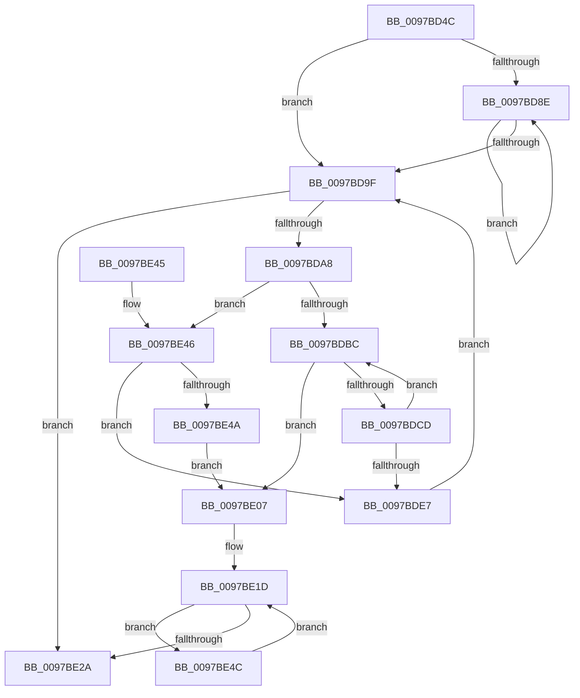

# PfpFlushEventBuffers

- RVA: `0x0097BD4C`–`0x0097BE54` (길이 `264` bytes)
- VA: `0x000000014097BD4C`
- 실행 섹션: `PAGE`
- PDB 이름 있음: `예`; PDB Function 태그: `아니요`
- unwind 정보 RVA: `0x00096E04`
- 디코드: `78`개 명령, `264/264` bytes 표시
- 미해석 바이트: `0` (있으면 어셈블리에 `.byte`로 보존)

> 이 문서는 커널 이미지의 기계어와 PDB 기호를 분석해 생성했습니다. 4번과 5번은 함수 원형과 자료형을 바이너리 사용 방식에서 추정한 C 해석이며 원본 소스 복구 결과는 아닙니다.

## 1. Dependencies

- 직접 호출 지점: **6**; 고유 호출 대상: **6**
- 직접 호출자로 확인된 함수: **1**
- RIP 상대 이미지 참조: **0**

### Outgoing calls
- `0x0097BD75` → [PfFbBufferListFlushStandby](../../text/48/PfFbBufferListFlushStandby_function_00484174.md) (function, `0x00484174`)
- `0x0097BD81` → [ExpInterlockedFlushSList](../../text/6B/ExpInterlockedFlushSList_function_006BA5F0.md) (function, `0x006BA5F0`)
- `0x0097BDC2` → [PfpCopyEvent](PfpCopyEvent_function_0097BE5C.md) (function, `0x0097BE5C`)
- `0x0097BE00` → [PfFbBufferListInsertInFree](../../text/48/PfFbBufferListInsertInFree_function_00484210.md) (function, `0x00484210`)
- `0x0097BE15` → [memcpy](../../text/6C/memcpy_function_006C6840.md) (function, `0x006C6840`)
- `0x0097BE20` → [PfTFullEventListAdd](../../text/49/PfTFullEventListAdd_function_00494B50.md) (function, `0x00494B50`)

### Direct callers
- [PfpFlushBuffers](PfpFlushBuffers_function_0097C0A0.md) at `0x0097C0E8`

### Static image references
- 디코드된 RIP-relative 메모리 참조가 없습니다.

## 2. Other-region calls and transfers

- 다른 실행 섹션으로 향하는 call: **5**
  - `0x0097BD75` → [PfFbBufferListFlushStandby](../../text/48/PfFbBufferListFlushStandby_function_00484174.md) (`PAGE` → `.text`)
  - `0x0097BD81` → [ExpInterlockedFlushSList](../../text/6B/ExpInterlockedFlushSList_function_006BA5F0.md) (`PAGE` → `.text`)
  - `0x0097BE00` → [PfFbBufferListInsertInFree](../../text/48/PfFbBufferListInsertInFree_function_00484210.md) (`PAGE` → `.text`)
  - `0x0097BE15` → [memcpy](../../text/6C/memcpy_function_006C6840.md) (`PAGE` → `.text`)
  - `0x0097BE20` → [PfTFullEventListAdd](../../text/49/PfTFullEventListAdd_function_00494B50.md) (`PAGE` → `.text`)
- 별도 외부 분기/꼬리 이동을 확인하지 못했습니다.

## 3. Assembly (complete function range)

```asm
0097BD4C  48 89 5C 24 08                  mov qword ptr [rsp + 8], rbx
0097BD51  48 89 6C 24 10                  mov qword ptr [rsp + 0x10], rbp
0097BD56  48 89 74 24 18                  mov qword ptr [rsp + 0x18], rsi
0097BD5B  57                              push rdi
0097BD5C  41 56                           push r14
0097BD5E  41 57                           push r15
0097BD60  48 83 EC 30                     sub rsp, 0x30
0097BD64  4C 8D B9 A0 01 00 00            lea r15, [rcx + 0x1a0]
0097BD6B  48 8B E9                        mov rbp, rcx
0097BD6E  49 8B D7                        mov rdx, r15
0097BD71  33 DB                           xor ebx, ebx
0097BD73  33 F6                           xor esi, esi
0097BD75  E8 FA 83 B0 FF                  call 0x140484174
0097BD7A  48 8D 8D 20 02 00 00            lea rcx, [rbp + 0x220]
0097BD81  E8 6A E8 D3 FF                  call 0x1406ba5f0
0097BD86  48 8B D0                        mov rdx, rax
0097BD89  48 85 C0                        test rax, rax
0097BD8C  74 11                           je 0x14097bd9f
0097BD8E  48 8B C2                        mov rax, rdx
0097BD91  48 8B 12                        mov rdx, qword ptr [rdx]
0097BD94  48 89 18                        mov qword ptr [rax], rbx
0097BD97  48 8B D8                        mov rbx, rax
0097BD9A  48 85 D2                        test rdx, rdx
0097BD9D  75 EF                           jne 0x14097bd8e
0097BD9F  48 85 DB                        test rbx, rbx
0097BDA2  0F 84 82 00 00 00               je 0x14097be2a
0097BDA8  48 8B FB                        mov rdi, rbx
0097BDAB  48 8B 1B                        mov rbx, qword ptr [rbx]
0097BDAE  83 7F 28 00                     cmp dword ptr [rdi + 0x28], 0
0097BDB2  4C 8D 77 30                     lea r14, [rdi + 0x30]
0097BDB6  0F 84 8A 00 00 00               je 0x14097be46
0097BDBC  49 8B D6                        mov rdx, r14
0097BDBF  48 8B CD                        mov rcx, rbp
0097BDC2  E8 95 00 00 00                  call 0x14097be5c
0097BDC7  8B F0                           mov esi, eax
0097BDC9  85 C0                           test eax, eax
0097BDCB  78 3A                           js 0x14097be07
0097BDCD  41 8B 0E                        mov ecx, dword ptr [r14]
0097BDD0  48 C1 E9 02                     shr rcx, 2
0097BDD4  81 E1 FF 03 00 00               and ecx, 0x3ff
0097BDDA  48 C1 E1 04                     shl rcx, 4
0097BDDE  4C 03 F1                        add r14, rcx
0097BDE1  83 47 28 FF                     add dword ptr [rdi + 0x28], -1
0097BDE5  75 D5                           jne 0x14097bdbc
0097BDE7  44 8B 47 20                     mov r8d, dword ptr [rdi + 0x20]
0097BDEB  48 8B D7                        mov rdx, rdi
0097BDEE  44 8B 4F 2C                     mov r9d, dword ptr [rdi + 0x2c]
0097BDF2  44 2B C7                        sub r8d, edi
0097BDF5  49 8B CF                        mov rcx, r15
0097BDF8  C7 44 24 20 01 00 00 00         mov dword ptr [rsp + 0x20], 1
0097BE00  E8 0B 84 B0 FF                  call 0x140484210
0097BE05  EB 98                           jmp 0x14097bd9f
0097BE07  44 8B 47 20                     mov r8d, dword ptr [rdi + 0x20]
0097BE0B  48 8D 4F 30                     lea rcx, [rdi + 0x30]
0097BE0F  45 2B C6                        sub r8d, r14d
0097BE12  49 8B D6                        mov rdx, r14
0097BE15  E8 26 AA D4 FF                  call 0x1406c6840
0097BE1A  48 8B D7                        mov rdx, rdi
0097BE1D  48 8B CD                        mov rcx, rbp
0097BE20  E8 2B 8D B1 FF                  call 0x140494b50
0097BE25  48 85 DB                        test rbx, rbx
0097BE28  75 22                           jne 0x14097be4c
0097BE2A  48 8B 5C 24 50                  mov rbx, qword ptr [rsp + 0x50]
0097BE2F  8B C6                           mov eax, esi
0097BE31  48 8B 74 24 60                  mov rsi, qword ptr [rsp + 0x60]
0097BE36  48 8B 6C 24 58                  mov rbp, qword ptr [rsp + 0x58]
0097BE3B  48 83 C4 30                     add rsp, 0x30
0097BE3F  41 5F                           pop r15
0097BE41  41 5E                           pop r14
0097BE43  5F                              pop rdi
0097BE44  C3                              ret
0097BE45  CC                              int3
0097BE46  85 F6                           test esi, esi
0097BE48  79 9D                           jns 0x14097bde7
0097BE4A  EB BB                           jmp 0x14097be07
0097BE4C  48 8B D3                        mov rdx, rbx
0097BE4F  48 8B 1B                        mov rbx, qword ptr [rbx]
0097BE52  EB C9                           jmp 0x14097be1d
```

## 4. C-style interpretation (structured pseudocode)

```c
__int64 __fastcall PfpFlushEventBuffers(__int64 a1)
{
    __int64 result;
    __int64 v_r14;
    __int64 v_rbx;
    __int64 v_rsi;
    __int64 v_rsp;
    unsigned int v_stack_m28;
    unsigned __int64 v_stack_p10;
    unsigned __int64 v_stack_p18;
    unsigned __int64 v_stack_p8;

    v_stack_p8 = v_rbx;
    v_stack_p10 = v_rbp;
    v_stack_p18 = v_rsi;
    v_rsp = (v_rsp) - (48);
    v_rbx = 0;
    v_rsi = 0;
    result = PfFbBufferListFlushStandby(a1, a1 + 416, a3, a4);
    result = ExpInterlockedFlushSList(a1 + 544, a1 + 416, a3, a4);
    if (result == 0) goto loc_0097BD9F;
loc_0097BD8E:
    *(unsigned __int64 *)(result) = 0;
    if (*(unsigned __int64 *)(result) != 0) goto loc_0097BD8E;
loc_0097BD9F:
    if (result == 0) goto loc_0097BE2A;
    if ((*(unsigned int *)(result + 40)) == 0) goto loc_0097BE46;
loc_0097BDBC:
    result = PfpCopyEvent(a1, result + 48, a3, a4);
    if (sign_flag) goto loc_0097BE07;
    a1 = ((unsigned int)(*(unsigned int *)(result + 48))) >> (2);
    a1 = (unsigned int)((a1) & (0x3FFULL));
    a1 = (a1) << (4);
    v_r14 = (result + 48) + (a1);
    if (condition_is_not_equal) goto loc_0097BDBC;
loc_0097BDE7:
    a3 = (unsigned int)(((unsigned int)(*(unsigned int *)(result + 32))) - ((unsigned int)(result)));
    v_stack_m28 = 1;
    result = PfFbBufferListInsertInFree(a1 + 416, result, a3, (unsigned int)(*(unsigned int *)(result + 44)));
    goto loc_0097BD9F;
loc_0097BE07:
    a3 = (unsigned int)(((unsigned int)(*(unsigned int *)(result + 32))) - ((unsigned int)(v_r14)));
    result = memcpy(result + 48, v_r14, a3, (unsigned int)(*(unsigned int *)(result + 44)));
loc_0097BE1D:
    result = PfTFullEventListAdd(a1, result, a3, (unsigned int)(*(unsigned int *)(result + 44)));
    if (*(unsigned __int64 *)(result) != 0) goto loc_0097BE4C;
loc_0097BE2A:
    v_rsp = (v_rsp) + (48);
    return (unsigned int)((unsigned int)((unsigned int)((unsigned int)(result))));
loc_0097BE46:
    if (!sign_flag) goto loc_0097BDE7;
    goto loc_0097BE07;
loc_0097BE4C:
    goto loc_0097BE1D;
}
```

## 5. (Beta) C Style

```c
int64_t PfpFlushEventBuffers(void *Arg1)
{
    uint8_t *arg1 = (uint8_t *)Arg1;

    int64_t result;
    int64_t local_r14;
    int64_t local_rbx;
    int64_t local_rsi;
    int64_t local_rsp;
    uint32_t v_stack_m28;
    uint64_t v_stack_p10;
    uint64_t v_stack_p18;
    uint64_t v_stack_p8;

    v_stack_p8 = local_rbx;
    v_stack_p10 = local_rbp;
    v_stack_p18 = local_rsi;
    local_rsp = (local_rsp) - (48);
    local_rbx = 0;
    local_rsi = 0;
    result = PfFbBufferListFlushStandby(Arg1, Arg1 + 416, a3, a4);
    result = ExpInterlockedFlushSList(Arg1 + 544, Arg1 + 416, a3, a4);
    if (result == 0) goto loc_0097BD9F;
loc_0097BD8E:
    *(uint64_t *)(result) = 0;
    if (*(uint64_t *)(result) != 0) goto loc_0097BD8E;
loc_0097BD9F:
    if (result == 0) goto loc_0097BE2A;
    if ((*(uint32_t *)(result + 0x28)) == 0) goto loc_0097BE46;
loc_0097BDBC:
    result = PfpCopyEvent(Arg1, result + 48, a3, a4);
    if (sign_flag) goto loc_0097BE07;
    Arg1 = ((uint32_t)(*(uint32_t *)(result + 0x30))) >> (2);
    Arg1 = (uint32_t)((Arg1) & (0x3FFULL));
    Arg1 = (Arg1) << (4);
    local_r14 = (result + 48) + (Arg1);
    if (condition_is_not_equal) goto loc_0097BDBC;
loc_0097BDE7:
    a3 = (uint32_t)(((uint32_t)(*(uint32_t *)(result + 0x20))) - ((uint32_t)(result)));
    v_stack_m28 = 1;
    result = PfFbBufferListInsertInFree(Arg1 + 416, result, a3, (uint32_t)(*(uint32_t *)(result + 0x2C)));
    goto loc_0097BD9F;
loc_0097BE07:
    a3 = (uint32_t)(((uint32_t)(*(uint32_t *)(result + 0x20))) - ((uint32_t)(local_r14)));
    result = memcpy(result + 48, local_r14, a3, (uint32_t)(*(uint32_t *)(result + 0x2C)));
loc_0097BE1D:
    result = PfTFullEventListAdd(Arg1, result, a3, (uint32_t)(*(uint32_t *)(result + 0x2C)));
    if (*(uint64_t *)(result) != 0) goto loc_0097BE4C;
loc_0097BE2A:
    local_rsp = (local_rsp) + (48);
    return (uint32_t)((uint32_t)((uint32_t)((uint32_t)(result))));
loc_0097BE46:
    if (!sign_flag) goto loc_0097BDE7;
    goto loc_0097BE07;
loc_0097BE4C:
    goto loc_0097BE1D;
}
```

### 관측된 메모리 오프셋

구조체 형식이 확인되지 않은 접근은 인자 기준의 오프셋으로만 기록했습니다.

| 기준 인자 | 오프셋 표현 | 폭 (bit) | 접근 |
|---|---:|---:|---|
| `Arg1` | `+ 0x1A0` | `64` | `R` |
| `Arg1` | `+ 0x220` | `64` | `R` |

## 6. Execution-region graph

[열기: 2D/3D 그래프와 함수 탐색 컨트롤 패널](../../../control-panel.html?section=page&rva=0x0097BD4C&view=graph)

- 2D 그래프는 위에서 아래로 흐르고, 3D 그래프는 빈 공간을 드래그해 회전합니다. Shift+드래그는 이동, 휠은 확대·축소, 함수 노드 선택은 대상 보고서 이동입니다.

### Static fallback


