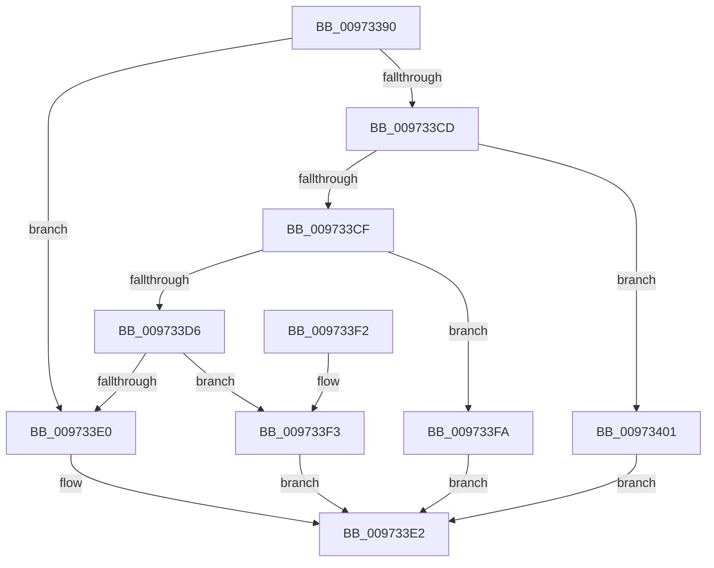

# PiCompareDDBCacheEntries

- RVA: `0x00973390`–`0x00973408` (길이 `120` bytes)
- VA: `0x0000000140973390`
- 실행 섹션: `PAGE`
- PDB 이름 있음: `예`; PDB Function 태그: `아니요`
- unwind 정보 RVA: `0x00096260`
- 디코드: `38`개 명령, `120/120` bytes 표시
- 미해석 바이트: `0` (있으면 어셈블리에 `.byte`로 보존)

> 이 문서는 커널 이미지의 기계어와 PDB 기호를 분석해 생성했습니다. 4번과 5번은 함수 원형과 자료형을 바이너리 사용 방식에서 추정한 C 해석이며 원본 소스 복구 결과는 아닙니다.

## 1. Dependencies

- 직접 호출 지점: **1**; 고유 호출 대상: **1**
- 직접 호출자로 확인된 함수: **0**
- RIP 상대 이미지 참조: **0**

### Outgoing calls
- `0x009733C4` → [RtlCompareUnicodeStrings](RtlCompareUnicodeStrings_function_009727E0.md) (function, `0x009727E0`)

### Direct callers
- 이 함수 시작 RVA로 연결되는 직접 call은 확인되지 않았습니다. 간접 호출은 완전히 역산할 수 없습니다.

### Static image references
- 디코드된 RIP-relative 메모리 참조가 없습니다.

## 2. Other-region calls and transfers

- 다른 실행 섹션으로 향하는 call: **0**
- 별도 외부 분기/꼬리 이동을 확인하지 못했습니다.

## 3. Assembly (complete function range)

```asm
00973390  48 89 5C 24 08                  mov qword ptr [rsp + 8], rbx
00973395  48 89 74 24 10                  mov qword ptr [rsp + 0x10], rsi
0097339A  57                              push rdi
0097339B  48 83 EC 30                     sub rsp, 0x30
0097339F  45 0F B7 48 10                  movzx r9d, word ptr [r8 + 0x10]
009733A4  48 8B FA                        mov rdi, rdx
009733A7  0F B7 52 10                     movzx edx, word ptr [rdx + 0x10]
009733AB  49 8B D8                        mov rbx, r8
009733AE  4D 8B 40 18                     mov r8, qword ptr [r8 + 0x18]
009733B2  48 8B F1                        mov rsi, rcx
009733B5  49 D1 E9                        shr r9, 1
009733B8  48 8B 4F 18                     mov rcx, qword ptr [rdi + 0x18]
009733BC  48 D1 EA                        shr rdx, 1
009733BF  C6 44 24 20 01                  mov byte ptr [rsp + 0x20], 1
009733C4  E8 17 F4 FF FF                  call 0x1409727e0
009733C9  85 C0                           test eax, eax
009733CB  78 13                           js 0x1409733e0
009733CD  7F 32                           jg 0x140973401
009733CF  48 83 7E 60 00                  cmp qword ptr [rsi + 0x60], 0
009733D4  75 24                           jne 0x1409733fa
009733D6  8B 47 20                        mov eax, dword ptr [rdi + 0x20]
009733D9  8B 4B 20                        mov ecx, dword ptr [rbx + 0x20]
009733DC  3B C8                           cmp ecx, eax
009733DE  76 13                           jbe 0x1409733f3
009733E0  33 C0                           xor eax, eax
009733E2  48 8B 5C 24 40                  mov rbx, qword ptr [rsp + 0x40]
009733E7  48 8B 74 24 48                  mov rsi, qword ptr [rsp + 0x48]
009733EC  48 83 C4 30                     add rsp, 0x30
009733F0  5F                              pop rdi
009733F1  C3                              ret
009733F2  CC                              int3
009733F3  1B C0                           sbb eax, eax
009733F5  83 C0 02                        add eax, 2
009733F8  EB E8                           jmp 0x1409733e2
009733FA  B8 02 00 00 00                  mov eax, 2
009733FF  EB E1                           jmp 0x1409733e2
00973401  B8 01 00 00 00                  mov eax, 1
00973406  EB DA                           jmp 0x1409733e2
```

## 4. C-style interpretation (structured pseudocode)

```c
__int64 __fastcall PiCompareDDBCacheEntries(__int64 a1, __int64 a2, __int64 a3)
{
    __int64 result;
    __int64 v_rsp;
    unsigned __int8 v_stack_m18;
    unsigned __int64 v_stack_p10;
    unsigned __int64 v_stack_p8;

    v_stack_p8 = v_rbx;
    v_stack_p10 = v_rsi;
    v_rsp = (v_rsp) - (48);
    a4 = (*(unsigned __int16 *)(a3 + 16)) >> (1);
    a2 = (*(unsigned __int16 *)(a2 + 16)) >> (1);
    v_stack_m18 = 1;
    result = RtlCompareUnicodeStrings(*(unsigned __int64 *)(a2 + 24), a2, *(unsigned __int64 *)(a3 + 24), a4);
    if (sign_flag) goto loc_009733E0;
    if (condition_is_greater) goto loc_00973401;
    if ((*(unsigned __int64 *)(a1 + 96)) != 0) goto loc_009733FA;
    if (((unsigned int)((unsigned int)(*(unsigned int *)(a3 + 32)))) <= ((unsigned int)((unsigned int)(*(unsigned int *)(a2 + 32))))) goto loc_009733F3;
loc_009733E0:
    result = 0;
loc_009733E2:
    v_rsp = (v_rsp) + (48);
    return result;
loc_009733F3:
    result = (unsigned int)((result) + (2));
    goto loc_009733E2;
loc_009733FA:
    goto loc_009733E2;
loc_00973401:
    goto loc_009733E2;
}
```

## 5. (Beta) C Style

```c
int64_t PiCompareDDBCacheEntries(void *Arg1, void *Arg2, void *Arg3)
{
    uint8_t *arg1 = (uint8_t *)Arg1;
    uint8_t *arg2 = (uint8_t *)Arg2;
    uint8_t *arg3 = (uint8_t *)Arg3;

    int64_t result;
    int64_t local_rsp;
    uint8_t v_stack_m18;
    uint64_t v_stack_p10;
    uint64_t v_stack_p8;

    v_stack_p8 = local_rbx;
    v_stack_p10 = local_rsi;
    local_rsp = (local_rsp) - (48);
    a4 = (*(uint16_t *)(arg3 + 0x10)) >> (1);
    Arg2 = (*(uint16_t *)(arg2 + 0x10)) >> (1);
    v_stack_m18 = 1;
    result = RtlCompareUnicodeStrings(*(uint64_t *)(arg2 + 0x18), Arg2, *(uint64_t *)(arg3 + 0x18), a4);
    if (sign_flag) goto loc_009733E0;
    if (condition_is_greater) goto loc_00973401;
    if ((*(uint64_t *)(arg1 + 0x60)) != 0) goto loc_009733FA;
    if (((uint32_t)((uint32_t)(*(uint32_t *)(arg3 + 0x20)))) <= ((uint32_t)((uint32_t)(*(uint32_t *)(arg2 + 0x20))))) goto loc_009733F3;
loc_009733E0:
    result = 0;
loc_009733E2:
    local_rsp = (local_rsp) + (48);
    return result;
loc_009733F3:
    result = (uint32_t)((result) + (2));
    goto loc_009733E2;
loc_009733FA:
    goto loc_009733E2;
loc_00973401:
    goto loc_009733E2;
}
```

### 관측된 메모리 오프셋

구조체 형식이 확인되지 않은 접근은 인자 기준의 오프셋으로만 기록했습니다.

| 기준 인자 | 오프셋 표현 | 폭 (bit) | 접근 |
|---|---:|---:|---|
| `Arg1` | `+ 0x60` | `64` | `R` |
| `Arg2` | `+ 0x10` | `16` | `R` |
| `Arg2` | `+ 0x18` | `64` | `R` |
| `Arg2` | `+ 0x20` | `32` | `R` |
| `Arg3` | `+ 0x10` | `16` | `R` |
| `Arg3` | `+ 0x18` | `64` | `R` |
| `Arg3` | `+ 0x20` | `32` | `R` |

## 6. Execution-region graph

[열기: 2D/3D 그래프와 함수 탐색 컨트롤 패널](../../../control-panel.html?section=page&rva=0x00973390&view=graph)

- 2D 그래프는 위에서 아래로 흐르고, 3D 그래프는 빈 공간을 드래그해 회전합니다. Shift+드래그는 이동, 휠은 확대·축소, 함수 노드 선택은 대상 보고서 이동입니다.

### Static fallback


