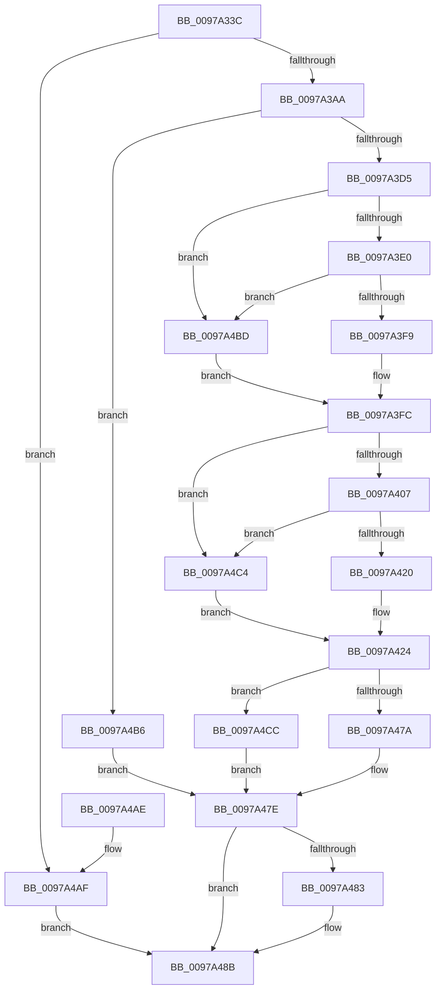

# PiDevCfgBuildDriverNodeStrongName

- RVA: `0x0097A33C`–`0x0097A4E4` (길이 `424` bytes)
- VA: `0x000000014097A33C`
- 실행 섹션: `PAGE`
- PDB 이름 있음: `예`; PDB Function 태그: `아니요`
- unwind 정보 RVA: `0x000967B4`
- 디코드: `114`개 명령, `424/424` bytes 표시
- 미해석 바이트: `0` (있으면 어셈블리에 `.byte`로 보존)

> 이 문서는 커널 이미지의 기계어와 PDB 기호를 분석해 생성했습니다. 4번과 5번은 함수 원형과 자료형을 바이너리 사용 방식에서 추정한 C 해석이며 원본 소스 복구 결과는 아닙니다.

## 1. Dependencies

- 직접 호출 지점: **5**; 고유 호출 대상: **4**
- 직접 호출자로 확인된 함수: **1**
- RIP 상대 이미지 참조: **1**

### Outgoing calls
- `0x0097A3C3` → [ExAllocatePool2](../../poolcode/B8/ExAllocatePool2_function_00B820F0.md) (function, `0x00B820F0`)
- `0x0097A3EC` → [RtlHashUnicodeString](RtlHashUnicodeString_function_0097A780.md) (function, `0x0097A780`)
- `0x0097A413` → [RtlHashUnicodeString](RtlHashUnicodeString_function_0097A780.md) (function, `0x0097A780`)
- `0x0097A46F` → [RtlUnicodeStringPrintf](../../text/48/RtlUnicodeStringPrintf_function_0048B984.md) (function, `0x0048B984`)
- `0x0097A486` → [ExFreePool](../../poolcode/B8/ExFreePool_function_00B82850.md) (function, `0x00B82850`)

### Direct callers
- [PiDevCfgConfigureDevice](PiDevCfgConfigureDevice_function_00977BB4.md) at `0x009793CE`

### Static image references
- `0x0097A441` → RVA `0x00AFEFB0` (` ?? ::NNGAKEGL::`string'`; read)

## 2. Other-region calls and transfers

- 다른 실행 섹션으로 향하는 call: **3**
  - `0x0097A3C3` → [ExAllocatePool2](../../poolcode/B8/ExAllocatePool2_function_00B820F0.md) (`PAGE` → `POOLCODE`)
  - `0x0097A46F` → [RtlUnicodeStringPrintf](../../text/48/RtlUnicodeStringPrintf_function_0048B984.md) (`PAGE` → `.text`)
  - `0x0097A486` → [ExFreePool](../../poolcode/B8/ExFreePool_function_00B82850.md) (`PAGE` → `POOLCODE`)
- 별도 외부 분기/꼬리 이동을 확인하지 못했습니다.

## 3. Assembly (complete function range)

```asm
0097A33C  48 89 5C 24 10                  mov qword ptr [rsp + 0x10], rbx
0097A341  48 89 74 24 18                  mov qword ptr [rsp + 0x18], rsi
0097A346  48 89 7C 24 20                  mov qword ptr [rsp + 0x20], rdi
0097A34B  55                              push rbp
0097A34C  41 54                           push r12
0097A34E  41 55                           push r13
0097A350  41 56                           push r14
0097A352  41 57                           push r15
0097A354  48 8B EC                        mov rbp, rsp
0097A357  48 81 EC 80 00 00 00            sub rsp, 0x80
0097A35E  44 0F B7 51 28                  movzx r10d, word ptr [rcx + 0x28]
0097A363  4C 8D 79 58                     lea r15, [rcx + 0x58]
0097A367  33 C0                           xor eax, eax
0097A369  4C 8D 61 48                     lea r12, [rcx + 0x48]
0097A36D  21 45 30                        and dword ptr [rbp + 0x30], eax
0097A370  48 8B F9                        mov rdi, rcx
0097A373  21 45 E0                        and dword ptr [rbp - 0x20], eax
0097A376  48 8B DA                        mov rbx, rdx
0097A379  41 0F B7 0C 24                  movzx ecx, word ptr [r12]
0097A37E  BA 02 00 00 00                  mov edx, 2
0097A383  89 45 EC                        mov dword ptr [rbp - 0x14], eax
0097A386  83 C1 5A                        add ecx, 0x5a
0097A389  41 0F B7 07                     movzx eax, word ptr [r15]
0097A38D  4D 8B F1                        mov r14, r9
0097A390  44 03 D0                        add r10d, eax
0097A393  49 8B F0                        mov rsi, r8
0097A396  41 03 CA                        add ecx, r10d
0097A399  8B C1                           mov eax, ecx
0097A39B  48 03 C2                        add rax, rdx
0097A39E  48 3D FE FF 00 00               cmp rax, 0xfffe
0097A3A4  0F 87 05 01 00 00               ja 0x14097a4af
0097A3AA  66 89 4D E8                     mov word ptr [rbp - 0x18], cx
0097A3AE  41 B8 53 74 72 67               mov r8d, 0x67727453
0097A3B4  66 03 CA                        add cx, dx
0097A3B7  0F B7 D1                        movzx edx, cx
0097A3BA  B9 00 01 00 00                  mov ecx, 0x100
0097A3BF  66 89 55 EA                     mov word ptr [rbp - 0x16], dx
0097A3C3  E8 28 7D 20 00                  call 0x140b820f0
0097A3C8  48 89 45 F0                     mov qword ptr [rbp - 0x10], rax
0097A3CC  48 85 C0                        test rax, rax
0097A3CF  0F 84 E1 00 00 00               je 0x14097a4b6
0097A3D5  48 83 7B 08 00                  cmp qword ptr [rbx + 8], 0
0097A3DA  0F 84 DD 00 00 00               je 0x14097a4bd
0097A3E0  4C 8D 4D 30                     lea r9, [rbp + 0x30]
0097A3E4  45 33 C0                        xor r8d, r8d
0097A3E7  B2 01                           mov dl, 1
0097A3E9  48 8B CB                        mov rcx, rbx
0097A3EC  E8 8F 03 00 00                  call 0x14097a780
0097A3F1  85 C0                           test eax, eax
0097A3F3  0F 88 C4 00 00 00               js 0x14097a4bd
0097A3F9  8B 5D 30                        mov ebx, dword ptr [rbp + 0x30]
0097A3FC  48 83 7E 08 00                  cmp qword ptr [rsi + 8], 0
0097A401  0F 84 BD 00 00 00               je 0x14097a4c4
0097A407  4C 8D 4D E0                     lea r9, [rbp - 0x20]
0097A40B  45 33 C0                        xor r8d, r8d
0097A40E  B2 01                           mov dl, 1
0097A410  48 8B CE                        mov rcx, rsi
0097A413  E8 68 03 00 00                  call 0x14097a780
0097A418  85 C0                           test eax, eax
0097A41A  0F 88 A4 00 00 00               js 0x14097a4c4
0097A420  44 8B 45 E0                     mov r8d, dword ptr [rbp - 0x20]
0097A424  0F B7 57 78                     movzx edx, word ptr [rdi + 0x78]
0097A428  44 8B CB                        mov r9d, ebx
0097A42B  8B 47 7C                        mov eax, dword ptr [rdi + 0x7c]
0097A42E  44 0F B7 57 7A                  movzx r10d, word ptr [rdi + 0x7a]
0097A433  44 0F B7 5F 7C                  movzx r11d, word ptr [rdi + 0x7c]
0097A438  4C 89 64 24 50                  mov qword ptr [rsp + 0x50], r12
0097A43D  89 54 24 48                     mov dword ptr [rsp + 0x48], edx
0097A441  48 8D 15 68 4B 18 00            lea rdx, [rip + 0x184b68]
0097A448  44 89 54 24 40                  mov dword ptr [rsp + 0x40], r10d
0097A44D  44 89 5C 24 38                  mov dword ptr [rsp + 0x38], r11d
0097A452  48 C1 E8 10                     shr rax, 0x10
0097A456  0F B7 C8                        movzx ecx, ax
0097A459  89 4C 24 30                     mov dword ptr [rsp + 0x30], ecx
0097A45D  48 8D 4D E8                     lea rcx, [rbp - 0x18]
0097A461  4C 89 7C 24 28                  mov qword ptr [rsp + 0x28], r15
0097A466  44 89 44 24 20                  mov dword ptr [rsp + 0x20], r8d
0097A46B  4C 8D 47 28                     lea r8, [rdi + 0x28]
0097A46F  E8 10 15 B1 FF                  call 0x14048b984
0097A474  8B D8                           mov ebx, eax
0097A476  85 C0                           test eax, eax
0097A478  79 52                           jns 0x14097a4cc
0097A47A  48 8B 45 F0                     mov rax, qword ptr [rbp - 0x10]
0097A47E  48 85 C0                        test rax, rax
0097A481  74 08                           je 0x14097a48b
0097A483  48 8B C8                        mov rcx, rax
0097A486  E8 C5 83 20 00                  call 0x140b82850
0097A48B  4C 8D 9C 24 80 00 00 00         lea r11, [rsp + 0x80]
0097A493  8B C3                           mov eax, ebx
0097A495  49 8B 5B 38                     mov rbx, qword ptr [r11 + 0x38]
0097A499  49 8B 73 40                     mov rsi, qword ptr [r11 + 0x40]
0097A49D  49 8B 7B 48                     mov rdi, qword ptr [r11 + 0x48]
0097A4A1  49 8B E3                        mov rsp, r11
0097A4A4  41 5F                           pop r15
0097A4A6  41 5E                           pop r14
0097A4A8  41 5D                           pop r13
0097A4AA  41 5C                           pop r12
0097A4AC  5D                              pop rbp
0097A4AD  C3                              ret
0097A4AE  CC                              int3
0097A4AF  BB 06 01 00 C0                  mov ebx, 0xc0000106
0097A4B4  EB D5                           jmp 0x14097a48b
0097A4B6  BB 9A 00 00 C0                  mov ebx, 0xc000009a
0097A4BB  EB C1                           jmp 0x14097a47e
0097A4BD  33 DB                           xor ebx, ebx
0097A4BF  E9 38 FF FF FF                  jmp 0x14097a3fc
0097A4C4  45 33 C0                        xor r8d, r8d
0097A4C7  E9 58 FF FF FF                  jmp 0x14097a424
0097A4CC  0F 10 45 E8                     movups xmm0, xmmword ptr [rbp - 0x18]
0097A4D0  0F 57 C9                        xorps xmm1, xmm1
0097A4D3  66 0F 73 D9 08                  psrldq xmm1, 8
0097A4D8  F3 41 0F 7F 06                  movdqu xmmword ptr [r14], xmm0
0097A4DD  66 48 0F 7E C8                  movq rax, xmm1
0097A4E2  EB 9A                           jmp 0x14097a47e
```

## 4. C-style interpretation (structured pseudocode)

```c
__int64 __fastcall PiDevCfgBuildDriverNodeStrongName(__int64 a1, __int64 a2, __int64 a3, __int64 a4)
{
    __int64 result;
    __int64 v_r10;
    __int64 v_rbx;
    __int64 v_rsp;
    unsigned __int64 v_stack_m28;
    unsigned __int64 v_stack_m38;
    unsigned int v_stack_m3C;
    unsigned __int16 v_stack_m3E;
    unsigned __int16 v_stack_m40;
    unsigned int v_stack_m48;
    unsigned __int64 v_stack_m58;
    unsigned int v_stack_m60;
    unsigned int v_stack_m68;
    unsigned int v_stack_m70;
    unsigned int v_stack_m78;
    unsigned __int64 v_stack_m80;
    unsigned int v_stack_m88;
    unsigned __int64 v_stack_p10;
    unsigned __int64 v_stack_p18;
    unsigned __int64 v_stack_p20;
    unsigned int v_stack_p8;

    v_stack_p10 = v_rbx;
    v_stack_p18 = v_rsi;
    v_stack_p20 = v_rdi;
    v_rsp = (v_rsp) - (128);
    result = 0;
    v_stack_m3C = 0;
    a1 = (unsigned int)((*(unsigned __int16 *)(a1 + 72)) + (90));
    v_r10 = (unsigned int)((*(unsigned __int16 *)(a1 + 40)) + ((unsigned int)(*(unsigned __int16 *)(a1 + 88))));
    a1 = (unsigned int)((a1) + ((unsigned int)(v_r10)));
    result = ((unsigned int)((unsigned int)(a1))) + (2);
    if (result > 0xFFFEULL) goto loc_0097A4AF;
    v_stack_m40 = (unsigned __int16)(a1);
    a1 = (unsigned __int16)((a1) + (2));
    v_stack_m3E = (unsigned __int16)((unsigned __int16)(a1));
    result = ExAllocatePool2(256, (unsigned __int16)(a1), (unsigned int)(0x67727453ULL), a4);
    v_stack_m38 = result;
    if (result == 0) goto loc_0097A4B6;
    if ((*(unsigned __int64 *)(a2 + 8)) == 0) goto loc_0097A4BD;
    a3 = 0;
    result = RtlHashUnicodeString(a2, 1, a3, v_stack_p8);
    if (sign_flag) goto loc_0097A4BD;
loc_0097A3FC:
    if ((*(unsigned __int64 *)(a3 + 8)) == 0) goto loc_0097A4C4;
    a3 = 0;
    result = RtlHashUnicodeString(0, 1, a3, v_stack_m48);
    if (sign_flag) goto loc_0097A4C4;
loc_0097A424:
    v_stack_m58 = a1 + 72;
    v_stack_m60 = (unsigned int)(*(unsigned __int16 *)(a1 + 120));
    v_stack_m68 = (unsigned int)(*(unsigned __int16 *)(a1 + 122));
    v_stack_m70 = (unsigned int)(*(unsigned __int16 *)(a1 + 124));
    result = ((unsigned int)(*(unsigned int *)(a1 + 124))) >> (16);
    v_stack_m78 = (unsigned int)((unsigned __int16)(result));
    v_stack_m80 = a1 + 88;
    v_stack_m88 = (unsigned int)((unsigned int)(v_stack_m48));
    result = RtlUnicodeStringPrintf(v_stack_m40, v_rip + 1592168, a1 + 40, (unsigned int)((unsigned int)((unsigned int)(v_stack_p8))));
    if (!sign_flag) goto loc_0097A4CC;
loc_0097A47E:
    result = v_stack_m38;
    if (v_stack_m38 != 0) {
        a1 = v_stack_m38;
        result = ExFreePool(a1, v_rip + 1592168, a1 + 40, (unsigned int)((unsigned int)((unsigned int)(v_stack_p8))));
    }
    return (unsigned int)((unsigned int)((unsigned int)((unsigned int)(result))));
loc_0097A4AF:
    goto loc_0097A48B;
loc_0097A4B6:
    goto loc_0097A47E;
loc_0097A4BD:
    v_rbx = 0;
    goto loc_0097A3FC;
loc_0097A4C4:
    a3 = 0;
    goto loc_0097A424;
loc_0097A4CC:
    *(unsigned __int64 *)(a4) = v_xmm0;
    goto loc_0097A47E;
}
```

## 5. (Beta) C Style

```c
int64_t PiDevCfgBuildDriverNodeStrongName(void *Arg1, void *Arg2, void *Arg3, void *Arg4)
{
    uint8_t *arg1 = (uint8_t *)Arg1;
    uint8_t *arg2 = (uint8_t *)Arg2;
    uint8_t *arg3 = (uint8_t *)Arg3;
    uint8_t *arg4 = (uint8_t *)Arg4;

    int64_t result;
    int64_t local_r10;
    int64_t local_rbx;
    int64_t local_rsp;
    uint64_t v_stack_m28;
    uint64_t v_stack_m38;
    uint32_t v_stack_m3C;
    uint16_t v_stack_m3E;
    uint16_t v_stack_m40;
    uint32_t v_stack_m48;
    uint64_t v_stack_m58;
    uint32_t v_stack_m60;
    uint32_t v_stack_m68;
    uint32_t v_stack_m70;
    uint32_t v_stack_m78;
    uint64_t v_stack_m80;
    uint32_t v_stack_m88;
    uint64_t v_stack_p10;
    uint64_t v_stack_p18;
    uint64_t v_stack_p20;
    uint32_t v_stack_p8;

    v_stack_p10 = local_rbx;
    v_stack_p18 = local_rsi;
    v_stack_p20 = local_rdi;
    local_rsp = (local_rsp) - (128);
    result = 0;
    v_stack_m3C = 0;
    Arg1 = (uint32_t)((*(uint16_t *)(arg1 + 0x48)) + (90));
    local_r10 = (uint32_t)((*(uint16_t *)(arg1 + 0x28)) + ((uint32_t)(*(uint16_t *)(arg1 + 0x58))));
    Arg1 = (uint32_t)((Arg1) + ((uint32_t)(local_r10)));
    result = ((uint32_t)((uint32_t)(Arg1))) + (2);
    if (result > 0xFFFEULL) goto loc_0097A4AF;
    v_stack_m40 = (uint16_t)(Arg1);
    Arg1 = (uint16_t)((Arg1) + (2));
    v_stack_m3E = (uint16_t)((uint16_t)(Arg1));
    result = ExAllocatePool2(256, (uint16_t)(Arg1), (uint32_t)(0x67727453ULL), Arg4);
    v_stack_m38 = result;
    if (result == 0) goto loc_0097A4B6;
    if ((*(uint64_t *)(arg2 + 0x8)) == 0) goto loc_0097A4BD;
    Arg3 = 0;
    result = RtlHashUnicodeString(Arg2, 1, Arg3, v_stack_p8);
    if (sign_flag) goto loc_0097A4BD;
loc_0097A3FC:
    if ((*(uint64_t *)(arg3 + 0x8)) == 0) goto loc_0097A4C4;
    Arg3 = 0;
    result = RtlHashUnicodeString(0, 1, Arg3, v_stack_m48);
    if (sign_flag) goto loc_0097A4C4;
loc_0097A424:
    v_stack_m58 = Arg1 + 72;
    v_stack_m60 = (uint32_t)(*(uint16_t *)(arg1 + 0x78));
    v_stack_m68 = (uint32_t)(*(uint16_t *)(arg1 + 0x7A));
    v_stack_m70 = (uint32_t)(*(uint16_t *)(arg1 + 0x7C));
    result = ((uint32_t)(*(uint32_t *)(arg1 + 0x7C))) >> (16);
    v_stack_m78 = (uint32_t)((uint16_t)(result));
    v_stack_m80 = Arg1 + 88;
    v_stack_m88 = (uint32_t)((uint32_t)(v_stack_m48));
    result = RtlUnicodeStringPrintf(v_stack_m40, v_rip + 1592168, Arg1 + 40, (uint32_t)((uint32_t)((uint32_t)(v_stack_p8))));
    if (!sign_flag) goto loc_0097A4CC;
loc_0097A47E:
    result = v_stack_m38;
    if (v_stack_m38 != 0) {
        Arg1 = v_stack_m38;
        result = ExFreePool(Arg1, v_rip + 1592168, Arg1 + 40, (uint32_t)((uint32_t)((uint32_t)(v_stack_p8))));
    }
    return (uint32_t)((uint32_t)((uint32_t)((uint32_t)(result))));
loc_0097A4AF:
    goto loc_0097A48B;
loc_0097A4B6:
    goto loc_0097A47E;
loc_0097A4BD:
    local_rbx = 0;
    goto loc_0097A3FC;
loc_0097A4C4:
    Arg3 = 0;
    goto loc_0097A424;
loc_0097A4CC:
    *(uint64_t *)(arg4) = v_xmm0;
    goto loc_0097A47E;
}
```

### 관측된 메모리 오프셋

구조체 형식이 확인되지 않은 접근은 인자 기준의 오프셋으로만 기록했습니다.

| 기준 인자 | 오프셋 표현 | 폭 (bit) | 접근 |
|---|---:|---:|---|
| `Arg1` | `+ 0x0` | `16` | `R` |
| `Arg1` | `+ 0x28` | `16` | `R` |
| `Arg1` | `+ 0x28` | `64` | `R` |
| `Arg1` | `+ 0x48` | `64` | `R` |
| `Arg1` | `+ 0x58` | `64` | `R` |
| `Arg1` | `+ 0x78` | `16` | `R` |
| `Arg1` | `+ 0x7A` | `16` | `R` |
| `Arg1` | `+ 0x7C` | `16` | `R` |
| `Arg1` | `+ 0x7C` | `32` | `R` |
| `Arg2` | `+ 0x8` | `64` | `R` |
| `Arg3` | `+ 0x8` | `64` | `R` |
| `Arg4` | `+ 0x0` | `128` | `W` |

## 6. Execution-region graph

[열기: 2D/3D 그래프와 함수 탐색 컨트롤 패널](../../../control-panel.html?section=page&rva=0x0097A33C&view=graph)

- 2D 그래프는 위에서 아래로 흐르고, 3D 그래프는 빈 공간을 드래그해 회전합니다. Shift+드래그는 이동, 휠은 확대·축소, 함수 노드 선택은 대상 보고서 이동입니다.

### Static fallback


