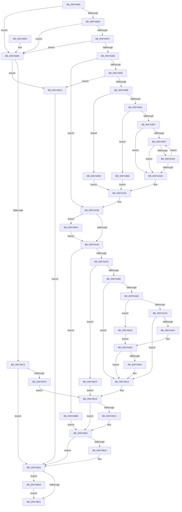

# PiDevCfgBuildIndirectString

- RVA: `0x0097A890`–`0x0097ABE3` (길이 `851` bytes)
- VA: `0x000000014097A890`
- 실행 섹션: `PAGE`
- PDB 이름 있음: `예`; PDB Function 태그: `아니요`
- unwind 정보 RVA: `0x0009686C`
- 디코드: `227`개 명령, `851/851` bytes 표시
- 미해석 바이트: `0` (있으면 어셈블리에 `.byte`로 보존)

> 이 문서는 커널 이미지의 기계어와 PDB 기호를 분석해 생성했습니다. 4번과 5번은 함수 원형과 자료형을 바이너리 사용 방식에서 추정한 C 해석이며 원본 소스 복구 결과는 아닙니다.

## 1. Dependencies

- 직접 호출 지점: **15**; 고유 호출 대상: **12**
- 직접 호출자로 확인된 함수: **1**
- RIP 상대 이미지 참조: **3**

### Outgoing calls
- `0x0097A94C` → [ZwOpenKey](../../text/6A/ZwOpenKey_function_006AD310.md) (function, `0x006AD310`)
- `0x0097A97A` → [ExAllocatePool2](../../poolcode/B8/ExAllocatePool2_function_00B820F0.md) (function, `0x00B820F0`)
- `0x0097A999` → [memcpy](../../text/6C/memcpy_function_006C6840.md) (function, `0x006C6840`)
- `0x0097A9B8` → [IopGetRegistryValue](../99/IopGetRegistryValue_function_009990EC.md) (function, `0x009990EC`)
- `0x0097A9C2` → [ExFreePool](../../poolcode/B8/ExFreePool_function_00B82850.md) (function, `0x00B82850`)
- `0x0097A9D8` → [PnpValidateRegistryString](../../text/4B/PnpValidateRegistryString_function_004B763C.md) (function, `0x004B763C`)
- `0x0097AA73` → [ExAllocatePool2](../../poolcode/B8/ExAllocatePool2_function_00B820F0.md) (function, `0x00B820F0`)
- `0x0097AAA7` → [RtlUnicodeStringPrintfEx](../../text/4A/RtlUnicodeStringPrintfEx_function_004A8FD0.md) (function, `0x004A8FD0`)
- `0x0097AAD7` → [RtlUnicodeStringPrintf](../../text/48/RtlUnicodeStringPrintf_function_0048B984.md) (function, `0x0048B984`)
- `0x0097AB0F` → [RtlInitUnicodeString](../../text/42/RtlInitUnicodeString_function_0042A780.md) (function, `0x0042A780`)
- `0x0097AB20` → [ExFreePool](../../poolcode/B8/ExFreePool_function_00B82850.md) (function, `0x00B82850`)
- `0x0097AB2F` → [ExFreePoolWithTag](../../poolcode/B8/ExFreePoolWithTag_function_00B82870.md) (function, `0x00B82870`)
- `0x0097AB6B` → [PnpDuplicateUnicodeString](../../text/4C/PnpDuplicateUnicodeString_function_004CC044.md) (function, `0x004CC044`)
- `0x0097AB8B` → [ExFreePoolWithTag](../../poolcode/B8/ExFreePoolWithTag_function_00B82870.md) (function, `0x00B82870`)
- `0x0097ABD9` → [ZwClose](../../text/6A/ZwClose_function_006AD2B0.md) (function, `0x006AD2B0`)

### Direct callers
- [PiDevCfgConfigureDevice](PiDevCfgConfigureDevice_function_00977BB4.md) at `0x00978DB2`
- [PiDevCfgConfigureDevice](PiDevCfgConfigureDevice_function_00977BB4.md) at `0x00978F18`

### Static image references
- `0x0097A908` → RVA `0x00AFEE70` (` ?? ::NNGAKEGL::`string'`; read)
- `0x0097AA8D` → RVA `0x00AFEF80` (` ?? ::NNGAKEGL::`string'`; read)
- `0x0097AACC` → RVA `0x00AFEFA0` (` ?? ::NNGAKEGL::`string'`; read)

## 2. Other-region calls and transfers

- 다른 실행 섹션으로 향하는 call: **14**
  - `0x0097A94C` → [ZwOpenKey](../../text/6A/ZwOpenKey_function_006AD310.md) (`PAGE` → `.text`)
  - `0x0097A97A` → [ExAllocatePool2](../../poolcode/B8/ExAllocatePool2_function_00B820F0.md) (`PAGE` → `POOLCODE`)
  - `0x0097A999` → [memcpy](../../text/6C/memcpy_function_006C6840.md) (`PAGE` → `.text`)
  - `0x0097A9C2` → [ExFreePool](../../poolcode/B8/ExFreePool_function_00B82850.md) (`PAGE` → `POOLCODE`)
  - `0x0097A9D8` → [PnpValidateRegistryString](../../text/4B/PnpValidateRegistryString_function_004B763C.md) (`PAGE` → `.text`)
  - `0x0097AA73` → [ExAllocatePool2](../../poolcode/B8/ExAllocatePool2_function_00B820F0.md) (`PAGE` → `POOLCODE`)
  - `0x0097AAA7` → [RtlUnicodeStringPrintfEx](../../text/4A/RtlUnicodeStringPrintfEx_function_004A8FD0.md) (`PAGE` → `.text`)
  - `0x0097AAD7` → [RtlUnicodeStringPrintf](../../text/48/RtlUnicodeStringPrintf_function_0048B984.md) (`PAGE` → `.text`)
  - `0x0097AB0F` → [RtlInitUnicodeString](../../text/42/RtlInitUnicodeString_function_0042A780.md) (`PAGE` → `.text`)
  - `0x0097AB20` → [ExFreePool](../../poolcode/B8/ExFreePool_function_00B82850.md) (`PAGE` → `POOLCODE`)
  - `0x0097AB2F` → [ExFreePoolWithTag](../../poolcode/B8/ExFreePoolWithTag_function_00B82870.md) (`PAGE` → `POOLCODE`)
  - `0x0097AB6B` → [PnpDuplicateUnicodeString](../../text/4C/PnpDuplicateUnicodeString_function_004CC044.md) (`PAGE` → `.text`)
  - `0x0097AB8B` → [ExFreePoolWithTag](../../poolcode/B8/ExFreePoolWithTag_function_00B82870.md) (`PAGE` → `POOLCODE`)
  - `0x0097ABD9` → [ZwClose](../../text/6A/ZwClose_function_006AD2B0.md) (`PAGE` → `.text`)
- 별도 외부 분기/꼬리 이동을 확인하지 못했습니다.

## 3. Assembly (complete function range)

```asm
0097A890  48 8B C4                        mov rax, rsp
0097A893  48 89 58 08                     mov qword ptr [rax + 8], rbx
0097A897  48 89 70 18                     mov qword ptr [rax + 0x18], rsi
0097A89B  48 89 78 20                     mov qword ptr [rax + 0x20], rdi
0097A89F  55                              push rbp
0097A8A0  41 54                           push r12
0097A8A2  41 55                           push r13
0097A8A4  41 56                           push r14
0097A8A6  41 57                           push r15
0097A8A8  48 8D 68 A1                     lea rbp, [rax - 0x5f]
0097A8AC  48 81 EC A0 00 00 00            sub rsp, 0xa0
0097A8B3  4C 8B FA                        mov r15, rdx
0097A8B6  0F 57 C0                        xorps xmm0, xmm0
0097A8B9  33 D2                           xor edx, edx
0097A8BB  4D 8B E1                        mov r12, r9
0097A8BE  4D 8B E8                        mov r13, r8
0097A8C1  48 89 55 6F                     mov qword ptr [rbp + 0x6f], rdx
0097A8C5  4C 8B F1                        mov r14, rcx
0097A8C8  48 89 55 C7                     mov qword ptr [rbp - 0x39], rdx
0097A8CC  41 0F B7 07                     movzx eax, word ptr [r15]
0097A8D0  8B DA                           mov ebx, edx
0097A8D2  48 89 55 CF                     mov qword ptr [rbp - 0x31], rdx
0097A8D6  8B FA                           mov edi, edx
0097A8D8  8B F2                           mov esi, edx
0097A8DA  0F 11 45 EF                     movups xmmword ptr [rbp - 0x11], xmm0
0097A8DE  0F 11 45 DF                     movups xmmword ptr [rbp - 0x21], xmm0
0097A8E2  83 F8 04                        cmp eax, 4
0097A8E5  0F 86 7A 02 00 00               jbe 0x14097ab65
0097A8EB  49 8B 4F 08                     mov rcx, qword ptr [r15 + 8]
0097A8EF  66 83 39 25                     cmp word ptr [rcx], 0x25
0097A8F3  0F 85 6C 02 00 00               jne 0x14097ab65
0097A8F9  48 D1 E8                        shr rax, 1
0097A8FC  66 83 7C 41 FE 25               cmp word ptr [rcx + rax*2 - 2], 0x25
0097A902  0F 85 5D 02 00 00               jne 0x14097ab65
0097A908  48 8D 05 61 45 18 00            lea rax, [rip + 0x184561]
0097A90F  C7 45 EF 0E 00 10 00            mov dword ptr [rbp - 0x11], 0x10000e
0097A916  48 89 45 F7                     mov qword ptr [rbp - 9], rax
0097A91A  4C 8D 45 FF                     lea r8, [rbp - 1]
0097A91E  49 8B 46 10                     mov rax, qword ptr [r14 + 0x10]
0097A922  48 8D 4D 6F                     lea rcx, [rbp + 0x6f]
0097A926  48 89 45 07                     mov qword ptr [rbp + 7], rax
0097A92A  BA 19 00 02 00                  mov edx, 0x20019
0097A92F  48 8D 45 EF                     lea rax, [rbp - 0x11]
0097A933  48 C7 45 FF 30 00 00 00         mov qword ptr [rbp - 1], 0x30
0097A93B  48 89 45 0F                     mov qword ptr [rbp + 0xf], rax
0097A93F  48 C7 45 17 40 02 00 00         mov qword ptr [rbp + 0x17], 0x240
0097A947  F3 0F 7F 45 1F                  movdqu xmmword ptr [rbp + 0x1f], xmm0
0097A94C  E8 BF 29 D3 FF                  call 0x1406ad310
0097A951  44 8D 46 02                     lea r8d, [rsi + 2]
0097A955  85 C0                           test eax, eax
0097A957  0F 88 CE 00 00 00               js 0x14097aa2b
0097A95D  41 0F B7 1F                     movzx ebx, word ptr [r15]
0097A961  B9 00 01 00 00                  mov ecx, 0x100
0097A966  66 83 EB 04                     sub bx, 4
0097A96A  0F B7 F3                        movzx esi, bx
0097A96D  41 8D 04 18                     lea eax, [r8 + rbx]
0097A971  41 B8 53 74 72 67               mov r8d, 0x67727453
0097A977  0F B7 D0                        movzx edx, ax
0097A97A  E8 71 77 20 00                  call 0x140b820f0
0097A97F  48 8B F8                        mov rdi, rax
0097A982  48 85 C0                        test rax, rax
0097A985  0F 84 3A 02 00 00               je 0x14097abc5
0097A98B  49 8B 57 08                     mov rdx, qword ptr [r15 + 8]
0097A98F  44 8B C6                        mov r8d, esi
0097A992  48 83 C2 02                     add rdx, 2
0097A996  48 8B C8                        mov rcx, rax
0097A999  E8 A2 BE D4 FF                  call 0x1406c6840
0097A99E  33 C9                           xor ecx, ecx
0097A9A0  0F B7 C3                        movzx eax, bx
0097A9A3  48 D1 E8                        shr rax, 1
0097A9A6  4C 8D 4D C7                     lea r9, [rbp - 0x39]
0097A9AA  45 33 C0                        xor r8d, r8d
0097A9AD  48 8B D7                        mov rdx, rdi
0097A9B0  66 89 0C 47                     mov word ptr [rdi + rax*2], cx
0097A9B4  48 8B 4D 6F                     mov rcx, qword ptr [rbp + 0x6f]
0097A9B8  E8 2F E7 01 00                  call 0x1409990ec
0097A9BD  48 8B CF                        mov rcx, rdi
0097A9C0  8B D8                           mov ebx, eax
0097A9C2  E8 89 7E 20 00                  call 0x140b82850
0097A9C7  33 C0                           xor eax, eax
0097A9C9  85 DB                           test ebx, ebx
0097A9CB  0F 88 C7 01 00 00               js 0x14097ab98
0097A9D1  48 8B 7D C7                     mov rdi, qword ptr [rbp - 0x39]
0097A9D5  48 8B CF                        mov rcx, rdi
0097A9D8  E8 5F CC B3 FF                  call 0x1404b763c
0097A9DD  33 DB                           xor ebx, ebx
0097A9DF  84 C0                           test al, al
0097A9E1  0F 84 9F 01 00 00               je 0x14097ab86
0097A9E7  8B 57 08                        mov edx, dword ptr [rdi + 8]
0097A9EA  8B 47 0C                        mov eax, dword ptr [rdi + 0xc]
0097A9ED  48 03 D7                        add rdx, rdi
0097A9F0  48 D1 E8                        shr rax, 1
0097A9F3  48 8B CA                        mov rcx, rdx
0097A9F6  4C 8D 04 42                     lea r8, [rdx + rax*2]
0097A9FA  49 3B D0                        cmp rdx, r8
0097A9FD  73 0E                           jae 0x14097aa0d
0097A9FF  66 39 19                        cmp word ptr [rcx], bx
0097AA02  74 09                           je 0x14097aa0d
0097AA04  48 83 C1 02                     add rcx, 2
0097AA08  49 3B C8                        cmp rcx, r8
0097AA0B  72 F2                           jb 0x14097a9ff
0097AA0D  2B CA                           sub ecx, edx
0097AA0F  66 89 4D DF                     mov word ptr [rbp - 0x21], cx
0097AA13  0F B7 47 0C                     movzx eax, word ptr [rdi + 0xc]
0097AA17  66 89 45 E1                     mov word ptr [rbp - 0x1f], ax
0097AA1B  8B 47 08                        mov eax, dword ptr [rdi + 8]
0097AA1E  48 03 C7                        add rax, rdi
0097AA21  48 89 45 E7                     mov qword ptr [rbp - 0x19], rax
0097AA25  41 B8 02 00 00 00               mov r8d, 2
0097AA2B  41 0F B7 0F                     movzx ecx, word ptr [r15]
0097AA2F  49 8D 5E 28                     lea rbx, [r14 + 0x28]
0097AA33  0F B7 13                        movzx edx, word ptr [rbx]
0097AA36  83 C1 04                        add ecx, 4
0097AA39  03 D1                           add edx, ecx
0097AA3B  45 33 F6                        xor r14d, r14d
0097AA3E  4C 39 75 E7                     cmp qword ptr [rbp - 0x19], r14
0097AA42  0F 85 58 01 00 00               jne 0x14097aba0
0097AA48  8B C2                           mov eax, edx
0097AA4A  49 03 C0                        add rax, r8
0097AA4D  48 3D FE FF 00 00               cmp rax, 0xfffe
0097AA53  0F 87 62 01 00 00               ja 0x14097abbb
0097AA59  66 89 55 CF                     mov word ptr [rbp - 0x31], dx
0097AA5D  B9 00 01 00 00                  mov ecx, 0x100
0097AA62  66 41 03 D0                     add dx, r8w
0097AA66  41 B8 53 74 72 67               mov r8d, 0x67727453
0097AA6C  0F B7 D2                        movzx edx, dx
0097AA6F  66 89 55 D1                     mov word ptr [rbp - 0x2f], dx
0097AA73  E8 78 76 20 00                  call 0x140b820f0
0097AA78  48 89 45 D7                     mov qword ptr [rbp - 0x29], rax
0097AA7C  48 8B F0                        mov rsi, rax
0097AA7F  48 85 C0                        test rax, rax
0097AA82  0F 84 47 01 00 00               je 0x14097abcf
0097AA88  4C 89 7C 24 28                  mov qword ptr [rsp + 0x28], r15
0097AA8D  4C 8D 0D EC 44 18 00            lea r9, [rip + 0x1844ec]
0097AA94  41 B8 00 08 00 00               mov r8d, 0x800
0097AA9A  48 89 5C 24 20                  mov qword ptr [rsp + 0x20], rbx
0097AA9F  48 8D 55 EF                     lea rdx, [rbp - 0x11]
0097AAA3  48 8D 4D CF                     lea rcx, [rbp - 0x31]
0097AAA7  E8 24 E5 B2 FF                  call 0x1404a8fd0
0097AAAC  8B D8                           mov ebx, eax
0097AAAE  85 C0                           test eax, eax
0097AAB0  78 62                           js 0x14097ab14
0097AAB2  44 0F B7 75 CF                  movzx r14d, word ptr [rbp - 0x31]
0097AAB7  33 C0                           xor eax, eax
0097AAB9  41 8B F6                        mov esi, r14d
0097AABC  D1 EE                           shr esi, 1
0097AABE  48 39 45 E7                     cmp qword ptr [rbp - 0x19], rax
0097AAC2  0F 84 E6 00 00 00               je 0x14097abae
0097AAC8  4C 8D 45 DF                     lea r8, [rbp - 0x21]
0097AACC  48 8D 15 CD 44 18 00            lea rdx, [rip + 0x1844cd]
0097AAD3  48 8D 4D EF                     lea rcx, [rbp - 0x11]
0097AAD7  E8 A8 0E B1 FF                  call 0x14048b984
0097AADC  8B D8                           mov ebx, eax
0097AADE  85 C0                           test eax, eax
0097AAE0  78 32                           js 0x14097ab14
0097AAE2  66 44 03 75 EF                  add r14w, word ptr [rbp - 0x11]
0097AAE7  66 44 89 75 CF                  mov word ptr [rbp - 0x31], r14w
0097AAEC  FF C6                           inc esi
0097AAEE  0F 57 C9                        xorps xmm1, xmm1
0097AAF1  0F 10 45 CF                     movups xmm0, xmmword ptr [rbp - 0x31]
0097AAF5  0F 11 4D CF                     movups xmmword ptr [rbp - 0x31], xmm1
0097AAF9  F3 41 0F 7F 45 00               movdqu xmmword ptr [r13], xmm0
0097AAFF  4D 85 E4                        test r12, r12
0097AB02  74 10                           je 0x14097ab14
0097AB04  49 8B 45 08                     mov rax, qword ptr [r13 + 8]
0097AB08  49 8B CC                        mov rcx, r12
0097AB0B  48 8D 14 70                     lea rdx, [rax + rsi*2]
0097AB0F  E8 6C FC AA FF                  call 0x14042a780
0097AB14  48 8B 75 D7                     mov rsi, qword ptr [rbp - 0x29]
0097AB18  48 85 F6                        test rsi, rsi
0097AB1B  74 08                           je 0x14097ab25
0097AB1D  48 8B CE                        mov rcx, rsi
0097AB20  E8 2B 7D 20 00                  call 0x140b82850
0097AB25  48 85 FF                        test rdi, rdi
0097AB28  74 0A                           je 0x14097ab34
0097AB2A  33 D2                           xor edx, edx
0097AB2C  48 8B CF                        mov rcx, rdi
0097AB2F  E8 3C 7D 20 00                  call 0x140b82870
0097AB34  48 8B 4D 6F                     mov rcx, qword ptr [rbp + 0x6f]
0097AB38  48 85 C9                        test rcx, rcx
0097AB3B  0F 85 98 00 00 00               jne 0x14097abd9
0097AB41  4C 8D 9C 24 A0 00 00 00         lea r11, [rsp + 0xa0]
0097AB49  8B C3                           mov eax, ebx
0097AB4B  49 8B 5B 30                     mov rbx, qword ptr [r11 + 0x30]
0097AB4F  49 8B 73 40                     mov rsi, qword ptr [r11 + 0x40]
0097AB53  49 8B 7B 48                     mov rdi, qword ptr [r11 + 0x48]
0097AB57  49 8B E3                        mov rsp, r11
0097AB5A  41 5F                           pop r15
0097AB5C  41 5E                           pop r14
0097AB5E  41 5D                           pop r13
0097AB60  41 5C                           pop r12
0097AB62  5D                              pop rbp
0097AB63  C3                              ret
0097AB64  CC                              int3
0097AB65  49 8B D7                        mov rdx, r15
0097AB68  49 8B CD                        mov rcx, r13
0097AB6B  E8 D4 14 B5 FF                  call 0x1404cc044
0097AB70  84 C0                           test al, al
0097AB72  74 51                           je 0x14097abc5
0097AB74  4D 85 E4                        test r12, r12
0097AB77  74 BB                           je 0x14097ab34
0097AB79  41 0F 10 45 00                  movups xmm0, xmmword ptr [r13]
0097AB7E  F3 41 0F 7F 04 24               movdqu xmmword ptr [r12], xmm0
0097AB84  EB 92                           jmp 0x14097ab18
0097AB86  33 D2                           xor edx, edx
0097AB88  48 8B CF                        mov rcx, rdi
0097AB8B  E8 E0 7C 20 00                  call 0x140b82870
0097AB90  48 8B FB                        mov rdi, rbx
0097AB93  E9 8D FE FF FF                  jmp 0x14097aa25
0097AB98  48 8B F8                        mov rdi, rax
0097AB9B  E9 85 FE FF FF                  jmp 0x14097aa25
0097ABA0  0F B7 45 DF                     movzx eax, word ptr [rbp - 0x21]
0097ABA4  83 C0 02                        add eax, 2
0097ABA7  03 D0                           add edx, eax
0097ABA9  E9 9A FE FF FF                  jmp 0x14097aa48
0097ABAE  41 0F B7 07                     movzx eax, word ptr [r15]
0097ABB2  D1 E8                           shr eax, 1
0097ABB4  2B F0                           sub esi, eax
0097ABB6  E9 33 FF FF FF                  jmp 0x14097aaee
0097ABBB  BB 06 01 00 C0                  mov ebx, 0xc0000106
0097ABC0  E9 60 FF FF FF                  jmp 0x14097ab25
0097ABC5  BB 9A 00 00 C0                  mov ebx, 0xc000009a
0097ABCA  E9 65 FF FF FF                  jmp 0x14097ab34
0097ABCF  BB 9A 00 00 C0                  mov ebx, 0xc000009a
0097ABD4  E9 3F FF FF FF                  jmp 0x14097ab18
0097ABD9  E8 D2 26 D3 FF                  call 0x1406ad2b0
0097ABDE  E9 5E FF FF FF                  jmp 0x14097ab41
```

## 4. C-style interpretation (structured pseudocode)

```c
__int64 __fastcall PiDevCfgBuildIndirectString(__int64 a1, __int64 a2, __int64 a3, __int64 a4)
{
    __int64 result;
    __int64 v_r14;
    __int64 v_rbx;
    __int64 v_rsi;
    __int64 v_rsp;
    unsigned __int64 v_stack_m28;
    unsigned __int64 v_stack_mA0;
    unsigned __int64 v_stack_mA8;

    *(unsigned __int64 *)(v_rsp + 8) = v_rbx;
    *(unsigned __int64 *)(v_rsp + 24) = v_rsi;
    *(unsigned __int64 *)(v_rsp + 32) = v_rdi;
    v_rsp = (v_rsp) - (160);
    a2 = 0;
    *(unsigned __int64 *)(v_rsp - 95 + 111) = 0;
    *(unsigned __int64 *)(v_rsp - 95 - 57) = 0;
    *(unsigned __int64 *)(v_rsp - 95 - 49) = 0;
    *(unsigned __int64 *)(v_rsp - 95 - 17) = v_xmm0;
    *(unsigned __int64 *)(v_rsp - 95 - 33) = v_xmm0;
    if (((unsigned int)(*(unsigned __int16 *)(a2))) <= 4) goto loc_0097AB65;
    if ((*(unsigned __int16 *)(*(unsigned __int64 *)(a2 + 8))) != 37) goto loc_0097AB65;
    result = (*(unsigned __int16 *)(a2)) >> (1);
    if ((*(unsigned __int16 *)(*(unsigned __int64 *)(a2 + 8) + result * 2 - 2)) != 37) goto loc_0097AB65;
    *(unsigned int *)(v_rsp - 95 - 17) = 0x10000EULL;
    *(unsigned __int64 *)(v_rsp - 95 - 9) = v_rip + 1590625;
    *(unsigned __int64 *)(v_rsp - 95 + 7) = *(unsigned __int64 *)(a1 + 16);
    *(unsigned __int64 *)(v_rsp - 95 - 1) = 48;
    *(unsigned __int64 *)(v_rsp - 95 + 15) = v_rsp - 95 - 17;
    *(unsigned __int64 *)(v_rsp - 95 + 23) = 576;
    *(unsigned __int64 *)(v_rsp - 95 + 31) = v_xmm0;
    result = ZwOpenKey(v_rsp - 95 + 111, (unsigned int)(0x20019ULL), v_rsp - 95 - 1, a4);
    if (sign_flag) goto loc_0097AA2B;
    v_rbx = (unsigned __int16)((*(unsigned __int16 *)(a2)) - (4));
    result = ExAllocatePool2(256, (unsigned __int16)(0 + 2 + v_rbx * 1), (unsigned int)(0x67727453ULL), a4);
    if (result == 0) goto loc_0097ABC5;
    a2 = (*(unsigned __int64 *)(a2 + 8)) + (2);
    result = memcpy(result, a2, (unsigned int)((unsigned int)((unsigned __int16)(v_rbx))), a4);
    a1 = 0;
    result = ((unsigned __int16)(v_rbx)) >> (1);
    a3 = 0;
    *(unsigned __int16 *)(result + result * 2) = 0;
    result = IopGetRegistryValue(*(unsigned __int64 *)(v_rsp - 95 + 111), result, a3, v_rsp - 95 - 57);
    result = ExFreePool(result, result, a3, v_rsp - 95 - 57);
    result = 0;
    if (sign_flag) goto loc_0097AB98;
    result = PnpValidateRegistryString(*(unsigned __int64 *)(v_rsp - 95 - 57), result, a3, v_rsp - 95 - 57);
    v_rbx = 0;
    if ((unsigned __int8)(result) == 0) goto loc_0097AB86;
    a2 = ((unsigned int)(*(unsigned int *)(*(unsigned __int64 *)(v_rsp - 95 - 57) + 8))) + (*(unsigned __int64 *)(v_rsp - 95 - 57));
    result = ((unsigned int)(*(unsigned int *)(*(unsigned __int64 *)(v_rsp - 95 - 57) + 12))) >> (1);
    if (a2 >= (a2 + result * 2)) goto loc_0097AA0D;
loc_0097A9FF:
    if ((*(unsigned __int16 *)(a2)) == 0) goto loc_0097AA0D;
    a1 = (a2) + (2);
    if (a1 < (a2 + result * 2)) goto loc_0097A9FF;
loc_0097AA0D:
    a1 = (unsigned int)((a1) - ((unsigned int)(a2)));
    *(unsigned __int16 *)(v_rsp - 95 - 33) = (unsigned __int16)(a1);
    *(unsigned __int16 *)(v_rsp - 95 - 31) = (unsigned __int16)(*(unsigned __int16 *)(*(unsigned __int64 *)(v_rsp - 95 - 57) + 12));
    result = ((unsigned int)(*(unsigned int *)(*(unsigned __int64 *)(v_rsp - 95 - 57) + 8))) + (*(unsigned __int64 *)(v_rsp - 95 - 57));
    *(unsigned __int64 *)(v_rsp - 95 - 25) = result;
loc_0097AA25:
loc_0097AA2B:
    a1 = (unsigned int)((*(unsigned __int16 *)(a2)) + (4));
    a2 = (unsigned int)((*(unsigned __int16 *)(a1 + 40)) + ((unsigned int)(a1)));
    v_r14 = 0;
    if ((*(unsigned __int64 *)(v_rsp - 95 - 25)) != 0) goto loc_0097ABA0;
loc_0097AA48:
    result = ((unsigned int)((unsigned int)(a2))) + (2);
    if (result > 0xFFFEULL) goto loc_0097ABBB;
    *(unsigned __int16 *)(v_rsp - 95 - 49) = (unsigned __int16)(a2);
    a2 = (unsigned __int16)((a2) + (2));
    *(unsigned __int16 *)(v_rsp - 95 - 47) = (unsigned __int16)((unsigned __int16)(a2));
    result = ExAllocatePool2(256, (unsigned __int16)(a2), (unsigned int)(0x67727453ULL), v_rsp - 95 - 57);
    *(unsigned __int64 *)(v_rsp - 95 - 41) = result;
    if (result == 0) goto loc_0097ABCF;
    v_stack_mA0 = a2;
    v_stack_mA8 = a1 + 40;
    result = RtlUnicodeStringPrintfEx(v_rsp - 95 - 49, v_rsp - 95 - 17, (unsigned int)(0x800ULL), v_rip + 1590508);
    if (sign_flag) goto loc_0097AB14;
    result = 0;
    v_rsi = (unsigned int)(((unsigned int)((unsigned int)(*(unsigned __int16 *)(v_rsp - 95 - 49)))) >> (1));
    if ((*(unsigned __int64 *)(v_rsp - 95 - 25)) == 0) goto loc_0097ABAE;
    result = RtlUnicodeStringPrintf(v_rsp - 95 - 17, v_rip + 1590477, v_rsp - 95 - 33, v_rip + 1590508);
    if (sign_flag) goto loc_0097AB14;
    v_r14 = (unsigned __int16)((*(unsigned __int16 *)(v_rsp - 95 - 49)) + (*(unsigned __int16 *)(v_rsp - 95 - 17)));
    *(unsigned __int16 *)(v_rsp - 95 - 49) = (unsigned __int16)(v_r14);
    v_rsi = (unsigned int)((v_rsi) + 1);
loc_0097AAEE:
    *(unsigned __int64 *)(v_rsp - 95 - 49) = v_xmm1;
    *(unsigned __int64 *)(a3) = v_xmm0;
    if (a4 != 0) {
        result = *(unsigned __int64 *)(a3 + 8);
        a1 = a4;
        a2 = result + v_rsi * 2;
        result = RtlInitUnicodeString(a1, a2, v_rsp - 95 - 33, v_rip + 1590508);
    }
loc_0097AB18:
    if (*(unsigned __int64 *)(v_rsp - 95 - 41) != 0) {
        a1 = *(unsigned __int64 *)(v_rsp - 95 - 41);
        result = ExFreePool(a1, a2, v_rsp - 95 - 33, v_rip + 1590508);
    }
    if (*(unsigned __int64 *)(v_rsp - 95 - 57) != 0) {
        a2 = 0;
        a1 = *(unsigned __int64 *)(v_rsp - 95 - 57);
        result = ExFreePoolWithTag(a1, a2, v_rsp - 95 - 33, v_rip + 1590508);
    }
    if (*(unsigned __int64 *)(v_rsp - 95 + 111) != 0) goto loc_0097ABD9;
loc_0097AB41:
    return (unsigned int)((unsigned int)((unsigned int)((unsigned int)(result))));
loc_0097AB65:
    result = PnpDuplicateUnicodeString(0, 0, v_rsp - 95 - 33, v_rip + 1590508);
    if ((unsigned __int8)(result) == 0) goto loc_0097ABC5;
    if (a4 == 0) goto loc_0097AB34;
    *(unsigned __int64 *)(a4) = v_xmm0;
    goto loc_0097AB18;
loc_0097AB86:
    a2 = 0;
    result = ExFreePoolWithTag(*(unsigned __int64 *)(v_stack_m28 + 72), a2, v_rsp - 95 - 33, v_rip + 1590508);
    goto loc_0097AA25;
loc_0097AB98:
    goto loc_0097AA25;
loc_0097ABA0:
    result = (unsigned int)((*(unsigned __int16 *)(v_rsp - 95 - 33)) + (2));
    a2 = (unsigned int)((a2) + ((unsigned int)(result)));
    goto loc_0097AA48;
loc_0097ABAE:
    result = (unsigned int)((*(unsigned __int16 *)(a2)) >> (1));
    v_rsi = (unsigned int)((*(unsigned __int64 *)(v_stack_m28 + 64)) - ((unsigned int)(result)));
    goto loc_0097AAEE;
loc_0097ABBB:
    goto loc_0097AB25;
loc_0097ABC5:
    goto loc_0097AB34;
loc_0097ABCF:
    goto loc_0097AB18;
loc_0097ABD9:
    result = ZwClose(*(unsigned __int64 *)(v_stack_m28 + 72), a2, v_rsp - 95 - 33, v_rip + 1590508);
    goto loc_0097AB41;
}
```

## 5. (Beta) C Style

```c
int64_t PiDevCfgBuildIndirectString(void *Arg1, void *Arg2, void *Arg3, int64_t Arg4)
{
    uint8_t *arg1 = (uint8_t *)Arg1;
    uint8_t *arg2 = (uint8_t *)Arg2;
    uint8_t *arg3 = (uint8_t *)Arg3;

    int64_t result;
    int64_t local_r14;
    int64_t local_rbx;
    int64_t local_rsi;
    int64_t local_rsp;
    uint64_t v_stack_m28;
    uint64_t v_stack_mA0;
    uint64_t v_stack_mA8;

    *(uint64_t *)(local_rsp + 0x8) = local_rbx;
    *(uint64_t *)(local_rsp + 0x18) = local_rsi;
    *(uint64_t *)(local_rsp + 0x20) = local_rdi;
    local_rsp = (local_rsp) - (160);
    Arg2 = 0;
    *(uint64_t *)(local_rsp - 0x5F + 0x6F) = 0;
    *(uint64_t *)(local_rsp - 0x5F - 0x39) = 0;
    *(uint64_t *)(local_rsp - 0x5F - 0x31) = 0;
    *(uint64_t *)(local_rsp - 0x5F - 0x11) = v_xmm0;
    *(uint64_t *)(local_rsp - 0x5F - 0x21) = v_xmm0;
    if (((uint32_t)(*(uint16_t *)(arg2))) <= 4) goto loc_0097AB65;
    if ((*(uint16_t *)(*(uint64_t *)(arg2 + 0x8))) != 37) goto loc_0097AB65;
    result = (*(uint16_t *)(arg2)) >> (1);
    if ((*(uint16_t *)(*(uint64_t *)(arg2 + 0x8) + result * 2 - 0x2)) != 37) goto loc_0097AB65;
    *(uint32_t *)(local_rsp - 0x5F - 0x11) = 0x10000EULL;
    *(uint64_t *)(local_rsp - 0x5F - 0x9) = v_rip + 1590625;
    *(uint64_t *)(local_rsp - 0x5F + 0x7) = *(uint64_t *)(arg1 + 0x10);
    *(uint64_t *)(local_rsp - 0x5F - 0x1) = 48;
    *(uint64_t *)(local_rsp - 0x5F + 0xF) = local_rsp - 95 - 17;
    *(uint64_t *)(local_rsp - 0x5F + 0x17) = 576;
    *(uint64_t *)(local_rsp - 0x5F + 0x1F) = v_xmm0;
    result = ZwOpenKey(local_rsp - 95 + 111, (uint32_t)(0x20019ULL), local_rsp - 95 - 1, Arg4);
    if (sign_flag) goto loc_0097AA2B;
    local_rbx = (uint16_t)((*(uint16_t *)(arg2)) - (4));
    result = ExAllocatePool2(256, (uint16_t)(0 + 2 + local_rbx * 1), (uint32_t)(0x67727453ULL), Arg4);
    if (result == 0) goto loc_0097ABC5;
    Arg2 = (*(uint64_t *)(arg2 + 0x8)) + (2);
    result = memcpy(result, Arg2, (uint32_t)((uint32_t)((uint16_t)(local_rbx))), Arg4);
    Arg1 = 0;
    result = ((uint16_t)(local_rbx)) >> (1);
    Arg3 = 0;
    *(uint16_t *)(result + result * 2) = 0;
    result = IopGetRegistryValue(*(uint64_t *)(local_rsp - 0x5F + 0x6F), result, Arg3, local_rsp - 95 - 57);
    result = ExFreePool(result, result, Arg3, local_rsp - 95 - 57);
    result = 0;
    if (sign_flag) goto loc_0097AB98;
    result = PnpValidateRegistryString(*(uint64_t *)(local_rsp - 0x5F - 0x39), result, Arg3, local_rsp - 95 - 57);
    local_rbx = 0;
    if ((uint8_t)(result) == 0) goto loc_0097AB86;
    Arg2 = ((uint32_t)(*(uint32_t *)(*(uint64_t *)(local_rsp - 0x5F - 0x39) + 0x8))) + (*(uint64_t *)(local_rsp - 0x5F - 0x39));
    result = ((uint32_t)(*(uint32_t *)(*(uint64_t *)(local_rsp - 0x5F - 0x39) + 0xC))) >> (1);
    if (Arg2 >= (Arg2 + result * 2)) goto loc_0097AA0D;
loc_0097A9FF:
    if ((*(uint16_t *)(arg2)) == 0) goto loc_0097AA0D;
    Arg1 = (Arg2) + (2);
    if (Arg1 < (Arg2 + result * 2)) goto loc_0097A9FF;
loc_0097AA0D:
    Arg1 = (uint32_t)((Arg1) - ((uint32_t)(Arg2)));
    *(uint16_t *)(local_rsp - 0x5F - 0x21) = (uint16_t)(Arg1);
    *(uint16_t *)(local_rsp - 0x5F - 0x1F) = (uint16_t)(*(uint16_t *)(*(uint64_t *)(local_rsp - 0x5F - 0x39) + 0xC));
    result = ((uint32_t)(*(uint32_t *)(*(uint64_t *)(local_rsp - 0x5F - 0x39) + 0x8))) + (*(uint64_t *)(local_rsp - 0x5F - 0x39));
    *(uint64_t *)(local_rsp - 0x5F - 0x19) = result;
loc_0097AA25:
loc_0097AA2B:
    Arg1 = (uint32_t)((*(uint16_t *)(arg2)) + (4));
    Arg2 = (uint32_t)((*(uint16_t *)(arg1 + 0x28)) + ((uint32_t)(Arg1)));
    local_r14 = 0;
    if ((*(uint64_t *)(local_rsp - 0x5F - 0x19)) != 0) goto loc_0097ABA0;
loc_0097AA48:
    result = ((uint32_t)((uint32_t)(Arg2))) + (2);
    if (result > 0xFFFEULL) goto loc_0097ABBB;
    *(uint16_t *)(local_rsp - 0x5F - 0x31) = (uint16_t)(Arg2);
    Arg2 = (uint16_t)((Arg2) + (2));
    *(uint16_t *)(local_rsp - 0x5F - 0x2F) = (uint16_t)((uint16_t)(Arg2));
    result = ExAllocatePool2(256, (uint16_t)(Arg2), (uint32_t)(0x67727453ULL), local_rsp - 95 - 57);
    *(uint64_t *)(local_rsp - 0x5F - 0x29) = result;
    if (result == 0) goto loc_0097ABCF;
    v_stack_mA0 = Arg2;
    v_stack_mA8 = Arg1 + 40;
    result = RtlUnicodeStringPrintfEx(local_rsp - 95 - 49, local_rsp - 95 - 17, (uint32_t)(0x800ULL), v_rip + 1590508);
    if (sign_flag) goto loc_0097AB14;
    result = 0;
    local_rsi = (uint32_t)(((uint32_t)((uint32_t)(*(uint16_t *)(local_rsp - 0x5F - 0x31)))) >> (1));
    if ((*(uint64_t *)(local_rsp - 0x5F - 0x19)) == 0) goto loc_0097ABAE;
    result = RtlUnicodeStringPrintf(local_rsp - 95 - 17, v_rip + 1590477, local_rsp - 95 - 33, v_rip + 1590508);
    if (sign_flag) goto loc_0097AB14;
    local_r14 = (uint16_t)((*(uint16_t *)(local_rsp - 0x5F - 0x31)) + (*(uint16_t *)(local_rsp - 0x5F - 0x11)));
    *(uint16_t *)(local_rsp - 0x5F - 0x31) = (uint16_t)(local_r14);
    local_rsi = (uint32_t)((local_rsi) + 1);
loc_0097AAEE:
    *(uint64_t *)(local_rsp - 0x5F - 0x31) = v_xmm1;
    *(uint64_t *)(arg3) = v_xmm0;
    if (Arg4 != 0) {
        result = *(uint64_t *)(arg3 + 0x8);
        Arg1 = Arg4;
        Arg2 = result + local_rsi * 2;
        result = RtlInitUnicodeString(Arg1, Arg2, local_rsp - 95 - 33, v_rip + 1590508);
    }
loc_0097AB18:
    if (*(uint64_t *)(local_rsp - 0x5F - 0x29) != 0) {
        Arg1 = *(uint64_t *)(local_rsp - 0x5F - 0x29);
        result = ExFreePool(Arg1, Arg2, local_rsp - 95 - 33, v_rip + 1590508);
    }
    if (*(uint64_t *)(local_rsp - 0x5F - 0x39) != 0) {
        Arg2 = 0;
        Arg1 = *(uint64_t *)(local_rsp - 0x5F - 0x39);
        result = ExFreePoolWithTag(Arg1, Arg2, local_rsp - 95 - 33, v_rip + 1590508);
    }
    if (*(uint64_t *)(local_rsp - 0x5F + 0x6F) != 0) goto loc_0097ABD9;
loc_0097AB41:
    return (uint32_t)((uint32_t)((uint32_t)((uint32_t)(result))));
loc_0097AB65:
    result = PnpDuplicateUnicodeString(0, 0, local_rsp - 95 - 33, v_rip + 1590508);
    if ((uint8_t)(result) == 0) goto loc_0097ABC5;
    if (Arg4 == 0) goto loc_0097AB34;
    *(uint64_t *)(Arg4) = v_xmm0;
    goto loc_0097AB18;
loc_0097AB86:
    Arg2 = 0;
    result = ExFreePoolWithTag(*(uint64_t *)(v_stack_m28 + 0x48), Arg2, local_rsp - 95 - 33, v_rip + 1590508);
    goto loc_0097AA25;
loc_0097AB98:
    goto loc_0097AA25;
loc_0097ABA0:
    result = (uint32_t)((*(uint16_t *)(local_rsp - 0x5F - 0x21)) + (2));
    Arg2 = (uint32_t)((Arg2) + ((uint32_t)(result)));
    goto loc_0097AA48;
loc_0097ABAE:
    result = (uint32_t)((*(uint16_t *)(arg2)) >> (1));
    local_rsi = (uint32_t)((*(uint64_t *)(v_stack_m28 + 0x40)) - ((uint32_t)(result)));
    goto loc_0097AAEE;
loc_0097ABBB:
    goto loc_0097AB25;
loc_0097ABC5:
    goto loc_0097AB34;
loc_0097ABCF:
    goto loc_0097AB18;
loc_0097ABD9:
    result = ZwClose(*(uint64_t *)(v_stack_m28 + 0x48), Arg2, local_rsp - 95 - 33, v_rip + 1590508);
    goto loc_0097AB41;
}
```

### 관측된 메모리 오프셋

구조체 형식이 확인되지 않은 접근은 인자 기준의 오프셋으로만 기록했습니다.

| 기준 인자 | 오프셋 표현 | 폭 (bit) | 접근 |
|---|---:|---:|---|
| `Arg1` | `+ 0x0` | `16` | `R` |
| `Arg1` | `+ 0x10` | `64` | `R` |
| `Arg1` | `+ 0x28` | `64` | `R` |
| `Arg2` | `+ 0x0` | `16` | `R` |
| `Arg2` | `+ 0x8` | `64` | `R` |
| `Arg3` | `+ 0x0` | `128` | `R` |
| `Arg3` | `+ 0x0` | `128` | `W` |
| `Arg3` | `+ 0x8` | `64` | `R` |

## 6. Execution-region graph

[열기: 2D/3D 그래프와 함수 탐색 컨트롤 패널](../../../control-panel.html?section=page&rva=0x0097A890&view=graph)

- 2D 그래프는 위에서 아래로 흐르고, 3D 그래프는 빈 공간을 드래그해 회전합니다. Shift+드래그는 이동, 휠은 확대·축소, 함수 노드 선택은 대상 보고서 이동입니다.

### Static fallback


