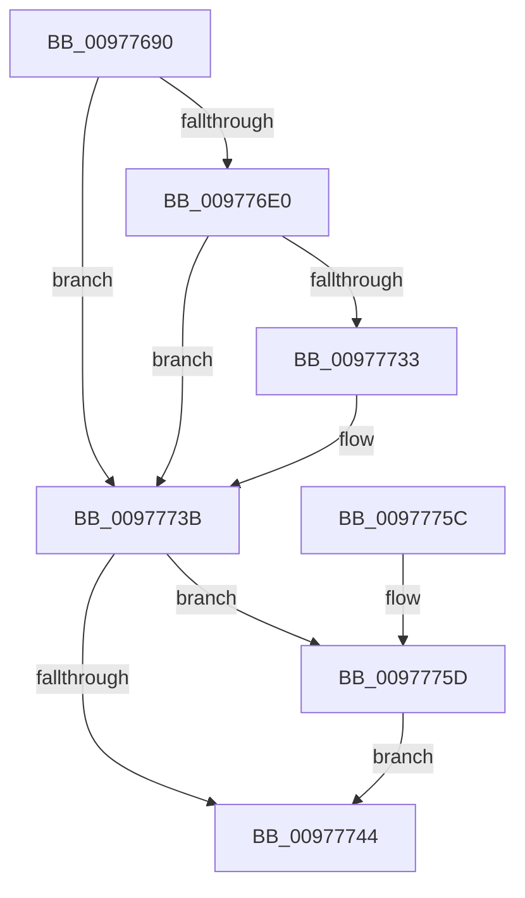

# PiDevCfgGetDriverPackageId

- RVA: `0x00977690`–`0x00977764` (길이 `212` bytes)
- VA: `0x0000000140977690`
- 실행 섹션: `PAGE`
- PDB 이름 있음: `예`; PDB Function 태그: `아니요`
- unwind 정보 RVA: `0x00096730`
- 디코드: `56`개 명령, `212/212` bytes 표시
- 미해석 바이트: `0` (있으면 어셈블리에 `.byte`로 보존)

> 이 문서는 커널 이미지의 기계어와 PDB 기호를 분석해 생성했습니다. 4번과 5번은 함수 원형과 자료형을 바이너리 사용 방식에서 추정한 C 해석이며 원본 소스 복구 결과는 아닙니다.

## 1. Dependencies

- 직접 호출 지점: **3**; 고유 호출 대상: **3**
- 직접 호출자로 확인된 함수: **5**
- RIP 상대 이미지 참조: **2**

### Outgoing calls
- `0x009776D5` → [PnpOpenObjectRegKey](../8E/PnpOpenObjectRegKey_function_008E15E8.md) (function, `0x008E15E8`)
- `0x00977728` → [PiDevCfgQueryObjectProperties](PiDevCfgQueryObjectProperties_function_0097776C.md) (function, `0x0097776C`)
- `0x0097775D` → [ZwClose](../../text/6A/ZwClose_function_006AD2B0.md) (function, `0x006AD2B0`)

### Direct callers
- [PiDevCfgCheckDeviceNeedsUpdate](../73/PiDevCfgCheckDeviceNeedsUpdate_function_00731DDC.md) at `0x0073239F`
- [PiDevCfgFindDeviceMigrationNode](../73/PiDevCfgFindDeviceMigrationNode_function_00732920.md) at `0x00732F4E`
- [PiDevCfgGetDeviceClassDriverConfigurable](../73/PiDevCfgGetDeviceClassDriverConfigurable_function_00733504.md) at `0x00733665`
- [PiDevCfgQueryDriverNode](../73/PiDevCfgQueryDriverNode_function_0073435C.md) at `0x0073440A`
- [PiDevCfgQueryIncludedDriverNode](../73/PiDevCfgQueryIncludedDriverNode_function_00734D88.md) at `0x00734E3C`
- [PiDevCfgQueryIncludedDriverNode](../73/PiDevCfgQueryIncludedDriverNode_function_00734D88.md) at `0x00734F61`

### Static image references
- `0x009776C8` → RVA `0x00E66398` (`.data`; read)
- `0x009776E4` → RVA `0x00012E68` (`.rdata`; read)

## 2. Other-region calls and transfers

- 다른 실행 섹션으로 향하는 call: **1**
  - `0x0097775D` → [ZwClose](../../text/6A/ZwClose_function_006AD2B0.md) (`PAGE` → `.text`)
- 별도 외부 분기/꼬리 이동을 확인하지 못했습니다.

## 3. Assembly (complete function range)

```asm
00977690  4C 8B DC                        mov r11, rsp
00977693  49 89 5B 08                     mov qword ptr [r11 + 8], rbx
00977697  49 89 73 10                     mov qword ptr [r11 + 0x10], rsi
0097769B  49 89 7B 20                     mov qword ptr [r11 + 0x20], rdi
0097769F  55                              push rbp
009776A0  48 8B EC                        mov rbp, rsp
009776A3  48 83 EC 70                     sub rsp, 0x70
009776A7  48 83 65 20 00                  and qword ptr [rbp + 0x20], 0
009776AC  48 8D 45 20                     lea rax, [rbp + 0x20]
009776B0  48 8B F2                        mov rsi, rdx
009776B3  49 89 43 B0                     mov qword ptr [r11 - 0x50], rax
009776B7  48 8B D1                        mov rdx, rcx
009776BA  C6 44 24 20 00                  mov byte ptr [rsp + 0x20], 0
009776BF  48 8B F9                        mov rdi, rcx
009776C2  41 B9 19 00 02 00               mov r9d, 0x20019
009776C8  48 8B 0D C9 EC 4E 00            mov rcx, qword ptr [rip + 0x4eecc9]
009776CF  41 B8 09 00 00 00               mov r8d, 9
009776D5  E8 0E 9F F6 FF                  call 0x1408e15e8
009776DA  8B D8                           mov ebx, eax
009776DC  85 C0                           test eax, eax
009776DE  78 5B                           js 0x14097773b
009776E0  4C 8B 4D 20                     mov r9, qword ptr [rbp + 0x20]
009776E4  48 8D 05 7D B7 69 FF            lea rax, [rip - 0x964883]
009776EB  83 65 DC 00                     and dword ptr [rbp - 0x24], 0
009776EF  41 B8 09 00 00 00               mov r8d, 9
009776F5  83 65 E8 00                     and dword ptr [rbp - 0x18], 0
009776F9  48 8B D7                        mov rdx, rdi
009776FC  48 83 65 F0 00                  and qword ptr [rbp - 0x10], 0
00977701  48 89 45 D0                     mov qword ptr [rbp - 0x30], rax
00977705  48 8D 45 D0                     lea rax, [rbp - 0x30]
00977709  C7 44 24 28 01 00 00 00         mov dword ptr [rsp + 0x28], 1
00977711  48 89 44 24 20                  mov qword ptr [rsp + 0x20], rax
00977716  C7 45 D8 12 00 00 00            mov dword ptr [rbp - 0x28], 0x12
0097771D  48 89 75 E0                     mov qword ptr [rbp - 0x20], rsi
00977721  C7 45 EC 06 00 00 00            mov dword ptr [rbp - 0x14], 6
00977728  E8 3F 00 00 00                  call 0x14097776c
0097772D  8B D8                           mov ebx, eax
0097772F  85 C0                           test eax, eax
00977731  78 08                           js 0x14097773b
00977733  8B 45 F0                        mov eax, dword ptr [rbp - 0x10]
00977736  85 C0                           test eax, eax
00977738  0F 48 D8                        cmovs ebx, eax
0097773B  48 8B 4D 20                     mov rcx, qword ptr [rbp + 0x20]
0097773F  48 85 C9                        test rcx, rcx
00977742  75 19                           jne 0x14097775d
00977744  4C 8D 5C 24 70                  lea r11, [rsp + 0x70]
00977749  8B C3                           mov eax, ebx
0097774B  49 8B 5B 10                     mov rbx, qword ptr [r11 + 0x10]
0097774F  49 8B 73 18                     mov rsi, qword ptr [r11 + 0x18]
00977753  49 8B 7B 28                     mov rdi, qword ptr [r11 + 0x28]
00977757  49 8B E3                        mov rsp, r11
0097775A  5D                              pop rbp
0097775B  C3                              ret
0097775C  CC                              int3
0097775D  E8 4E 5B D3 FF                  call 0x1406ad2b0
00977762  EB E0                           jmp 0x140977744
```

## 4. C-style interpretation (structured pseudocode)

```c
__int64 __fastcall PiDevCfgGetDriverPackageId(__int64 a1, __int64 a2)
{
    __int64 result;
    __int64 v_rbx;
    __int64 v_rsp;
    unsigned __int64 v_stack_m18;
    unsigned int v_stack_m1C;
    unsigned int v_stack_m20;
    unsigned __int64 v_stack_m28;
    unsigned int v_stack_m2C;
    unsigned int v_stack_m30;
    unsigned __int64 v_stack_m38;
    unsigned int v_stack_m50;
    unsigned __int8 v_stack_m58;
    unsigned __int64 v_stack_m8;
    unsigned __int64 v_stack_p18;

    *(unsigned __int64 *)(v_rsp + 8) = v_rbx;
    *(unsigned __int64 *)(v_rsp + 16) = v_rsi;
    *(unsigned __int64 *)(v_rsp + 32) = v_rdi;
    v_rsp = (v_rsp) - (112);
    *(unsigned __int64 *)(v_rsp - 80) = v_stack_p18;
    v_stack_m58 = 0;
    result = PnpOpenObjectRegKey(*(unsigned __int64 *)(v_rip + 5172425), a1, 9, (unsigned int)(0x20019ULL));
    if (sign_flag) goto loc_0097773B;
    v_stack_m38 = v_rip - 9848963;
    v_stack_m50 = 1;
    v_stack_m58 = v_stack_m38;
    v_stack_m30 = 18;
    v_stack_m28 = a2;
    v_stack_m1C = 6;
    result = PiDevCfgQueryObjectProperties(*(unsigned __int64 *)(v_rip + 5172425), a1, 9, v_stack_p18);
    v_rbx = (unsigned int)((unsigned int)(result));
    if (!(sign_flag)) {
        result = v_stack_m18;
        v_rbx = (unsigned int)((unsigned int)(result));
        if (sign_flag) { v_rbx = (unsigned int)(result); }
    }
    if (v_stack_p18 != 0) goto loc_0097775D;
loc_00977744:
    return (unsigned int)((unsigned int)(v_rbx));
loc_0097775D:
    result = ZwClose(v_stack_p18, a1, 9, v_stack_p18);
    goto loc_00977744;
}
```

## 5. (Beta) C Style

```c
int64_t PiDevCfgGetDriverPackageId(int64_t Arg1, int64_t Arg2)
{
    int64_t result;
    int64_t local_rbx;
    int64_t local_rsp;
    uint64_t v_stack_m18;
    uint32_t v_stack_m1C;
    uint32_t v_stack_m20;
    uint64_t v_stack_m28;
    uint32_t v_stack_m2C;
    uint32_t v_stack_m30;
    uint64_t v_stack_m38;
    uint32_t v_stack_m50;
    uint8_t v_stack_m58;
    uint64_t v_stack_m8;
    uint64_t v_stack_p18;

    *(uint64_t *)(local_rsp + 0x8) = local_rbx;
    *(uint64_t *)(local_rsp + 0x10) = local_rsi;
    *(uint64_t *)(local_rsp + 0x20) = local_rdi;
    local_rsp = (local_rsp) - (112);
    *(uint64_t *)(local_rsp - 0x50) = v_stack_p18;
    v_stack_m58 = 0;
    result = PnpOpenObjectRegKey(*(uint64_t *)(v_rip + 0x4EECC9), Arg1, 9, (uint32_t)(0x20019ULL));
    if (sign_flag) goto loc_0097773B;
    v_stack_m38 = v_rip - 9848963;
    v_stack_m50 = 1;
    v_stack_m58 = v_stack_m38;
    v_stack_m30 = 18;
    v_stack_m28 = Arg2;
    v_stack_m1C = 6;
    result = PiDevCfgQueryObjectProperties(*(uint64_t *)(v_rip + 0x4EECC9), Arg1, 9, v_stack_p18);
    local_rbx = (uint32_t)((uint32_t)(result));
    if (!(sign_flag)) {
        result = v_stack_m18;
        local_rbx = (uint32_t)((uint32_t)(result));
        if (sign_flag) { local_rbx = (uint32_t)(result); }
    }
    if (v_stack_p18 != 0) goto loc_0097775D;
loc_00977744:
    return (uint32_t)((uint32_t)(local_rbx));
loc_0097775D:
    result = ZwClose(v_stack_p18, Arg1, 9, v_stack_p18);
    goto loc_00977744;
}
```

## 6. Execution-region graph

[열기: 2D/3D 그래프와 함수 탐색 컨트롤 패널](../../../control-panel.html?section=page&rva=0x00977690&view=graph)

- 2D 그래프는 위에서 아래로 흐르고, 3D 그래프는 빈 공간을 드래그해 회전합니다. Shift+드래그는 이동, 휠은 확대·축소, 함수 노드 선택은 대상 보고서 이동입니다.

### Static fallback


