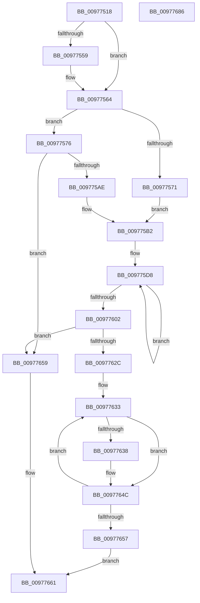

# PiDevCfgInitDeviceContext

- RVA: `0x00977518`–`0x00977687` (길이 `367` bytes)
- VA: `0x0000000140977518`
- 실행 섹션: `PAGE`
- PDB 이름 있음: `예`; PDB Function 태그: `아니요`
- unwind 정보 RVA: `0x00096710`
- 디코드: `96`개 명령, `367/367` bytes 표시
- 미해석 바이트: `0` (있으면 어셈블리에 `.byte`로 보존)

> 이 문서는 커널 이미지의 기계어와 PDB 기호를 분석해 생성했습니다. 4번과 5번은 함수 원형과 자료형을 바이너리 사용 방식에서 추정한 C 해석이며 원본 소스 복구 결과는 아닙니다.

## 1. Dependencies

- 직접 호출 지점: **8**; 고유 호출 대상: **7**
- 직접 호출자로 확인된 함수: **8**
- RIP 상대 이미지 참조: **3**

### Outgoing calls
- `0x0097754B` → [memset](../../text/6C/memset_function_006C6C40.md) (function, `0x006C6C40`)
- `0x00977550` → [Feature_KernelPnP_LogBlockedDrivers__private_IsEnabledDeviceUsageNoInline](../../text/4F/Feature_KernelPnP_LogBlockedDrivers__private_IsEnabledDeviceUsageNoInline_function_004F7944.md) (function, `0x004F7944`)
- `0x0097759F` → [_CmOpenDeviceRegKey](../8E/_CmOpenDeviceRegKey_function_008EE540.md) (function, `0x008EE540`)
- `0x009775BD` → [memset](../../text/6C/memset_function_006C6C40.md) (function, `0x006C6C40`)
- `0x00977621` → [PiDevCfgQueryObjectProperties](PiDevCfgQueryObjectProperties_function_0097776C.md) (function, `0x0097776C`)
- `0x00977647` → [RtlInitUnicodeString](../../text/42/RtlInitUnicodeString_function_0042A780.md) (function, `0x0042A780`)
- `0x0097765C` → [PiDevCfgFreeDeviceContext](../70/PiDevCfgFreeDeviceContext_function_00704A00.md) (function, `0x00704A00`)
- `0x0097766E` → [_security_check_cookie](../../text/6A/_security_check_cookie_function_006AC640.md) (function, `0x006AC640`)

### Direct callers
- [PiDevCfgInitDeviceCallback](../73/PiDevCfgInitDeviceCallback_function_00733800.md) at `0x007338D5`
- [PiDevCfgProcessDeviceCallback](../73/PiDevCfgProcessDeviceCallback_function_00734080.md) at `0x00734189`
- [PpDevCfgCheckDeviceNeedsUpdate](../73/PpDevCfgCheckDeviceNeedsUpdate_function_007367AC.md) at `0x007367E2`
- [PpDevCfgProcessDeviceClass](../73/PpDevCfgProcessDeviceClass_function_00736824.md) at `0x007368DE`
- [PpDevCfgProcessDeviceExtensions](../73/PpDevCfgProcessDeviceExtensions_function_00736C2C.md) at `0x00736D28`
- [PpDevCfgProcessDeviceReset](../96/PpDevCfgProcessDeviceReset_function_00965498.md) at `0x00965532`
- [PiDevCfgProcessDevice](PiDevCfgProcessDevice_function_00976D34.md) at `0x00976DEB`
- [sub_00B47D18](../B4/Unknown_function_00B47D18.md) at `0x00B47D2B`

### Static image references
- `0x00977527` → RVA `0x00E0A740` (`.data`; read)
- `0x0097757F` → RVA `0x00E66398` (`.data`; read)
- `0x009775CD` → RVA `0x00FD8760` (`PAGEDATA`; read)

## 2. Other-region calls and transfers

- 다른 실행 섹션으로 향하는 call: **5**
  - `0x0097754B` → [memset](../../text/6C/memset_function_006C6C40.md) (`PAGE` → `.text`)
  - `0x00977550` → [Feature_KernelPnP_LogBlockedDrivers__private_IsEnabledDeviceUsageNoInline](../../text/4F/Feature_KernelPnP_LogBlockedDrivers__private_IsEnabledDeviceUsageNoInline_function_004F7944.md) (`PAGE` → `.text`)
  - `0x009775BD` → [memset](../../text/6C/memset_function_006C6C40.md) (`PAGE` → `.text`)
  - `0x00977647` → [RtlInitUnicodeString](../../text/42/RtlInitUnicodeString_function_0042A780.md) (`PAGE` → `.text`)
  - `0x0097766E` → [_security_check_cookie](../../text/6A/_security_check_cookie_function_006AC640.md) (`PAGE` → `.text`)
- 별도 외부 분기/꼬리 이동을 확인하지 못했습니다.

## 3. Assembly (complete function range)

```asm
00977518  48 89 5C 24 10                  mov qword ptr [rsp + 0x10], rbx
0097751D  55                              push rbp
0097751E  56                              push rsi
0097751F  57                              push rdi
00977520  48 81 EC D0 00 00 00            sub rsp, 0xd0
00977527  48 8B 05 12 32 49 00            mov rax, qword ptr [rip + 0x493212]
0097752E  48 33 C4                        xor rax, rsp
00977531  48 89 84 24 C0 00 00 00         mov qword ptr [rsp + 0xc0], rax
00977539  49 8B D8                        mov rbx, r8
0097753C  48 8B F2                        mov rsi, rdx
0097753F  33 D2                           xor edx, edx
00977541  48 8B E9                        mov rbp, rcx
00977544  48 8B CB                        mov rcx, rbx
00977547  44 8D 42 58                     lea r8d, [rdx + 0x58]
0097754B  E8 F0 F6 D4 FF                  call 0x1406c6c40
00977550  E8 EF 03 B8 FF                  call 0x1404f7944
00977555  85 C0                           test eax, eax
00977557  74 0B                           je 0x140977564
00977559  48 8D 43 18                     lea rax, [rbx + 0x18]
0097755D  48 89 40 08                     mov qword ptr [rax + 8], rax
00977561  48 89 00                        mov qword ptr [rax], rax
00977564  48 89 6B 08                     mov qword ptr [rbx + 8], rbp
00977568  48 8D 7B 10                     lea rdi, [rbx + 0x10]
0097756C  48 85 F6                        test rsi, rsi
0097756F  74 05                           je 0x140977576
00977571  48 89 37                        mov qword ptr [rdi], rsi
00977574  EB 3C                           jmp 0x1409775b2
00977576  48 83 64 24 38 00               and qword ptr [rsp + 0x38], 0
0097757C  45 33 C9                        xor r9d, r9d
0097757F  48 8B 0D 12 EE 4E 00            mov rcx, qword ptr [rip + 0x4eee12]
00977586  48 8B D5                        mov rdx, rbp
00977589  48 89 7C 24 30                  mov qword ptr [rsp + 0x30], rdi
0097758E  C6 44 24 28 00                  mov byte ptr [rsp + 0x28], 0
00977593  45 8D 41 10                     lea r8d, [r9 + 0x10]
00977597  C7 44 24 20 3F 00 0F 00         mov dword ptr [rsp + 0x20], 0xf003f
0097759F  E8 9C 6F F7 FF                  call 0x1408ee540
009775A4  8B E8                           mov ebp, eax
009775A6  85 C0                           test eax, eax
009775A8  0F 88 AB 00 00 00               js 0x140977659
009775AE  0F BA 2B 1F                     bts dword ptr [rbx], 0x1f
009775B2  33 D2                           xor edx, edx
009775B4  48 8D 4C 24 40                  lea rcx, [rsp + 0x40]
009775B9  44 8D 42 78                     lea r8d, [rdx + 0x78]
009775BD  E8 7E F6 D4 FF                  call 0x1406c6c40
009775C2  48 8D 4C 24 48                  lea rcx, [rsp + 0x48]
009775C7  41 B9 03 00 00 00               mov r9d, 3
009775CD  48 8D 15 8C 11 66 00            lea rdx, [rip + 0x66118c]
009775D4  4C 8D 43 28                     lea r8, [rbx + 0x28]
009775D8  48 8B 02                        mov rax, qword ptr [rdx]
009775DB  48 8D 52 08                     lea rdx, [rdx + 8]
009775DF  4C 89 41 08                     mov qword ptr [rcx + 8], r8
009775E3  49 83 C0 10                     add r8, 0x10
009775E7  48 89 41 F8                     mov qword ptr [rcx - 8], rax
009775EB  C7 01 12 20 00 00               mov dword ptr [rcx], 0x2012
009775F1  C7 41 14 06 00 00 00            mov dword ptr [rcx + 0x14], 6
009775F8  48 8D 49 28                     lea rcx, [rcx + 0x28]
009775FC  49 83 E9 01                     sub r9, 1
00977600  75 D6                           jne 0x1409775d8
00977602  4C 8B 0F                        mov r9, qword ptr [rdi]
00977605  48 8D 44 24 40                  lea rax, [rsp + 0x40]
0097760A  48 8B 53 08                     mov rdx, qword ptr [rbx + 8]
0097760E  41 B8 01 00 00 00               mov r8d, 1
00977614  C7 44 24 28 03 00 00 00         mov dword ptr [rsp + 0x28], 3
0097761C  48 89 44 24 20                  mov qword ptr [rsp + 0x20], rax
00977621  E8 46 01 00 00                  call 0x14097776c
00977626  8B E8                           mov ebp, eax
00977628  85 C0                           test eax, eax
0097762A  78 2D                           js 0x140977659
0097762C  33 FF                           xor edi, edi
0097762E  48 8D 74 24 60                  lea rsi, [rsp + 0x60]
00977633  83 3E 00                        cmp dword ptr [rsi], 0
00977636  7D 14                           jge 0x14097764c
00977638  8B CF                           mov ecx, edi
0097763A  33 D2                           xor edx, edx
0097763C  48 C1 E1 04                     shl rcx, 4
00977640  48 83 C1 28                     add rcx, 0x28
00977644  48 03 CB                        add rcx, rbx
00977647  E8 34 31 AB FF                  call 0x14042a780
0097764C  FF C7                           inc edi
0097764E  48 83 C6 28                     add rsi, 0x28
00977652  83 FF 03                        cmp edi, 3
00977655  72 DC                           jb 0x140977633
00977657  EB 08                           jmp 0x140977661
00977659  48 8B CB                        mov rcx, rbx
0097765C  E8 9F D3 D8 FF                  call 0x140704a00
00977661  8B C5                           mov eax, ebp
00977663  48 8B 8C 24 C0 00 00 00         mov rcx, qword ptr [rsp + 0xc0]
0097766B  48 33 CC                        xor rcx, rsp
0097766E  E8 CD 4F D3 FF                  call 0x1406ac640
00977673  48 8B 9C 24 F8 00 00 00         mov rbx, qword ptr [rsp + 0xf8]
0097767B  48 81 C4 D0 00 00 00            add rsp, 0xd0
00977682  5F                              pop rdi
00977683  5E                              pop rsi
00977684  5D                              pop rbp
00977685  C3                              ret
00977686  CC                              int3
```

## 4. C-style interpretation (structured pseudocode)

```c
__int64 __fastcall PiDevCfgInitDeviceContext(__int64 a1, __int64 a2, __int64 a3, int a4)
{
    __int64 result;
    __int64 v_rdi;
    __int64 v_rsi;
    __int64 v_rsp;
    unsigned __int64 v_stack_m28;
    unsigned __int64 v_stack_m88;
    unsigned __int64 v_stack_mA0;
    unsigned __int64 v_stack_mA8;
    unsigned __int64 v_stack_mB0;
    unsigned __int64 v_stack_mB8;
    unsigned __int8 v_stack_mC0;
    unsigned int v_stack_mC8;
    unsigned __int64 v_stack_p10;

    v_stack_p10 = v_rbx;
    v_rsp = (v_rsp) - (208);
    result = (*(unsigned __int64 *)(v_rip + 4796946)) ^ (v_rsp);
    v_stack_m28 = result;
    a2 = 0;
    result = memset(a3, a2, a2 + 88, a4);
    result = Feature_KernelPnP_LogBlockedDrivers__private_IsEnabledDeviceUsageNoInline(a3, a2, a2 + 88, a4);
    if ((unsigned int)(result) != 0) {
        result = a3 + 24;
        *(unsigned __int64 *)(result + 8) = result;
        *(unsigned __int64 *)(result) = result;
    }
    *(unsigned __int64 *)(a3 + 8) = a1;
    if (0 == 0) goto loc_00977576;
    *(unsigned __int64 *)(a3 + 16) = 0;
    goto loc_009775B2;
loc_00977576:
    a4 = 0;
    v_stack_mB8 = a3 + 16;
    v_stack_mC0 = 0;
    v_stack_mC8 = 0xF003FULL;
    result = _CmOpenDeviceRegKey(*(unsigned __int64 *)(v_rip + 5172754), a1, a4 + 16, a4);
    if (sign_flag) goto loc_00977659;
loc_009775B2:
    a2 = 0;
    result = memset(v_stack_mA8, a2, a2 + 120, a4);
loc_009775D8:
    *(unsigned __int64 *)(v_stack_mA0 + 8) = a3 + 40;
    a3 = (a3 + 40) + (16);
    *(unsigned __int64 *)(v_stack_mA0 - 8) = *(unsigned __int64 *)(v_rip + 6689164);
    *(unsigned int *)(v_stack_mA0) = 0x2012ULL;
    *(unsigned int *)(v_stack_mA0 + 20) = 6;
    a4 = (3) - (1);
    if (condition_is_not_equal) goto loc_009775D8;
    v_stack_mC0 = 3;
    v_stack_mC8 = v_stack_mA8;
    result = PiDevCfgQueryObjectProperties(v_stack_mA0 + 40, *(unsigned __int64 *)(a3 + 8), 1, *(unsigned __int64 *)(a3 + 16));
    if (sign_flag) goto loc_00977659;
    v_rdi = 0;
loc_00977633:
    if ((*(unsigned int *)(v_stack_m88)) < 0) {
        a1 = 0;
        a2 = 0;
        a1 = (a1) << (4);
        a1 = (a1) + (40);
        a1 = (a1) + (a3);
        result = RtlInitUnicodeString(a1, a2, 1, *(unsigned __int64 *)(a3 + 16));
    }
    v_rdi = (unsigned int)((v_rdi) + 1);
    v_rsi = (v_stack_m88) + (40);
    if (((unsigned int)(v_rdi)) < 3) goto loc_00977633;
    goto loc_00977661;
loc_00977659:
    result = PiDevCfgFreeDeviceContext(a3, a2, 1, *(unsigned __int64 *)(a3 + 16));
loc_00977661:
    a1 = (v_stack_m28) ^ (v_rsp);
    result = _security_check_cookie(a1, a2, 1, *(unsigned __int64 *)(a3 + 16));
    v_rsp = (v_rsp) + (208);
    return result;
}
```

## 5. (Beta) C Style

```c
int64_t PiDevCfgInitDeviceContext(int64_t Arg1, int64_t Arg2, void *Arg3, int32_t Arg4)
{
    uint8_t *arg3 = (uint8_t *)Arg3;

    int64_t result;
    int64_t local_rdi;
    int64_t local_rsi;
    int64_t local_rsp;
    uint64_t v_stack_m28;
    uint64_t v_stack_m88;
    uint64_t v_stack_mA0;
    uint64_t v_stack_mA8;
    uint64_t v_stack_mB0;
    uint64_t v_stack_mB8;
    uint8_t v_stack_mC0;
    uint32_t v_stack_mC8;
    uint64_t v_stack_p10;

    v_stack_p10 = local_rbx;
    local_rsp = (local_rsp) - (208);
    result = (*(uint64_t *)(v_rip + 0x493212)) ^ (local_rsp);
    v_stack_m28 = result;
    Arg2 = 0;
    result = memset(Arg3, Arg2, Arg2 + 88, Arg4);
    result = Feature_KernelPnP_LogBlockedDrivers__private_IsEnabledDeviceUsageNoInline(Arg3, Arg2, Arg2 + 88, Arg4);
    if ((uint32_t)(result) != 0) {
        result = Arg3 + 24;
        *(uint64_t *)(result + 0x8) = result;
        *(uint64_t *)(result) = result;
    }
    *(uint64_t *)(arg3 + 0x8) = Arg1;
    if (0 == 0) goto loc_00977576;
    *(uint64_t *)(arg3 + 0x10) = 0;
    goto loc_009775B2;
loc_00977576:
    Arg4 = 0;
    v_stack_mB8 = Arg3 + 16;
    v_stack_mC0 = 0;
    v_stack_mC8 = 0xF003FULL;
    result = _CmOpenDeviceRegKey(*(uint64_t *)(v_rip + 0x4EEE12), Arg1, Arg4 + 16, Arg4);
    if (sign_flag) goto loc_00977659;
loc_009775B2:
    Arg2 = 0;
    result = memset(v_stack_mA8, Arg2, Arg2 + 120, Arg4);
loc_009775D8:
    *(void **)(v_stack_mA0 + 0x8) = Arg3 + 40;
    Arg3 = (Arg3 + 40) + (16);
    *(uint64_t *)(v_stack_mA0 - 0x8) = *(uint64_t *)(v_rip + 0x66118C);
    *(uint32_t *)(v_stack_mA0) = 0x2012ULL;
    *(uint32_t *)(v_stack_mA0 + 0x14) = 6;
    Arg4 = (3) - (1);
    if (condition_is_not_equal) goto loc_009775D8;
    v_stack_mC0 = 3;
    v_stack_mC8 = v_stack_mA8;
    result = PiDevCfgQueryObjectProperties(v_stack_mA0 + 40, *(uint64_t *)(arg3 + 0x8), 1, *(uint64_t *)(arg3 + 0x10));
    if (sign_flag) goto loc_00977659;
    local_rdi = 0;
loc_00977633:
    if ((*(uint32_t *)(v_stack_m88)) < 0) {
        Arg1 = 0;
        Arg2 = 0;
        Arg1 = (Arg1) << (4);
        Arg1 = (Arg1) + (40);
        Arg1 = (Arg1) + (Arg3);
        result = RtlInitUnicodeString(Arg1, Arg2, 1, *(uint64_t *)(arg3 + 0x10));
    }
    local_rdi = (uint32_t)((local_rdi) + 1);
    local_rsi = (v_stack_m88) + (40);
    if (((uint32_t)(local_rdi)) < 3) goto loc_00977633;
    goto loc_00977661;
loc_00977659:
    result = PiDevCfgFreeDeviceContext(Arg3, Arg2, 1, *(uint64_t *)(arg3 + 0x10));
loc_00977661:
    Arg1 = (v_stack_m28) ^ (local_rsp);
    result = _security_check_cookie(Arg1, Arg2, 1, *(uint64_t *)(arg3 + 0x10));
    local_rsp = (local_rsp) + (208);
    return result;
}
```

### 관측된 메모리 오프셋

구조체 형식이 확인되지 않은 접근은 인자 기준의 오프셋으로만 기록했습니다.

| 기준 인자 | 오프셋 표현 | 폭 (bit) | 접근 |
|---|---:|---:|---|
| `Arg3` | `+ 0x0` | `32` | `R/W` |
| `Arg3` | `+ 0x0` | `64` | `R` |
| `Arg3` | `+ 0x0` | `64` | `W` |
| `Arg3` | `+ 0x8` | `64` | `R` |
| `Arg3` | `+ 0x8` | `64` | `W` |
| `Arg3` | `+ 0x10` | `64` | `R` |
| `Arg3` | `+ 0x18` | `64` | `R` |
| `Arg3` | `+ 0x28` | `64` | `R` |

## 6. Execution-region graph

[열기: 2D/3D 그래프와 함수 탐색 컨트롤 패널](../../../control-panel.html?section=page&rva=0x00977518&view=graph)

- 2D 그래프는 위에서 아래로 흐르고, 3D 그래프는 빈 공간을 드래그해 회전합니다. Shift+드래그는 이동, 휠은 확대·축소, 함수 노드 선택은 대상 보고서 이동입니다.

### Static fallback


