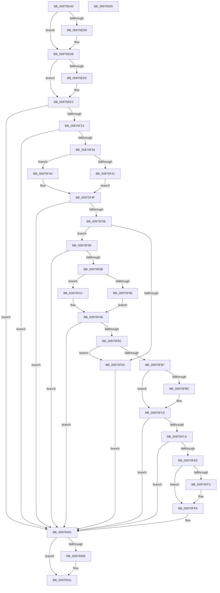

# PiDevCfgVerifyService

- RVA: `0x00975EA0`–`0x00976026` (길이 `390` bytes)
- VA: `0x0000000140975EA0`
- 실행 섹션: `PAGE`
- PDB 이름 있음: `예`; PDB Function 태그: `아니요`
- unwind 정보 RVA: `0x000966A4`
- 디코드: `117`개 명령, `390/390` bytes 표시
- 미해석 바이트: `0` (있으면 어셈블리에 `.byte`로 보존)

> 이 문서는 커널 이미지의 기계어와 PDB 기호를 분석해 생성했습니다. 4번과 5번은 함수 원형과 자료형을 바이너리 사용 방식에서 추정한 C 해석이며 원본 소스 복구 결과는 아닙니다.

## 1. Dependencies

- 직접 호출 지점: **12**; 고유 호출 대상: **6**
- 직접 호출자로 확인된 함수: **1**
- RIP 상대 이미지 참조: **3**

### Outgoing calls
- `0x00975EEA` → [RtlInitUnicodeString](../../text/42/RtlInitUnicodeString_function_0042A780.md) (function, `0x0042A780`)
- `0x00975F04` → [PipOpenServiceEnumKeys](../99/PipOpenServiceEnumKeys_function_00998E94.md) (function, `0x00998E94`)
- `0x00975F25` → [IopGetRegistryValue](../99/IopGetRegistryValue_function_009990EC.md) (function, `0x009990EC`)
- `0x00975F38` → [PnpValidateRegistryDword](../../text/4D/PnpValidateRegistryDword_function_004D109C.md) (function, `0x004D109C`)
- `0x00975F51` → [ExFreePoolWithTag](../../poolcode/B8/ExFreePoolWithTag_function_00B82870.md) (function, `0x00B82870`)
- `0x00975F80` → [IopGetRegistryValue](../99/IopGetRegistryValue_function_009990EC.md) (function, `0x009990EC`)
- `0x00975F8F` → [PnpValidateRegistryDword](../../text/4D/PnpValidateRegistryDword_function_004D109C.md) (function, `0x004D109C`)
- `0x00975FA8` → [ExFreePoolWithTag](../../poolcode/B8/ExFreePoolWithTag_function_00B82870.md) (function, `0x00B82870`)
- `0x00975FDC` → [IopGetRegistryValue](../99/IopGetRegistryValue_function_009990EC.md) (function, `0x009990EC`)
- `0x00975FE9` → [PnpValidateRegistryDword](../../text/4D/PnpValidateRegistryDword_function_004D109C.md) (function, `0x004D109C`)
- `0x00975FFC` → [ExFreePoolWithTag](../../poolcode/B8/ExFreePoolWithTag_function_00B82870.md) (function, `0x00B82870`)
- `0x0097600C` → [ZwClose](../../text/6A/ZwClose_function_006AD2B0.md) (function, `0x006AD2B0`)

### Direct callers
- [PiDevCfgQueryDriverConfiguration](PiDevCfgQueryDriverConfiguration_function_0097584C.md) at `0x00975BC0`
- [PiDevCfgQueryDriverConfiguration](PiDevCfgQueryDriverConfiguration_function_0097584C.md) at `0x00975BFB`
- [PiDevCfgQueryDriverConfiguration](PiDevCfgQueryDriverConfiguration_function_0097584C.md) at `0x00975C43`

### Static image references
- `0x00975F1E` → RVA `0x00AFC720` (` ?? ::NNGAKEGL::`string'`; read)
- `0x00975F79` → RVA `0x00AFDF50` (` ?? ::NNGAKEGL::`string'`; read)
- `0x00975FD5` → RVA `0x00AFDAB0` (` ?? ::NNGAKEGL::`string'`; read)

## 2. Other-region calls and transfers

- 다른 실행 섹션으로 향하는 call: **8**
  - `0x00975EEA` → [RtlInitUnicodeString](../../text/42/RtlInitUnicodeString_function_0042A780.md) (`PAGE` → `.text`)
  - `0x00975F38` → [PnpValidateRegistryDword](../../text/4D/PnpValidateRegistryDword_function_004D109C.md) (`PAGE` → `.text`)
  - `0x00975F51` → [ExFreePoolWithTag](../../poolcode/B8/ExFreePoolWithTag_function_00B82870.md) (`PAGE` → `POOLCODE`)
  - `0x00975F8F` → [PnpValidateRegistryDword](../../text/4D/PnpValidateRegistryDword_function_004D109C.md) (`PAGE` → `.text`)
  - `0x00975FA8` → [ExFreePoolWithTag](../../poolcode/B8/ExFreePoolWithTag_function_00B82870.md) (`PAGE` → `POOLCODE`)
  - `0x00975FE9` → [PnpValidateRegistryDword](../../text/4D/PnpValidateRegistryDword_function_004D109C.md) (`PAGE` → `.text`)
  - `0x00975FFC` → [ExFreePoolWithTag](../../poolcode/B8/ExFreePoolWithTag_function_00B82870.md) (`PAGE` → `POOLCODE`)
  - `0x0097600C` → [ZwClose](../../text/6A/ZwClose_function_006AD2B0.md) (`PAGE` → `.text`)
- 별도 외부 분기/꼬리 이동을 확인하지 못했습니다.

## 3. Assembly (complete function range)

```asm
00975EA0  48 89 5C 24 08                  mov qword ptr [rsp + 8], rbx
00975EA5  55                              push rbp
00975EA6  56                              push rsi
00975EA7  41 54                           push r12
00975EA9  41 56                           push r14
00975EAB  41 57                           push r15
00975EAD  48 8B EC                        mov rbp, rsp
00975EB0  48 83 EC 40                     sub rsp, 0x40
00975EB4  48 83 65 40 00                  and qword ptr [rbp + 0x40], 0
00975EB9  45 33 E4                        xor r12d, r12d
00975EBC  48 83 65 38 00                  and qword ptr [rbp + 0x38], 0
00975EC1  0F 57 C0                        xorps xmm0, xmm0
00975EC4  49 8B F0                        mov rsi, r8
00975EC7  4C 8B F2                        mov r14, rdx
00975ECA  0F 11 45 F0                     movups xmmword ptr [rbp - 0x10], xmm0
00975ECE  45 8D 7C 24 04                  lea r15d, [r12 + 4]
00975ED3  48 85 D2                        test rdx, rdx
00975ED6  74 03                           je 0x140975edb
00975ED8  44 88 22                        mov byte ptr [rdx], r12b
00975EDB  48 85 F6                        test rsi, rsi
00975EDE  74 03                           je 0x140975ee3
00975EE0  45 21 20                        and dword ptr [r8], r12d
00975EE3  48 8B D1                        mov rdx, rcx
00975EE6  48 8D 4D F0                     lea rcx, [rbp - 0x10]
00975EEA  E8 91 48 AB FF                  call 0x14042a780
00975EEF  45 33 C9                        xor r9d, r9d
00975EF2  44 88 64 24 20                  mov byte ptr [rsp + 0x20], r12b
00975EF7  4C 8D 45 40                     lea r8, [rbp + 0x40]
00975EFB  BA 19 00 02 00                  mov edx, 0x20019
00975F00  48 8D 4D F0                     lea rcx, [rbp - 0x10]
00975F04  E8 8B 2F 02 00                  call 0x140998e94
00975F09  8B D8                           mov ebx, eax
00975F0B  85 C0                           test eax, eax
00975F0D  0F 88 EE 00 00 00               js 0x140976001
00975F13  48 8B 4D 40                     mov rcx, qword ptr [rbp + 0x40]
00975F17  4C 8D 4D 38                     lea r9, [rbp + 0x38]
00975F1B  45 33 C0                        xor r8d, r8d
00975F1E  48 8D 15 FB 67 18 00            lea rdx, [rip + 0x1867fb]
00975F25  E8 C2 31 02 00                  call 0x1409990ec
00975F2A  8B D8                           mov ebx, eax
00975F2C  85 C0                           test eax, eax
00975F2E  0F 88 CD 00 00 00               js 0x140976001
00975F34  48 8B 4D 38                     mov rcx, qword ptr [rbp + 0x38]
00975F38  E8 5F B1 B5 FF                  call 0x1404d109c
00975F3D  84 C0                           test al, al
00975F3F  74 09                           je 0x140975f4a
00975F41  8B 41 08                        mov eax, dword ptr [rcx + 8]
00975F44  44 8B 24 08                     mov r12d, dword ptr [rax + rcx]
00975F48  EB 05                           jmp 0x140975f4f
00975F4A  BB 01 00 00 C0                  mov ebx, 0xc0000001
00975F4F  33 D2                           xor edx, edx
00975F51  E8 1A C9 20 00                  call 0x140b82870
00975F56  85 DB                           test ebx, ebx
00975F58  0F 88 A3 00 00 00               js 0x140976001
00975F5E  41 F6 C4 0B                     test r12b, 0xb
00975F62  75 0A                           jne 0x140975f6e
00975F64  BB 01 00 00 C0                  mov ebx, 0xc0000001
00975F69  E9 93 00 00 00                  jmp 0x140976001
00975F6E  48 8B 4D 40                     mov rcx, qword ptr [rbp + 0x40]
00975F72  4C 8D 4D 38                     lea r9, [rbp + 0x38]
00975F76  45 33 C0                        xor r8d, r8d
00975F79  48 8D 15 D0 7F 18 00            lea rdx, [rip + 0x187fd0]
00975F80  E8 67 31 02 00                  call 0x1409990ec
00975F85  8B D8                           mov ebx, eax
00975F87  85 C0                           test eax, eax
00975F89  78 76                           js 0x140976001
00975F8B  48 8B 4D 38                     mov rcx, qword ptr [rbp + 0x38]
00975F8F  E8 08 B1 B5 FF                  call 0x1404d109c
00975F94  84 C0                           test al, al
00975F96  74 09                           je 0x140975fa1
00975F98  8B 41 08                        mov eax, dword ptr [rcx + 8]
00975F9B  44 8B 3C 08                     mov r15d, dword ptr [rax + rcx]
00975F9F  EB 05                           jmp 0x140975fa6
00975FA1  BB 01 00 00 C0                  mov ebx, 0xc0000001
00975FA6  33 D2                           xor edx, edx
00975FA8  E8 C3 C8 20 00                  call 0x140b82870
00975FAD  85 DB                           test ebx, ebx
00975FAF  78 50                           js 0x140976001
00975FB1  41 83 FF 04                     cmp r15d, 4
00975FB5  77 AD                           ja 0x140975f64
00975FB7  4D 85 F6                        test r14, r14
00975FBA  74 09                           je 0x140975fc5
00975FBC  45 85 FF                        test r15d, r15d
00975FBF  0F 94 C0                        sete al
00975FC2  41 88 06                        mov byte ptr [r14], al
00975FC5  48 85 F6                        test rsi, rsi
00975FC8  74 37                           je 0x140976001
00975FCA  48 8B 4D 40                     mov rcx, qword ptr [rbp + 0x40]
00975FCE  4C 8D 4D 38                     lea r9, [rbp + 0x38]
00975FD2  45 33 C0                        xor r8d, r8d
00975FD5  48 8D 15 D4 7A 18 00            lea rdx, [rip + 0x187ad4]
00975FDC  E8 0B 31 02 00                  call 0x1409990ec
00975FE1  85 C0                           test eax, eax
00975FE3  78 1C                           js 0x140976001
00975FE5  48 8B 4D 38                     mov rcx, qword ptr [rbp + 0x38]
00975FE9  E8 AE B0 B5 FF                  call 0x1404d109c
00975FEE  84 C0                           test al, al
00975FF0  74 08                           je 0x140975ffa
00975FF2  8B 41 08                        mov eax, dword ptr [rcx + 8]
00975FF5  8B 14 08                        mov edx, dword ptr [rax + rcx]
00975FF8  89 16                           mov dword ptr [rsi], edx
00975FFA  33 D2                           xor edx, edx
00975FFC  E8 6F C8 20 00                  call 0x140b82870
00976001  48 83 7D 40 00                  cmp qword ptr [rbp + 0x40], 0
00976006  74 09                           je 0x140976011
00976008  48 8B 4D 40                     mov rcx, qword ptr [rbp + 0x40]
0097600C  E8 9F 72 D3 FF                  call 0x1406ad2b0
00976011  8B C3                           mov eax, ebx
00976013  48 8B 5C 24 70                  mov rbx, qword ptr [rsp + 0x70]
00976018  48 83 C4 40                     add rsp, 0x40
0097601C  41 5F                           pop r15
0097601E  41 5E                           pop r14
00976020  41 5C                           pop r12
00976022  5E                              pop rsi
00976023  5D                              pop rbp
00976024  C3                              ret
00976025  CC                              int3
```

## 4. C-style interpretation (structured pseudocode)

```c
__int64 __fastcall PiDevCfgVerifyService(__int64 a1, __int64 a2, __int64 a3, int a4)
{
    __int64 result;
    __int64 v_r12;
    __int64 v_rsp;
    unsigned __int64 v_stack_m38;
    unsigned __int8 v_stack_m48;
    unsigned __int64 v_stack_p10;
    unsigned __int64 v_stack_p18;
    unsigned __int64 v_stack_p8;

    v_stack_p8 = v_rbx;
    v_rsp = (v_rsp) - (64);
    v_r12 = 0;
    v_stack_m38 = v_xmm0;
    if (a2 != 0) {
        *(unsigned __int8 *)(a2) = 0;
    }
    if (a3 != 0) {
    }
    result = RtlInitUnicodeString(v_stack_m38, a1, a3, a4);
    a4 = 0;
    v_stack_m48 = 0;
    result = PipOpenServiceEnumKeys(v_stack_m38, (unsigned int)(0x20019ULL), v_stack_p18, a4);
    if (sign_flag) goto loc_00976001;
    a3 = 0;
    result = IopGetRegistryValue(v_stack_p18, v_rip + 1599483, a3, v_stack_p10);
    if (sign_flag) goto loc_00976001;
    result = PnpValidateRegistryDword(v_stack_p10, v_rip + 1599483, a3, v_stack_p10);
    if ((unsigned __int8)(result) == 0) goto loc_00975F4A;
    goto loc_00975F4F;
loc_00975F4A:
loc_00975F4F:
    a2 = 0;
    result = ExFreePoolWithTag(v_stack_p10, a2, a3, v_stack_p10);
    if (sign_flag) goto loc_00976001;
    if ((((unsigned __int8)((unsigned int)(*(unsigned int *)((unsigned int)(*(unsigned int *)(v_stack_p10 + 8)) + v_stack_p10 * 1)))) & (11)) != 0) goto loc_00975F6E;
loc_00975F64:
    goto loc_00976001;
loc_00975F6E:
    a3 = 0;
    result = IopGetRegistryValue(v_stack_p18, v_rip + 1605584, a3, v_stack_p10);
    if (sign_flag) goto loc_00976001;
    result = PnpValidateRegistryDword(v_stack_p10, v_rip + 1605584, a3, v_stack_p10);
    if ((unsigned __int8)(result) == 0) goto loc_00975FA1;
    goto loc_00975FA6;
loc_00975FA1:
loc_00975FA6:
    a2 = 0;
    result = ExFreePoolWithTag(v_stack_p10, a2, a3, v_stack_p10);
    if (sign_flag) goto loc_00976001;
    if (((unsigned int)((unsigned int)(*(unsigned int *)((unsigned int)(*(unsigned int *)(v_stack_p10 + 8)) + v_stack_p10 * 1)))) > 4) goto loc_00975F64;
    if (0 != 0) {
        result = ((unsigned int)((unsigned int)(*(unsigned int *)((unsigned int)(*(unsigned int *)(v_stack_p10 + 8)) + v_stack_p10 * 1))) == 0) ? 1 : 0;
        *(unsigned __int8 *)(a2) = (unsigned __int8)(result);
    }
    if (0 == 0) goto loc_00976001;
    a3 = 0;
    result = IopGetRegistryValue(v_stack_p18, v_rip + 1604308, a3, v_stack_p10);
    if (sign_flag) goto loc_00976001;
    result = PnpValidateRegistryDword(v_stack_p10, v_rip + 1604308, a3, v_stack_p10);
    if ((unsigned __int8)(result) != 0) {
        result = *(unsigned int *)(v_stack_p10 + 8);
        a2 = *(unsigned int *)(result + v_stack_p10 * 1);
        *(unsigned int *)(a3) = (unsigned int)(a2);
    }
    a2 = 0;
    result = ExFreePoolWithTag(v_stack_p10, a2, a3, v_stack_p10);
loc_00976001:
    if (v_stack_p18 != 0) {
        a1 = v_stack_p18;
        result = ZwClose(a1, a2, a3, v_stack_p10);
    }
    v_rsp = (v_rsp) + (64);
    return (unsigned int)((unsigned int)((unsigned int)(0xC0000001ULL)));
}
```

## 5. (Beta) C Style

```c
int64_t PiDevCfgVerifyService(int64_t Arg1, int64_t Arg2, void *Arg3, int32_t Arg4)
{
    uint8_t *arg3 = (uint8_t *)Arg3;

    int64_t result;
    int64_t local_r12;
    int64_t local_rsp;
    uint64_t v_stack_m38;
    uint8_t v_stack_m48;
    uint64_t v_stack_p10;
    uint64_t v_stack_p18;
    uint64_t v_stack_p8;

    v_stack_p8 = local_rbx;
    local_rsp = (local_rsp) - (64);
    local_r12 = 0;
    v_stack_m38 = v_xmm0;
    if (Arg2 != 0) {
        *(uint8_t *)(Arg2) = 0;
    }
    if (Arg3 != NULL) {
    }
    result = RtlInitUnicodeString(v_stack_m38, Arg1, Arg3, Arg4);
    Arg4 = 0;
    v_stack_m48 = 0;
    result = PipOpenServiceEnumKeys(v_stack_m38, (uint32_t)(0x20019ULL), v_stack_p18, Arg4);
    if (sign_flag) goto loc_00976001;
    Arg3 = 0;
    result = IopGetRegistryValue(v_stack_p18, v_rip + 1599483, Arg3, v_stack_p10);
    if (sign_flag) goto loc_00976001;
    result = PnpValidateRegistryDword(v_stack_p10, v_rip + 1599483, Arg3, v_stack_p10);
    if ((uint8_t)(result) == 0) goto loc_00975F4A;
    goto loc_00975F4F;
loc_00975F4A:
loc_00975F4F:
    Arg2 = 0;
    result = ExFreePoolWithTag(v_stack_p10, Arg2, Arg3, v_stack_p10);
    if (sign_flag) goto loc_00976001;
    if ((((uint8_t)((uint32_t)(*(uint32_t *)((uint32_t)(*(uint32_t *)(v_stack_p10 + 0x8)) + v_stack_p10 * 1)))) & (11)) != 0) goto loc_00975F6E;
loc_00975F64:
    goto loc_00976001;
loc_00975F6E:
    Arg3 = 0;
    result = IopGetRegistryValue(v_stack_p18, v_rip + 1605584, Arg3, v_stack_p10);
    if (sign_flag) goto loc_00976001;
    result = PnpValidateRegistryDword(v_stack_p10, v_rip + 1605584, Arg3, v_stack_p10);
    if ((uint8_t)(result) == 0) goto loc_00975FA1;
    goto loc_00975FA6;
loc_00975FA1:
loc_00975FA6:
    Arg2 = 0;
    result = ExFreePoolWithTag(v_stack_p10, Arg2, Arg3, v_stack_p10);
    if (sign_flag) goto loc_00976001;
    if (((uint32_t)((uint32_t)(*(uint32_t *)((uint32_t)(*(uint32_t *)(v_stack_p10 + 0x8)) + v_stack_p10 * 1)))) > 4) goto loc_00975F64;
    if (0 != 0) {
        result = ((uint32_t)((uint32_t)(*(uint32_t *)((uint32_t)(*(uint32_t *)(v_stack_p10 + 0x8)) + v_stack_p10 * 1))) == 0) ? 1 : 0;
        *(uint8_t *)(Arg2) = (uint8_t)(result);
    }
    if (0 == 0) goto loc_00976001;
    Arg3 = 0;
    result = IopGetRegistryValue(v_stack_p18, v_rip + 1604308, Arg3, v_stack_p10);
    if (sign_flag) goto loc_00976001;
    result = PnpValidateRegistryDword(v_stack_p10, v_rip + 1604308, Arg3, v_stack_p10);
    if ((uint8_t)(result) != 0) {
        result = *(uint32_t *)(v_stack_p10 + 0x8);
        Arg2 = *(uint32_t *)(result + v_stack_p10 * 1);
        *(uint32_t *)(arg3) = (uint32_t)(Arg2);
    }
    Arg2 = 0;
    result = ExFreePoolWithTag(v_stack_p10, Arg2, Arg3, v_stack_p10);
loc_00976001:
    if (v_stack_p18 != 0) {
        Arg1 = v_stack_p18;
        result = ZwClose(Arg1, Arg2, Arg3, v_stack_p10);
    }
    local_rsp = (local_rsp) + (64);
    return (uint32_t)((uint32_t)((uint32_t)(0xC0000001ULL)));
}
```

### 관측된 메모리 오프셋

구조체 형식이 확인되지 않은 접근은 인자 기준의 오프셋으로만 기록했습니다.

| 기준 인자 | 오프셋 표현 | 폭 (bit) | 접근 |
|---|---:|---:|---|
| `Arg3` | `+ 0x0` | `32` | `R/W` |

## 6. Execution-region graph

[열기: 2D/3D 그래프와 함수 탐색 컨트롤 패널](../../../control-panel.html?section=page&rva=0x00975EA0&view=graph)

- 2D 그래프는 위에서 아래로 흐르고, 3D 그래프는 빈 공간을 드래그해 회전합니다. Shift+드래그는 이동, 휠은 확대·축소, 함수 노드 선택은 대상 보고서 이동입니다.

### Static fallback


