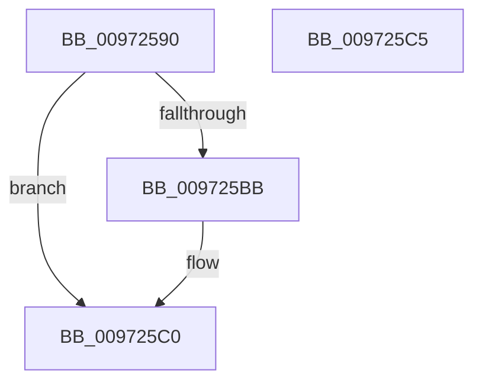

# PiSwBusRelationsCompareInstancePath

- RVA: `0x00972590`–`0x009725C6` (길이 `54` bytes)
- VA: `0x0000000140972590`
- 실행 섹션: `PAGE`
- PDB 이름 있음: `예`; PDB Function 태그: `아니요`
- unwind 정보 RVA: `0x0005D2F4`
- 디코드: `18`개 명령, `54/54` bytes 표시
- 미해석 바이트: `0` (있으면 어셈블리에 `.byte`로 보존)

> 이 문서는 커널 이미지의 기계어와 PDB 기호를 분석해 생성했습니다. 4번과 5번은 함수 원형과 자료형을 바이너리 사용 방식에서 추정한 C 해석이며 원본 소스 복구 결과는 아닙니다.

## 1. Dependencies

- 직접 호출 지점: **1**; 고유 호출 대상: **1**
- 직접 호출자로 확인된 함수: **0**
- RIP 상대 이미지 참조: **0**

### Outgoing calls
- `0x009725AE` → [RtlCompareUnicodeStrings](RtlCompareUnicodeStrings_function_009727E0.md) (function, `0x009727E0`)

### Direct callers
- 이 함수 시작 RVA로 연결되는 직접 call은 확인되지 않았습니다. 간접 호출은 완전히 역산할 수 없습니다.

### Static image references
- 디코드된 RIP-relative 메모리 참조가 없습니다.

## 2. Other-region calls and transfers

- 다른 실행 섹션으로 향하는 call: **0**
- 별도 외부 분기/꼬리 이동을 확인하지 못했습니다.

## 3. Assembly (complete function range)

```asm
00972590  48 83 EC 38                     sub rsp, 0x38
00972594  48 8B 4A 08                     mov rcx, qword ptr [rdx + 8]
00972598  45 0F B7 08                     movzx r9d, word ptr [r8]
0097259C  0F B7 12                        movzx edx, word ptr [rdx]
0097259F  4D 8B 40 08                     mov r8, qword ptr [r8 + 8]
009725A3  48 D1 EA                        shr rdx, 1
009725A6  49 D1 E9                        shr r9, 1
009725A9  C6 44 24 20 01                  mov byte ptr [rsp + 0x20], 1
009725AE  E8 2D 02 00 00                  call 0x1409727e0
009725B3  8B C8                           mov ecx, eax
009725B5  33 C0                           xor eax, eax
009725B7  85 C9                           test ecx, ecx
009725B9  78 05                           js 0x1409725c0
009725BB  0F 9E C0                        setle al
009725BE  FF C0                           inc eax
009725C0  48 83 C4 38                     add rsp, 0x38
009725C4  C3                              ret
009725C5  CC                              int3
```

## 4. C-style interpretation (structured pseudocode)

```c
__int64 __fastcall PiSwBusRelationsCompareInstancePath(__int64 a1, __int64 a2, __int64 a3)
{
    __int64 result;
    __int64 v_rsp;
    unsigned __int8 v_stack_m18;

    v_rsp = (v_rsp) - (56);
    a2 = (*(unsigned __int16 *)(a2)) >> (1);
    a4 = (*(unsigned __int16 *)(a3)) >> (1);
    v_stack_m18 = 1;
    result = RtlCompareUnicodeStrings(*(unsigned __int64 *)(a2 + 8), a2, *(unsigned __int64 *)(a3 + 8), a4);
    result = 0;
    if (!(sign_flag)) {
        result = (condition_is_less_or_equal) ? 1 : 0;
        result = (unsigned int)((result) + 1);
    }
    v_rsp = (v_rsp) + (56);
    return result;
}
```

## 5. (Beta) C Style

```c
int64_t PiSwBusRelationsCompareInstancePath(int64_t Arg1, void *Arg2, void *Arg3)
{
    uint8_t *arg2 = (uint8_t *)Arg2;
    uint8_t *arg3 = (uint8_t *)Arg3;

    int64_t result;
    int64_t local_rsp;
    uint8_t v_stack_m18;

    local_rsp = (local_rsp) - (56);
    Arg2 = (*(uint16_t *)(arg2)) >> (1);
    a4 = (*(uint16_t *)(arg3)) >> (1);
    v_stack_m18 = 1;
    result = RtlCompareUnicodeStrings(*(uint64_t *)(arg2 + 0x8), Arg2, *(uint64_t *)(arg3 + 0x8), a4);
    result = 0;
    if (!(sign_flag)) {
        result = (condition_is_less_or_equal) ? 1 : 0;
        result = (uint32_t)((result) + 1);
    }
    local_rsp = (local_rsp) + (56);
    return result;
}
```

### 관측된 메모리 오프셋

구조체 형식이 확인되지 않은 접근은 인자 기준의 오프셋으로만 기록했습니다.

| 기준 인자 | 오프셋 표현 | 폭 (bit) | 접근 |
|---|---:|---:|---|
| `Arg2` | `+ 0x0` | `16` | `R` |
| `Arg2` | `+ 0x8` | `64` | `R` |
| `Arg3` | `+ 0x0` | `16` | `R` |
| `Arg3` | `+ 0x8` | `64` | `R` |

## 6. Execution-region graph

[열기: 2D/3D 그래프와 함수 탐색 컨트롤 패널](../../../control-panel.html?section=page&rva=0x00972590&view=graph)

- 2D 그래프는 위에서 아래로 흐르고, 3D 그래프는 빈 공간을 드래그해 회전합니다. Shift+드래그는 이동, 휠은 확대·축소, 함수 노드 선택은 대상 보고서 이동입니다.

### Static fallback


