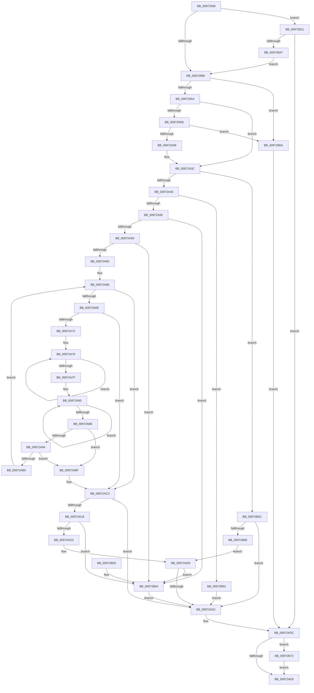

# PnpCheckDeviceIdsChanged

- RVA: `0x00972938`–`0x00972B7C` (길이 `580` bytes)
- VA: `0x0000000140972938`
- 실행 섹션: `PAGE`
- PDB 이름 있음: `예`; PDB Function 태그: `아니요`
- unwind 정보 RVA: `0x00096168`
- 디코드: `164`개 명령, `580/580` bytes 표시
- 미해석 바이트: `0` (있으면 어셈블리에 `.byte`로 보존)

> 이 문서는 커널 이미지의 기계어와 PDB 기호를 분석해 생성했습니다. 4번과 5번은 함수 원형과 자료형을 바이너리 사용 방식에서 추정한 C 해석이며 원본 소스 복구 결과는 아닙니다.

## 1. Dependencies

- 직접 호출 지점: **9**; 고유 호출 대상: **6**
- 직접 호출자로 확인된 함수: **2**
- RIP 상대 이미지 참조: **1**

### Outgoing calls
- `0x00972993` → [ExAllocatePool2](../../poolcode/B8/ExAllocatePool2_function_00B820F0.md) (function, `0x00B820F0`)
- `0x009729D0` → [CmGetDeviceRegProp](../8E/CmGetDeviceRegProp_function_008ED870.md) (function, `0x008ED870`)
- `0x009729E3` → [ExFreePoolWithTag](../../poolcode/B8/ExFreePoolWithTag_function_00B82870.md) (function, `0x00B82870`)
- `0x009729F6` → [ExAllocatePool2](../../poolcode/B8/ExAllocatePool2_function_00B820F0.md) (function, `0x00B820F0`)
- `0x00972A35` → [CmGetDeviceRegProp](../8E/CmGetDeviceRegProp_function_008ED870.md) (function, `0x008ED870`)
- `0x00972AAA` → [RtlCompareUnicodeStrings](RtlCompareUnicodeStrings_function_009727E0.md) (function, `0x009727E0`)
- `0x00972AD7` → [ExFreePoolWithTag](../../poolcode/B8/ExFreePoolWithTag_function_00B82870.md) (function, `0x00B82870`)
- `0x00972B3C` → [_CmOpenDeviceRegKey](../8E/_CmOpenDeviceRegKey_function_008EE540.md) (function, `0x008EE540`)
- `0x00972B72` → [ZwClose](../../text/6A/ZwClose_function_006AD2B0.md) (function, `0x006AD2B0`)

### Direct callers
- [PiProcessNewDeviceNode](../A2/PiProcessNewDeviceNode_function_00A28F20.md) at `0x00A29EA5`
- [PiProcessNewDeviceNode](../A2/PiProcessNewDeviceNode_function_00A28F20.md) at `0x00A29EDC`
- [sub_00B1F622](../B1/Unknown_function_00B1F622.md) at `0x00B1F774`
- [sub_00B1F622](../B1/Unknown_function_00B1F622.md) at `0x00B1F79F`

### Static image references
- `0x009729AB` → RVA `0x00E66398` (`.data`; read)

## 2. Other-region calls and transfers

- 다른 실행 섹션으로 향하는 call: **5**
  - `0x00972993` → [ExAllocatePool2](../../poolcode/B8/ExAllocatePool2_function_00B820F0.md) (`PAGE` → `POOLCODE`)
  - `0x009729E3` → [ExFreePoolWithTag](../../poolcode/B8/ExFreePoolWithTag_function_00B82870.md) (`PAGE` → `POOLCODE`)
  - `0x009729F6` → [ExAllocatePool2](../../poolcode/B8/ExAllocatePool2_function_00B820F0.md) (`PAGE` → `POOLCODE`)
  - `0x00972AD7` → [ExFreePoolWithTag](../../poolcode/B8/ExFreePoolWithTag_function_00B82870.md) (`PAGE` → `POOLCODE`)
  - `0x00972B72` → [ZwClose](../../text/6A/ZwClose_function_006AD2B0.md) (`PAGE` → `.text`)
- 별도 외부 분기/꼬리 이동을 확인하지 못했습니다.

## 3. Assembly (complete function range)

```asm
00972938  48 89 5C 24 08                  mov qword ptr [rsp + 8], rbx
0097293D  44 89 4C 24 20                  mov dword ptr [rsp + 0x20], r9d
00972942  55                              push rbp
00972943  56                              push rsi
00972944  57                              push rdi
00972945  41 54                           push r12
00972947  41 55                           push r13
00972949  41 56                           push r14
0097294B  41 57                           push r15
0097294D  48 8B EC                        mov rbp, rsp
00972950  48 83 EC 50                     sub rsp, 0x50
00972954  4C 8B 75 68                     mov r14, qword ptr [rbp + 0x68]
00972958  48 8D 71 30                     lea rsi, [rcx + 0x30]
0097295C  33 DB                           xor ebx, ebx
0097295E  49 8B F8                        mov rdi, r8
00972961  F6 5D 60                        neg byte ptr [rbp + 0x60]
00972964  4C 8B FA                        mov r15, rdx
00972967  89 5D 48                        mov dword ptr [rbp + 0x48], ebx
0097296A  45 1B ED                        sbb r13d, r13d
0097296D  89 5D F0                        mov dword ptr [rbp - 0x10], ebx
00972970  48 89 5D F8                     mov qword ptr [rbp - 8], rbx
00972974  41 88 1E                        mov byte ptr [r14], bl
00972977  48 85 D2                        test rdx, rdx
0097297A  0F 84 91 01 00 00               je 0x140972b11
00972980  BA 00 02 00 00                  mov edx, 0x200
00972985  B9 00 01 00 00                  mov ecx, 0x100
0097298A  41 B8 50 70 73 75               mov r8d, 0x75737050
00972990  89 55 48                        mov dword ptr [rbp + 0x48], edx
00972993  E8 58 F7 20 00                  call 0x140b820f0
00972998  4C 8B E0                        mov r12, rax
0097299B  48 85 C0                        test rax, rax
0097299E  0F 84 66 01 00 00               je 0x140972b0a
009729A4  48 8B 16                        mov rdx, qword ptr [rsi]
009729A7  48 8D 45 48                     lea rax, [rbp + 0x48]
009729AB  48 8B 0D E6 39 4F 00            mov rcx, qword ptr [rip + 0x4f39e6]
009729B2  45 8D 4D 03                     lea r9d, [r13 + 3]
009729B6  89 5C 24 38                     mov dword ptr [rsp + 0x38], ebx
009729BA  4D 8B C7                        mov r8, r15
009729BD  48 89 44 24 30                  mov qword ptr [rsp + 0x30], rax
009729C2  48 8D 45 F0                     lea rax, [rbp - 0x10]
009729C6  4C 89 64 24 28                  mov qword ptr [rsp + 0x28], r12
009729CB  48 89 44 24 20                  mov qword ptr [rsp + 0x20], rax
009729D0  E8 9B AE F7 FF                  call 0x1408ed870
009729D5  8B D8                           mov ebx, eax
009729D7  3D 23 00 00 C0                  cmp eax, 0xc0000023
009729DC  75 5E                           jne 0x140972a3c
009729DE  33 D2                           xor edx, edx
009729E0  49 8B CC                        mov rcx, r12
009729E3  E8 88 FE 20 00                  call 0x140b82870
009729E8  8B 55 48                        mov edx, dword ptr [rbp + 0x48]
009729EB  B9 00 01 00 00                  mov ecx, 0x100
009729F0  41 B8 50 70 73 75               mov r8d, 0x75737050
009729F6  E8 F5 F6 20 00                  call 0x140b820f0
009729FB  4C 8B E0                        mov r12, rax
009729FE  33 C0                           xor eax, eax
00972A00  4D 85 E4                        test r12, r12
00972A03  0F 84 01 01 00 00               je 0x140972b0a
00972A09  48 8B 16                        mov rdx, qword ptr [rsi]
00972A0C  45 8D 4D 03                     lea r9d, [r13 + 3]
00972A10  48 8B 0D 81 39 4F 00            mov rcx, qword ptr [rip + 0x4f3981]
00972A17  4D 8B C7                        mov r8, r15
00972A1A  89 44 24 38                     mov dword ptr [rsp + 0x38], eax
00972A1E  48 8D 45 48                     lea rax, [rbp + 0x48]
00972A22  48 89 44 24 30                  mov qword ptr [rsp + 0x30], rax
00972A27  48 8D 45 F0                     lea rax, [rbp - 0x10]
00972A2B  4C 89 64 24 28                  mov qword ptr [rsp + 0x28], r12
00972A30  48 89 44 24 20                  mov qword ptr [rsp + 0x20], rax
00972A35  E8 36 AE F7 FF                  call 0x1408ed870
00972A3A  8B D8                           mov ebx, eax
00972A3C  33 D2                           xor edx, edx
00972A3E  85 DB                           test ebx, ebx
00972A40  0F 88 16 01 00 00               js 0x140972b5c
00972A46  83 7D F0 07                     cmp dword ptr [rbp - 0x10], 7
00972A4A  0F 85 02 01 00 00               jne 0x140972b52
00972A50  48 85 FF                        test rdi, rdi
00972A53  0F 84 AB 00 00 00               je 0x140972b04
00972A59  8B 45 58                        mov eax, dword ptr [rbp + 0x58]
00972A5C  3B 45 48                        cmp eax, dword ptr [rbp + 0x48]
00972A5F  0F 85 9F 00 00 00               jne 0x140972b04
00972A65  49 8B F4                        mov rsi, r12
00972A68  66 39 17                        cmp word ptr [rdi], dx
00972A6B  74 56                           je 0x140972ac3
00972A6D  66 39 16                        cmp word ptr [rsi], dx
00972A70  74 51                           je 0x140972ac3
00972A72  48 83 C9 FF                     or rcx, 0xffffffffffffffff
00972A76  48 FF C1                        inc rcx
00972A79  66 39 14 4F                     cmp word ptr [rdi + rcx*2], dx
00972A7D  75 F7                           jne 0x140972a76
00972A7F  FF C1                           inc ecx
00972A81  48 83 C8 FF                     or rax, 0xffffffffffffffff
00972A85  48 FF C0                        inc rax
00972A88  66 39 14 46                     cmp word ptr [rsi + rax*2], dx
00972A8C  75 F7                           jne 0x140972a85
00972A8E  FF C0                           inc eax
00972A90  3B C8                           cmp ecx, eax
00972A92  75 2B                           jne 0x140972abf
00972A94  44 8B E9                        mov r13d, ecx
00972A97  4C 8B C6                        mov r8, rsi
00972A9A  8B D1                           mov edx, ecx
00972A9C  48 8B CF                        mov rcx, rdi
00972A9F  44 8B C8                        mov r9d, eax
00972AA2  44 8B F8                        mov r15d, eax
00972AA5  C6 44 24 20 01                  mov byte ptr [rsp + 0x20], 1
00972AAA  E8 31 FD FF FF                  call 0x1409727e0
00972AAF  33 D2                           xor edx, edx
00972AB1  85 C0                           test eax, eax
00972AB3  75 0A                           jne 0x140972abf
00972AB5  4A 8D 3C 6F                     lea rdi, [rdi + r13*2]
00972AB9  4A 8D 34 7E                     lea rsi, [rsi + r15*2]
00972ABD  EB A9                           jmp 0x140972a68
00972ABF  41 C6 06 01                     mov byte ptr [r14], 1
00972AC3  41 38 16                        cmp byte ptr [r14], dl
00972AC6  75 0A                           jne 0x140972ad2
00972AC8  66 39 17                        cmp word ptr [rdi], dx
00972ACB  75 37                           jne 0x140972b04
00972ACD  66 39 16                        cmp word ptr [rsi], dx
00972AD0  75 32                           jne 0x140972b04
00972AD2  33 D2                           xor edx, edx
00972AD4  49 8B CC                        mov rcx, r12
00972AD7  E8 94 FD 20 00                  call 0x140b82870
00972ADC  48 8B 4D F8                     mov rcx, qword ptr [rbp - 8]
00972AE0  48 85 C9                        test rcx, rcx
00972AE3  0F 85 89 00 00 00               jne 0x140972b72
00972AE9  8B C3                           mov eax, ebx
00972AEB  48 8B 9C 24 90 00 00 00         mov rbx, qword ptr [rsp + 0x90]
00972AF3  48 83 C4 50                     add rsp, 0x50
00972AF7  41 5F                           pop r15
00972AF9  41 5E                           pop r14
00972AFB  41 5D                           pop r13
00972AFD  41 5C                           pop r12
00972AFF  5F                              pop rdi
00972B00  5E                              pop rsi
00972B01  5D                              pop rbp
00972B02  C3                              ret
00972B03  CC                              int3
00972B04  41 C6 06 01                     mov byte ptr [r14], 1
00972B08  EB C8                           jmp 0x140972ad2
00972B0A  BB 9A 00 00 C0                  mov ebx, 0xc000009a
00972B0F  EB CB                           jmp 0x140972adc
00972B11  48 8B 16                        mov rdx, qword ptr [rsi]
00972B14  48 8D 45 F8                     lea rax, [rbp - 8]
00972B18  48 8B 0D 79 38 4F 00            mov rcx, qword ptr [rip + 0x4f3879]
00972B1F  45 33 C9                        xor r9d, r9d
00972B22  48 89 5C 24 38                  mov qword ptr [rsp + 0x38], rbx
00972B27  48 89 44 24 30                  mov qword ptr [rsp + 0x30], rax
00972B2C  88 5C 24 28                     mov byte ptr [rsp + 0x28], bl
00972B30  45 8D 41 10                     lea r8d, [r9 + 0x10]
00972B34  C7 44 24 20 3F 00 0F 00         mov dword ptr [rsp + 0x20], 0xf003f
00972B3C  E8 FF B9 F7 FF                  call 0x1408ee540
00972B41  8B D8                           mov ebx, eax
00972B43  85 C0                           test eax, eax
00972B45  78 95                           js 0x140972adc
00972B47  4C 8B 7D F8                     mov r15, qword ptr [rbp - 8]
00972B4B  33 DB                           xor ebx, ebx
00972B4D  E9 2E FE FF FF                  jmp 0x140972980
00972B52  BB 01 00 00 C0                  mov ebx, 0xc0000001
00972B57  E9 76 FF FF FF                  jmp 0x140972ad2
00972B5C  81 FB 25 02 00 C0               cmp ebx, 0xc0000225
00972B62  0F 85 6A FF FF FF               jne 0x140972ad2
00972B68  8B DA                           mov ebx, edx
00972B6A  48 85 FF                        test rdi, rdi
00972B6D  E9 5E FF FF FF                  jmp 0x140972ad0
00972B72  E8 39 A7 D3 FF                  call 0x1406ad2b0
00972B77  E9 6D FF FF FF                  jmp 0x140972ae9
```

## 4. C-style interpretation (structured pseudocode)

```c
__int64 __fastcall PnpCheckDeviceIdsChanged(__int64 a1, __int64 a2, __int64 a3, int a4, unsigned __int8 a5, __int64 a6)
{
    __int64 result;
    __int64 v_rbx;
    __int64 v_rsp;
    unsigned __int64 v_stack_m40;
    unsigned int v_stack_m48;
    unsigned int v_stack_m50;
    unsigned __int64 v_stack_m58;
    unsigned __int64 v_stack_m60;
    unsigned __int64 v_stack_m68;
    unsigned int v_stack_p10;
    unsigned int v_stack_p20;
    unsigned __int8 v_stack_p28;
    unsigned __int64 v_stack_p30;
    unsigned __int64 v_stack_p38;
    unsigned __int64 v_stack_p8;

    v_stack_p8 = v_rbx;
    v_stack_p20 = a4;
    v_rsp = (v_rsp) - (80);
    v_rbx = 0;
    v_stack_p10 = 0;
    v_stack_m48 = 0;
    v_stack_m40 = 0;
    *(unsigned __int8 *)(a6) = 0;
    if (a2 == 0) goto loc_00972B11;
loc_00972980:
    v_stack_p10 = 512;
    result = ExAllocatePool2(256, 512, (unsigned int)(0x75737050ULL), a4);
    if (result == 0) goto loc_00972B0A;
    v_stack_m50 = 0;
    v_stack_m58 = v_stack_p10;
    v_stack_m60 = result;
    v_stack_m68 = v_stack_m48;
    result = CmGetDeviceRegProp(*(unsigned __int64 *)(v_rip + 5192166), *(unsigned __int64 *)(a1 + 48), a2, v_r13 + 3);
    if (((unsigned int)(result)) != 0xC0000023ULL) goto loc_00972A3C;
    a2 = 0;
    result = ExFreePoolWithTag(result, a2, a2, v_r13 + 3);
    result = ExAllocatePool2(256, (unsigned int)(v_stack_p10), (unsigned int)(0x75737050ULL), v_r13 + 3);
    result = 0;
    if (0 == 0) goto loc_00972B0A;
    v_stack_m50 = 0;
    v_stack_m58 = v_stack_p10;
    v_stack_m60 = 0;
    v_stack_m68 = v_stack_m48;
    result = CmGetDeviceRegProp(*(unsigned __int64 *)(v_rip + 5192065), *(unsigned __int64 *)(a1 + 48), 0, v_r13 + 3);
loc_00972A3C:
    a2 = 0;
    if (sign_flag) goto loc_00972B5C;
    if (v_stack_m48 != 7) goto loc_00972B52;
    if (a3 == 0) goto loc_00972B04;
    if (((unsigned int)((unsigned int)(v_stack_p20))) != v_stack_p10) goto loc_00972B04;
loc_00972A68:
    if ((*(unsigned __int16 *)(a3)) == 0) goto loc_00972AC3;
    if ((*(unsigned __int16 *)(result)) == 0) goto loc_00972AC3;
    a1 = (*(unsigned __int64 *)(v_rip + 5192065)) | (-1);
loc_00972A76:
    a1 = (a1) + 1;
    if ((*(unsigned __int16 *)(a3 + a1 * 2)) != 0) goto loc_00972A76;
    a1 = (unsigned int)((a1) + 1);
    result = ((unsigned int)(v_stack_p20)) | (-1);
loc_00972A85:
    result = (result) + 1;
    if ((*(unsigned __int16 *)(result + result * 2)) != 0) goto loc_00972A85;
    result = (unsigned int)((result) + 1);
    if (((unsigned int)(a1)) != ((unsigned int)(result))) goto loc_00972ABF;
    v_stack_m68 = 1;
    result = RtlCompareUnicodeStrings(a3, (unsigned int)((unsigned int)(a1)), result, (unsigned int)((unsigned int)(result)));
    a2 = 0;
    if ((unsigned int)(result) != 0) goto loc_00972ABF;
    goto loc_00972A68;
loc_00972ABF:
    *(unsigned __int8 *)(a6) = 1;
loc_00972AC3:
    if ((*(unsigned __int8 *)(a6)) != 0) goto loc_00972AD2;
    if ((*(unsigned __int16 *)(a3 + (unsigned int)((unsigned int)(a1)) * 2)) != 0) goto loc_00972B04;
loc_00972AD0:
    if ((*(unsigned __int16 *)(result + (unsigned int)((unsigned int)(result)) * 2)) != 0) goto loc_00972B04;
loc_00972AD2:
    a2 = 0;
    result = ExFreePoolWithTag(result, a2, result, (unsigned int)((unsigned int)(result)));
loc_00972ADC:
    if (v_stack_m40 != 0) goto loc_00972B72;
loc_00972AE9:
    v_rsp = (v_rsp) + (80);
    return (unsigned int)((unsigned int)((unsigned int)((unsigned int)(result))));
loc_00972B04:
    *(unsigned __int8 *)(a6) = 1;
    goto loc_00972AD2;
loc_00972B0A:
    goto loc_00972ADC;
loc_00972B11:
    a4 = 0;
    v_stack_p38 = (unsigned int)(0xC000009AULL);
    v_stack_p30 = v_stack_m40;
    v_stack_p28 = (unsigned __int8)((unsigned int)(0xC000009AULL));
    v_stack_p20 = 0xF003FULL;
    result = _CmOpenDeviceRegKey(*(unsigned __int64 *)(v_rip + 5191801), *(unsigned __int64 *)(result + (unsigned int)((unsigned int)(result)) * 2), a4 + 16, a4);
    if (sign_flag) goto loc_00972ADC;
    v_rbx = 0;
    goto loc_00972980;
loc_00972B52:
    goto loc_00972AD2;
loc_00972B5C:
    if (((unsigned int)((unsigned int)(0xC0000001ULL))) != 0xC0000225ULL) goto loc_00972AD2;
    goto loc_00972AD0;
loc_00972B72:
    result = ZwClose(*(unsigned __int64 *)(v_rip + 5191801), *(unsigned __int64 *)(result + (unsigned int)((unsigned int)(result)) * 2), a4 + 16, a4);
    goto loc_00972AE9;
}
```

## 5. (Beta) C Style

```c
int64_t PnpCheckDeviceIdsChanged(void *Arg1, int64_t Arg2, int64_t Arg3, int32_t Arg4, uint8_t Arg5, void *Arg6)
{
    uint8_t *arg1 = (uint8_t *)Arg1;
    uint8_t *arg6 = (uint8_t *)Arg6;

    int64_t result;
    int64_t local_rbx;
    int64_t local_rsp;
    uint64_t v_stack_m40;
    uint32_t v_stack_m48;
    uint32_t v_stack_m50;
    uint64_t v_stack_m58;
    uint64_t v_stack_m60;
    uint64_t v_stack_m68;
    uint32_t v_stack_p10;
    uint32_t v_stack_p20;
    uint8_t v_stack_p28;
    uint64_t v_stack_p30;
    uint64_t v_stack_p38;
    uint64_t v_stack_p8;

    v_stack_p8 = local_rbx;
    v_stack_p20 = Arg4;
    local_rsp = (local_rsp) - (80);
    local_rbx = 0;
    v_stack_p10 = 0;
    v_stack_m48 = 0;
    v_stack_m40 = 0;
    *(uint8_t *)(arg6) = 0;
    if (Arg2 == 0) goto loc_00972B11;
loc_00972980:
    v_stack_p10 = 512;
    result = ExAllocatePool2(256, 512, (uint32_t)(0x75737050ULL), Arg4);
    if (result == 0) goto loc_00972B0A;
    v_stack_m50 = 0;
    v_stack_m58 = v_stack_p10;
    v_stack_m60 = result;
    v_stack_m68 = v_stack_m48;
    result = CmGetDeviceRegProp(*(uint64_t *)(v_rip + 0x4F39E6), *(uint64_t *)(arg1 + 0x30), Arg2, local_r13 + 3);
    if (((uint32_t)(result)) != 0xC0000023ULL) goto loc_00972A3C;
    Arg2 = 0;
    result = ExFreePoolWithTag(result, Arg2, Arg2, local_r13 + 3);
    result = ExAllocatePool2(256, (uint32_t)(v_stack_p10), (uint32_t)(0x75737050ULL), local_r13 + 3);
    result = 0;
    if (0 == 0) goto loc_00972B0A;
    v_stack_m50 = 0;
    v_stack_m58 = v_stack_p10;
    v_stack_m60 = 0;
    v_stack_m68 = v_stack_m48;
    result = CmGetDeviceRegProp(*(uint64_t *)(v_rip + 0x4F3981), *(uint64_t *)(arg1 + 0x30), 0, local_r13 + 3);
loc_00972A3C:
    Arg2 = 0;
    if (sign_flag) goto loc_00972B5C;
    if (v_stack_m48 != 7) goto loc_00972B52;
    if (Arg3 == 0) goto loc_00972B04;
    if (((uint32_t)((uint32_t)(v_stack_p20))) != v_stack_p10) goto loc_00972B04;
loc_00972A68:
    if ((*(uint16_t *)(Arg3)) == 0) goto loc_00972AC3;
    if ((*(uint16_t *)(result)) == 0) goto loc_00972AC3;
    Arg1 = (*(uint64_t *)(v_rip + 0x4F3981)) | (-1);
loc_00972A76:
    Arg1 = (Arg1) + 1;
    if ((*(uint16_t *)(Arg3 + arg1 * 2)) != 0) goto loc_00972A76;
    Arg1 = (uint32_t)((Arg1) + 1);
    result = ((uint32_t)(v_stack_p20)) | (-1);
loc_00972A85:
    result = (result) + 1;
    if ((*(uint16_t *)(result + result * 2)) != 0) goto loc_00972A85;
    result = (uint32_t)((result) + 1);
    if (((uint32_t)(Arg1)) != ((uint32_t)(result))) goto loc_00972ABF;
    v_stack_m68 = 1;
    result = RtlCompareUnicodeStrings(Arg3, (uint32_t)((uint32_t)(Arg1)), result, (uint32_t)((uint32_t)(result)));
    Arg2 = 0;
    if ((uint32_t)(result) != 0) goto loc_00972ABF;
    goto loc_00972A68;
loc_00972ABF:
    *(uint8_t *)(arg6) = 1;
loc_00972AC3:
    if ((*(uint8_t *)(arg6)) != 0) goto loc_00972AD2;
    if ((*(uint16_t *)(Arg3 + (uint32_t)((uint32_t)(arg1)) * 2)) != 0) goto loc_00972B04;
loc_00972AD0:
    if ((*(uint16_t *)(result + (uint32_t)((uint32_t)(result)) * 2)) != 0) goto loc_00972B04;
loc_00972AD2:
    Arg2 = 0;
    result = ExFreePoolWithTag(result, Arg2, result, (uint32_t)((uint32_t)(result)));
loc_00972ADC:
    if (v_stack_m40 != 0) goto loc_00972B72;
loc_00972AE9:
    local_rsp = (local_rsp) + (80);
    return (uint32_t)((uint32_t)((uint32_t)((uint32_t)(result))));
loc_00972B04:
    *(uint8_t *)(arg6) = 1;
    goto loc_00972AD2;
loc_00972B0A:
    goto loc_00972ADC;
loc_00972B11:
    Arg4 = 0;
    v_stack_p38 = (uint32_t)(0xC000009AULL);
    v_stack_p30 = v_stack_m40;
    v_stack_p28 = (uint8_t)((uint32_t)(0xC000009AULL));
    v_stack_p20 = 0xF003FULL;
    result = _CmOpenDeviceRegKey(*(uint64_t *)(v_rip + 0x4F3879), *(uint64_t *)(result + (uint32_t)((uint32_t)(result)) * 2), Arg4 + 16, Arg4);
    if (sign_flag) goto loc_00972ADC;
    local_rbx = 0;
    goto loc_00972980;
loc_00972B52:
    goto loc_00972AD2;
loc_00972B5C:
    if (((uint32_t)((uint32_t)(0xC0000001ULL))) != 0xC0000225ULL) goto loc_00972AD2;
    goto loc_00972AD0;
loc_00972B72:
    result = ZwClose(*(uint64_t *)(v_rip + 0x4F3879), *(uint64_t *)(result + (uint32_t)((uint32_t)(result)) * 2), Arg4 + 16, Arg4);
    goto loc_00972AE9;
}
```

### 관측된 메모리 오프셋

구조체 형식이 확인되지 않은 접근은 인자 기준의 오프셋으로만 기록했습니다.

| 기준 인자 | 오프셋 표현 | 폭 (bit) | 접근 |
|---|---:|---:|---|
| `Arg1` | `+ 0x0` | `64` | `R` |
| `Arg1` | `+ 0x30` | `64` | `R` |
| `Arg6` | `+ 0x0` | `8` | `R` |
| `Arg6` | `+ 0x0` | `8` | `W` |

## 6. Execution-region graph

[열기: 2D/3D 그래프와 함수 탐색 컨트롤 패널](../../../control-panel.html?section=page&rva=0x00972938&view=graph)

- 2D 그래프는 위에서 아래로 흐르고, 3D 그래프는 빈 공간을 드래그해 회전합니다. Shift+드래그는 이동, 휠은 확대·축소, 함수 노드 선택은 대상 보고서 이동입니다.

### Static fallback


