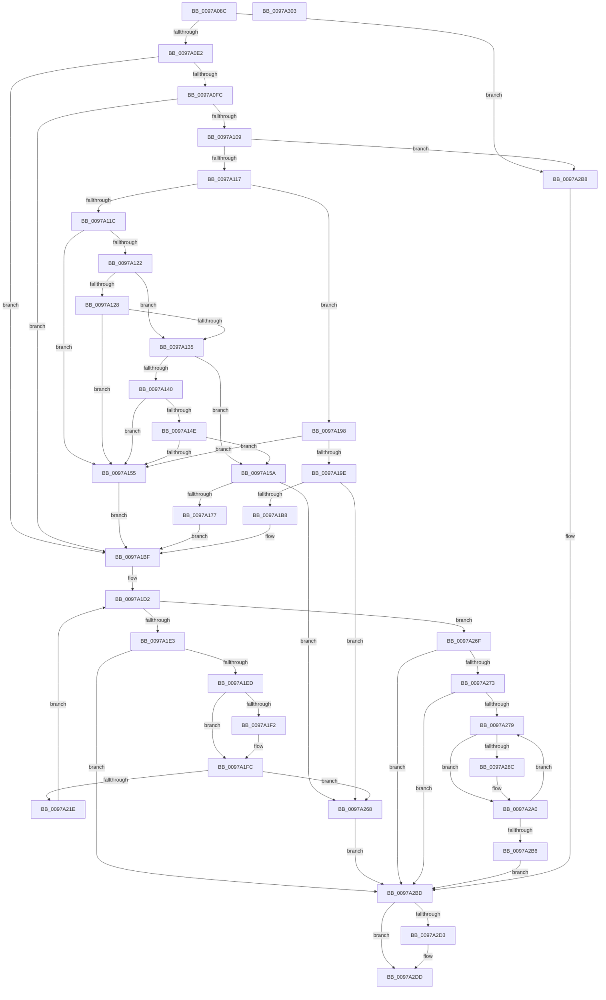

# PnpDeleteDeviceInterfaces

- RVA: `0x0097A08C`–`0x0097A304` (길이 `632` bytes)
- VA: `0x000000014097A08C`
- 실행 섹션: `PAGE`
- PDB 이름 있음: `예`; PDB Function 태그: `아니요`
- unwind 정보 RVA: `0x00096798`
- 디코드: `168`개 명령, `632/632` bytes 표시
- 미해석 바이트: `0` (있으면 어셈블리에 `.byte`로 보존)

> 이 문서는 커널 이미지의 기계어와 PDB 기호를 분석해 생성했습니다. 4번과 5번은 함수 원형과 자료형을 바이너리 사용 방식에서 추정한 C 해석이며 원본 소스 복구 결과는 아닙니다.

## 1. Dependencies

- 직접 호출 지점: **13**; 고유 호출 대상: **10**
- 직접 호출자로 확인된 함수: **1**
- RIP 상대 이미지 참조: **2**

### Outgoing calls
- `0x0097A0D4` → [ExAcquireResourceExclusiveLite](../../text/21/ExAcquireResourceExclusiveLite_function_00214E20.md) (function, `0x00214E20`)
- `0x0097A166` → [ExAllocatePool2](../../poolcode/B8/ExAllocatePool2_function_00B820F0.md) (function, `0x00B820F0`)
- `0x0097A182` → [memcpy](../../text/6C/memcpy_function_006C6840.md) (function, `0x006C6840`)
- `0x0097A1AA` → [ExAllocatePool2](../../poolcode/B8/ExAllocatePool2_function_00B820F0.md) (function, `0x00B820F0`)
- `0x0097A1F7` → [ExFreePoolWithTag](../../poolcode/B8/ExFreePoolWithTag_function_00B82870.md) (function, `0x00B82870`)
- `0x0097A211` → [ExAllocatePool2](../../poolcode/B8/ExAllocatePool2_function_00B820F0.md) (function, `0x00B820F0`)
- `0x0097A259` → [_CmGetMatchingFilteredDeviceInterfaceList](../A0/_CmGetMatchingFilteredDeviceInterfaceList_function_00A09610.md) (function, `0x00A09610`)
- `0x0097A281` → [RtlInitUnicodeStringEx](../../text/46/RtlInitUnicodeStringEx_function_00463960.md) (function, `0x00463960`)
- `0x0097A29B` → [CmDeleteDeviceInterface](../A0/CmDeleteDeviceInterface_function_00A09E98.md) (function, `0x00A09E98`)
- `0x0097A2C4` → [ExReleaseResourceLite](../../text/25/ExReleaseResourceLite_function_0025FA10.md) (function, `0x0025FA10`)
- `0x0097A2C9` → [KeLeaveCriticalRegion](../../text/25/KeLeaveCriticalRegion_function_0025D8B0.md) (function, `0x0025D8B0`)
- `0x0097A2D8` → [ExFreePoolWithTag](../../poolcode/B8/ExFreePoolWithTag_function_00B82870.md) (function, `0x00B82870`)
- `0x0097A2E3` → [PnpUnicodeStringToWstrFree](../8F/PnpUnicodeStringToWstrFree_function_008F59F0.md) (function, `0x008F59F0`)

### Direct callers
- [PiDevCfgConfigureDevice](PiDevCfgConfigureDevice_function_00977BB4.md) at `0x00979BC4`

### Static image references
- `0x0097A0BD` → RVA `0x00F8C600` (`.data`; read)
- `0x0097A21E` → RVA `0x00E66398` (`.data`; read)

## 2. Other-region calls and transfers

- 다른 실행 섹션으로 향하는 call: **10**
  - `0x0097A0D4` → [ExAcquireResourceExclusiveLite](../../text/21/ExAcquireResourceExclusiveLite_function_00214E20.md) (`PAGE` → `.text`)
  - `0x0097A166` → [ExAllocatePool2](../../poolcode/B8/ExAllocatePool2_function_00B820F0.md) (`PAGE` → `POOLCODE`)
  - `0x0097A182` → [memcpy](../../text/6C/memcpy_function_006C6840.md) (`PAGE` → `.text`)
  - `0x0097A1AA` → [ExAllocatePool2](../../poolcode/B8/ExAllocatePool2_function_00B820F0.md) (`PAGE` → `POOLCODE`)
  - `0x0097A1F7` → [ExFreePoolWithTag](../../poolcode/B8/ExFreePoolWithTag_function_00B82870.md) (`PAGE` → `POOLCODE`)
  - `0x0097A211` → [ExAllocatePool2](../../poolcode/B8/ExAllocatePool2_function_00B820F0.md) (`PAGE` → `POOLCODE`)
  - `0x0097A281` → [RtlInitUnicodeStringEx](../../text/46/RtlInitUnicodeStringEx_function_00463960.md) (`PAGE` → `.text`)
  - `0x0097A2C4` → [ExReleaseResourceLite](../../text/25/ExReleaseResourceLite_function_0025FA10.md) (`PAGE` → `.text`)
  - `0x0097A2C9` → [KeLeaveCriticalRegion](../../text/25/KeLeaveCriticalRegion_function_0025D8B0.md) (`PAGE` → `.text`)
  - `0x0097A2D8` → [ExFreePoolWithTag](../../poolcode/B8/ExFreePoolWithTag_function_00B82870.md) (`PAGE` → `POOLCODE`)
- 별도 외부 분기/꼬리 이동을 확인하지 못했습니다.

## 3. Assembly (complete function range)

```asm
0097A08C  48 8B C4                        mov rax, rsp
0097A08F  48 89 58 08                     mov qword ptr [rax + 8], rbx
0097A093  48 89 68 18                     mov qword ptr [rax + 0x18], rbp
0097A097  56                              push rsi
0097A098  57                              push rdi
0097A099  41 54                           push r12
0097A09B  41 56                           push r14
0097A09D  41 57                           push r15
0097A09F  48 83 EC 60                     sub rsp, 0x60
0097A0A3  45 33 E4                        xor r12d, r12d
0097A0A6  0F 57 C0                        xorps xmm0, xmm0
0097A0A9  44 89 60 10                     mov dword ptr [rax + 0x10], r12d
0097A0AD  4C 8B F1                        mov r14, rcx
0097A0B0  0F 11 40 C8                     movups xmmword ptr [rax - 0x38], xmm0
0097A0B4  65 48 8B 04 25 88 01 00 00      mov rax, qword ptr gs:[0x188]
0097A0BD  48 8D 0D 3C 25 61 00            lea rcx, [rip + 0x61253c]
0097A0C4  B2 01                           mov dl, 1
0097A0C6  41 8B EC                        mov ebp, r12d
0097A0C9  41 8B F4                        mov esi, r12d
0097A0CC  66 FF 88 E4 01 00 00            dec word ptr [rax + 0x1e4]
0097A0D3  90                              nop
0097A0D4  E8 47 AD 89 FF                  call 0x140214e20
0097A0D9  4D 85 F6                        test r14, r14
0097A0DC  0F 84 D6 01 00 00               je 0x14097a2b8
0097A0E2  45 0F B7 46 02                  movzx r8d, word ptr [r14 + 2]
0097A0E7  45 8D 4C 24 02                  lea r9d, [r12 + 2]
0097A0EC  41 BA 00 01 00 00               mov r10d, 0x100
0097A0F2  66 45 3B C1                     cmp r8w, r9w
0097A0F6  0F 82 C3 00 00 00               jb 0x14097a1bf
0097A0FC  49 8B 4E 08                     mov rcx, qword ptr [r14 + 8]
0097A100  48 85 C9                        test rcx, rcx
0097A103  0F 84 B6 00 00 00               je 0x14097a1bf
0097A109  41 0F B7 16                     movzx edx, word ptr [r14]
0097A10D  66 41 3B D0                     cmp dx, r8w
0097A111  0F 87 A1 01 00 00               ja 0x14097a2b8
0097A117  66 85 D2                        test dx, dx
0097A11A  74 7C                           je 0x14097a198
0097A11C  66 44 39 21                     cmp word ptr [rcx], r12w
0097A120  74 33                           je 0x14097a155
0097A122  66 41 3B D0                     cmp dx, r8w
0097A126  75 0D                           jne 0x14097a135
0097A128  8B C2                           mov eax, edx
0097A12A  48 D1 E8                        shr rax, 1
0097A12D  66 44 39 64 41 FE               cmp word ptr [rcx + rax*2 - 2], r12w
0097A133  74 20                           je 0x14097a155
0097A135  49 8B C0                        mov rax, r8
0097A138  49 2B C1                        sub rax, r9
0097A13B  48 3B D0                        cmp rdx, rax
0097A13E  77 1A                           ja 0x14097a15a
0097A140  48 8B C2                        mov rax, rdx
0097A143  48 D1 E8                        shr rax, 1
0097A146  66 44 39 64 41 FE               cmp word ptr [rcx + rax*2 - 2], r12w
0097A14C  74 07                           je 0x14097a155
0097A14E  66 44 39 24 41                  cmp word ptr [rcx + rax*2], r12w
0097A153  75 05                           jne 0x14097a15a
0097A155  48 8B E9                        mov rbp, rcx
0097A158  EB 65                           jmp 0x14097a1bf
0097A15A  49 03 D1                        add rdx, r9
0097A15D  41 B8 50 70 73 75               mov r8d, 0x75737050
0097A163  49 8B CA                        mov rcx, r10
0097A166  E8 85 7F 20 00                  call 0x140b820f0
0097A16B  48 8B D8                        mov rbx, rax
0097A16E  48 85 C0                        test rax, rax
0097A171  0F 84 F1 00 00 00               je 0x14097a268
0097A177  45 0F B7 06                     movzx r8d, word ptr [r14]
0097A17B  48 8B C8                        mov rcx, rax
0097A17E  49 8B 56 08                     mov rdx, qword ptr [r14 + 8]
0097A182  E8 B9 C6 D4 FF                  call 0x1406c6840
0097A187  41 0F B7 06                     movzx eax, word ptr [r14]
0097A18B  48 8B EB                        mov rbp, rbx
0097A18E  48 D1 E8                        shr rax, 1
0097A191  66 44 89 24 43                  mov word ptr [rbx + rax*2], r12w
0097A196  EB 27                           jmp 0x14097a1bf
0097A198  66 44 39 21                     cmp word ptr [rcx], r12w
0097A19C  74 B7                           je 0x14097a155
0097A19E  41 B8 50 70 73 75               mov r8d, 0x75737050
0097A1A4  49 8B D1                        mov rdx, r9
0097A1A7  49 8B CA                        mov rcx, r10
0097A1AA  E8 41 7F 20 00                  call 0x140b820f0
0097A1AF  48 85 C0                        test rax, rax
0097A1B2  0F 84 B0 00 00 00               je 0x14097a268
0097A1B8  66 44 89 20                     mov word ptr [rax], r12w
0097A1BC  48 8B E8                        mov rbp, rax
0097A1BF  C7 84 24 98 00 00 00 00 10 00 00  mov dword ptr [rsp + 0x98], 0x1000
0097A1CA  BB 23 00 00 C0                  mov ebx, 0xc0000023
0097A1CF  45 8B FC                        mov r15d, r12d
0097A1D2  8B C3                           mov eax, ebx
0097A1D4  48 8B FE                        mov rdi, rsi
0097A1D7  81 FB 23 00 00 C0               cmp ebx, 0xc0000023
0097A1DD  0F 85 8C 00 00 00               jne 0x14097a26f
0097A1E3  41 83 FF 05                     cmp r15d, 5
0097A1E7  0F 83 D0 00 00 00               jae 0x14097a2bd
0097A1ED  48 85 F6                        test rsi, rsi
0097A1F0  74 0A                           je 0x14097a1fc
0097A1F2  33 D2                           xor edx, edx
0097A1F4  48 8B CE                        mov rcx, rsi
0097A1F7  E8 74 86 20 00                  call 0x140b82870
0097A1FC  8B 94 24 98 00 00 00            mov edx, dword ptr [rsp + 0x98]
0097A203  B9 00 01 00 00                  mov ecx, 0x100
0097A208  48 03 D2                        add rdx, rdx
0097A20B  41 B8 50 70 20 20               mov r8d, 0x20207050
0097A211  E8 DA 7E 20 00                  call 0x140b820f0
0097A216  48 8B F0                        mov rsi, rax
0097A219  48 85 C0                        test rax, rax
0097A21C  74 4A                           je 0x14097a268
0097A21E  48 8B 0D 73 C1 4E 00            mov rcx, qword ptr [rip + 0x4ec173]
0097A225  48 8D 84 24 98 00 00 00         lea rax, [rsp + 0x98]
0097A22D  44 89 64 24 48                  mov dword ptr [rsp + 0x48], r12d
0097A232  45 33 C9                        xor r9d, r9d
0097A235  48 89 44 24 40                  mov qword ptr [rsp + 0x40], rax
0097A23A  4C 8B C5                        mov r8, rbp
0097A23D  8B 84 24 98 00 00 00            mov eax, dword ptr [rsp + 0x98]
0097A244  33 D2                           xor edx, edx
0097A246  89 44 24 38                     mov dword ptr [rsp + 0x38], eax
0097A24A  48 89 74 24 30                  mov qword ptr [rsp + 0x30], rsi
0097A24F  4C 89 64 24 28                  mov qword ptr [rsp + 0x28], r12
0097A254  4C 89 64 24 20                  mov qword ptr [rsp + 0x20], r12
0097A259  E8 B2 F3 08 00                  call 0x140a09610
0097A25E  8B D8                           mov ebx, eax
0097A260  41 FF C7                        inc r15d
0097A263  E9 6A FF FF FF                  jmp 0x14097a1d2
0097A268  BB 9A 00 00 C0                  mov ebx, 0xc000009a
0097A26D  EB 4E                           jmp 0x14097a2bd
0097A26F  85 C0                           test eax, eax
0097A271  78 4A                           js 0x14097a2bd
0097A273  66 44 39 26                     cmp word ptr [rsi], r12w
0097A277  74 44                           je 0x14097a2bd
0097A279  48 8B D7                        mov rdx, rdi
0097A27C  48 8D 4C 24 50                  lea rcx, [rsp + 0x50]
0097A281  E8 DA 96 AE FF                  call 0x140463960
0097A286  8B D8                           mov ebx, eax
0097A288  85 C0                           test eax, eax
0097A28A  78 14                           js 0x14097a2a0
0097A28C  48 8B 54 24 58                  mov rdx, qword ptr [rsp + 0x58]
0097A291  45 33 C0                        xor r8d, r8d
0097A294  48 8B 0D FD C0 4E 00            mov rcx, qword ptr [rip + 0x4ec0fd]
0097A29B  E8 F8 FB 08 00                  call 0x140a09e98
0097A2A0  0F B7 44 24 50                  movzx eax, word ptr [rsp + 0x50]
0097A2A5  48 83 C0 02                     add rax, 2
0097A2A9  48 D1 E8                        shr rax, 1
0097A2AC  48 8D 3C 47                     lea rdi, [rdi + rax*2]
0097A2B0  66 44 39 27                     cmp word ptr [rdi], r12w
0097A2B4  75 C3                           jne 0x14097a279
0097A2B6  EB 05                           jmp 0x14097a2bd
0097A2B8  BB 0D 00 00 C0                  mov ebx, 0xc000000d
0097A2BD  48 8D 0D 3C 23 61 00            lea rcx, [rip + 0x61233c]
0097A2C4  E8 47 57 8E FF                  call 0x14025fa10
0097A2C9  E8 E2 35 8E FF                  call 0x14025d8b0
0097A2CE  48 85 F6                        test rsi, rsi
0097A2D1  74 0A                           je 0x14097a2dd
0097A2D3  33 D2                           xor edx, edx
0097A2D5  48 8B CE                        mov rcx, rsi
0097A2D8  E8 93 85 20 00                  call 0x140b82870
0097A2DD  49 8B D6                        mov rdx, r14
0097A2E0  48 8B CD                        mov rcx, rbp
0097A2E3  E8 08 B7 F7 FF                  call 0x1408f59f0
0097A2E8  4C 8D 5C 24 60                  lea r11, [rsp + 0x60]
0097A2ED  8B C3                           mov eax, ebx
0097A2EF  49 8B 5B 30                     mov rbx, qword ptr [r11 + 0x30]
0097A2F3  49 8B 6B 40                     mov rbp, qword ptr [r11 + 0x40]
0097A2F7  49 8B E3                        mov rsp, r11
0097A2FA  41 5F                           pop r15
0097A2FC  41 5E                           pop r14
0097A2FE  41 5C                           pop r12
0097A300  5F                              pop rdi
0097A301  5E                              pop rsi
0097A302  C3                              ret
0097A303  CC                              int3
```

## 4. C-style interpretation (structured pseudocode)

```c
__int64 __fastcall PnpDeleteDeviceInterfaces(__int64 a1)
{
    __int64 result;
    __int64 v_r12;
    __int64 v_r15;
    __int64 v_rsp;
    unsigned __int64 v_stack_m28;
    unsigned __int64 v_stack_m30;
    unsigned __int64 v_stack_m38;
    unsigned int v_stack_m40;
    unsigned __int64 v_stack_m48;
    unsigned int v_stack_m50;
    unsigned __int64 v_stack_m58;
    unsigned __int64 v_stack_m60;
    unsigned __int64 v_stack_m68;
    unsigned int v_stack_p10;

    *(unsigned __int64 *)(v_rsp + 8) = v_rbx;
    *(unsigned __int64 *)(v_rsp + 24) = v_rbp;
    v_rsp = (v_rsp) - (96);
    v_r12 = 0;
    *(unsigned int *)(v_rsp + 16) = 0;
    *(unsigned __int64 *)(v_rsp - 56) = v_xmm0;
    result = ExAcquireResourceExclusiveLite(v_rip + 6366524, 1, a3, a4);
    if (a1 == 0) goto loc_0097A2B8;
    if (((unsigned __int16)(*(unsigned __int16 *)(a1 + 2))) < ((unsigned __int16)(v_r12 + 2))) goto loc_0097A1BF;
    if (*(unsigned __int64 *)(a1 + 8) == 0) goto loc_0097A1BF;
    if (((unsigned __int16)(*(unsigned __int16 *)(a1))) > ((unsigned __int16)(*(unsigned __int16 *)(a1 + 2)))) goto loc_0097A2B8;
    if ((unsigned __int16)(*(unsigned __int16 *)(a1)) == 0) goto loc_0097A198;
    if ((*(unsigned __int16 *)(*(unsigned __int64 *)(a1 + 8))) == 0) goto loc_0097A155;
    if (((unsigned __int16)(*(unsigned __int16 *)(a1))) != ((unsigned __int16)(*(unsigned __int16 *)(a1 + 2)))) goto loc_0097A135;
    result = ((unsigned int)((unsigned int)(*(unsigned __int16 *)(a1)))) >> (1);
    if ((*(unsigned __int16 *)(*(unsigned __int64 *)(a1 + 8) + result * 2 - 2)) == 0) goto loc_0097A155;
loc_0097A135:
    result = (*(unsigned __int16 *)(a1 + 2)) - (v_r12 + 2);
    if ((*(unsigned __int16 *)(a1)) > result) goto loc_0097A15A;
    result = (*(unsigned __int16 *)(a1)) >> (1);
    if ((*(unsigned __int16 *)(*(unsigned __int64 *)(a1 + 8) + result * 2 - 2)) == 0) goto loc_0097A155;
    if ((*(unsigned __int16 *)(*(unsigned __int64 *)(a1 + 8) + result * 2)) != 0) goto loc_0097A15A;
loc_0097A155:
    goto loc_0097A1BF;
loc_0097A15A:
    a2 = (*(unsigned __int16 *)(a1)) + (v_r12 + 2);
    result = ExAllocatePool2(256, a2, (unsigned int)(0x75737050ULL), v_r12 + 2);
    if (result == 0) goto loc_0097A268;
    result = memcpy(result, *(unsigned __int64 *)(a1 + 8), *(unsigned __int16 *)(a1), v_r12 + 2);
    result = (*(unsigned __int16 *)(a1)) >> (1);
    *(unsigned __int16 *)(result + result * 2) = 0;
    goto loc_0097A1BF;
loc_0097A198:
    if ((*(unsigned __int16 *)(result)) == 0) goto loc_0097A155;
    result = ExAllocatePool2(256, v_r12 + 2, (unsigned int)(0x75737050ULL), v_r12 + 2);
    if (result == 0) goto loc_0097A268;
    *(unsigned __int16 *)(result) = 0;
loc_0097A1BF:
    v_stack_p10 = 0x1000ULL;
loc_0097A1D2:
    if (((unsigned int)((unsigned int)(0xC0000023ULL))) != 0xC0000023ULL) goto loc_0097A26F;
    if (0 >= 5) goto loc_0097A2BD;
    result = (unsigned int)((unsigned int)((unsigned int)(0xC0000023ULL)));
    if (0 != 0) {
        a2 = 0;
        a1 = 0;
        result = ExFreePoolWithTag(a1, a2, (unsigned int)(0x75737050ULL), v_r12 + 2);
    }
    a2 = ((unsigned int)(v_stack_p10)) + ((unsigned int)(v_stack_p10));
    result = ExAllocatePool2(256, a2, (unsigned int)(0x20207050ULL), v_r12 + 2);
    if (result == 0) goto loc_0097A268;
    v_stack_m40 = 0;
    a4 = 0;
    v_stack_m48 = v_stack_p10;
    a2 = 0;
    v_stack_m50 = (unsigned int)((unsigned int)(v_stack_p10));
    v_stack_m58 = result;
    v_stack_m60 = 0;
    v_stack_m68 = 0;
    result = _CmGetMatchingFilteredDeviceInterfaceList(*(unsigned __int64 *)(v_rip + 5161331), a2, result, a4);
    v_r15 = (unsigned int)((0) + 1);
    goto loc_0097A1D2;
loc_0097A268:
    goto loc_0097A2BD;
loc_0097A26F:
    if (sign_flag) goto loc_0097A2BD;
    if ((*(unsigned __int16 *)(result)) == 0) goto loc_0097A2BD;
loc_0097A279:
    result = RtlInitUnicodeStringEx(v_stack_m38, 0, result, a4);
    if (!(sign_flag)) {
        a2 = v_stack_m30;
        a3 = 0;
        a1 = *(unsigned __int64 *)(v_rip + 5161213);
        result = CmDeleteDeviceInterface(a1, a2, a3, a4);
    }
    result = (v_stack_m38) + (2);
    result = (result) >> (1);
    if ((*(unsigned __int16 *)(0 + result * 2)) != 0) goto loc_0097A279;
    goto loc_0097A2BD;
loc_0097A2B8:
loc_0097A2BD:
    result = ExReleaseResourceLite(v_rip + 6366012, a2, a3, a4);
    result = KeLeaveCriticalRegion(v_rip + 6366012, a2, a3, a4);
    if (result != 0) {
        a2 = 0;
        a1 = result;
        result = ExFreePoolWithTag(a1, a2, a3, a4);
    }
    result = PnpUnicodeStringToWstrFree(result, a1, a3, a4);
    return (unsigned int)((unsigned int)((unsigned int)(0xC000000DULL)));
}
```

## 5. (Beta) C Style

```c
int64_t PnpDeleteDeviceInterfaces(int64_t Arg1)
{
    int64_t result;
    int64_t local_r12;
    int64_t local_r15;
    int64_t local_rsp;
    uint64_t v_stack_m28;
    uint64_t v_stack_m30;
    uint64_t v_stack_m38;
    uint32_t v_stack_m40;
    uint64_t v_stack_m48;
    uint32_t v_stack_m50;
    uint64_t v_stack_m58;
    uint64_t v_stack_m60;
    uint64_t v_stack_m68;
    uint32_t v_stack_p10;

    *(uint64_t *)(local_rsp + 0x8) = local_rbx;
    *(uint64_t *)(local_rsp + 0x18) = local_rbp;
    local_rsp = (local_rsp) - (96);
    local_r12 = 0;
    *(uint32_t *)(local_rsp + 0x10) = 0;
    *(uint64_t *)(local_rsp - 0x38) = v_xmm0;
    result = ExAcquireResourceExclusiveLite(v_rip + 6366524, 1, a3, a4);
    if (Arg1 == 0) goto loc_0097A2B8;
    if (((uint16_t)(*(uint16_t *)(Arg1 + 0x2))) < ((uint16_t)(local_r12 + 2))) goto loc_0097A1BF;
    if (*(uint64_t *)(Arg1 + 0x8) == 0) goto loc_0097A1BF;
    if (((uint16_t)(*(uint16_t *)(Arg1))) > ((uint16_t)(*(uint16_t *)(Arg1 + 0x2)))) goto loc_0097A2B8;
    if ((uint16_t)(*(uint16_t *)(Arg1)) == 0) goto loc_0097A198;
    if ((*(uint16_t *)(*(uint64_t *)(Arg1 + 0x8))) == 0) goto loc_0097A155;
    if (((uint16_t)(*(uint16_t *)(Arg1))) != ((uint16_t)(*(uint16_t *)(Arg1 + 0x2)))) goto loc_0097A135;
    result = ((uint32_t)((uint32_t)(*(uint16_t *)(Arg1)))) >> (1);
    if ((*(uint16_t *)(*(uint64_t *)(Arg1 + 0x8) + result * 2 - 0x2)) == 0) goto loc_0097A155;
loc_0097A135:
    result = (*(uint16_t *)(Arg1 + 0x2)) - (local_r12 + 2);
    if ((*(uint16_t *)(Arg1)) > result) goto loc_0097A15A;
    result = (*(uint16_t *)(Arg1)) >> (1);
    if ((*(uint16_t *)(*(uint64_t *)(Arg1 + 0x8) + result * 2 - 0x2)) == 0) goto loc_0097A155;
    if ((*(uint16_t *)(*(uint64_t *)(Arg1 + 0x8) + result * 2)) != 0) goto loc_0097A15A;
loc_0097A155:
    goto loc_0097A1BF;
loc_0097A15A:
    a2 = (*(uint16_t *)(Arg1)) + (local_r12 + 2);
    result = ExAllocatePool2(256, a2, (uint32_t)(0x75737050ULL), local_r12 + 2);
    if (result == 0) goto loc_0097A268;
    result = memcpy(result, *(uint64_t *)(Arg1 + 0x8), *(uint16_t *)(Arg1), local_r12 + 2);
    result = (*(uint16_t *)(Arg1)) >> (1);
    *(uint16_t *)(result + result * 2) = 0;
    goto loc_0097A1BF;
loc_0097A198:
    if ((*(uint16_t *)(result)) == 0) goto loc_0097A155;
    result = ExAllocatePool2(256, local_r12 + 2, (uint32_t)(0x75737050ULL), local_r12 + 2);
    if (result == 0) goto loc_0097A268;
    *(uint16_t *)(result) = 0;
loc_0097A1BF:
    v_stack_p10 = 0x1000ULL;
loc_0097A1D2:
    if (((uint32_t)((uint32_t)(0xC0000023ULL))) != 0xC0000023ULL) goto loc_0097A26F;
    if (0 >= 5) goto loc_0097A2BD;
    result = (uint32_t)((uint32_t)((uint32_t)(0xC0000023ULL)));
    if (0 != 0) {
        a2 = 0;
        Arg1 = 0;
        result = ExFreePoolWithTag(Arg1, a2, (uint32_t)(0x75737050ULL), local_r12 + 2);
    }
    a2 = ((uint32_t)(v_stack_p10)) + ((uint32_t)(v_stack_p10));
    result = ExAllocatePool2(256, a2, (uint32_t)(0x20207050ULL), local_r12 + 2);
    if (result == 0) goto loc_0097A268;
    v_stack_m40 = 0;
    a4 = 0;
    v_stack_m48 = v_stack_p10;
    a2 = 0;
    v_stack_m50 = (uint32_t)((uint32_t)(v_stack_p10));
    v_stack_m58 = result;
    v_stack_m60 = 0;
    v_stack_m68 = 0;
    result = _CmGetMatchingFilteredDeviceInterfaceList(*(uint64_t *)(v_rip + 0x4EC173), a2, result, a4);
    local_r15 = (uint32_t)((0) + 1);
    goto loc_0097A1D2;
loc_0097A268:
    goto loc_0097A2BD;
loc_0097A26F:
    if (sign_flag) goto loc_0097A2BD;
    if ((*(uint16_t *)(result)) == 0) goto loc_0097A2BD;
loc_0097A279:
    result = RtlInitUnicodeStringEx(v_stack_m38, 0, result, a4);
    if (!(sign_flag)) {
        a2 = v_stack_m30;
        a3 = 0;
        Arg1 = *(uint64_t *)(v_rip + 0x4EC0FD);
        result = CmDeleteDeviceInterface(Arg1, a2, a3, a4);
    }
    result = (v_stack_m38) + (2);
    result = (result) >> (1);
    if ((*(uint16_t *)(0 + result * 2)) != 0) goto loc_0097A279;
    goto loc_0097A2BD;
loc_0097A2B8:
loc_0097A2BD:
    result = ExReleaseResourceLite(v_rip + 6366012, a2, a3, a4);
    result = KeLeaveCriticalRegion(v_rip + 6366012, a2, a3, a4);
    if (result != 0) {
        a2 = 0;
        Arg1 = result;
        result = ExFreePoolWithTag(Arg1, a2, a3, a4);
    }
    result = PnpUnicodeStringToWstrFree(result, Arg1, a3, a4);
    return (uint32_t)((uint32_t)((uint32_t)(0xC000000DULL)));
}
```

## 6. Execution-region graph

[열기: 2D/3D 그래프와 함수 탐색 컨트롤 패널](../../../control-panel.html?section=page&rva=0x0097A08C&view=graph)

- 2D 그래프는 위에서 아래로 흐르고, 3D 그래프는 빈 공간을 드래그해 회전합니다. Shift+드래그는 이동, 휠은 확대·축소, 함수 노드 선택은 대상 보고서 이동입니다.

### Static fallback


