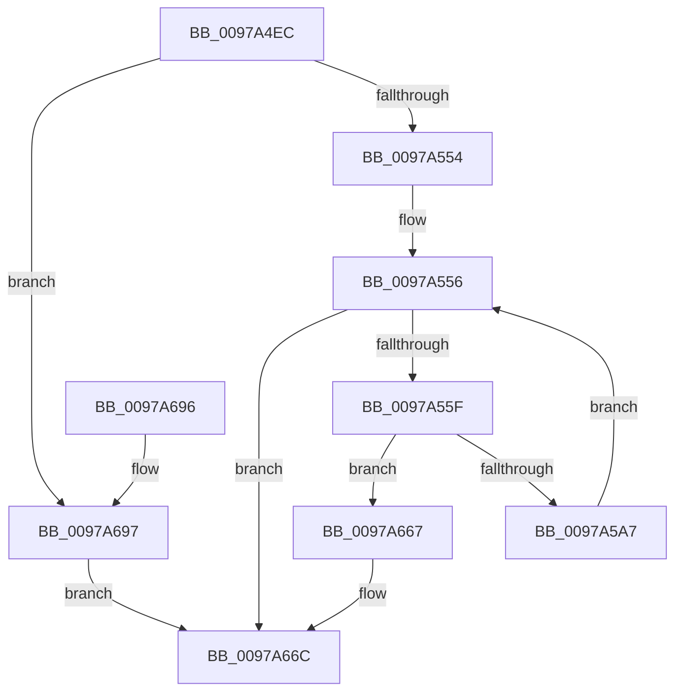

# PopFxLogSocSubsystemBlockingTimes

- RVA: `0x0097A4EC`–`0x0097A69E` (길이 `434` bytes)
- VA: `0x000000014097A4EC`
- 실행 섹션: `PAGE`
- PDB 이름 있음: `예`; PDB Function 태그: `아니요`
- unwind 정보 RVA: `0x000967D4`
- 디코드: `105`개 명령, `434/434` bytes 표시
- 미해석 바이트: `0` (있으면 어셈블리에 `.byte`로 보존)

> 이 문서는 커널 이미지의 기계어와 PDB 기호를 분석해 생성했습니다. 4번과 5번은 함수 원형과 자료형을 바이너리 사용 방식에서 추정한 C 해석이며 원본 소스 복구 결과는 아닙니다.

## 1. Dependencies

- 직접 호출 지점: **4**; 고유 호출 대상: **4**
- 직접 호출자로 확인된 함수: **1**
- RIP 상대 이미지 참조: **2**

### Outgoing calls
- `0x0097A543` → [PopFxLookupSocSubsystemsByPlatformIdleState](PopFxLookupSocSubsystemsByPlatformIdleState_function_0097ABEC.md) (function, `0x0097ABEC`)
- `0x0097A59A` → [PopPluginQuerySocSubsystemBlockingTime](PopPluginQuerySocSubsystemBlockingTime_function_0097A6A4.md) (function, `0x0097A6A4`)
- `0x0097A65B` → [PopDiagTraceSleepStudyBlocker](../../text/4A/PopDiagTraceSleepStudyBlocker_function_004A5930.md) (function, `0x004A5930`)
- `0x0097A675` → [_security_check_cookie](../../text/6A/_security_check_cookie_function_006AC640.md) (function, `0x006AC640`)

### Direct callers
- [PopCaptureSleepStudyStatistics](../../text/43/PopCaptureSleepStudyStatistics_function_004399F4.md) at `0x00439F8E`

### Static image references
- `0x0097A50A` → RVA `0x00E0A740` (`.data`; read)
- `0x0097A518` → RVA `0x00F0B6B0` (`.data`; read)

## 2. Other-region calls and transfers

- 다른 실행 섹션으로 향하는 call: **2**
  - `0x0097A65B` → [PopDiagTraceSleepStudyBlocker](../../text/4A/PopDiagTraceSleepStudyBlocker_function_004A5930.md) (`PAGE` → `.text`)
  - `0x0097A675` → [_security_check_cookie](../../text/6A/_security_check_cookie_function_006AC640.md) (`PAGE` → `.text`)
- 별도 외부 분기/꼬리 이동을 확인하지 못했습니다.

## 3. Assembly (complete function range)

```asm
0097A4EC  48 89 5C 24 08                  mov qword ptr [rsp + 8], rbx
0097A4F1  48 89 74 24 18                  mov qword ptr [rsp + 0x18], rsi
0097A4F6  55                              push rbp
0097A4F7  57                              push rdi
0097A4F8  41 54                           push r12
0097A4FA  41 56                           push r14
0097A4FC  41 57                           push r15
0097A4FE  48 8D 6C 24 C9                  lea rbp, [rsp - 0x37]
0097A503  48 81 EC 00 01 00 00            sub rsp, 0x100
0097A50A  48 8B 05 2F 02 49 00            mov rax, qword ptr [rip + 0x49022f]
0097A511  48 33 C4                        xor rax, rsp
0097A514  48 89 45 27                     mov qword ptr [rbp + 0x27], rax
0097A518  48 8B 05 91 11 59 00            mov rax, qword ptr [rip + 0x591191]
0097A51F  33 DB                           xor ebx, ebx
0097A521  48 89 44 24 30                  mov qword ptr [rsp + 0x30], rax
0097A526  8B CA                           mov ecx, edx
0097A528  33 C0                           xor eax, eax
0097A52A  48 89 5C 24 38                  mov qword ptr [rsp + 0x38], rbx
0097A52F  89 44 24 44                     mov dword ptr [rsp + 0x44], eax
0097A533  44 8B FA                        mov r15d, edx
0097A536  48 89 5C 24 28                  mov qword ptr [rsp + 0x28], rbx
0097A53B  88 5C 24 20                     mov byte ptr [rsp + 0x20], bl
0097A53F  89 5C 24 24                     mov dword ptr [rsp + 0x24], ebx
0097A543  E8 A4 06 00 00                  call 0x14097abec
0097A548  48 8B F8                        mov rdi, rax
0097A54B  48 85 C0                        test rax, rax
0097A54E  0F 84 43 01 00 00               je 0x14097a697
0097A554  8B F3                           mov esi, ebx
0097A556  3B 77 14                        cmp esi, dword ptr [rdi + 0x14]
0097A559  0F 83 0D 01 00 00               jae 0x14097a66c
0097A55F  89 5C 24 44                     mov dword ptr [rsp + 0x44], ebx
0097A563  4C 8D 67 28                     lea r12, [rdi + 0x28]
0097A567  89 5D 9B                        mov dword ptr [rbp - 0x65], ebx
0097A56A  4C 8D 44 24 40                  lea r8, [rsp + 0x40]
0097A56F  44 89 7C 24 40                  mov dword ptr [rsp + 0x40], r15d
0097A574  8B C6                           mov eax, esi
0097A576  4C 69 F0 58 01 00 00            imul r14, rax, 0x158
0097A57D  4D 03 E6                        add r12, r14
0097A580  49 8B 44 3E 40                  mov rax, qword ptr [r14 + rdi + 0x40]
0097A585  48 89 44 24 48                  mov qword ptr [rsp + 0x48], rax
0097A58A  4C 89 65 87                     mov qword ptr [rbp - 0x79], r12
0097A58E  48 89 5D 8F                     mov qword ptr [rbp - 0x71], rbx
0097A592  89 5D 97                        mov dword ptr [rbp - 0x69], ebx
0097A595  41 8B 54 3E 3C                  mov edx, dword ptr [r14 + rdi + 0x3c]
0097A59A  E8 05 01 00 00                  call 0x14097a6a4
0097A59F  84 C0                           test al, al
0097A5A1  0F 84 C0 00 00 00               je 0x14097a667
0097A5A7  48 8B 45 8F                     mov rax, qword ptr [rbp - 0x71]
0097A5AB  48 89 44 24 28                  mov qword ptr [rsp + 0x28], rax
0097A5B0  8A 44 24 30                     mov al, byte ptr [rsp + 0x30]
0097A5B4  88 44 24 20                     mov byte ptr [rsp + 0x20], al
0097A5B8  48 8D 44 24 20                  lea rax, [rsp + 0x20]
0097A5BD  48 89 45 A7                     mov qword ptr [rbp - 0x59], rax
0097A5C1  48 8D 47 58                     lea rax, [rdi + 0x58]
0097A5C5  49 03 C6                        add rax, r14
0097A5C8  48 C7 45 AF 01 00 00 00         mov qword ptr [rbp - 0x51], 1
0097A5D0  48 89 45 B7                     mov qword ptr [rbp - 0x49], rax
0097A5D4  48 C7 45 BF 10 00 00 00         mov qword ptr [rbp - 0x41], 0x10
0097A5DC  41 0F B7 04 24                  movzx eax, word ptr [r12]
0097A5E1  D1 E8                           shr eax, 1
0097A5E3  89 44 24 24                     mov dword ptr [rsp + 0x24], eax
0097A5E7  48 8D 44 24 24                  lea rax, [rsp + 0x24]
0097A5EC  48 89 45 C7                     mov qword ptr [rbp - 0x39], rax
0097A5F0  48 C7 45 CF 04 00 00 00         mov qword ptr [rbp - 0x31], 4
0097A5F8  49 8B 44 3E 30                  mov rax, qword ptr [r14 + rdi + 0x30]
0097A5FD  41 0F B7 0C 24                  movzx ecx, word ptr [r12]
0097A602  48 89 45 D7                     mov qword ptr [rbp - 0x29], rax
0097A606  48 8D 47 48                     lea rax, [rdi + 0x48]
0097A60A  49 03 C6                        add rax, r14
0097A60D  89 4D DF                        mov dword ptr [rbp - 0x21], ecx
0097A610  48 89 45 E7                     mov qword ptr [rbp - 0x19], rax
0097A614  48 8D 4D A7                     lea rcx, [rbp - 0x59]
0097A618  48 8D 44 24 28                  lea rax, [rsp + 0x28]
0097A61D  89 5D E3                        mov dword ptr [rbp - 0x1d], ebx
0097A620  48 89 45 F7                     mov qword ptr [rbp - 9], rax
0097A624  48 8D 44 24 30                  lea rax, [rsp + 0x30]
0097A629  48 89 45 07                     mov qword ptr [rbp + 7], rax
0097A62D  48 8D 44 24 38                  lea rax, [rsp + 0x38]
0097A632  48 89 45 17                     mov qword ptr [rbp + 0x17], rax
0097A636  48 C7 45 EF 10 00 00 00         mov qword ptr [rbp - 0x11], 0x10
0097A63E  48 C7 45 FF 08 00 00 00         mov qword ptr [rbp - 1], 8
0097A646  48 C7 45 0F 08 00 00 00         mov qword ptr [rbp + 0xf], 8
0097A64E  48 89 5C 24 38                  mov qword ptr [rsp + 0x38], rbx
0097A653  48 C7 45 1F 08 00 00 00         mov qword ptr [rbp + 0x1f], 8
0097A65B  E8 D0 B2 B2 FF                  call 0x1404a5930
0097A660  FF C6                           inc esi
0097A662  E9 EF FE FF FF                  jmp 0x14097a556
0097A667  BB E5 00 00 C0                  mov ebx, 0xc00000e5
0097A66C  8B C3                           mov eax, ebx
0097A66E  48 8B 4D 27                     mov rcx, qword ptr [rbp + 0x27]
0097A672  48 33 CC                        xor rcx, rsp
0097A675  E8 C6 1F D3 FF                  call 0x1406ac640
0097A67A  4C 8D 9C 24 00 01 00 00         lea r11, [rsp + 0x100]
0097A682  49 8B 5B 30                     mov rbx, qword ptr [r11 + 0x30]
0097A686  49 8B 73 40                     mov rsi, qword ptr [r11 + 0x40]
0097A68A  49 8B E3                        mov rsp, r11
0097A68D  41 5F                           pop r15
0097A68F  41 5E                           pop r14
0097A691  41 5C                           pop r12
0097A693  5F                              pop rdi
0097A694  5D                              pop rbp
0097A695  C3                              ret
0097A696  CC                              int3
0097A697  BB F0 00 00 C0                  mov ebx, 0xc00000f0
0097A69C  EB CE                           jmp 0x14097a66c
```

## 4. C-style interpretation (structured pseudocode)

```c
__int64 __fastcall PopFxLogSocSubsystemBlockingTimes(__int64 a1, int a2)
{
    __int64 result;
    __int64 v_r12;
    __int64 v_r14;
    __int64 v_rbx;
    __int64 v_rsi;
    __int64 v_rsp;
    unsigned __int64 v_stack_m100;
    unsigned int v_stack_m104;
    unsigned __int8 v_stack_m108;
    unsigned __int64 v_stack_m28;
    unsigned __int64 v_stack_m38;
    unsigned __int64 v_stack_m40;
    unsigned __int64 v_stack_m48;
    unsigned __int64 v_stack_m50;
    unsigned __int64 v_stack_m58;
    unsigned __int64 v_stack_m5F;
    unsigned __int64 v_stack_m60;
    unsigned __int64 v_stack_m68;
    unsigned __int64 v_stack_m70;
    unsigned __int64 v_stack_m78;
    unsigned int v_stack_m7C;
    unsigned int v_stack_m80;
    unsigned __int64 v_stack_m88;
    unsigned __int64 v_stack_m90;
    unsigned __int64 v_stack_m98;
    unsigned __int64 v_stack_mA0;
    unsigned __int64 v_stack_mA8;
    unsigned __int64 v_stack_mB0;
    unsigned __int64 v_stack_mB8;
    unsigned int v_stack_mC4;
    unsigned int v_stack_mC8;
    unsigned __int64 v_stack_mD0;
    unsigned __int64 v_stack_mD8;
    unsigned __int64 v_stack_mE0;
    unsigned int v_stack_mE4;
    unsigned __int64 v_stack_mE8;
    unsigned __int64 v_stack_mF0;
    unsigned __int64 v_stack_mF8;
    unsigned __int64 v_stack_p18;
    unsigned __int64 v_stack_p8;

    v_stack_p8 = v_rbx;
    v_stack_p18 = v_rsi;
    v_rsp = (v_rsp) - (256);
    result = (*(unsigned __int64 *)(v_rip + 4784687)) ^ (v_rsp);
    v_stack_m38 = result;
    v_rbx = 0;
    v_stack_mF8 = *(unsigned __int64 *)(v_rip + 5837201);
    result = 0;
    v_stack_mF0 = 0;
    v_stack_mE4 = 0;
    v_stack_m100 = 0;
    v_stack_m108 = 0;
    v_stack_m104 = 0;
    result = PopFxLookupSocSubsystemsByPlatformIdleState((unsigned int)(a2), a2, a3, a4);
    if (result == 0) goto loc_0097A697;
loc_0097A556:
    if (0 >= (*(unsigned int *)(result + 20))) goto loc_0097A66C;
    v_stack_mE4 = 0;
    v_stack_mC4 = 0;
    v_stack_mE8 = (unsigned int)((unsigned int)(a2));
    v_r14 = (v_r14) * (0);
    v_r12 = (result + 40) + (v_r14);
    v_stack_mE0 = *(unsigned __int64 *)(v_r14 + result * 1 + 64);
    v_stack_mD8 = v_r12;
    v_stack_mD0 = 0;
    v_stack_mC8 = 0;
    result = PopPluginQuerySocSubsystemBlockingTime((unsigned int)(a2), (unsigned int)(*(unsigned int *)(v_r14 + result * 1 + 60)), v_stack_mE8, a4);
    if ((unsigned __int8)(result) == 0) goto loc_0097A667;
    v_stack_m100 = v_stack_mD0;
    v_stack_m108 = (unsigned __int8)(v_stack_mF8);
    v_stack_mB8 = v_stack_m108;
    result = (result + 88) + (v_r14);
    v_stack_mB0 = 1;
    v_stack_mA8 = result;
    v_stack_mA0 = 16;
    result = (unsigned int)((*(unsigned __int16 *)(v_r12)) >> (1));
    v_stack_m104 = (unsigned int)(result);
    v_stack_m98 = v_stack_m104;
    v_stack_m90 = 4;
    v_stack_m88 = *(unsigned __int64 *)(v_r14 + result * 1 + 48);
    result = (result + 72) + (v_r14);
    v_stack_m80 = (unsigned int)(*(unsigned __int16 *)(v_r12));
    v_stack_m78 = result;
    v_stack_m7C = 0;
    v_stack_m68 = v_stack_m100;
    v_stack_m58 = v_stack_mF8;
    v_stack_m48 = v_stack_mF0;
    v_stack_m70 = 16;
    v_stack_m60 = 8;
    v_stack_m50 = 8;
    v_stack_mF0 = 0;
    v_stack_m40 = 8;
    result = PopDiagTraceSleepStudyBlocker(v_stack_mB8, (unsigned int)(*(unsigned int *)(v_r14 + result * 1 + 60)), v_stack_mE8, a4);
    v_rsi = (unsigned int)((0) + 1);
    goto loc_0097A556;
loc_0097A667:
loc_0097A66C:
    a1 = (v_stack_m38) ^ (v_rsp);
    result = _security_check_cookie(a1, (unsigned int)(*(unsigned int *)(v_r14 + result * 1 + 60)), v_stack_mE8, a4);
    return result;
loc_0097A697:
    goto loc_0097A66C;
}
```

## 5. (Beta) C Style

```c
int64_t PopFxLogSocSubsystemBlockingTimes(int64_t Arg1, int32_t Arg2)
{
    int64_t result;
    int64_t local_r12;
    int64_t local_r14;
    int64_t local_rbx;
    int64_t local_rsi;
    int64_t local_rsp;
    uint64_t v_stack_m100;
    uint32_t v_stack_m104;
    uint8_t v_stack_m108;
    uint64_t v_stack_m28;
    uint64_t v_stack_m38;
    uint64_t v_stack_m40;
    uint64_t v_stack_m48;
    uint64_t v_stack_m50;
    uint64_t v_stack_m58;
    uint64_t v_stack_m5F;
    uint64_t v_stack_m60;
    uint64_t v_stack_m68;
    uint64_t v_stack_m70;
    uint64_t v_stack_m78;
    uint32_t v_stack_m7C;
    uint32_t v_stack_m80;
    uint64_t v_stack_m88;
    uint64_t v_stack_m90;
    uint64_t v_stack_m98;
    uint64_t v_stack_mA0;
    uint64_t v_stack_mA8;
    uint64_t v_stack_mB0;
    uint64_t v_stack_mB8;
    uint32_t v_stack_mC4;
    uint32_t v_stack_mC8;
    uint64_t v_stack_mD0;
    uint64_t v_stack_mD8;
    uint64_t v_stack_mE0;
    uint32_t v_stack_mE4;
    uint64_t v_stack_mE8;
    uint64_t v_stack_mF0;
    uint64_t v_stack_mF8;
    uint64_t v_stack_p18;
    uint64_t v_stack_p8;

    v_stack_p8 = local_rbx;
    v_stack_p18 = local_rsi;
    local_rsp = (local_rsp) - (256);
    result = (*(uint64_t *)(v_rip + 0x49022F)) ^ (local_rsp);
    v_stack_m38 = result;
    local_rbx = 0;
    v_stack_mF8 = *(uint64_t *)(v_rip + 0x591191);
    result = 0;
    v_stack_mF0 = 0;
    v_stack_mE4 = 0;
    v_stack_m100 = 0;
    v_stack_m108 = 0;
    v_stack_m104 = 0;
    result = PopFxLookupSocSubsystemsByPlatformIdleState((uint32_t)(Arg2), Arg2, a3, a4);
    if (result == 0) goto loc_0097A697;
loc_0097A556:
    if (0 >= (*(uint32_t *)(result + 0x14))) goto loc_0097A66C;
    v_stack_mE4 = 0;
    v_stack_mC4 = 0;
    v_stack_mE8 = (uint32_t)((uint32_t)(Arg2));
    local_r14 = (local_r14) * (0);
    local_r12 = (result + 40) + (local_r14);
    v_stack_mE0 = *(uint64_t *)(local_r14 + result * 1 + 0x40);
    v_stack_mD8 = local_r12;
    v_stack_mD0 = 0;
    v_stack_mC8 = 0;
    result = PopPluginQuerySocSubsystemBlockingTime((uint32_t)(Arg2), (uint32_t)(*(uint32_t *)(local_r14 + result * 1 + 0x3C)), v_stack_mE8, a4);
    if ((uint8_t)(result) == 0) goto loc_0097A667;
    v_stack_m100 = v_stack_mD0;
    v_stack_m108 = (uint8_t)(v_stack_mF8);
    v_stack_mB8 = v_stack_m108;
    result = (result + 88) + (local_r14);
    v_stack_mB0 = 1;
    v_stack_mA8 = result;
    v_stack_mA0 = 16;
    result = (uint32_t)((*(uint16_t *)(local_r12)) >> (1));
    v_stack_m104 = (uint32_t)(result);
    v_stack_m98 = v_stack_m104;
    v_stack_m90 = 4;
    v_stack_m88 = *(uint64_t *)(local_r14 + result * 1 + 0x30);
    result = (result + 72) + (local_r14);
    v_stack_m80 = (uint32_t)(*(uint16_t *)(local_r12));
    v_stack_m78 = result;
    v_stack_m7C = 0;
    v_stack_m68 = v_stack_m100;
    v_stack_m58 = v_stack_mF8;
    v_stack_m48 = v_stack_mF0;
    v_stack_m70 = 16;
    v_stack_m60 = 8;
    v_stack_m50 = 8;
    v_stack_mF0 = 0;
    v_stack_m40 = 8;
    result = PopDiagTraceSleepStudyBlocker(v_stack_mB8, (uint32_t)(*(uint32_t *)(local_r14 + result * 1 + 0x3C)), v_stack_mE8, a4);
    local_rsi = (uint32_t)((0) + 1);
    goto loc_0097A556;
loc_0097A667:
loc_0097A66C:
    Arg1 = (v_stack_m38) ^ (local_rsp);
    result = _security_check_cookie(Arg1, (uint32_t)(*(uint32_t *)(local_r14 + result * 1 + 0x3C)), v_stack_mE8, a4);
    return result;
loc_0097A697:
    goto loc_0097A66C;
}
```

## 6. Execution-region graph

[열기: 2D/3D 그래프와 함수 탐색 컨트롤 패널](../../../control-panel.html?section=page&rva=0x0097A4EC&view=graph)

- 2D 그래프는 위에서 아래로 흐르고, 3D 그래프는 빈 공간을 드래그해 회전합니다. Shift+드래그는 이동, 휠은 확대·축소, 함수 노드 선택은 대상 보고서 이동입니다.

### Static fallback


