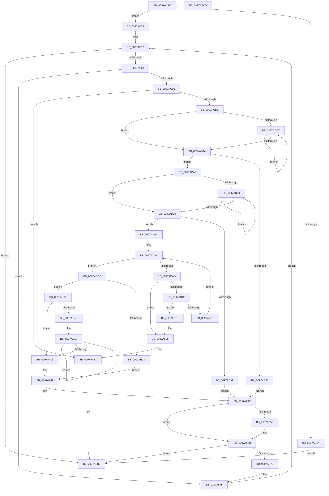

# PopFxLogSocSubsystemMetadata

- RVA: `0x0097AC1C`–`0x0097AFCE` (길이 `946` bytes)
- VA: `0x000000014097AC1C`
- 실행 섹션: `PAGE`
- PDB 이름 있음: `예`; PDB Function 태그: `아니요`
- unwind 정보 RVA: `0x00096890`
- 디코드: `241`개 명령, `946/946` bytes 표시
- 미해석 바이트: `0` (있으면 어셈블리에 `.byte`로 보존)

> 이 문서는 커널 이미지의 기계어와 PDB 기호를 분석해 생성했습니다. 4번과 5번은 함수 원형과 자료형을 바이너리 사용 방식에서 추정한 C 해석이며 원본 소스 복구 결과는 아닙니다.

## 1. Dependencies

- 직접 호출 지점: **11**; 고유 호출 대상: **6**
- 직접 호출자로 확인된 함수: **1**
- RIP 상대 이미지 참조: **1**

### Outgoing calls
- `0x0097AC57` → [PopFxLookupSocSubsystemsByPlatformIdleState](PopFxLookupSocSubsystemsByPlatformIdleState_function_0097ABEC.md) (function, `0x0097ABEC`)
- `0x0097ACAD` → [ExAllocatePool2](../../poolcode/B8/ExAllocatePool2_function_00B820F0.md) (function, `0x00B820F0`)
- `0x0097AD29` → [ExAllocatePool2](../../poolcode/B8/ExAllocatePool2_function_00B820F0.md) (function, `0x00B820F0`)
- `0x0097AD88` → [PopPluginQuerySocSubsystemMetadata](../75/PopPluginQuerySocSubsystemMetadata_function_0075AABC.md) (function, `0x0075AABC`)
- `0x0097ADF6` → [ExAllocatePool2](../../poolcode/B8/ExAllocatePool2_function_00B820F0.md) (function, `0x00B820F0`)
- `0x0097AF37` → [PopDiagTraceSleepStudyBlockerData](../76/PopDiagTraceSleepStudyBlockerData_function_00762F60.md) (function, `0x00762F60`)
- `0x0097AF44` → [ExFreePoolWithTag](../../poolcode/B8/ExFreePoolWithTag_function_00B82870.md) (function, `0x00B82870`)
- `0x0097AF54` → [ExFreePoolWithTag](../../poolcode/B8/ExFreePoolWithTag_function_00B82870.md) (function, `0x00B82870`)
- `0x0097AF66` → [ExFreePoolWithTag](../../poolcode/B8/ExFreePoolWithTag_function_00B82870.md) (function, `0x00B82870`)
- `0x0097AF92` → [PopFxBugCheck](../../text/2B/PopFxBugCheck_function_002BFC6C.md) (function, `0x002BFC6C`)
- `0x0097AFAD` → [PopFxBugCheck](../../text/2B/PopFxBugCheck_function_002BFC6C.md) (function, `0x002BFC6C`)

### Direct callers
- [PopCaptureSleepStudyStatistics](../../text/43/PopCaptureSleepStudyStatistics_function_004399F4.md) at `0x00439F99`

### Static image references
- `0x0097AC3D` → RVA `0x00F0B6B0` (`.data`; read)

## 2. Other-region calls and transfers

- 다른 실행 섹션으로 향하는 call: **8**
  - `0x0097ACAD` → [ExAllocatePool2](../../poolcode/B8/ExAllocatePool2_function_00B820F0.md) (`PAGE` → `POOLCODE`)
  - `0x0097AD29` → [ExAllocatePool2](../../poolcode/B8/ExAllocatePool2_function_00B820F0.md) (`PAGE` → `POOLCODE`)
  - `0x0097ADF6` → [ExAllocatePool2](../../poolcode/B8/ExAllocatePool2_function_00B820F0.md) (`PAGE` → `POOLCODE`)
  - `0x0097AF44` → [ExFreePoolWithTag](../../poolcode/B8/ExFreePoolWithTag_function_00B82870.md) (`PAGE` → `POOLCODE`)
  - `0x0097AF54` → [ExFreePoolWithTag](../../poolcode/B8/ExFreePoolWithTag_function_00B82870.md) (`PAGE` → `POOLCODE`)
  - `0x0097AF66` → [ExFreePoolWithTag](../../poolcode/B8/ExFreePoolWithTag_function_00B82870.md) (`PAGE` → `POOLCODE`)
  - `0x0097AF92` → [PopFxBugCheck](../../text/2B/PopFxBugCheck_function_002BFC6C.md) (`PAGE` → `.text`)
  - `0x0097AFAD` → [PopFxBugCheck](../../text/2B/PopFxBugCheck_function_002BFC6C.md) (`PAGE` → `.text`)
- 별도 외부 분기/꼬리 이동을 확인하지 못했습니다.

## 3. Assembly (complete function range)

```asm
0097AC1C  44 89 44 24 18                  mov dword ptr [rsp + 0x18], r8d
0097AC21  89 54 24 10                     mov dword ptr [rsp + 0x10], edx
0097AC25  48 89 4C 24 08                  mov qword ptr [rsp + 8], rcx
0097AC2A  55                              push rbp
0097AC2B  53                              push rbx
0097AC2C  56                              push rsi
0097AC2D  57                              push rdi
0097AC2E  41 54                           push r12
0097AC30  41 55                           push r13
0097AC32  41 56                           push r14
0097AC34  41 57                           push r15
0097AC36  48 8B EC                        mov rbp, rsp
0097AC39  48 83 EC 38                     sub rsp, 0x38
0097AC3D  48 8B 05 6C 0A 59 00            mov rax, qword ptr [rip + 0x590a6c]
0097AC44  8B CA                           mov ecx, edx
0097AC46  83 65 48 00                     and dword ptr [rbp + 0x48], 0
0097AC4A  8B DA                           mov ebx, edx
0097AC4C  48 89 45 E8                     mov qword ptr [rbp - 0x18], rax
0097AC50  45 33 F6                        xor r14d, r14d
0097AC53  C6 45 58 00                     mov byte ptr [rbp + 0x58], 0
0097AC57  E8 90 FF FF FF                  call 0x14097abec
0097AC5C  4C 8B F8                        mov r15, rax
0097AC5F  48 85 C0                        test rax, rax
0097AC62  75 0B                           jne 0x14097ac6f
0097AC64  41 BE F0 00 00 C0               mov r14d, 0xc00000f0
0097AC6A  E9 4A 03 00 00                  jmp 0x14097afb9
0097AC6F  45 33 ED                        xor r13d, r13d
0097AC72  BE 80 00 00 00                  mov esi, 0x80
0097AC77  45 3B 6F 14                     cmp r13d, dword ptr [r15 + 0x14]
0097AC7B  0F 83 38 03 00 00               jae 0x14097afb9
0097AC81  41 8B C5                        mov eax, r13d
0097AC84  4C 69 E0 58 01 00 00            imul r12, rax, 0x158
0097AC8B  43 8B 44 3C 68                  mov eax, dword ptr [r12 + r15 + 0x68]
0097AC90  89 45 48                        mov dword ptr [rbp + 0x48], eax
0097AC93  85 C0                           test eax, eax
0097AC95  0F 84 DA 02 00 00               je 0x14097af75
0097AC9B  48 69 D0 28 01 00 00            imul rdx, rax, 0x128
0097ACA2  B9 00 01 00 00                  mov ecx, 0x100
0097ACA7  41 B8 50 46 58 4D               mov r8d, 0x4d584650
0097ACAD  E8 3E 74 20 00                  call 0x140b820f0
0097ACB2  48 8B F8                        mov rdi, rax
0097ACB5  48 85 C0                        test rax, rax
0097ACB8  0F 84 F5 02 00 00               je 0x14097afb3
0097ACBE  8B 45 48                        mov eax, dword ptr [rbp + 0x48]
0097ACC1  33 D2                           xor edx, edx
0097ACC3  85 C0                           test eax, eax
0097ACC5  74 4D                           je 0x14097ad14
0097ACC7  8B C2                           mov eax, edx
0097ACC9  FF C2                           inc edx
0097ACCB  48 69 C8 28 01 00 00            imul rcx, rax, 0x128
0097ACD2  48 8D 41 20                     lea rax, [rcx + 0x20]
0097ACD6  66 89 74 39 02                  mov word ptr [rcx + rdi + 2], si
0097ACDB  48 03 C7                        add rax, rdi
0097ACDE  66 89 74 39 12                  mov word ptr [rcx + rdi + 0x12], si
0097ACE3  48 89 44 39 08                  mov qword ptr [rcx + rdi + 8], rax
0097ACE8  48 8D 81 A4 00 00 00            lea rax, [rcx + 0xa4]
0097ACEF  48 03 C7                        add rax, rdi
0097ACF2  C7 84 39 A0 00 00 00 BB AA BB AA  mov dword ptr [rcx + rdi + 0xa0], 0xaabbaabb
0097ACFD  48 89 44 39 18                  mov qword ptr [rcx + rdi + 0x18], rax
0097AD02  C7 84 39 24 01 00 00 BB AA BB AA  mov dword ptr [rcx + rdi + 0x124], 0xaabbaabb
0097AD0D  8B 45 48                        mov eax, dword ptr [rbp + 0x48]
0097AD10  3B D0                           cmp edx, eax
0097AD12  72 B3                           jb 0x14097acc7
0097AD14  8D 04 C5 20 00 00 00            lea eax, [rax*8 + 0x20]
0097AD1B  B9 00 01 00 00                  mov ecx, 0x100
0097AD20  48 63 D0                        movsxd rdx, eax
0097AD23  41 B8 50 46 58 4D               mov r8d, 0x4d584650
0097AD29  E8 C2 73 20 00                  call 0x140b820f0
0097AD2E  48 8B F0                        mov rsi, rax
0097AD31  48 85 C0                        test rax, rax
0097AD34  75 0B                           jne 0x14097ad41
0097AD36  41 BE 9A 00 00 C0               mov r14d, 0xc000009a
0097AD3C  E9 0B 02 00 00                  jmp 0x14097af4c
0097AD41  89 18                           mov dword ptr [rax], ebx
0097AD43  33 D2                           xor edx, edx
0097AD45  4B 8B 44 3C 40                  mov rax, qword ptr [r12 + r15 + 0x40]
0097AD4A  83 66 18 00                     and dword ptr [rsi + 0x18], 0
0097AD4E  48 89 46 08                     mov qword ptr [rsi + 8], rax
0097AD52  49 8D 47 28                     lea rax, [r15 + 0x28]
0097AD56  49 03 C4                        add rax, r12
0097AD59  48 89 46 10                     mov qword ptr [rsi + 0x10], rax
0097AD5D  8B 45 48                        mov eax, dword ptr [rbp + 0x48]
0097AD60  89 46 1C                        mov dword ptr [rsi + 0x1c], eax
0097AD63  39 55 48                        cmp dword ptr [rbp + 0x48], edx
0097AD66  76 18                           jbe 0x14097ad80
0097AD68  8B CA                           mov ecx, edx
0097AD6A  48 69 C1 28 01 00 00            imul rax, rcx, 0x128
0097AD71  48 03 C7                        add rax, rdi
0097AD74  48 89 44 D6 20                  mov qword ptr [rsi + rdx*8 + 0x20], rax
0097AD79  FF C2                           inc edx
0097AD7B  3B 55 48                        cmp edx, dword ptr [rbp + 0x48]
0097AD7E  72 E8                           jb 0x14097ad68
0097AD80  43 8B 54 3C 3C                  mov edx, dword ptr [r12 + r15 + 0x3c]
0097AD85  4C 8B C6                        mov r8, rsi
0097AD88  E8 2F FD DD FF                  call 0x14075aabc
0097AD8D  84 C0                           test al, al
0097AD8F  75 0B                           jne 0x14097ad9c
0097AD91  41 BE E5 00 00 C0               mov r14d, 0xc00000e5
0097AD97  E9 B0 01 00 00                  jmp 0x14097af4c
0097AD9C  44 8B 45 48                     mov r8d, dword ptr [rbp + 0x48]
0097ADA0  33 D2                           xor edx, edx
0097ADA2  41 B9 BB AA BB AA               mov r9d, 0xaabbaabb
0097ADA8  41 3B D0                        cmp edx, r8d
0097ADAB  73 2A                           jae 0x14097add7
0097ADAD  8B C2                           mov eax, edx
0097ADAF  48 69 C8 28 01 00 00            imul rcx, rax, 0x128
0097ADB6  48 03 CF                        add rcx, rdi
0097ADB9  44 39 89 A0 00 00 00            cmp dword ptr [rcx + 0xa0], r9d
0097ADC0  0F 85 D2 01 00 00               jne 0x14097af98
0097ADC6  44 39 89 24 01 00 00            cmp dword ptr [rcx + 0x124], r9d
0097ADCD  0F 85 AA 01 00 00               jne 0x14097af7d
0097ADD3  FF C2                           inc edx
0097ADD5  EB D1                           jmp 0x14097ada8
0097ADD7  42 8D 04 85 03 00 00 00         lea eax, [r8*4 + 3]
0097ADDF  B9 00 01 00 00                  mov ecx, 0x100
0097ADE4  41 03 C0                        add eax, r8d
0097ADE7  41 B8 50 46 58 4D               mov r8d, 0x4d584650
0097ADED  8B D0                           mov edx, eax
0097ADEF  48 C1 E2 04                     shl rdx, 4
0097ADF3  89 45 60                        mov dword ptr [rbp + 0x60], eax
0097ADF6  E8 F5 72 20 00                  call 0x140b820f0
0097ADFB  48 8B D8                        mov rbx, rax
0097ADFE  48 85 C0                        test rax, rax
0097AE01  75 0B                           jne 0x14097ae0e
0097AE03  41 BE 9A 00 00 C0               mov r14d, 0xc000009a
0097AE09  E9 3B 01 00 00                  jmp 0x14097af49
0097AE0E  8A 45 E8                        mov al, byte ptr [rbp - 0x18]
0097AE11  45 33 D2                        xor r10d, r10d
0097AE14  88 45 58                        mov byte ptr [rbp + 0x58], al
0097AE17  41 B9 02 00 00 00               mov r9d, 2
0097AE1D  83 63 0C 00                     and dword ptr [rbx + 0xc], 0
0097AE21  48 8D 45 58                     lea rax, [rbp + 0x58]
0097AE25  48 89 03                        mov qword ptr [rbx], rax
0097AE28  48 8D 45 48                     lea rax, [rbp + 0x48]
0097AE2C  C7 43 08 01 00 00 00            mov dword ptr [rbx + 8], 1
0097AE33  83 63 1C 00                     and dword ptr [rbx + 0x1c], 0
0097AE37  48 89 43 10                     mov qword ptr [rbx + 0x10], rax
0097AE3B  C7 43 18 04 00 00 00            mov dword ptr [rbx + 0x18], 4
0097AE42  44 39 55 48                     cmp dword ptr [rbp + 0x48], r10d
0097AE46  0F 86 CA 00 00 00               jbe 0x14097af16
0097AE4C  4D 8D 5F 48                     lea r11, [r15 + 0x48]
0097AE50  4D 03 DC                        add r11, r12
0097AE53  41 8B C1                        mov eax, r9d
0097AE56  45 33 E4                        xor r12d, r12d
0097AE59  48 03 C0                        add rax, rax
0097AE5C  41 FF C1                        inc r9d
0097AE5F  83 64 C3 0C 00                  and dword ptr [rbx + rax*8 + 0xc], 0
0097AE64  4C 89 1C C3                     mov qword ptr [rbx + rax*8], r11
0097AE68  C7 44 C3 08 10 00 00 00         mov dword ptr [rbx + rax*8 + 8], 0x10
0097AE70  41 8B C2                        mov eax, r10d
0097AE73  41 FF C2                        inc r10d
0097AE76  4C 69 C0 28 01 00 00            imul r8, rax, 0x128
0097AE7D  4C 03 C7                        add r8, rdi
0097AE80  41 0F B7 00                     movzx eax, word ptr [r8]
0097AE84  49 8D 88 A0 00 00 00            lea rcx, [r8 + 0xa0]
0097AE8B  D1 E8                           shr eax, 1
0097AE8D  89 01                           mov dword ptr [rcx], eax
0097AE8F  41 8B C1                        mov eax, r9d
0097AE92  41 FF C1                        inc r9d
0097AE95  48 03 C0                        add rax, rax
0097AE98  41 8B D1                        mov edx, r9d
0097AE9B  48 03 D2                        add rdx, rdx
0097AE9E  41 FF C1                        inc r9d
0097AEA1  83 64 C3 0C 00                  and dword ptr [rbx + rax*8 + 0xc], 0
0097AEA6  48 89 0C C3                     mov qword ptr [rbx + rax*8], rcx
0097AEAA  C7 44 C3 08 04 00 00 00         mov dword ptr [rbx + rax*8 + 8], 4
0097AEB2  49 8B 40 08                     mov rax, qword ptr [r8 + 8]
0097AEB6  41 0F B7 08                     movzx ecx, word ptr [r8]
0097AEBA  48 89 04 D3                     mov qword ptr [rbx + rdx*8], rax
0097AEBE  89 4C D3 08                     mov dword ptr [rbx + rdx*8 + 8], ecx
0097AEC2  49 8D 88 24 01 00 00            lea rcx, [r8 + 0x124]
0097AEC9  44 89 64 D3 0C                  mov dword ptr [rbx + rdx*8 + 0xc], r12d
0097AECE  41 0F B7 40 10                  movzx eax, word ptr [r8 + 0x10]
0097AED3  D1 E8                           shr eax, 1
0097AED5  89 01                           mov dword ptr [rcx], eax
0097AED7  41 8B C1                        mov eax, r9d
0097AEDA  41 FF C1                        inc r9d
0097AEDD  48 03 C0                        add rax, rax
0097AEE0  41 8B D1                        mov edx, r9d
0097AEE3  48 03 D2                        add rdx, rdx
0097AEE6  41 FF C1                        inc r9d
0097AEE9  48 89 0C C3                     mov qword ptr [rbx + rax*8], rcx
0097AEED  48 C7 44 C3 08 04 00 00 00      mov qword ptr [rbx + rax*8 + 8], 4
0097AEF6  41 0F B7 48 10                  movzx ecx, word ptr [r8 + 0x10]
0097AEFB  49 8B 40 18                     mov rax, qword ptr [r8 + 0x18]
0097AEFF  48 89 04 D3                     mov qword ptr [rbx + rdx*8], rax
0097AF03  89 4C D3 08                     mov dword ptr [rbx + rdx*8 + 8], ecx
0097AF07  44 89 64 D3 0C                  mov dword ptr [rbx + rdx*8 + 0xc], r12d
0097AF0C  44 3B 55 48                     cmp r10d, dword ptr [rbp + 0x48]
0097AF10  0F 82 3D FF FF FF               jb 0x14097ae53
0097AF16  48 8D 4D E8                     lea rcx, [rbp - 0x18]
0097AF1A  41 8B C1                        mov eax, r9d
0097AF1D  48 03 C0                        add rax, rax
0097AF20  48 8B D3                        mov rdx, rbx
0097AF23  83 64 C3 0C 00                  and dword ptr [rbx + rax*8 + 0xc], 0
0097AF28  48 89 0C C3                     mov qword ptr [rbx + rax*8], rcx
0097AF2C  8B 4D 60                        mov ecx, dword ptr [rbp + 0x60]
0097AF2F  C7 44 C3 08 08 00 00 00         mov dword ptr [rbx + rax*8 + 8], 8
0097AF37  E8 24 80 DE FF                  call 0x140762f60
0097AF3C  BA 50 46 58 4D                  mov edx, 0x4d584650
0097AF41  48 8B CB                        mov rcx, rbx
0097AF44  E8 27 79 20 00                  call 0x140b82870
0097AF49  8B 5D 50                        mov ebx, dword ptr [rbp + 0x50]
0097AF4C  BA 50 46 58 4D                  mov edx, 0x4d584650
0097AF51  48 8B CF                        mov rcx, rdi
0097AF54  E8 17 79 20 00                  call 0x140b82870
0097AF59  48 85 F6                        test rsi, rsi
0097AF5C  74 0D                           je 0x14097af6b
0097AF5E  BA 50 46 58 4D                  mov edx, 0x4d584650
0097AF63  48 8B CE                        mov rcx, rsi
0097AF66  E8 05 79 20 00                  call 0x140b82870
0097AF6B  45 85 F6                        test r14d, r14d
0097AF6E  78 49                           js 0x14097afb9
0097AF70  BE 80 00 00 00                  mov esi, 0x80
0097AF75  41 FF C5                        inc r13d
0097AF78  E9 FA FC FF FF                  jmp 0x14097ac77
0097AF7D  44 0F B7 49 12                  movzx r9d, word ptr [rcx + 0x12]
0097AF82  BA 28 00 00 00                  mov edx, 0x28
0097AF87  B9 06 07 00 00                  mov ecx, 0x706
0097AF8C  41 B8 75 6C 61 56               mov r8d, 0x56616c75
0097AF92  E8 D5 4C 94 FF                  call 0x1402bfc6c
0097AF97  CC                              int3
0097AF98  44 0F B7 49 02                  movzx r9d, word ptr [rcx + 2]
0097AF9D  BA 28 00 00 00                  mov edx, 0x28
0097AFA2  B9 06 07 00 00                  mov ecx, 0x706
0097AFA7  41 B8 20 79 65 4B               mov r8d, 0x4b657920
0097AFAD  E8 BA 4C 94 FF                  call 0x1402bfc6c
0097AFB2  CC                              int3
0097AFB3  41 BE 9A 00 00 C0               mov r14d, 0xc000009a
0097AFB9  41 8B C6                        mov eax, r14d
0097AFBC  48 83 C4 38                     add rsp, 0x38
0097AFC0  41 5F                           pop r15
0097AFC2  41 5E                           pop r14
0097AFC4  41 5D                           pop r13
0097AFC6  41 5C                           pop r12
0097AFC8  5F                              pop rdi
0097AFC9  5E                              pop rsi
0097AFCA  5B                              pop rbx
0097AFCB  5D                              pop rbp
0097AFCC  C3                              ret
0097AFCD  CC                              int3
```

## 4. C-style interpretation (structured pseudocode)

```c
__int64 __fastcall PopFxLogSocSubsystemMetadata(__int64 a1, int a2, int a3)
{
    __int64 result;
    __int64 v_r10;
    __int64 v_r11;
    __int64 v_r12;
    __int64 v_r13;
    __int64 v_r14;
    __int64 v_rsp;
    unsigned __int64 v_stack_m58;
    unsigned int v_stack_p10;
    unsigned int v_stack_p18;
    unsigned int v_stack_p20;
    unsigned __int64 v_stack_p8;

    v_stack_p18 = a3;
    v_stack_p10 = a2;
    v_stack_p8 = a1;
    v_rsp = (v_rsp) - (56);
    v_stack_m58 = *(unsigned __int64 *)(v_rip + 5835372);
    v_r14 = 0;
    v_stack_p18 = 0;
    result = PopFxLookupSocSubsystemsByPlatformIdleState((unsigned int)(a2), a2, a3, a4);
    if (result != 0) goto loc_0097AC6F;
    goto loc_0097AFB9;
loc_0097AC6F:
    v_r13 = 0;
loc_0097AC77:
    if (0 >= (*(unsigned int *)(result + 20))) goto loc_0097AFB9;
    v_r12 = (v_r12) * (0);
    v_stack_p8 = (unsigned int)((unsigned int)(*(unsigned int *)(v_r12 + result * 1 + 104)));
    if ((unsigned int)((unsigned int)(*(unsigned int *)(v_r12 + result * 1 + 104))) == 0) goto loc_0097AF75;
    a2 = (a2) * ((unsigned int)(*(unsigned int *)(v_r12 + result * 1 + 104)));
    result = ExAllocatePool2(256, a2, (unsigned int)(0x4D584650ULL), a4);
    if (result == 0) goto loc_0097AFB3;
    a2 = 0;
    if ((unsigned int)((unsigned int)(v_stack_p8)) == 0) goto loc_0097AD14;
loc_0097ACC7:
    a2 = (unsigned int)((a2) + 1);
    a1 = (256) * (0);
    *(unsigned __int16 *)(a1 + result * 1 + 2) = 128;
    result = (a1 + 32) + (result);
    *(unsigned __int16 *)(a1 + result * 1 + 18) = 128;
    *(unsigned __int64 *)(a1 + result * 1 + 8) = result;
    result = (a1 + 164) + (result);
    *(unsigned int *)(a1 + result * 1 + 160) = 0xAABBAABBULL;
    *(unsigned __int64 *)(a1 + result * 1 + 24) = result;
    *(unsigned int *)(a1 + result * 1 + 292) = 0xAABBAABBULL;
    if (a2 < ((unsigned int)((unsigned int)(v_stack_p8)))) goto loc_0097ACC7;
loc_0097AD14:
    result = ExAllocatePool2(256, (int)((unsigned int)((unsigned int)(v_stack_p8) * 8 + 32)), (unsigned int)(0x4D584650ULL), a4);
    if (result != 0) goto loc_0097AD41;
    goto loc_0097AF4C;
loc_0097AD41:
    *(unsigned int *)(result) = (unsigned int)((unsigned int)(a2));
    a2 = 0;
    *(unsigned __int64 *)(result + 8) = *(unsigned __int64 *)(v_r12 + result * 1 + 64);
    result = (result + 40) + (v_r12);
    *(unsigned __int64 *)(result + 16) = result;
    *(unsigned int *)(result + 28) = (unsigned int)((unsigned int)(v_stack_p8));
    if (v_stack_p8 <= 0) goto loc_0097AD80;
loc_0097AD68:
    result = ((unsigned int)(v_stack_p8)) * (0);
    result = (result) + (result);
    *(unsigned __int64 *)(result + a2 * 8 + 32) = result;
    a2 = (unsigned int)((a2) + 1);
    if (a2 < v_stack_p8) goto loc_0097AD68;
loc_0097AD80:
    result = PopPluginQuerySocSubsystemMetadata(0, (unsigned int)(*(unsigned int *)(v_r12 + result * 1 + 60)), result, a4);
    if ((unsigned __int8)(result) != 0) goto loc_0097AD9C;
    goto loc_0097AF4C;
loc_0097AD9C:
    a2 = 0;
loc_0097ADA8:
    if (0 >= ((unsigned int)((unsigned int)(v_stack_p8)))) goto loc_0097ADD7;
    a1 = (0) * (0);
    a1 = (a1) + (result);
    if ((*(unsigned int *)(a1 + 160)) != ((unsigned int)((unsigned int)(0xAABBAABBULL)))) goto loc_0097AF98;
    if ((*(unsigned int *)(a1 + 292)) != ((unsigned int)((unsigned int)(0xAABBAABBULL)))) goto loc_0097AF7D;
    a2 = (unsigned int)((a2) + 1);
    goto loc_0097ADA8;
loc_0097ADD7:
    result = (unsigned int)(((unsigned int)(v_stack_p8) * 4 + 3) + ((unsigned int)((unsigned int)(v_stack_p8))));
    a2 = ((unsigned int)((unsigned int)(result))) << (4);
    v_stack_p20 = (unsigned int)(result);
    result = ExAllocatePool2(256, a2, (unsigned int)(0x4D584650ULL), (unsigned int)(0xAABBAABBULL));
    if (result != 0) goto loc_0097AE0E;
    goto loc_0097AF49;
loc_0097AE0E:
    v_r10 = 0;
    v_stack_p18 = (unsigned __int8)(v_stack_m58);
    *(unsigned __int64 *)(result) = v_stack_p18;
    *(unsigned int *)(result + 8) = 1;
    *(unsigned __int64 *)(result + 16) = v_stack_p8;
    *(unsigned int *)(result + 24) = 4;
    if (v_stack_p8 <= 0) goto loc_0097AF16;
    v_r11 = (result + 72) + (v_r12);
loc_0097AE53:
    v_r12 = 0;
    result = (2) + (2);
    a4 = (unsigned int)((2) + 1);
    *(unsigned __int64 *)(result + result * 8) = v_r11;
    *(unsigned int *)(result + result * 8 + 8) = 16;
    v_r10 = (unsigned int)((v_r10) + 1);
    a3 = ((unsigned int)(0x4D584650ULL)) * (0);
    a3 = (a3) + (result);
    result = (unsigned int)((*(unsigned __int16 *)(a3)) >> (1));
    *(unsigned int *)(a3 + 160) = (unsigned int)(result);
    a4 = (unsigned int)((a4) + 1);
    result = ((unsigned int)((unsigned int)(a4))) + ((unsigned int)((unsigned int)(a4)));
    a2 = ((unsigned int)((unsigned int)(a4))) + ((unsigned int)((unsigned int)(a4)));
    a4 = (unsigned int)((a4) + 1);
    *(unsigned __int64 *)(result + result * 8) = a3 + 160;
    *(unsigned int *)(result + result * 8 + 8) = 4;
    *(unsigned __int64 *)(result + a2 * 8) = *(unsigned __int64 *)(a3 + 8);
    *(unsigned int *)(result + a2 * 8 + 8) = (unsigned int)(*(unsigned __int16 *)(a3));
    *(unsigned int *)(result + a2 * 8 + 12) = 0;
    result = (unsigned int)((*(unsigned __int16 *)(a3 + 16)) >> (1));
    *(unsigned int *)(a3 + 292) = (unsigned int)(result);
    a4 = (unsigned int)((a4) + 1);
    result = ((unsigned int)((unsigned int)(a4))) + ((unsigned int)((unsigned int)(a4)));
    a2 = ((unsigned int)((unsigned int)(a4))) + ((unsigned int)((unsigned int)(a4)));
    a4 = (unsigned int)((a4) + 1);
    *(unsigned __int64 *)(result + result * 8) = a3 + 292;
    *(unsigned __int64 *)(result + result * 8 + 8) = 4;
    *(unsigned __int64 *)(result + a2 * 8) = *(unsigned __int64 *)(a3 + 24);
    *(unsigned int *)(result + a2 * 8 + 8) = (unsigned int)(*(unsigned __int16 *)(a3 + 16));
    *(unsigned int *)(result + a2 * 8 + 12) = 0;
    if (((unsigned int)(v_r10)) < v_stack_p8) goto loc_0097AE53;
loc_0097AF16:
    result = ((unsigned int)((unsigned int)(a4))) + ((unsigned int)((unsigned int)(a4)));
    *(unsigned __int64 *)(result + result * 8) = v_stack_m58;
    *(unsigned int *)(result + result * 8 + 8) = 8;
    result = PopDiagTraceSleepStudyBlockerData((unsigned int)(v_stack_p20), result, a3, a4);
    result = ExFreePoolWithTag(result, (unsigned int)(0x4D584650ULL), a3, a4);
loc_0097AF49:
loc_0097AF4C:
    result = ExFreePoolWithTag(result, (unsigned int)(0x4D584650ULL), a3, a4);
    if (result != 0) {
        a2 = 0x4D584650ULL;
        a1 = result;
        result = ExFreePoolWithTag(a1, a2, a3, a4);
    }
    if (sign_flag) goto loc_0097AFB9;
loc_0097AF75:
    v_r13 = (unsigned int)((v_r13) + 1);
    goto loc_0097AC77;
loc_0097AF7D:
    result = PopFxBugCheck((unsigned int)(0x706ULL), 40, (unsigned int)(0x56616C75ULL), *(unsigned __int16 *)(a1 + 18));
loc_0097AF98:
    result = PopFxBugCheck((unsigned int)(0x706ULL), 40, (unsigned int)(0x4B657920ULL), *(unsigned __int16 *)((unsigned int)(0x706ULL) + 2));
loc_0097AFB3:
loc_0097AFB9:
    v_rsp = (v_rsp) + (56);
    return (unsigned int)((unsigned int)((unsigned int)(0xC000009AULL)));
}
```

## 5. (Beta) C Style

```c
int64_t PopFxLogSocSubsystemMetadata(int64_t Arg1, int32_t Arg2, int32_t Arg3)
{
    int64_t result;
    int64_t local_r10;
    int64_t local_r11;
    int64_t local_r12;
    int64_t local_r13;
    int64_t local_r14;
    int64_t local_rsp;
    uint64_t v_stack_m58;
    uint32_t v_stack_p10;
    uint32_t v_stack_p18;
    uint32_t v_stack_p20;
    uint64_t v_stack_p8;

    v_stack_p18 = Arg3;
    v_stack_p10 = Arg2;
    v_stack_p8 = Arg1;
    local_rsp = (local_rsp) - (56);
    v_stack_m58 = *(uint64_t *)(v_rip + 0x590A6C);
    local_r14 = 0;
    v_stack_p18 = 0;
    result = PopFxLookupSocSubsystemsByPlatformIdleState((uint32_t)(Arg2), Arg2, Arg3, a4);
    if (result != 0) goto loc_0097AC6F;
    goto loc_0097AFB9;
loc_0097AC6F:
    local_r13 = 0;
loc_0097AC77:
    if (0 >= (*(uint32_t *)(result + 0x14))) goto loc_0097AFB9;
    local_r12 = (local_r12) * (0);
    v_stack_p8 = (uint32_t)((uint32_t)(*(uint32_t *)(local_r12 + result * 1 + 0x68)));
    if ((uint32_t)((uint32_t)(*(uint32_t *)(local_r12 + result * 1 + 0x68))) == 0) goto loc_0097AF75;
    Arg2 = (Arg2) * ((uint32_t)(*(uint32_t *)(local_r12 + result * 1 + 0x68)));
    result = ExAllocatePool2(256, Arg2, (uint32_t)(0x4D584650ULL), a4);
    if (result == 0) goto loc_0097AFB3;
    Arg2 = 0;
    if ((uint32_t)((uint32_t)(v_stack_p8)) == 0) goto loc_0097AD14;
loc_0097ACC7:
    Arg2 = (uint32_t)((Arg2) + 1);
    Arg1 = (256) * (0);
    *(uint16_t *)(Arg1 + result * 1 + 0x2) = 128;
    result = (Arg1 + 32) + (result);
    *(uint16_t *)(Arg1 + result * 1 + 0x12) = 128;
    *(uint64_t *)(Arg1 + result * 1 + 0x8) = result;
    result = (Arg1 + 164) + (result);
    *(uint32_t *)(Arg1 + result * 1 + 0xA0) = 0xAABBAABBULL;
    *(uint64_t *)(Arg1 + result * 1 + 0x18) = result;
    *(uint32_t *)(Arg1 + result * 1 + 0x124) = 0xAABBAABBULL;
    if (Arg2 < ((uint32_t)((uint32_t)(v_stack_p8)))) goto loc_0097ACC7;
loc_0097AD14:
    result = ExAllocatePool2(256, (int32_t)((uint32_t)((uint32_t)(v_stack_p8) * 8 + 32)), (uint32_t)(0x4D584650ULL), a4);
    if (result != 0) goto loc_0097AD41;
    goto loc_0097AF4C;
loc_0097AD41:
    *(uint32_t *)(result) = (uint32_t)((uint32_t)(Arg2));
    Arg2 = 0;
    *(uint64_t *)(result + 0x8) = *(uint64_t *)(local_r12 + result * 1 + 0x40);
    result = (result + 40) + (local_r12);
    *(uint64_t *)(result + 0x10) = result;
    *(uint32_t *)(result + 0x1C) = (uint32_t)((uint32_t)(v_stack_p8));
    if (v_stack_p8 <= 0) goto loc_0097AD80;
loc_0097AD68:
    result = ((uint32_t)(v_stack_p8)) * (0);
    result = (result) + (result);
    *(uint64_t *)(result + Arg2 * 8 + 0x20) = result;
    Arg2 = (uint32_t)((Arg2) + 1);
    if (Arg2 < v_stack_p8) goto loc_0097AD68;
loc_0097AD80:
    result = PopPluginQuerySocSubsystemMetadata(0, (uint32_t)(*(uint32_t *)(local_r12 + result * 1 + 0x3C)), result, a4);
    if ((uint8_t)(result) != 0) goto loc_0097AD9C;
    goto loc_0097AF4C;
loc_0097AD9C:
    Arg2 = 0;
loc_0097ADA8:
    if (0 >= ((uint32_t)((uint32_t)(v_stack_p8)))) goto loc_0097ADD7;
    Arg1 = (0) * (0);
    Arg1 = (Arg1) + (result);
    if ((*(uint32_t *)(Arg1 + 0xA0)) != ((uint32_t)((uint32_t)(0xAABBAABBULL)))) goto loc_0097AF98;
    if ((*(uint32_t *)(Arg1 + 0x124)) != ((uint32_t)((uint32_t)(0xAABBAABBULL)))) goto loc_0097AF7D;
    Arg2 = (uint32_t)((Arg2) + 1);
    goto loc_0097ADA8;
loc_0097ADD7:
    result = (uint32_t)(((uint32_t)(v_stack_p8) * 4 + 3) + ((uint32_t)((uint32_t)(v_stack_p8))));
    Arg2 = ((uint32_t)((uint32_t)(result))) << (4);
    v_stack_p20 = (uint32_t)(result);
    result = ExAllocatePool2(256, Arg2, (uint32_t)(0x4D584650ULL), (uint32_t)(0xAABBAABBULL));
    if (result != 0) goto loc_0097AE0E;
    goto loc_0097AF49;
loc_0097AE0E:
    local_r10 = 0;
    v_stack_p18 = (uint8_t)(v_stack_m58);
    *(uint64_t *)(result) = v_stack_p18;
    *(uint32_t *)(result + 0x8) = 1;
    *(uint64_t *)(result + 0x10) = v_stack_p8;
    *(uint32_t *)(result + 0x18) = 4;
    if (v_stack_p8 <= 0) goto loc_0097AF16;
    local_r11 = (result + 72) + (local_r12);
loc_0097AE53:
    local_r12 = 0;
    result = (2) + (2);
    a4 = (uint32_t)((2) + 1);
    *(uint64_t *)(result + result * 8) = local_r11;
    *(uint32_t *)(result + result * 8 + 0x8) = 16;
    local_r10 = (uint32_t)((local_r10) + 1);
    Arg3 = ((uint32_t)(0x4D584650ULL)) * (0);
    Arg3 = (Arg3) + (result);
    result = (uint32_t)((*(uint16_t *)(Arg3)) >> (1));
    *(uint32_t *)(Arg3 + 0xA0) = (uint32_t)(result);
    a4 = (uint32_t)((a4) + 1);
    result = ((uint32_t)((uint32_t)(a4))) + ((uint32_t)((uint32_t)(a4)));
    Arg2 = ((uint32_t)((uint32_t)(a4))) + ((uint32_t)((uint32_t)(a4)));
    a4 = (uint32_t)((a4) + 1);
    *(uint64_t *)(result + result * 8) = Arg3 + 160;
    *(uint32_t *)(result + result * 8 + 0x8) = 4;
    *(uint64_t *)(result + Arg2 * 8) = *(uint64_t *)(Arg3 + 0x8);
    *(uint32_t *)(result + Arg2 * 8 + 0x8) = (uint32_t)(*(uint16_t *)(Arg3));
    *(uint32_t *)(result + Arg2 * 8 + 0xC) = 0;
    result = (uint32_t)((*(uint16_t *)(Arg3 + 0x10)) >> (1));
    *(uint32_t *)(Arg3 + 0x124) = (uint32_t)(result);
    a4 = (uint32_t)((a4) + 1);
    result = ((uint32_t)((uint32_t)(a4))) + ((uint32_t)((uint32_t)(a4)));
    Arg2 = ((uint32_t)((uint32_t)(a4))) + ((uint32_t)((uint32_t)(a4)));
    a4 = (uint32_t)((a4) + 1);
    *(uint64_t *)(result + result * 8) = Arg3 + 292;
    *(uint64_t *)(result + result * 8 + 0x8) = 4;
    *(uint64_t *)(result + Arg2 * 8) = *(uint64_t *)(Arg3 + 0x18);
    *(uint32_t *)(result + Arg2 * 8 + 0x8) = (uint32_t)(*(uint16_t *)(Arg3 + 0x10));
    *(uint32_t *)(result + Arg2 * 8 + 0xC) = 0;
    if (((uint32_t)(local_r10)) < v_stack_p8) goto loc_0097AE53;
loc_0097AF16:
    result = ((uint32_t)((uint32_t)(a4))) + ((uint32_t)((uint32_t)(a4)));
    *(uint64_t *)(result + result * 8) = v_stack_m58;
    *(uint32_t *)(result + result * 8 + 0x8) = 8;
    result = PopDiagTraceSleepStudyBlockerData((uint32_t)(v_stack_p20), result, Arg3, a4);
    result = ExFreePoolWithTag(result, (uint32_t)(0x4D584650ULL), Arg3, a4);
loc_0097AF49:
loc_0097AF4C:
    result = ExFreePoolWithTag(result, (uint32_t)(0x4D584650ULL), Arg3, a4);
    if (result != 0) {
        Arg2 = 0x4D584650ULL;
        Arg1 = result;
        result = ExFreePoolWithTag(Arg1, Arg2, Arg3, a4);
    }
    if (sign_flag) goto loc_0097AFB9;
loc_0097AF75:
    local_r13 = (uint32_t)((local_r13) + 1);
    goto loc_0097AC77;
loc_0097AF7D:
    result = PopFxBugCheck((uint32_t)(0x706ULL), 40, (uint32_t)(0x56616C75ULL), *(uint16_t *)(Arg1 + 0x12));
loc_0097AF98:
    result = PopFxBugCheck((uint32_t)(0x706ULL), 40, (uint32_t)(0x4B657920ULL), *(uint16_t *)((uint32_t)(0x706ULL) + 0x2));
loc_0097AFB3:
loc_0097AFB9:
    local_rsp = (local_rsp) + (56);
    return (uint32_t)((uint32_t)((uint32_t)(0xC000009AULL)));
}
```

## 6. Execution-region graph

[열기: 2D/3D 그래프와 함수 탐색 컨트롤 패널](../../../control-panel.html?section=page&rva=0x0097AC1C&view=graph)

- 2D 그래프는 위에서 아래로 흐르고, 3D 그래프는 빈 공간을 드래그해 회전합니다. Shift+드래그는 이동, 휠은 확대·축소, 함수 노드 선택은 대상 보고서 이동입니다.

### Static fallback


