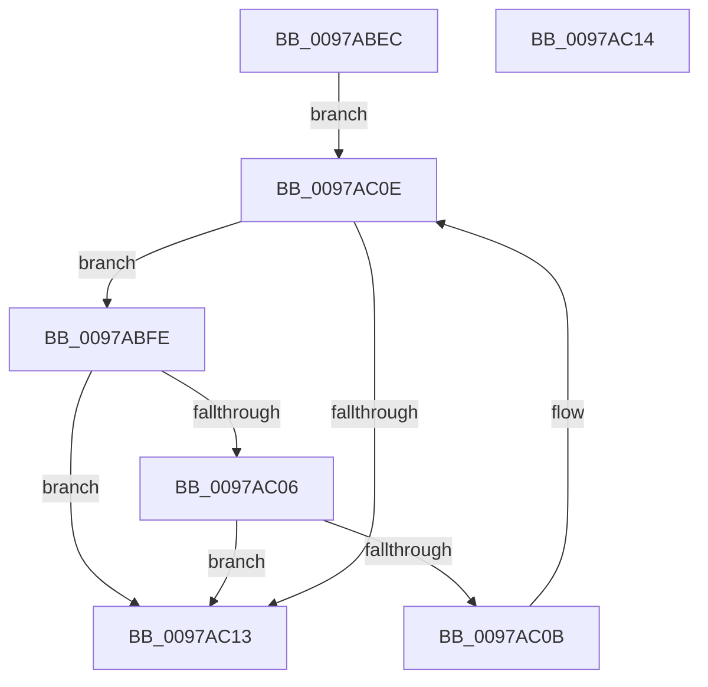

# PopFxLookupSocSubsystemsByPlatformIdleState

- RVA: `0x0097ABEC`–`0x0097AC15` (길이 `41` bytes)
- VA: `0x000000014097ABEC`
- 실행 섹션: `PAGE`
- PDB 이름 있음: `예`; PDB Function 태그: `아니요`
- unwind 정보 RVA: `0x000DB714`
- 디코드: `14`개 명령, `41/41` bytes 표시
- 미해석 바이트: `0` (있으면 어셈블리에 `.byte`로 보존)

> 이 문서는 커널 이미지의 기계어와 PDB 기호를 분석해 생성했습니다. 4번과 5번은 함수 원형과 자료형을 바이너리 사용 방식에서 추정한 C 해석이며 원본 소스 복구 결과는 아닙니다.

## 1. Dependencies

- 직접 호출 지점: **0**; 고유 호출 대상: **0**
- 직접 호출자로 확인된 함수: **5**
- RIP 상대 이미지 참조: **1**

### Outgoing calls
- 직접 디코드된 call 명령이 없습니다.

### Direct callers
- [PopCaptureSleepStudyStatistics](../../text/43/PopCaptureSleepStudyStatistics_function_004399F4.md) at `0x00439E5B`
- [PopCaptureSleepStudyStatistics](../../text/43/PopCaptureSleepStudyStatistics_function_004399F4.md) at `0x00439F7E`
- [PopFxInitializeSocSubsystemStaticInfo](../75/PopFxInitializeSocSubsystemStaticInfo_function_00758EC8.md) at `0x00758FA0`
- [PopFxResetSocSubsystemAccounting](../75/PopFxResetSocSubsystemAccounting_function_0075A6A0.md) at `0x0075A6A6`
- [PopFxLogSocSubsystemBlockingTimes](PopFxLogSocSubsystemBlockingTimes_function_0097A4EC.md) at `0x0097A543`
- [PopFxLogSocSubsystemMetadata](PopFxLogSocSubsystemMetadata_function_0097AC1C.md) at `0x0097AC57`

### Static image references
- `0x0097ABEC` → RVA `0x00F0E540` (`.data`; read)

## 2. Other-region calls and transfers

- 다른 실행 섹션으로 향하는 call: **0**
- 별도 외부 분기/꼬리 이동을 확인하지 못했습니다.

## 3. Assembly (complete function range)

```asm
0097ABEC  48 8B 15 4D 39 59 00            mov rdx, qword ptr [rip + 0x59394d]
0097ABF3  4C 8D 05 46 39 59 00            lea r8, [rip + 0x593946]
0097ABFA  33 C0                           xor eax, eax
0097ABFC  EB 10                           jmp 0x14097ac0e
0097ABFE  48 8B C2                        mov rax, rdx
0097AC01  48 85 D2                        test rdx, rdx
0097AC04  74 0D                           je 0x14097ac13
0097AC06  39 4A 10                        cmp dword ptr [rdx + 0x10], ecx
0097AC09  74 08                           je 0x14097ac13
0097AC0B  48 8B 12                        mov rdx, qword ptr [rdx]
0097AC0E  49 3B D0                        cmp rdx, r8
0097AC11  75 EB                           jne 0x14097abfe
0097AC13  C3                              ret
0097AC14  CC                              int3
```

## 4. C-style interpretation (structured pseudocode)

```c
__int64 __fastcall PopFxLookupSocSubsystemsByPlatformIdleState(int a1)
{
    __int64 result;

    result = 0;
    goto loc_0097AC0E;
loc_0097ABFE:
    if (*(unsigned __int64 *)(v_rip + 5847373) == 0) goto loc_0097AC13;
    if ((*(unsigned int *)(*(unsigned __int64 *)(v_rip + 5847373) + 16)) == a1) goto loc_0097AC13;
loc_0097AC0E:
    if ((*(unsigned __int64 *)(*(unsigned __int64 *)(v_rip + 5847373))) != (v_rip + 5847366)) goto loc_0097ABFE;
loc_0097AC13:
    return *(unsigned __int64 *)(v_rip + 5847373);
}
```

## 5. (Beta) C Style

```c
int64_t PopFxLookupSocSubsystemsByPlatformIdleState(int32_t Arg1)
{
    int64_t result;

    result = 0;
    goto loc_0097AC0E;
loc_0097ABFE:
    if (*(uint64_t *)(v_rip + 0x59394D) == 0) goto loc_0097AC13;
    if ((*(uint32_t *)(*(uint64_t *)(v_rip + 0x59394D) + 0x10)) == Arg1) goto loc_0097AC13;
loc_0097AC0E:
    if ((*(uint64_t *)(*(uint64_t *)(v_rip + 0x59394D))) != (v_rip + 5847366)) goto loc_0097ABFE;
loc_0097AC13:
    return *(uint64_t *)(v_rip + 0x59394D);
}
```

## 6. Execution-region graph

[열기: 2D/3D 그래프와 함수 탐색 컨트롤 패널](../../../control-panel.html?section=page&rva=0x0097ABEC&view=graph)

- 2D 그래프는 위에서 아래로 흐르고, 3D 그래프는 빈 공간을 드래그해 회전합니다. Shift+드래그는 이동, 휠은 확대·축소, 함수 노드 선택은 대상 보고서 이동입니다.

### Static fallback


