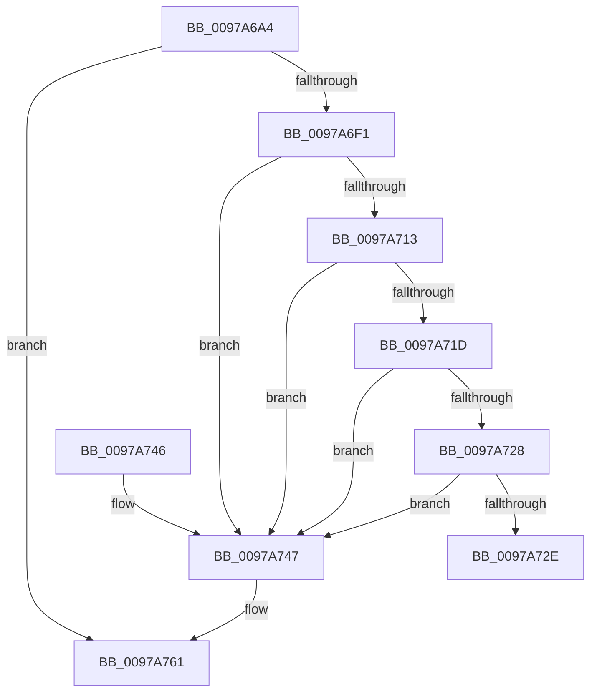

# PopPluginQuerySocSubsystemBlockingTime

- RVA: `0x0097A6A4`–`0x0097A77A` (길이 `214` bytes)
- VA: `0x000000014097A6A4`
- 실행 섹션: `PAGE`
- PDB 이름 있음: `예`; PDB Function 태그: `아니요`
- unwind 정보 RVA: `0x000967FC`
- 디코드: `58`개 명령, `214/214` bytes 표시
- 미해석 바이트: `0` (있으면 어셈블리에 `.byte`로 보존)

> 이 문서는 커널 이미지의 기계어와 PDB 기호를 분석해 생성했습니다. 4번과 5번은 함수 원형과 자료형을 바이너리 사용 방식에서 추정한 C 해석이며 원본 소스 복구 결과는 아닙니다.

## 1. Dependencies

- 직접 호출 지점: **4**; 고유 호출 대상: **3**
- 직접 호출자로 확인된 함수: **1**
- RIP 상대 이미지 참조: **1**

### Outgoing calls
- `0x0097A6E5` → [guard_dispatch_icall](../../text/6B/guard_dispatch_icall_function_006BAAD0.md) (function, `0x006BAAD0`)
- `0x0097A6FF` → [RtlHashUnicodeString](RtlHashUnicodeString_function_0097A780.md) (function, `0x0097A780`)
- `0x0097A75B` → [PopFxBugCheck](../../text/2B/PopFxBugCheck_function_002BFC6C.md) (function, `0x002BFC6C`)
- `0x0097A774` → [PopFxBugCheck](../../text/2B/PopFxBugCheck_function_002BFC6C.md) (function, `0x002BFC6C`)

### Direct callers
- [PopFxLogSocSubsystemBlockingTimes](PopFxLogSocSubsystemBlockingTimes_function_0097A4EC.md) at `0x0097A59A`

### Static image references
- `0x0097A6C9` → RVA `0x00E676B8` (`.data`; read)

## 2. Other-region calls and transfers

- 다른 실행 섹션으로 향하는 call: **3**
  - `0x0097A6E5` → [guard_dispatch_icall](../../text/6B/guard_dispatch_icall_function_006BAAD0.md) (`PAGE` → `.text`)
  - `0x0097A75B` → [PopFxBugCheck](../../text/2B/PopFxBugCheck_function_002BFC6C.md) (`PAGE` → `.text`)
  - `0x0097A774` → [PopFxBugCheck](../../text/2B/PopFxBugCheck_function_002BFC6C.md) (`PAGE` → `.text`)
- 별도 외부 분기/꼬리 이동을 확인하지 못했습니다.

## 3. Assembly (complete function range)

```asm
0097A6A4  48 8B C4                        mov rax, rsp
0097A6A7  48 89 58 10                     mov qword ptr [rax + 0x10], rbx
0097A6AB  48 89 68 18                     mov qword ptr [rax + 0x18], rbp
0097A6AF  48 89 70 20                     mov qword ptr [rax + 0x20], rsi
0097A6B3  48 89 48 08                     mov qword ptr [rax + 8], rcx
0097A6B7  57                              push rdi
0097A6B8  48 83 EC 30                     sub rsp, 0x30
0097A6BC  83 60 08 00                     and dword ptr [rax + 8], 0
0097A6C0  8B EA                           mov ebp, edx
0097A6C2  49 8B 40 10                     mov rax, qword ptr [r8 + 0x10]
0097A6C6  49 8B D0                        mov rdx, r8
0097A6C9  48 8B 35 E8 CF 4E 00            mov rsi, qword ptr [rip + 0x4ecfe8]
0097A6D0  B9 27 00 00 00                  mov ecx, 0x27
0097A6D5  49 8B D8                        mov rbx, r8
0097A6D8  0F 10 00                        movups xmm0, xmmword ptr [rax]
0097A6DB  48 8B 46 60                     mov rax, qword ptr [rsi + 0x60]
0097A6DF  F3 0F 7F 44 24 20               movdqu xmmword ptr [rsp + 0x20], xmm0
0097A6E5  E8 E6 03 D4 FF                  call 0x1406baad0
0097A6EA  40 8A F8                        mov dil, al
0097A6ED  84 C0                           test al, al
0097A6EF  74 70                           je 0x14097a761
0097A6F1  48 8B 4B 10                     mov rcx, qword ptr [rbx + 0x10]
0097A6F5  4C 8D 4C 24 40                  lea r9, [rsp + 0x40]
0097A6FA  45 33 C0                        xor r8d, r8d
0097A6FD  33 D2                           xor edx, edx
0097A6FF  E8 7C 00 00 00                  call 0x14097a780
0097A704  48 8B 4B 10                     mov rcx, qword ptr [rbx + 0x10]
0097A708  0F B7 44 24 22                  movzx eax, word ptr [rsp + 0x22]
0097A70D  66 39 41 02                     cmp word ptr [rcx + 2], ax
0097A711  75 34                           jne 0x14097a747
0097A713  0F B7 44 24 20                  movzx eax, word ptr [rsp + 0x20]
0097A718  66 39 01                        cmp word ptr [rcx], ax
0097A71B  75 2A                           jne 0x14097a747
0097A71D  48 8B 44 24 28                  mov rax, qword ptr [rsp + 0x28]
0097A722  48 39 41 08                     cmp qword ptr [rcx + 8], rax
0097A726  75 1F                           jne 0x14097a747
0097A728  39 6C 24 40                     cmp dword ptr [rsp + 0x40], ebp
0097A72C  75 19                           jne 0x14097a747
0097A72E  48 8B 5C 24 48                  mov rbx, qword ptr [rsp + 0x48]
0097A733  40 8A C7                        mov al, dil
0097A736  48 8B 6C 24 50                  mov rbp, qword ptr [rsp + 0x50]
0097A73B  48 8B 74 24 58                  mov rsi, qword ptr [rsp + 0x58]
0097A740  48 83 C4 30                     add rsp, 0x30
0097A744  5F                              pop rdi
0097A745  C3                              ret
0097A746  CC                              int3
0097A747  41 B9 65 6D 61 4E               mov r9d, 0x4e616d65
0097A74D  41 B8 27 00 00 00               mov r8d, 0x27
0097A753  48 8B D6                        mov rdx, rsi
0097A756  B9 05 07 00 00                  mov ecx, 0x705
0097A75B  E8 0C 55 94 FF                  call 0x1402bfc6c
0097A760  CC                              int3
0097A761  4C 8B 05 50 CF 4E 00            mov r8, qword ptr [rip + 0x4ecf50]
0097A768  45 33 C9                        xor r9d, r9d
0097A76B  B9 05 06 00 00                  mov ecx, 0x605
0097A770  41 8D 51 27                     lea edx, [r9 + 0x27]
0097A774  E8 F3 54 94 FF                  call 0x1402bfc6c
0097A779  CC                              int3
```

## 4. C-style interpretation (structured pseudocode)

```c
__int64 __fastcall PopPluginQuerySocSubsystemBlockingTime(__int64 a1, int a2, __int64 a3)
{
    __int64 result;
    __int64 v_rsp;
    unsigned __int64 v_stack_m10;
    unsigned __int16 v_stack_m16;
    unsigned __int64 v_stack_m18;
    unsigned __int64 v_stack_p10;
    unsigned __int64 v_stack_p18;
    unsigned __int64 v_stack_p20;
    unsigned __int64 v_stack_p8;

    *(unsigned __int64 *)(v_rsp + 16) = v_rbx;
    *(unsigned __int64 *)(v_rsp + 24) = v_rbp;
    *(unsigned __int64 *)(v_rsp + 32) = v_rsi;
    *(unsigned __int64 *)(v_rsp + 8) = a1;
    v_rsp = (v_rsp) - (48);
    v_stack_m18 = v_xmm0;
    result = guard_dispatch_icall(39, a3, a3, a4);
    if ((unsigned __int8)(result) == 0) goto loc_0097A761;
    a3 = 0;
    a2 = 0;
    result = RtlHashUnicodeString(*(unsigned __int64 *)(a3 + 16), a2, a3, v_stack_p8);
    if ((*(unsigned __int16 *)(*(unsigned __int64 *)(a3 + 16) + 2)) != ((unsigned __int16)(v_stack_m16))) goto loc_0097A747;
    if ((*(unsigned __int16 *)(*(unsigned __int64 *)(a3 + 16))) != ((unsigned __int16)(v_stack_m18))) goto loc_0097A747;
    if ((*(unsigned __int64 *)(*(unsigned __int64 *)(a3 + 16) + 8)) != v_stack_m10) goto loc_0097A747;
    if (v_stack_p8 != ((unsigned int)((unsigned int)(a2)))) goto loc_0097A747;
    v_rsp = (v_rsp) + (48);
    return (unsigned __int8)((unsigned __int8)(result));
loc_0097A747:
    result = PopFxBugCheck((unsigned int)(0x705ULL), v_stack_p20, 39, (unsigned int)(0x4E616D65ULL));
loc_0097A761:
    a4 = 0;
    result = PopFxBugCheck((unsigned int)(0x605ULL), a4 + 39, *(unsigned __int64 *)(v_rip + 5164880), a4);
    return result;
}
```

## 5. (Beta) C Style

```c
int64_t PopPluginQuerySocSubsystemBlockingTime(int64_t Arg1, int32_t Arg2, void *Arg3)
{
    uint8_t *arg3 = (uint8_t *)Arg3;

    int64_t result;
    int64_t local_rsp;
    uint64_t v_stack_m10;
    uint16_t v_stack_m16;
    uint64_t v_stack_m18;
    uint64_t v_stack_p10;
    uint64_t v_stack_p18;
    uint64_t v_stack_p20;
    uint64_t v_stack_p8;

    *(uint64_t *)(local_rsp + 0x10) = local_rbx;
    *(uint64_t *)(local_rsp + 0x18) = local_rbp;
    *(uint64_t *)(local_rsp + 0x20) = local_rsi;
    *(uint64_t *)(local_rsp + 0x8) = Arg1;
    local_rsp = (local_rsp) - (48);
    v_stack_m18 = v_xmm0;
    result = guard_dispatch_icall(39, Arg3, Arg3, a4);
    if ((uint8_t)(result) == 0) goto loc_0097A761;
    Arg3 = 0;
    Arg2 = 0;
    result = RtlHashUnicodeString(*(uint64_t *)(arg3 + 0x10), Arg2, Arg3, v_stack_p8);
    if ((*(uint16_t *)(*(uint64_t *)(arg3 + 0x10) + 0x2)) != ((uint16_t)(v_stack_m16))) goto loc_0097A747;
    if ((*(uint16_t *)(*(uint64_t *)(arg3 + 0x10))) != ((uint16_t)(v_stack_m18))) goto loc_0097A747;
    if ((*(uint64_t *)(*(uint64_t *)(arg3 + 0x10) + 0x8)) != v_stack_m10) goto loc_0097A747;
    if (v_stack_p8 != ((uint32_t)((uint32_t)(Arg2)))) goto loc_0097A747;
    local_rsp = (local_rsp) + (48);
    return (uint8_t)((uint8_t)(result));
loc_0097A747:
    result = PopFxBugCheck((uint32_t)(0x705ULL), v_stack_p20, 39, (uint32_t)(0x4E616D65ULL));
loc_0097A761:
    a4 = 0;
    result = PopFxBugCheck((uint32_t)(0x605ULL), a4 + 39, *(uint64_t *)(v_rip + 0x4ECF50), a4);
    return result;
}
```

### 관측된 메모리 오프셋

구조체 형식이 확인되지 않은 접근은 인자 기준의 오프셋으로만 기록했습니다.

| 기준 인자 | 오프셋 표현 | 폭 (bit) | 접근 |
|---|---:|---:|---|
| `Arg3` | `+ 0x10` | `64` | `R` |

## 6. Execution-region graph

[열기: 2D/3D 그래프와 함수 탐색 컨트롤 패널](../../../control-panel.html?section=page&rva=0x0097A6A4&view=graph)

- 2D 그래프는 위에서 아래로 흐르고, 3D 그래프는 빈 공간을 드래그해 회전합니다. Shift+드래그는 이동, 휠은 확대·축소, 함수 노드 선택은 대상 보고서 이동입니다.

### Static fallback


