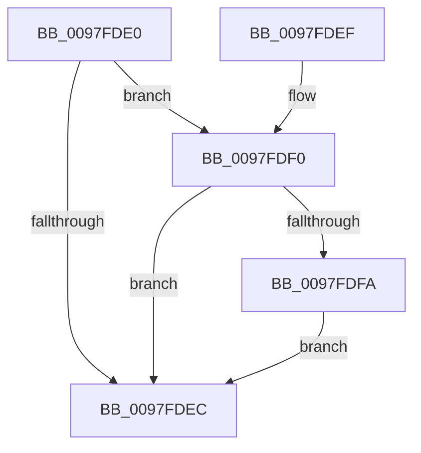

# PsIsImageNotifyEnabled

- RVA: `0x0097FDE0`–`0x0097FDFE` (길이 `30` bytes)
- VA: `0x000000014097FDE0`
- 실행 섹션: `PAGE`
- PDB 이름 있음: `예`; PDB Function 태그: `아니요`
- unwind 정보 RVA: `0x000DB714`
- 디코드: `12`개 명령, `30/30` bytes 표시
- 미해석 바이트: `0` (있으면 어셈블리에 `.byte`로 보존)

> 이 문서는 커널 이미지의 기계어와 PDB 기호를 분석해 생성했습니다. 4번과 5번은 함수 원형과 자료형을 바이너리 사용 방식에서 추정한 C 해석이며 원본 소스 복구 결과는 아닙니다.

## 1. Dependencies

- 직접 호출 지점: **0**; 고유 호출 대상: **0**
- 직접 호출자로 확인된 함수: **2**
- RIP 상대 이미지 참조: **2**

### Outgoing calls
- 직접 디코드된 call 명령이 없습니다.

### Direct callers
- [DbgkCreateThread](../8D/DbgkCreateThread_function_008D5E34.md) at `0x008D5F36`
- [MiMapViewOfImageSection](MiMapViewOfImageSection_function_0097E92C.md) at `0x0097F103`

### Static image references
- `0x0097FDE0` → RVA `0x00FD9A88` (`PAGEDATA`; read)
- `0x0097FDF0` → RVA `0x00FC6B00` (`ALMOSTRO`; read)

## 2. Other-region calls and transfers

- 다른 실행 섹션으로 향하는 call: **0**
- 별도 외부 분기/꼬리 이동을 확인하지 못했습니다.

## 3. Assembly (complete function range)

```asm
0097FDE0  8B 05 A2 9C 65 00               mov eax, dword ptr [rip + 0x659ca2]
0097FDE6  B1 01                           mov cl, 1
0097FDE8  84 C1                           test cl, al
0097FDEA  74 04                           je 0x14097fdf0
0097FDEC  8A C1                           mov al, cl
0097FDEE  C3                              ret
0097FDEF  CC                              int3
0097FDF0  8B 05 0A 6D 64 00               mov eax, dword ptr [rip + 0x646d0a]
0097FDF6  A8 04                           test al, 4
0097FDF8  75 F2                           jne 0x14097fdec
0097FDFA  33 C9                           xor ecx, ecx
0097FDFC  EB EE                           jmp 0x14097fdec
```

## 4. C-style interpretation (structured pseudocode)

```c
__int64 __fastcall PsIsImageNotifyEnabled(void)
{
    if (((1) & ((unsigned __int8)((unsigned int)(*(unsigned int *)(v_rip + 6659234))))) == 0) goto loc_0097FDF0;
loc_0097FDEC:
    return 1;
loc_0097FDF0:
    if ((((unsigned __int8)((unsigned int)(*(unsigned int *)(v_rip + 6581514)))) & (4)) != 0) goto loc_0097FDEC;
    a1 = 0;
    goto loc_0097FDEC;
}
```

## 5. (Beta) C Style

```c
void PsIsImageNotifyEnabled(void)
{
    if (((1) & ((uint8_t)((uint32_t)(*(uint32_t *)(v_rip + 0x659CA2))))) == 0) goto loc_0097FDF0;
loc_0097FDEC:
    return 1;
loc_0097FDF0:
    if ((((uint8_t)((uint32_t)(*(uint32_t *)(v_rip + 0x646D0A)))) & (4)) != 0) goto loc_0097FDEC;
    a1 = 0;
    goto loc_0097FDEC;
}
```

## 6. Execution-region graph

[열기: 2D/3D 그래프와 함수 탐색 컨트롤 패널](../../../control-panel.html?section=page&rva=0x0097FDE0&view=graph)

- 2D 그래프는 위에서 아래로 흐르고, 3D 그래프는 빈 공간을 드래그해 회전합니다. Shift+드래그는 이동, 휠은 확대·축소, 함수 노드 선택은 대상 보고서 이동입니다.

### Static fallback


