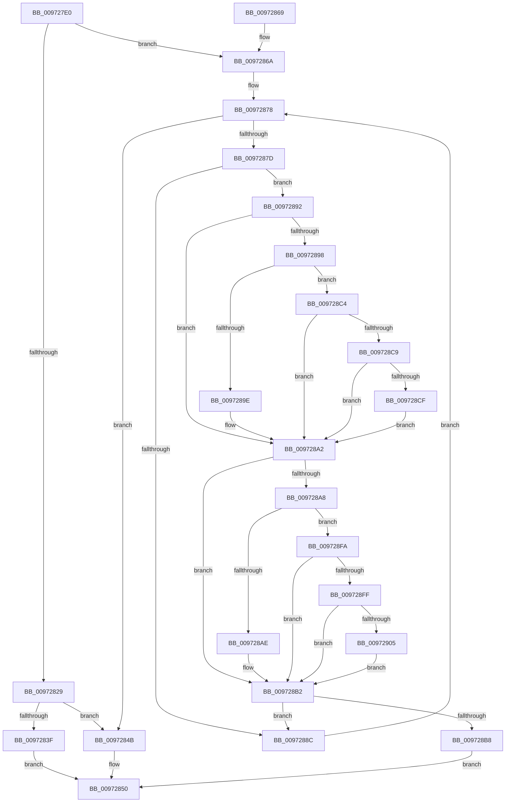

# RtlCompareUnicodeStrings

- RVA: `0x009727E0`–`0x00972930` (길이 `336` bytes)
- VA: `0x00000001409727E0`
- 실행 섹션: `PAGE`
- PDB 이름 있음: `예`; PDB Function 태그: `아니요`
- unwind 정보 RVA: `0x00078E58`
- 디코드: `103`개 명령, `336/336` bytes 표시
- 미해석 바이트: `0` (있으면 어셈블리에 `.byte`로 보존)

> 이 문서는 커널 이미지의 기계어와 PDB 기호를 분석해 생성했습니다. 4번과 5번은 함수 원형과 자료형을 바이너리 사용 방식에서 추정한 C 해석이며 원본 소스 복구 결과는 아닙니다.

## 1. Dependencies

- 직접 호출 지점: **2**; 고유 호출 대상: **2**
- 직접 호출자로 확인된 함수: **42**
- RIP 상대 이미지 참조: **0**

### Outgoing calls
- `0x00972804` → [PsGetCurrentServerSiloGlobals](../../text/2F/PsGetCurrentServerSiloGlobals_function_002FE1F0.md) (function, `0x002FE1F0`)
- `0x0097282F` → [RtlCompareMemory](../../text/6B/RtlCompareMemory_function_006BA670.md) (function, `0x006BA670`)

### Direct callers
- [EtwpAvlCompareKeyNames](../../text/4B/EtwpAvlCompareKeyNames_function_004B55C0.md) at `0x004B55ED`
- [ApiSetpSearchForApiSet](../../text/4B/ApiSetpSearchForApiSet_function_004B8048.md) at `0x004B810F`
- [ApiSetpSearchForApiSetHost](../../text/66/ApiSetpSearchForApiSetHost_function_006625CC.md) at `0x0066263D`
- [AsiSortValueList](../../text/66/AsiSortValueList_function_00662F60.md) at `0x00662FB9`
- [ApiSetpSearchForHostOverrideIndex_V7](../../text/66/ApiSetpSearchForHostOverrideIndex_V7_function_0066516C.md) at `0x006651DE`
- [PiDevCfgFindDeviceMigrationNode](../73/PiDevCfgFindDeviceMigrationNode_function_00732920.md) at `0x00732DB9`
- [PiDevCfgFindDeviceMigrationNode](../73/PiDevCfgFindDeviceMigrationNode_function_00732920.md) at `0x00732EE0`
- [PiDevCfgFindDeviceMigrationNode](../73/PiDevCfgFindDeviceMigrationNode_function_00732920.md) at `0x0073301F`
- [PnpCompareMultiSz](../73/PnpCompareMultiSz_function_0073D27C.md) at `0x0073D2E5`
- [IopExecuteHardwareProfileChange](../74/IopExecuteHardwareProfileChange_function_00744024.md) at `0x007440D6`
- [KsepCacheDeviceEqual](../74/KsepCacheDeviceEqual_function_0074AD60.md) at `0x0074AD80`
- [PopConnectToPolicyDevice](../76/PopConnectToPolicyDevice_function_00765D20.md) at `0x00765D76`
- [PopDirectedDripsUmTestDeviceCompare](../77/PopDirectedDripsUmTestDeviceCompare_function_007718F0.md) at `0x00771931`
- [WmipCheckSMBiosSysInfoString](../7B/WmipCheckSMBiosSysInfoString_function_007B289C.md) at `0x007B2918`
- [sub_007C8730](../7C/Unknown_function_007C8730.md) at `0x007C8782`
- [CmpLoadSystemVersionData](../7E/CmpLoadSystemVersionData_function_007E70BC.md) at `0x007E71F6`
- [CmpLoadSystemVersionData](../7E/CmpLoadSystemVersionData_function_007E70BC.md) at `0x007E725C`
- [RtlpMuiRegInitLIPLanguage](../83/RtlpMuiRegInitLIPLanguage_function_0083F8D8.md) at `0x0083FAB7`
- [RtlpMuiRegPopulateBaseLanguages](../83/RtlpMuiRegPopulateBaseLanguages_function_0083FC4C.md) at `0x0083FEAD`
- [RtlpMuiRegPopulateBaseLanguages](../83/RtlpMuiRegPopulateBaseLanguages_function_0083FC4C.md) at `0x0083FFD6`
- [RtlpMuiRegPopulateBaseLanguages](../83/RtlpMuiRegPopulateBaseLanguages_function_0083FC4C.md) at `0x00840002`
- [CmpFindNameInListWithStatus](../84/CmpFindNameInListWithStatus_function_00846B80.md) at `0x00846DF7`
- [CmpFindSubKeyByNameWithStatus](../85/CmpFindSubKeyByNameWithStatus_function_00852770.md) at `0x00852B7F`
- [CmpWalkOneLevel](../85/CmpWalkOneLevel_function_00852BA0.md) at `0x00853926`
- [sub_0085416A](../85/Unknown_function_0085416A.md) at `0x008547B1`
- [sub_0085416A](../85/Unknown_function_0085416A.md) at `0x008547E6`
- [sub_0085416A](../85/Unknown_function_0085416A.md) at `0x008548A1`
- [sub_0085416A](../85/Unknown_function_0085416A.md) at `0x008548D6`
- [sub_0085416A](../85/Unknown_function_0085416A.md) at `0x00854908`
- [sub_00854FDC](../85/Unknown_function_00854FDC.md) at `0x0085503D`
- [sub_00856195](../85/Unknown_function_00856195.md) at `0x008561EF`
- [CmpCompareInIndex](../85/CmpCompareInIndex_function_0085CC40.md) at `0x0085D1A4`
- [CmpCompareInIndex](../85/CmpCompareInIndex_function_0085CC40.md) at `0x0085D1D1`
- [CmpFindSubKeyInRoot](../85/CmpFindSubKeyInRoot_function_0085D890.md) at `0x0085E19B`
- [CmpFindSubKeyInRoot](../85/CmpFindSubKeyInRoot_function_0085D890.md) at `0x0085E1CA`
- [sub_0086E95E](../86/Unknown_function_0086E95E.md) at `0x0086EDA8`
- [SepAdtStagingEvent](../91/SepAdtStagingEvent_function_0091F948.md) at `0x0091FA4C`
- [sub_00970CE3](Unknown_function_00970CE3.md) at `0x00970D22`
- [SepCaptureTokenSecurityAttributesInformation](SepCaptureTokenSecurityAttributesInformation_function_00971FB8.md) at `0x009724FE`
- [PiSwBusRelationsCompareInstancePath](PiSwBusRelationsCompareInstancePath_function_00972590.md) at `0x009725AE`
- [SshpCacheDatabaseCompare](SshpCacheDatabaseCompare_function_009725D0.md) at `0x0097270F`
- [PnpCheckDeviceIdsChanged](PnpCheckDeviceIdsChanged_function_00972938.md) at `0x00972AAA`
- [PiCompareDDBCacheEntries](PiCompareDDBCacheEntries_function_00973390.md) at `0x009733C4`
- [SeExamineGlobalSacl](SeExamineGlobalSacl_function_00973C98.md) at `0x00973D3F`
- [SepRmGlobalSaclFind](SepRmGlobalSaclFind_function_00973DD4.md) at `0x00973E5B`
- [PiDevCfgConfigureDevice](PiDevCfgConfigureDevice_function_00977BB4.md) at `0x009793FE`
- [CmpSortedValueEnumStackValueCompareFunction](../A3/CmpSortedValueEnumStackValueCompareFunction_function_00A30F30.md) at `0x00A31090`
- [RtlpProcessIFEOKeyFilter](../A3/RtlpProcessIFEOKeyFilter_function_00A3BA78.md) at `0x00A3BE0B`
- [SeMaximumAuditMaskFromGlobalSacl](../A8/SeMaximumAuditMaskFromGlobalSacl_function_00A832DC.md) at `0x00A8335C`
- [PiDevCfgResolveVariableExpression](../AA/PiDevCfgResolveVariableExpression_function_00AA8C00.md) at `0x00AA9228`
- [PiDevCfgResolveVariableExpression](../AA/PiDevCfgResolveVariableExpression_function_00AA8C00.md) at `0x00AA927B`
- [PiDevCfgResolveVariableExpression](../AA/PiDevCfgResolveVariableExpression_function_00AA8C00.md) at `0x00AA929D`
- [PiDevCfgResolveVariableExpression](../AA/PiDevCfgResolveVariableExpression_function_00AA8C00.md) at `0x00AA92C1`
- [PiDevCfgResolveVariableExpression](../AA/PiDevCfgResolveVariableExpression_function_00AA8C00.md) at `0x00AA92E8`
- [PiDevCfgResolveVariableExpression](../AA/PiDevCfgResolveVariableExpression_function_00AA8C00.md) at `0x00AA9307`
- [PiDevCfgResolveVariableExpression](../AA/PiDevCfgResolveVariableExpression_function_00AA8C00.md) at `0x00AA9973`
- [PiDevCfgResolveVariableExpression](../AA/PiDevCfgResolveVariableExpression_function_00AA8C00.md) at `0x00AA999D`
- [PiDevCfgResolveVariableExpression](../AA/PiDevCfgResolveVariableExpression_function_00AA8C00.md) at `0x00AA99CD`
- [PiDevCfgResolveVariableExpression](../AA/PiDevCfgResolveVariableExpression_function_00AA8C00.md) at `0x00AA99F8`
- [PiDevCfgResolveVariableExpression](../AA/PiDevCfgResolveVariableExpression_function_00AA8C00.md) at `0x00AA9A1B`
- [PiDevCfgResolveVariableExpression](../AA/PiDevCfgResolveVariableExpression_function_00AA8C00.md) at `0x00AA9A46`
- [sub_00B2CCAC](../B2/Unknown_function_00B2CCAC.md) at `0x00B2CCFF`
- [sub_00B37784](../B3/Unknown_function_00B37784.md) at `0x00B377AF`
- [sub_00B37784](../B3/Unknown_function_00B37784.md) at `0x00B37808`
- [sub_00B37A8C](../B3/Unknown_function_00B37A8C.md) at `0x00B37AEA`

### Static image references
- 디코드된 RIP-relative 메모리 참조가 없습니다.

## 2. Other-region calls and transfers

- 다른 실행 섹션으로 향하는 call: **2**
  - `0x00972804` → [PsGetCurrentServerSiloGlobals](../../text/2F/PsGetCurrentServerSiloGlobals_function_002FE1F0.md) (`PAGE` → `.text`)
  - `0x0097282F` → [RtlCompareMemory](../../text/6B/RtlCompareMemory_function_006BA670.md) (`PAGE` → `.text`)
- 별도 외부 분기/꼬리 이동을 확인하지 못했습니다.

## 3. Assembly (complete function range)

```asm
009727E0  48 89 5C 24 08                  mov qword ptr [rsp + 8], rbx
009727E5  48 89 6C 24 10                  mov qword ptr [rsp + 0x10], rbp
009727EA  48 89 74 24 18                  mov qword ptr [rsp + 0x18], rsi
009727EF  57                              push rdi
009727F0  41 56                           push r14
009727F2  41 57                           push r15
009727F4  48 83 EC 20                     sub rsp, 0x20
009727F8  4D 8B F1                        mov r14, r9
009727FB  49 8B F8                        mov rdi, r8
009727FE  48 8B EA                        mov rbp, rdx
00972801  48 8B D9                        mov rbx, rcx
00972804  E8 E7 B9 98 FF                  call 0x1402fe1f0
00972809  49 3B D1                        cmp rdx, r9
0097280C  48 8B F2                        mov rsi, rdx
0097280F  49 0F 47 F1                     cmova rsi, r9
00972813  80 7C 24 60 00                  cmp byte ptr [rsp + 0x60], 0
00972818  4C 8B 98 B0 04 00 00            mov r11, qword ptr [rax + 0x4b0]
0097281F  4C 8D 04 36                     lea r8, [rsi + rsi]
00972823  4D 8D 14 18                     lea r10, [r8 + rbx]
00972827  75 41                           jne 0x14097286a
00972829  48 8B D7                        mov rdx, rdi
0097282C  48 8B CB                        mov rcx, rbx
0097282F  E8 3C 7E D4 FF                  call 0x1406ba670
00972834  48 8B C8                        mov rcx, rax
00972837  48 D1 E9                        shr rcx, 1
0097283A  48 3B CE                        cmp rcx, rsi
0097283D  73 0C                           jae 0x14097284b
0097283F  0F B7 04 4B                     movzx eax, word ptr [rbx + rcx*2]
00972843  0F B7 0C 4F                     movzx ecx, word ptr [rdi + rcx*2]
00972847  2B C1                           sub eax, ecx
00972849  EB 05                           jmp 0x140972850
0097284B  41 2B EE                        sub ebp, r14d
0097284E  8B C5                           mov eax, ebp
00972850  48 8B 5C 24 40                  mov rbx, qword ptr [rsp + 0x40]
00972855  48 8B 6C 24 48                  mov rbp, qword ptr [rsp + 0x48]
0097285A  48 8B 74 24 50                  mov rsi, qword ptr [rsp + 0x50]
0097285F  48 83 C4 20                     add rsp, 0x20
00972863  41 5F                           pop r15
00972865  41 5E                           pop r14
00972867  5F                              pop rdi
00972868  C3                              ret
00972869  CC                              int3
0097286A  48 2B FB                        sub rdi, rbx
0097286D  BE E0 FF 00 00                  mov esi, 0xffe0
00972872  41 BF C0 00 00 00               mov r15d, 0xc0
00972878  49 3B DA                        cmp rbx, r10
0097287B  73 CE                           jae 0x14097284b
0097287D  44 0F B7 03                     movzx r8d, word ptr [rbx]
00972881  44 0F B7 0C 1F                  movzx r9d, word ptr [rdi + rbx]
00972886  66 45 3B C1                     cmp r8w, r9w
0097288A  75 06                           jne 0x140972892
0097288C  48 83 C3 02                     add rbx, 2
00972890  EB E6                           jmp 0x140972878
00972892  41 83 F8 61                     cmp r8d, 0x61
00972896  72 0A                           jb 0x1409728a2
00972898  41 83 F8 7A                     cmp r8d, 0x7a
0097289C  77 26                           ja 0x1409728c4
0097289E  66 44 03 C6                     add r8w, si
009728A2  41 83 F9 61                     cmp r9d, 0x61
009728A6  72 0A                           jb 0x1409728b2
009728A8  41 83 F9 7A                     cmp r9d, 0x7a
009728AC  77 4C                           ja 0x1409728fa
009728AE  66 44 03 CE                     add r9w, si
009728B2  66 45 3B C1                     cmp r8w, r9w
009728B6  74 D4                           je 0x14097288c
009728B8  41 0F B7 C9                     movzx ecx, r9w
009728BC  41 0F B7 C0                     movzx eax, r8w
009728C0  2B C1                           sub eax, ecx
009728C2  EB 8C                           jmp 0x140972850
009728C4  4D 85 DB                        test r11, r11
009728C7  74 D9                           je 0x1409728a2
009728C9  66 45 3B C7                     cmp r8w, r15w
009728CD  72 D3                           jb 0x1409728a2
009728CF  49 8B C0                        mov rax, r8
009728D2  41 8B D0                        mov edx, r8d
009728D5  48 C1 E8 08                     shr rax, 8
009728D9  83 E2 0F                        and edx, 0xf
009728DC  41 0F B7 0C 43                  movzx ecx, word ptr [r11 + rax*2]
009728E1  41 8B C0                        mov eax, r8d
009728E4  C1 E8 04                        shr eax, 4
009728E7  83 E0 0F                        and eax, 0xf
009728EA  03 C8                           add ecx, eax
009728EC  41 0F B7 0C 4B                  movzx ecx, word ptr [r11 + rcx*2]
009728F1  03 CA                           add ecx, edx
009728F3  66 45 03 04 4B                  add r8w, word ptr [r11 + rcx*2]
009728F8  EB A8                           jmp 0x1409728a2
009728FA  4D 85 DB                        test r11, r11
009728FD  74 B3                           je 0x1409728b2
009728FF  66 45 3B CF                     cmp r9w, r15w
00972903  72 AD                           jb 0x1409728b2
00972905  49 8B C1                        mov rax, r9
00972908  41 8B D1                        mov edx, r9d
0097290B  48 C1 E8 08                     shr rax, 8
0097290F  83 E2 0F                        and edx, 0xf
00972912  41 0F B7 0C 43                  movzx ecx, word ptr [r11 + rax*2]
00972917  41 8B C1                        mov eax, r9d
0097291A  C1 E8 04                        shr eax, 4
0097291D  83 E0 0F                        and eax, 0xf
00972920  03 C8                           add ecx, eax
00972922  41 0F B7 0C 4B                  movzx ecx, word ptr [r11 + rcx*2]
00972927  03 CA                           add ecx, edx
00972929  66 45 03 0C 4B                  add r9w, word ptr [r11 + rcx*2]
0097292E  EB 82                           jmp 0x1409728b2
```

## 4. C-style interpretation (structured pseudocode)

```c
__int64 __fastcall RtlCompareUnicodeStrings(__int64 a1, __int64 a2, __int64 a3, __int64 a4, unsigned __int8 a5)
{
    __int64 result;
    __int64 v_rbp;
    __int64 v_rbx;
    __int64 v_rdi;
    __int64 v_rsp;
    unsigned __int64 v_stack_p10;
    unsigned __int64 v_stack_p18;
    unsigned __int64 v_stack_p8;

    v_stack_p8 = v_rbx;
    v_stack_p10 = v_rbp;
    v_stack_p18 = v_rsi;
    v_rsp = (v_rsp) - (32);
    result = PsGetCurrentServerSiloGlobals(a1, a2, a3, a4);
    if (a2 > a4) { a2 = a4; }
    if (a5 != 0) goto loc_0097286A;
    result = RtlCompareMemory(a1, a3, a2 + a2 * 1, a4);
    a1 = (result) >> (1);
    if (a1 >= a2) goto loc_0097284B;
    result = (unsigned int)((*(unsigned __int16 *)(a1 + a1 * 2)) - ((unsigned int)(*(unsigned __int16 *)(a3 + a1 * 2))));
    goto loc_00972850;
loc_0097284B:
    v_rbp = (unsigned int)((a2) - ((unsigned int)(a4)));
loc_00972850:
    v_rsp = (v_rsp) + (32);
    return (unsigned int)((unsigned int)(v_rbp));
loc_0097286A:
    v_rdi = (a3) - (v_stack_p8);
loc_00972878:
    if (v_stack_p8 >= (a2 + a2 * 1 + a1 * 1)) goto loc_0097284B;
    if (((unsigned __int16)(*(unsigned __int16 *)(v_stack_p8))) != ((unsigned __int16)(*(unsigned __int16 *)(v_rdi + v_stack_p8 * 1)))) goto loc_00972892;
loc_0097288C:
    v_rbx = (v_stack_p8) + (2);
    goto loc_00972878;
loc_00972892:
    if (((unsigned int)(*(unsigned __int16 *)(v_stack_p8))) < 97) goto loc_009728A2;
    if (((unsigned int)(*(unsigned __int16 *)(v_stack_p8))) > 122) goto loc_009728C4;
    a3 = (unsigned __int16)((*(unsigned __int16 *)(v_stack_p8)) + ((unsigned __int16)((unsigned int)(0xFFE0ULL))));
loc_009728A2:
    if (((unsigned int)(*(unsigned __int16 *)(v_rdi + v_stack_p8 * 1))) < 97) goto loc_009728B2;
    if (((unsigned int)(*(unsigned __int16 *)(v_rdi + v_stack_p8 * 1))) > 122) goto loc_009728FA;
    a4 = (unsigned __int16)((*(unsigned __int16 *)(v_rdi + v_stack_p8 * 1)) + ((unsigned __int16)((unsigned int)(0xFFE0ULL))));
loc_009728B2:
    if (((unsigned __int16)(a3)) == ((unsigned __int16)(a4))) goto loc_0097288C;
    result = (unsigned int)(((unsigned __int16)(a3)) - ((unsigned int)((unsigned __int16)(a4))));
    goto loc_00972850;
loc_009728C4:
    if (*(unsigned __int64 *)(result + 1200) == 0) goto loc_009728A2;
    if (((unsigned __int16)(a3)) < 192) goto loc_009728A2;
    result = (a3) >> (8);
    a2 = (unsigned int)(((unsigned int)((unsigned int)(a3))) & (15));
    result = (unsigned int)(((unsigned int)((unsigned int)(a3))) >> (4));
    result = (unsigned int)((result) & (15));
    a1 = (unsigned int)((*(unsigned __int16 *)(*(unsigned __int64 *)(result + 1200) + result * 2)) + ((unsigned int)(result)));
    a1 = (unsigned int)((*(unsigned __int16 *)(*(unsigned __int64 *)(result + 1200) + a1 * 2)) + ((unsigned int)(a2)));
    a3 = (unsigned __int16)((a3) + (*(unsigned __int16 *)(*(unsigned __int64 *)(result + 1200) + a1 * 2)));
    goto loc_009728A2;
loc_009728FA:
    if (*(unsigned __int64 *)(result + 1200) == 0) goto loc_009728B2;
    if (((unsigned __int16)(a4)) < 192) goto loc_009728B2;
    result = (a4) >> (8);
    a2 = (unsigned int)(((unsigned int)((unsigned int)(a4))) & (15));
    result = (unsigned int)(((unsigned int)((unsigned int)(a4))) >> (4));
    result = (unsigned int)((result) & (15));
    a1 = (unsigned int)((*(unsigned __int16 *)(*(unsigned __int64 *)(result + 1200) + result * 2)) + ((unsigned int)(result)));
    a1 = (unsigned int)((*(unsigned __int16 *)(*(unsigned __int64 *)(result + 1200) + a1 * 2)) + ((unsigned int)(a2)));
    a4 = (unsigned __int16)((a4) + (*(unsigned __int16 *)(*(unsigned __int64 *)(result + 1200) + a1 * 2)));
    goto loc_009728B2;
}
```

## 5. (Beta) C Style

```c
int64_t RtlCompareUnicodeStrings(void *Arg1, int64_t Arg2, void *Arg3, int64_t Arg4, uint8_t Arg5)
{
    uint8_t *arg1 = (uint8_t *)Arg1;
    uint8_t *arg3 = (uint8_t *)Arg3;

    int64_t result;
    int64_t local_rbp;
    int64_t local_rbx;
    int64_t local_rdi;
    int64_t local_rsp;
    uint64_t v_stack_p10;
    uint64_t v_stack_p18;
    uint64_t v_stack_p8;

    v_stack_p8 = local_rbx;
    v_stack_p10 = local_rbp;
    v_stack_p18 = local_rsi;
    local_rsp = (local_rsp) - (32);
    result = PsGetCurrentServerSiloGlobals(Arg1, Arg2, Arg3, Arg4);
    if (Arg2 > Arg4) { Arg2 = Arg4; }
    if (Arg5 != 0) goto loc_0097286A;
    result = RtlCompareMemory(Arg1, Arg3, Arg2 + Arg2 * 1, Arg4);
    Arg1 = (result) >> (1);
    if (Arg1 >= Arg2) goto loc_0097284B;
    result = (uint32_t)((*(uint16_t *)(arg1 + arg1 * 2)) - ((uint32_t)(*(uint16_t *)(arg3 + arg1 * 2))));
    goto loc_00972850;
loc_0097284B:
    local_rbp = (uint32_t)((Arg2) - ((uint32_t)(Arg4)));
loc_00972850:
    local_rsp = (local_rsp) + (32);
    return (uint32_t)((uint32_t)(local_rbp));
loc_0097286A:
    local_rdi = (Arg3) - (v_stack_p8);
loc_00972878:
    if (v_stack_p8 >= (Arg2 + Arg2 * 1 + Arg1 * 1)) goto loc_0097284B;
    if (((uint16_t)(*(uint16_t *)(v_stack_p8))) != ((uint16_t)(*(uint16_t *)(local_rdi + v_stack_p8 * 1)))) goto loc_00972892;
loc_0097288C:
    local_rbx = (v_stack_p8) + (2);
    goto loc_00972878;
loc_00972892:
    if (((uint32_t)(*(uint16_t *)(v_stack_p8))) < 97) goto loc_009728A2;
    if (((uint32_t)(*(uint16_t *)(v_stack_p8))) > 122) goto loc_009728C4;
    Arg3 = (uint16_t)((*(uint16_t *)(v_stack_p8)) + ((uint16_t)((uint32_t)(0xFFE0ULL))));
loc_009728A2:
    if (((uint32_t)(*(uint16_t *)(local_rdi + v_stack_p8 * 1))) < 97) goto loc_009728B2;
    if (((uint32_t)(*(uint16_t *)(local_rdi + v_stack_p8 * 1))) > 122) goto loc_009728FA;
    Arg4 = (uint16_t)((*(uint16_t *)(local_rdi + v_stack_p8 * 1)) + ((uint16_t)((uint32_t)(0xFFE0ULL))));
loc_009728B2:
    if (((uint16_t)(Arg3)) == ((uint16_t)(Arg4))) goto loc_0097288C;
    result = (uint32_t)(((uint16_t)(Arg3)) - ((uint32_t)((uint16_t)(Arg4))));
    goto loc_00972850;
loc_009728C4:
    if (*(uint64_t *)(result + 0x4B0) == 0) goto loc_009728A2;
    if (((uint16_t)(Arg3)) < 192) goto loc_009728A2;
    result = (Arg3) >> (8);
    Arg2 = (uint32_t)(((uint32_t)((uint32_t)(Arg3))) & (15));
    result = (uint32_t)(((uint32_t)((uint32_t)(Arg3))) >> (4));
    result = (uint32_t)((result) & (15));
    Arg1 = (uint32_t)((*(uint16_t *)(*(uint64_t *)(result + 0x4B0) + result * 2)) + ((uint32_t)(result)));
    Arg1 = (uint32_t)((*(uint16_t *)(*(uint64_t *)(result + 0x4B0) + arg1 * 2)) + ((uint32_t)(Arg2)));
    Arg3 = (uint16_t)((Arg3) + (*(uint16_t *)(*(uint64_t *)(result + 0x4B0) + arg1 * 2)));
    goto loc_009728A2;
loc_009728FA:
    if (*(uint64_t *)(result + 0x4B0) == 0) goto loc_009728B2;
    if (((uint16_t)(Arg4)) < 192) goto loc_009728B2;
    result = (Arg4) >> (8);
    Arg2 = (uint32_t)(((uint32_t)((uint32_t)(Arg4))) & (15));
    result = (uint32_t)(((uint32_t)((uint32_t)(Arg4))) >> (4));
    result = (uint32_t)((result) & (15));
    Arg1 = (uint32_t)((*(uint16_t *)(*(uint64_t *)(result + 0x4B0) + result * 2)) + ((uint32_t)(result)));
    Arg1 = (uint32_t)((*(uint16_t *)(*(uint64_t *)(result + 0x4B0) + arg1 * 2)) + ((uint32_t)(Arg2)));
    Arg4 = (uint16_t)((Arg4) + (*(uint16_t *)(*(uint64_t *)(result + 0x4B0) + arg1 * 2)));
    goto loc_009728B2;
}
```

### 관측된 메모리 오프셋

구조체 형식이 확인되지 않은 접근은 인자 기준의 오프셋으로만 기록했습니다.

| 기준 인자 | 오프셋 표현 | 폭 (bit) | 접근 |
|---|---:|---:|---|
| `Arg1` | `+ 0x0 + rcx*2` | `16` | `R` |
| `Arg3` | `+ 0x0 + rbx*1` | `16` | `R` |
| `Arg3` | `+ 0x0 + rcx*2` | `16` | `R` |

## 6. Execution-region graph

[열기: 2D/3D 그래프와 함수 탐색 컨트롤 패널](../../../control-panel.html?section=page&rva=0x009727E0&view=graph)

- 2D 그래프는 위에서 아래로 흐르고, 3D 그래프는 빈 공간을 드래그해 회전합니다. Shift+드래그는 이동, 휠은 확대·축소, 함수 노드 선택은 대상 보고서 이동입니다.

### Static fallback


