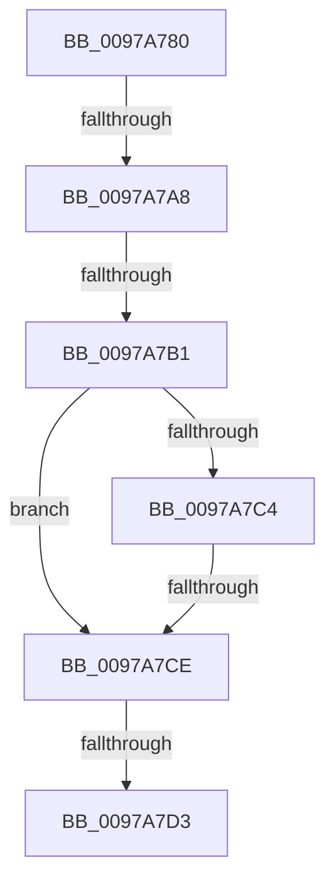

# RtlHashUnicodeString

- RVA: `0x0097A780`–`0x0097A7DB` (길이 `91` bytes)
- VA: `0x000000014097A780`
- 실행 섹션: `PAGE`
- PDB 이름 있음: `예`; PDB Function 태그: `아니요`
- unwind 정보 RVA: `0x00096814`
- 디코드: `24`개 명령, `91/91` bytes 표시
- 미해석 바이트: `0` (있으면 어셈블리에 `.byte`로 보존)

> 이 문서는 커널 이미지의 기계어와 PDB 기호를 분석해 생성했습니다. 4번과 5번은 함수 원형과 자료형을 바이너리 사용 방식에서 추정한 C 해석이며 원본 소스 복구 결과는 아닙니다.

## 1. Dependencies

- 직접 호출 지점: **1**; 고유 호출 대상: **1**
- 직접 호출자로 확인된 함수: **12**
- RIP 상대 이미지 참조: **0**

### Outgoing calls
- `0x0097A793` → [PsGetCurrentServerSiloGlobals](../../text/2F/PsGetCurrentServerSiloGlobals_function_002FE1F0.md) (function, `0x002FE1F0`)

### Direct callers
- [PiUEventHashStringIntoBucket](../../text/48/PiUEventHashStringIntoBucket_function_00486690.md) at `0x004866DD`
- [KsepCacheHwIdHash](../../text/4B/KsepCacheHwIdHash_function_004BD3B0.md) at `0x004BD3C7`
- [CarLiveDumpCallBack](../../text/61/CarLiveDumpCallBack_function_0061BC20.md) at `0x0061BCD0`
- [PopFxInitializeSocSubsystemStaticInfo](../75/PopFxInitializeSocSubsystemStaticInfo_function_00758EC8.md) at `0x007590B7`
- [PopPluginQuerySocSubsystemMetadata](../75/PopPluginQuerySocSubsystemMetadata_function_0075AABC.md) at `0x0075ABBF`
- [PiDmObjectCreate](../94/PiDmObjectCreate_function_0094F5CC.md) at `0x0094F773`
- [KsepCacheDeviceHash](KsepCacheDeviceHash_function_0097A310.md) at `0x0097A327`
- [PiDevCfgBuildDriverNodeStrongName](PiDevCfgBuildDriverNodeStrongName_function_0097A33C.md) at `0x0097A3EC`
- [PiDevCfgBuildDriverNodeStrongName](PiDevCfgBuildDriverNodeStrongName_function_0097A33C.md) at `0x0097A413`
- [PopPluginQuerySocSubsystemBlockingTime](PopPluginQuerySocSubsystemBlockingTime_function_0097A6A4.md) at `0x0097A6FF`
- [SepComputeCachedHandlesEntrySignature](../9A/SepComputeCachedHandlesEntrySignature_function_009A975C.md) at `0x009A979D`
- [PiCreateDriverSwDeviceCallback](../AB/PiCreateDriverSwDeviceCallback_function_00ABB420.md) at `0x00ABB825`
- [PiCreateDriverSwDeviceCallback](../AB/PiCreateDriverSwDeviceCallback_function_00ABB420.md) at `0x00ABB85C`
- [PipInitDeviceOverrideCache](../../init/C3/PipInitDeviceOverrideCache_function_00C312C8.md) at `0x00C3150C`

### Static image references
- 디코드된 RIP-relative 메모리 참조가 없습니다.

## 2. Other-region calls and transfers

- 다른 실행 섹션으로 향하는 call: **1**
  - `0x0097A793` → [PsGetCurrentServerSiloGlobals](../../text/2F/PsGetCurrentServerSiloGlobals_function_002FE1F0.md) (`PAGE` → `.text`)
- call이 아닌 외부 분기/꼬리 이동: **5**
  - `0x0097A7A2` → [sub_0097A864](Unknown_function_0097A864.md) (`tail-transfer`)
  - `0x0097A7AB` → [sub_0097A864](Unknown_function_0097A864.md) (`tail-transfer`)
  - `0x0097A7C8` → [sub_0097A864](Unknown_function_0097A864.md) (`tail-transfer`)
  - `0x0097A7D1` → [sub_0097A820](Unknown_function_0097A820.md) (`tail-transfer`)
  - `0x0097A7D5` → [sub_0097A864 + 0xC](Unknown_function_0097A864.md) (`tail-transfer`)

## 3. Assembly (complete function range)

```asm
0097A780  48 89 5C 24 10                  mov qword ptr [rsp + 0x10], rbx
0097A785  57                              push rdi
0097A786  48 83 EC 20                     sub rsp, 0x20
0097A78A  49 8B F9                        mov rdi, r9
0097A78D  4C 8B D9                        mov r11, rcx
0097A790  45 33 D2                        xor r10d, r10d
0097A793  E8 58 3A 98 FF                  call 0x1402fe1f0
0097A798  48 8B 98 B0 04 00 00            mov rbx, qword ptr [rax + 0x4b0]
0097A79F  4D 85 DB                        test r11, r11
0097A7A2  0F 84 BC 00 00 00               je 0x14097a864
0097A7A8  4D 85 C9                        test r9, r9
0097A7AB  0F 84 B3 00 00 00               je 0x14097a864
0097A7B1  4D 8B 4B 08                     mov r9, qword ptr [r11 + 8]
0097A7B5  44 89 17                        mov dword ptr [rdi], r10d
0097A7B8  45 0F B7 1B                     movzx r11d, word ptr [r11]
0097A7BC  41 D1 EB                        shr r11d, 1
0097A7BF  45 85 C0                        test r8d, r8d
0097A7C2  74 0A                           je 0x14097a7ce
0097A7C4  41 83 F8 01                     cmp r8d, 1
0097A7C8  0F 85 96 00 00 00               jne 0x14097a864
0097A7CE  45 85 DB                        test r11d, r11d
0097A7D1  74 4D                           je 0x14097a820
0097A7D3  84 D2                           test dl, dl
0097A7D5  0F 84 95 00 00 00               je 0x14097a870
```

## 4. C-style interpretation (structured pseudocode)

```c
__int64 __fastcall RtlHashUnicodeString(__int64 a1, unsigned __int8 a2, int a3, __int64 a4)
{
    __int64 result;
    __int64 v_r10;
    __int64 v_r11;
    __int64 v_rsp;
    unsigned __int64 v_stack_p10;

    v_stack_p10 = v_rbx;
    v_rsp = (v_rsp) - (32);
    v_r10 = 0;
    result = PsGetCurrentServerSiloGlobals(a1, a2, a3, a4);
    *(unsigned int *)(a4) = 0;
    v_r11 = (unsigned int)((*(unsigned __int16 *)(a1)) >> (1));
    if (a3 == 0) goto loc_0097A7CE;
loc_0097A7CE:
}
```

## 5. (Beta) C Style

```c
int64_t RtlHashUnicodeString(int64_t Arg1, uint8_t Arg2, int32_t Arg3, void *Arg4)
{
    uint8_t *arg4 = (uint8_t *)Arg4;

    int64_t result;
    int64_t local_r10;
    int64_t local_r11;
    int64_t local_rsp;
    uint64_t v_stack_p10;

    v_stack_p10 = local_rbx;
    local_rsp = (local_rsp) - (32);
    local_r10 = 0;
    result = PsGetCurrentServerSiloGlobals(Arg1, Arg2, Arg3, Arg4);
    *(uint32_t *)(arg4) = 0;
    local_r11 = (uint32_t)((*(uint16_t *)(Arg1)) >> (1));
    if (Arg3 == 0) goto loc_0097A7CE;
loc_0097A7CE:
}
```

### 관측된 메모리 오프셋

구조체 형식이 확인되지 않은 접근은 인자 기준의 오프셋으로만 기록했습니다.

| 기준 인자 | 오프셋 표현 | 폭 (bit) | 접근 |
|---|---:|---:|---|
| `Arg4` | `+ 0x0` | `32` | `W` |

## 6. Execution-region graph

[열기: 2D/3D 그래프와 함수 탐색 컨트롤 패널](../../../control-panel.html?section=page&rva=0x0097A780&view=graph)

- 2D 그래프는 위에서 아래로 흐르고, 3D 그래프는 빈 공간을 드래그해 회전합니다. Shift+드래그는 이동, 휠은 확대·축소, 함수 노드 선택은 대상 보고서 이동입니다.

### Static fallback


