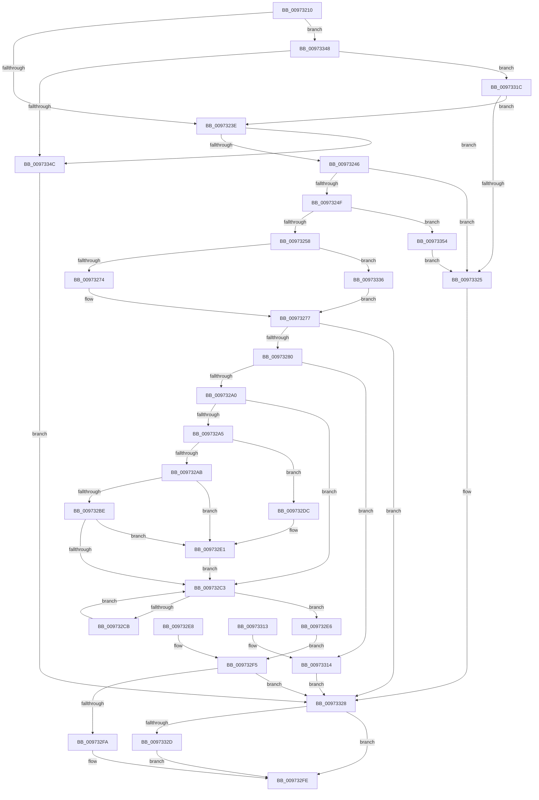

# SeCaptureUnicodeStringStructures

- RVA: `0x00973210`–`0x00973359` (길이 `329` bytes)
- VA: `0x0000000140973210`
- 실행 섹션: `PAGE`
- PDB 이름 있음: `예`; PDB Function 태그: `아니요`
- unwind 정보 RVA: `0x00096230`
- 디코드: `98`개 명령, `329/329` bytes 표시
- 미해석 바이트: `0` (있으면 어셈블리에 `.byte`로 보존)

> 이 문서는 커널 이미지의 기계어와 PDB 기호를 분석해 생성했습니다. 4번과 5번은 함수 원형과 자료형을 바이너리 사용 방식에서 추정한 C 해석이며 원본 소스 복구 결과는 아닙니다.

## 1. Dependencies

- 직접 호출 지점: **3**; 고유 호출 대상: **3**
- 직접 호출자로 확인된 함수: **1**
- RIP 상대 이미지 참조: **0**

### Outgoing calls
- `0x0097328E` → [ExAllocatePool2](../../poolcode/B8/ExAllocatePool2_function_00B820F0.md) (function, `0x00B820F0`)
- `0x009732DC` → [ExRaiseDatatypeMisalignment](../89/ExRaiseDatatypeMisalignment_function_00899FD0.md) (function, `0x00899FD0`)
- `0x0097332F` → [ExFreePoolWithTag](../../poolcode/B8/ExFreePoolWithTag_function_00B82870.md) (function, `0x00B82870`)

### Direct callers
- [SepCaptureUnicodeStringArray](SepCaptureUnicodeStringArray_function_00972F70.md) at `0x00972FC9`

### Static image references
- 디코드된 RIP-relative 메모리 참조가 없습니다.

## 2. Other-region calls and transfers

- 다른 실행 섹션으로 향하는 call: **2**
  - `0x0097328E` → [ExAllocatePool2](../../poolcode/B8/ExAllocatePool2_function_00B820F0.md) (`PAGE` → `POOLCODE`)
  - `0x0097332F` → [ExFreePoolWithTag](../../poolcode/B8/ExFreePoolWithTag_function_00B82870.md) (`PAGE` → `POOLCODE`)
- 별도 외부 분기/꼬리 이동을 확인하지 못했습니다.

## 3. Assembly (complete function range)

```asm
00973210  48 89 5C 24 10                  mov qword ptr [rsp + 0x10], rbx
00973215  4C 89 4C 24 20                  mov qword ptr [rsp + 0x20], r9
0097321A  56                              push rsi
0097321B  57                              push rdi
0097321C  41 54                           push r12
0097321E  41 56                           push r14
00973220  41 57                           push r15
00973222  48 83 EC 30                     sub rsp, 0x30
00973226  4D 8B E1                        mov r12, r9
00973229  8B FA                           mov edi, edx
0097322B  48 8B F1                        mov rsi, rcx
0097322E  33 DB                           xor ebx, ebx
00973230  8B CB                           mov ecx, ebx
00973232  49 89 19                        mov qword ptr [r9], rbx
00973235  48 85 F6                        test rsi, rsi
00973238  0F 84 0A 01 00 00               je 0x140973348
0097323E  85 D2                           test edx, edx
00973240  0F 84 06 01 00 00               je 0x14097334c
00973246  48 85 F6                        test rsi, rsi
00973249  0F 84 D6 00 00 00               je 0x140973325
0097324F  45 84 C0                        test r8b, r8b
00973252  0F 84 FC 00 00 00               je 0x140973354
00973258  48 89 5C 24 60                  mov qword ptr [rsp + 0x60], rbx
0097325D  48 8B C7                        mov rax, rdi
00973260  BA 10 00 00 00                  mov edx, 0x10
00973265  48 F7 E2                        mul rdx
00973268  4C 8B F8                        mov r15, rax
0097326B  48 85 D2                        test rdx, rdx
0097326E  0F 85 C2 00 00 00               jne 0x140973336
00973274  44 8B F3                        mov r14d, ebx
00973277  45 85 F6                        test r14d, r14d
0097327A  0F 88 A8 00 00 00               js 0x140973328
00973280  41 B8 53 65 55 73               mov r8d, 0x73556553
00973286  49 8B D7                        mov rdx, r15
00973289  B9 00 01 00 00                  mov ecx, 0x100
0097328E  E8 5D EE 20 00                  call 0x140b820f0
00973293  48 8B C8                        mov rcx, rax
00973296  48 89 44 24 60                  mov qword ptr [rsp + 0x60], rax
0097329B  48 85 C0                        test rax, rax
0097329E  74 74                           je 0x140973314
009732A0  4D 85 FF                        test r15, r15
009732A3  74 1E                           je 0x1409732c3
009732A5  40 F6 C6 03                     test sil, 3
009732A9  75 31                           jne 0x1409732dc
009732AB  49 8D 04 37                     lea rax, [r15 + rsi]
009732AF  48 BA 00 00 FF FF FF 7F 00 00   movabs rdx, 0x7fffffff0000
009732B9  48 3B C2                        cmp rax, rdx
009732BC  77 23                           ja 0x1409732e1
009732BE  48 3B C6                        cmp rax, rsi
009732C1  72 1E                           jb 0x1409732e1
009732C3  89 5C 24 20                     mov dword ptr [rsp + 0x20], ebx
009732C7  3B DF                           cmp ebx, edi
009732C9  73 1B                           jae 0x1409732e6
009732CB  8B C3                           mov eax, ebx
009732CD  48 03 C0                        add rax, rax
009732D0  0F 10 04 C6                     movups xmm0, xmmword ptr [rsi + rax*8]
009732D4  0F 11 04 C1                     movups xmmword ptr [rcx + rax*8], xmm0
009732D8  FF C3                           inc ebx
009732DA  EB E7                           jmp 0x1409732c3
009732DC  E8 EF 6C F2 FF                  call 0x140899fd0
009732E1  0F B6 02                        movzx eax, byte ptr [rdx]
009732E4  EB DD                           jmp 0x1409732c3
009732E6  EB 0D                           jmp 0x1409732f5
009732E8  44 8B F0                        mov r14d, eax
009732EB  4C 8B 64 24 78                  mov r12, qword ptr [rsp + 0x78]
009732F0  48 8B 4C 24 60                  mov rcx, qword ptr [rsp + 0x60]
009732F5  45 85 F6                        test r14d, r14d
009732F8  78 2E                           js 0x140973328
009732FA  49 89 0C 24                     mov qword ptr [r12], rcx
009732FE  41 8B C6                        mov eax, r14d
00973301  48 8B 5C 24 68                  mov rbx, qword ptr [rsp + 0x68]
00973306  48 83 C4 30                     add rsp, 0x30
0097330A  41 5F                           pop r15
0097330C  41 5E                           pop r14
0097330E  41 5C                           pop r12
00973310  5F                              pop rdi
00973311  5E                              pop rsi
00973312  C3                              ret
00973313  CC                              int3
00973314  41 BE 9A 00 00 C0               mov r14d, 0xc000009a
0097331A  EB 0C                           jmp 0x140973328
0097331C  48 85 F6                        test rsi, rsi
0097331F  0F 85 19 FF FF FF               jne 0x14097323e
00973325  44 8B F3                        mov r14d, ebx
00973328  48 85 C9                        test rcx, rcx
0097332B  74 D1                           je 0x1409732fe
0097332D  33 D2                           xor edx, edx
0097332F  E8 3C F5 20 00                  call 0x140b82870
00973334  EB C8                           jmp 0x1409732fe
00973336  49 C7 C7 FF FF FF FF            mov r15, 0xffffffffffffffff
0097333D  41 BE 95 00 00 C0               mov r14d, 0xc0000095
00973343  E9 2F FF FF FF                  jmp 0x140973277
00973348  85 D2                           test edx, edx
0097334A  74 D0                           je 0x14097331c
0097334C  41 BE 0D 00 00 C0               mov r14d, 0xc000000d
00973352  EB D4                           jmp 0x140973328
00973354  49 89 31                        mov qword ptr [r9], rsi
00973357  EB CC                           jmp 0x140973325
```

## 4. C-style interpretation (structured pseudocode)

```c
__int64 __fastcall SeCaptureUnicodeStringStructures(__int64 a1, int a2, unsigned __int8 a3, __int64 a4)
{
    __int64 result;
    __int64 v_rbx;
    __int64 v_rsp;
    unsigned int v_stack_m38;
    unsigned __int64 v_stack_p10;
    unsigned __int64 v_stack_p20;
    unsigned __int64 v_stack_p8;

    v_stack_p10 = v_rbx;
    v_stack_p20 = a4;
    v_rsp = (v_rsp) - (48);
    v_rbx = 0;
    *(unsigned __int64 *)(a4) = 0;
    if (a1 == 0) goto loc_00973348;
loc_0097323E:
    if (a2 == 0) goto loc_0097334C;
    if (a1 == 0) goto loc_00973325;
    if (a3 == 0) goto loc_00973354;
    v_stack_p8 = 0;
    if (16 != 0) goto loc_00973336;
loc_00973277:
    if (sign_flag) goto loc_00973328;
    result = ExAllocatePool2(256, (unsigned int)(a2), (unsigned int)(0x73556553ULL), a4);
    v_stack_p8 = result;
    if (result == 0) goto loc_00973314;
    if ((unsigned int)(a2) == 0) goto loc_009732C3;
    if ((((unsigned __int8)(a1)) & (3)) != 0) goto loc_009732DC;
    if (((unsigned int)(a2) + a1 * 1) > ((unsigned int)(a2))) goto loc_009732E1;
    if (((unsigned int)(a2) + a1 * 1) < a1) goto loc_009732E1;
loc_009732C3:
    v_stack_m38 = 0;
    if (0 >= ((unsigned int)((unsigned int)(a2)))) goto loc_009732E6;
    result = (0) + (0);
    *(unsigned __int64 *)(result + result * 8) = v_xmm0;
    v_rbx = (unsigned int)((v_rbx) + 1);
    goto loc_009732C3;
loc_009732DC:
    result = ExRaiseDatatypeMisalignment(result, (unsigned int)(a2), (unsigned int)(0x73556553ULL), a4);
loc_009732E1:
    goto loc_009732C3;
loc_009732E6:
    goto loc_009732F5;
loc_009732F5:
    if (sign_flag) goto loc_00973328;
    *(unsigned __int64 *)(a4) = result;
loc_009732FE:
    v_rsp = (v_rsp) + (48);
    return 0;
loc_00973314:
    goto loc_00973328;
loc_0097331C:
    if (a1 != 0) goto loc_0097323E;
loc_00973325:
loc_00973328:
    if (result == 0) goto loc_009732FE;
    a2 = 0;
    result = ExFreePoolWithTag(result, a2, (unsigned int)(0x73556553ULL), a4);
    goto loc_009732FE;
loc_00973336:
    goto loc_00973277;
loc_00973348:
    if (0 == 0) goto loc_0097331C;
loc_0097334C:
    goto loc_00973328;
loc_00973354:
    *(unsigned __int64 *)(a4) = a1;
    goto loc_00973325;
}
```

## 5. (Beta) C Style

```c
int64_t SeCaptureUnicodeStringStructures(int64_t Arg1, int32_t Arg2, uint8_t Arg3, void *Arg4)
{
    uint8_t *arg4 = (uint8_t *)Arg4;

    int64_t result;
    int64_t local_rbx;
    int64_t local_rsp;
    uint32_t v_stack_m38;
    uint64_t v_stack_p10;
    uint64_t v_stack_p20;
    uint64_t v_stack_p8;

    v_stack_p10 = local_rbx;
    v_stack_p20 = Arg4;
    local_rsp = (local_rsp) - (48);
    local_rbx = 0;
    *(uint64_t *)(arg4) = 0;
    if (Arg1 == 0) goto loc_00973348;
loc_0097323E:
    if (Arg2 == 0) goto loc_0097334C;
    if (Arg1 == 0) goto loc_00973325;
    if (Arg3 == 0) goto loc_00973354;
    v_stack_p8 = 0;
    if (16 != 0) goto loc_00973336;
loc_00973277:
    if (sign_flag) goto loc_00973328;
    result = ExAllocatePool2(256, (uint32_t)(Arg2), (uint32_t)(0x73556553ULL), Arg4);
    v_stack_p8 = result;
    if (result == 0) goto loc_00973314;
    if ((uint32_t)(Arg2) == 0) goto loc_009732C3;
    if ((((uint8_t)(Arg1)) & (3)) != 0) goto loc_009732DC;
    if (((uint32_t)(Arg2) + Arg1 * 1) > ((uint32_t)(Arg2))) goto loc_009732E1;
    if (((uint32_t)(Arg2) + Arg1 * 1) < Arg1) goto loc_009732E1;
loc_009732C3:
    v_stack_m38 = 0;
    if (0 >= ((uint32_t)((uint32_t)(Arg2)))) goto loc_009732E6;
    result = (0) + (0);
    *(uint64_t *)(result + result * 8) = v_xmm0;
    local_rbx = (uint32_t)((local_rbx) + 1);
    goto loc_009732C3;
loc_009732DC:
    result = ExRaiseDatatypeMisalignment(result, (uint32_t)(Arg2), (uint32_t)(0x73556553ULL), Arg4);
loc_009732E1:
    goto loc_009732C3;
loc_009732E6:
    goto loc_009732F5;
loc_009732F5:
    if (sign_flag) goto loc_00973328;
    *(uint64_t *)(arg4) = result;
loc_009732FE:
    local_rsp = (local_rsp) + (48);
    return 0;
loc_00973314:
    goto loc_00973328;
loc_0097331C:
    if (Arg1 != 0) goto loc_0097323E;
loc_00973325:
loc_00973328:
    if (result == 0) goto loc_009732FE;
    Arg2 = 0;
    result = ExFreePoolWithTag(result, Arg2, (uint32_t)(0x73556553ULL), Arg4);
    goto loc_009732FE;
loc_00973336:
    goto loc_00973277;
loc_00973348:
    if (0 == 0) goto loc_0097331C;
loc_0097334C:
    goto loc_00973328;
loc_00973354:
    *(uint64_t *)(arg4) = Arg1;
    goto loc_00973325;
}
```

### 관측된 메모리 오프셋

구조체 형식이 확인되지 않은 접근은 인자 기준의 오프셋으로만 기록했습니다.

| 기준 인자 | 오프셋 표현 | 폭 (bit) | 접근 |
|---|---:|---:|---|
| `Arg4` | `+ 0x0` | `64` | `W` |

## 6. Execution-region graph

[열기: 2D/3D 그래프와 함수 탐색 컨트롤 패널](../../../control-panel.html?section=page&rva=0x00973210&view=graph)

- 2D 그래프는 위에서 아래로 흐르고, 3D 그래프는 빈 공간을 드래그해 회전합니다. Shift+드래그는 이동, 휠은 확대·축소, 함수 노드 선택은 대상 보고서 이동입니다.

### Static fallback


