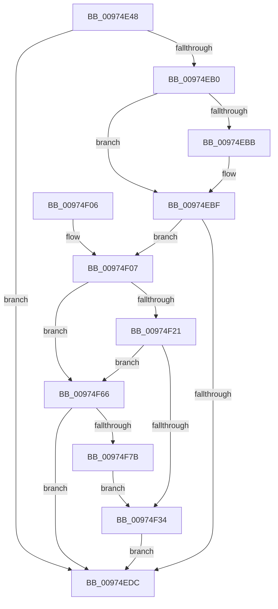

# SeCheckAuditPrivilege

- RVA: `0x00974E48`–`0x00974F7D` (길이 `309` bytes)
- VA: `0x0000000140974E48`
- 실행 섹션: `PAGE`
- PDB 이름 있음: `예`; PDB Function 태그: `아니요`
- unwind 정보 RVA: `0x000964B4`
- 디코드: `82`개 명령, `309/309` bytes 표시
- 미해석 바이트: `0` (있으면 어셈블리에 `.byte`로 보존)

> 이 문서는 커널 이미지의 기계어와 PDB 기호를 분석해 생성했습니다. 4번과 5번은 함수 원형과 자료형을 바이너리 사용 방식에서 추정한 C 해석이며 원본 소스 복구 결과는 아닙니다.

## 1. Dependencies

- 직접 호출 지점: **7**; 고유 호출 대상: **5**
- 직접 호출자로 확인된 함수: **6**
- RIP 상대 이미지 참조: **5**

### Outgoing calls
- `0x00974EA4` → [SepPrivilegeCheck](../../text/40/SepPrivilegeCheck_function_0040B6B0.md) (function, `0x0040B6B0`)
- `0x00974ED3` → [RtlEqualSid](../../text/40/RtlEqualSid_function_00400AD0.md) (function, `0x00400AD0`)
- `0x00974EE7` → [_security_check_cookie](../../text/6A/_security_check_cookie_function_006AC640.md) (function, `0x006AC640`)
- `0x00974F18` → [RtlEqualSid](../../text/40/RtlEqualSid_function_00400AD0.md) (function, `0x00400AD0`)
- `0x00974F2B` → [RtlEqualSid](../../text/40/RtlEqualSid_function_00400AD0.md) (function, `0x00400AD0`)
- `0x00974F5C` → [SepAdtPrivilegedServiceAuditAlarm](../87/SepAdtPrivilegedServiceAuditAlarm_function_008714F0.md) (function, `0x008714F0`)
- `0x00974F6E` → [SepFilterPrivilegeAudits](SepFilterPrivilegeAudits_function_00974F90.md) (function, `0x00974F90`)

### Direct callers
- [NtDeleteObjectAuditAlarm](../7A/NtDeleteObjectAuditAlarm_function_007A03C0.md) at `0x007A042A`
- [NtPrivilegeObjectAuditAlarm](NtPrivilegeObjectAuditAlarm_function_00974170.md) at `0x009741D7`
- [NtPrivilegedServiceAuditAlarm](NtPrivilegedServiceAuditAlarm_function_00974430.md) at `0x00974493`
- [NtOpenObjectAuditAlarm](NtOpenObjectAuditAlarm_function_00974700.md) at `0x009747B3`
- [SepAccessCheckAndAuditAlarm](../A1/SepAccessCheckAndAuditAlarm_function_00A1AF4C.md) at `0x00A1B58B`
- [NtCloseObjectAuditAlarm](../A2/NtCloseObjectAuditAlarm_function_00A21E60.md) at `0x00A21EC6`

### Static image references
- `0x00974E60` → RVA `0x00E0A740` (`.data`; read)
- `0x00974E6F` → RVA `0x00FD9C10` (`PAGEDATA`; read)
- `0x00974EC6` → RVA `0x00E67D58` (`.data`; read)
- `0x00974F07` → RVA `0x00FD9AA0` (`PAGEDATA`; read)
- `0x00974F43` → RVA `0x000013A8` (`.rdata`; read)

## 2. Other-region calls and transfers

- 다른 실행 섹션으로 향하는 call: **5**
  - `0x00974EA4` → [SepPrivilegeCheck](../../text/40/SepPrivilegeCheck_function_0040B6B0.md) (`PAGE` → `.text`)
  - `0x00974ED3` → [RtlEqualSid](../../text/40/RtlEqualSid_function_00400AD0.md) (`PAGE` → `.text`)
  - `0x00974EE7` → [_security_check_cookie](../../text/6A/_security_check_cookie_function_006AC640.md) (`PAGE` → `.text`)
  - `0x00974F18` → [RtlEqualSid](../../text/40/RtlEqualSid_function_00400AD0.md) (`PAGE` → `.text`)
  - `0x00974F2B` → [RtlEqualSid](../../text/40/RtlEqualSid_function_00400AD0.md) (`PAGE` → `.text`)
- 별도 외부 분기/꼬리 이동을 확인하지 못했습니다.

## 3. Assembly (complete function range)

```asm
00974E48  4C 8B DC                        mov r11, rsp
00974E4B  49 89 5B 10                     mov qword ptr [r11 + 0x10], rbx
00974E4F  49 89 6B 18                     mov qword ptr [r11 + 0x18], rbp
00974E53  49 89 73 20                     mov qword ptr [r11 + 0x20], rsi
00974E57  57                              push rdi
00974E58  41 56                           push r14
00974E5A  41 57                           push r15
00974E5C  48 83 EC 60                     sub rsp, 0x60
00974E60  48 8B 05 D9 58 49 00            mov rax, qword ptr [rip + 0x4958d9]
00974E67  48 33 C4                        xor rax, rsp
00974E6A  48 89 44 24 58                  mov qword ptr [rsp + 0x58], rax
00974E6F  48 8B 05 9A 4D 66 00            mov rax, qword ptr [rip + 0x664d9a]
00974E76  41 BF 01 00 00 00               mov r15d, 1
00974E7C  8A DA                           mov bl, dl
00974E7E  88 54 24 20                     mov byte ptr [rsp + 0x20], dl
00974E82  48 8B F9                        mov rdi, rcx
00974E85  45 89 7B C8                     mov dword ptr [r11 - 0x38], r15d
00974E89  48 8B 49 10                     mov rcx, qword ptr [rcx + 0x10]
00974E8D  49 8D 53 D0                     lea rdx, [r11 - 0x30]
00974E91  45 89 7B CC                     mov dword ptr [r11 - 0x34], r15d
00974E95  45 8B CF                        mov r9d, r15d
00974E98  49 89 43 D0                     mov qword ptr [r11 - 0x30], rax
00974E9C  45 8B C7                        mov r8d, r15d
00974E9F  83 64 24 50 00                  and dword ptr [rsp + 0x50], 0
00974EA4  E8 07 68 A9 FF                  call 0x14040b6b0
00974EA9  40 8A E8                        mov bpl, al
00974EAC  84 DB                           test bl, bl
00974EAE  74 2C                           je 0x140974edc
00974EB0  48 8B 1F                        mov rbx, qword ptr [rdi]
00974EB3  48 8B C3                        mov rax, rbx
00974EB6  48 85 DB                        test rbx, rbx
00974EB9  75 04                           jne 0x140974ebf
00974EBB  48 8B 47 10                     mov rax, qword ptr [rdi + 0x10]
00974EBF  48 8B 80 98 00 00 00            mov rax, qword ptr [rax + 0x98]
00974EC6  48 8B 0D 8B 2E 4F 00            mov rcx, qword ptr [rip + 0x4f2e8b]
00974ECD  48 8B 30                        mov rsi, qword ptr [rax]
00974ED0  48 8B D6                        mov rdx, rsi
00974ED3  E8 F8 BB A8 FF                  call 0x140400ad0
00974ED8  84 C0                           test al, al
00974EDA  74 2B                           je 0x140974f07
00974EDC  40 8A C5                        mov al, bpl
00974EDF  48 8B 4C 24 58                  mov rcx, qword ptr [rsp + 0x58]
00974EE4  48 33 CC                        xor rcx, rsp
00974EE7  E8 54 77 D3 FF                  call 0x1406ac640
00974EEC  4C 8D 5C 24 60                  lea r11, [rsp + 0x60]
00974EF1  49 8B 5B 28                     mov rbx, qword ptr [r11 + 0x28]
00974EF5  49 8B 6B 30                     mov rbp, qword ptr [r11 + 0x30]
00974EF9  49 8B 73 38                     mov rsi, qword ptr [r11 + 0x38]
00974EFD  49 8B E3                        mov rsp, r11
00974F00  41 5F                           pop r15
00974F02  41 5E                           pop r14
00974F04  5F                              pop rdi
00974F05  C3                              ret
00974F06  CC                              int3
00974F07  4C 8B 35 92 4B 66 00            mov r14, qword ptr [rip + 0x664b92]
00974F0E  48 8B D6                        mov rdx, rsi
00974F11  49 8B 8E 88 01 00 00            mov rcx, qword ptr [r14 + 0x188]
00974F18  E8 B3 BB A8 FF                  call 0x140400ad0
00974F1D  84 C0                           test al, al
00974F1F  75 45                           jne 0x140974f66
00974F21  49 8B 8E 80 01 00 00            mov rcx, qword ptr [r14 + 0x180]
00974F28  48 8B D6                        mov rdx, rsi
00974F2B  E8 A0 BB A8 FF                  call 0x140400ad0
00974F30  84 C0                           test al, al
00974F32  75 32                           jne 0x140974f66
00974F34  48 8D 44 24 40                  lea rax, [rsp + 0x40]
00974F39  40 88 6C 24 30                  mov byte ptr [rsp + 0x30], bpl
00974F3E  48 89 44 24 28                  mov qword ptr [rsp + 0x28], rax
00974F43  48 8D 15 5E C4 68 FF            lea rdx, [rip - 0x973ba2]
00974F4A  48 8B 47 10                     mov rax, qword ptr [rdi + 0x10]
00974F4E  4C 8B CB                        mov r9, rbx
00974F51  45 33 C0                        xor r8d, r8d
00974F54  48 89 44 24 20                  mov qword ptr [rsp + 0x20], rax
00974F59  48 8B CF                        mov rcx, rdi
00974F5C  E8 8F C5 EF FF                  call 0x1408714f0
00974F61  E9 76 FF FF FF                  jmp 0x140974edc
00974F66  48 8D 54 24 40                  lea rdx, [rsp + 0x40]
00974F6B  41 8B CF                        mov ecx, r15d
00974F6E  E8 1D 00 00 00                  call 0x140974f90
00974F73  84 C0                           test al, al
00974F75  0F 84 61 FF FF FF               je 0x140974edc
00974F7B  EB B7                           jmp 0x140974f34
```

## 4. C-style interpretation (structured pseudocode)

```c
__int64 __fastcall SeCheckAuditPrivilege(__int64 a1, unsigned __int8 a2)
{
    __int64 result;
    __int64 v_rsp;
    unsigned __int64 v_stack_m18;
    unsigned __int64 v_stack_m20;
    unsigned int v_stack_m28;
    unsigned __int8 v_stack_m30;
    unsigned __int64 v_stack_m38;
    unsigned __int64 v_stack_m40;
    unsigned __int8 v_stack_m58;

    *(unsigned __int64 *)(v_rsp + 16) = v_rbx;
    *(unsigned __int64 *)(v_rsp + 24) = v_rbp;
    *(unsigned __int64 *)(v_rsp + 32) = v_rsi;
    v_rsp = (v_rsp) - (96);
    result = (*(unsigned __int64 *)(v_rip + 4806873)) ^ (v_rsp);
    v_stack_m20 = result;
    v_stack_m58 = a2;
    *(unsigned int *)(v_rsp - 56) = 1;
    *(unsigned int *)(v_rsp - 52) = 1;
    *(unsigned __int64 *)(v_rsp - 48) = *(unsigned __int64 *)(v_rip + 6704538);
    result = SepPrivilegeCheck(*(unsigned __int64 *)(a1 + 16), v_rsp - 48, 1, 1);
    if (a2 == 0) goto loc_00974EDC;
    result = *(unsigned __int64 *)(a1);
    if (*(unsigned __int64 *)(a1) == 0) {
        result = *(unsigned __int64 *)(a1 + 16);
    }
    result = RtlEqualSid(*(unsigned __int64 *)(v_rip + 5189259), *(unsigned __int64 *)(*(unsigned __int64 *)(result + 152)), 1, 1);
    if ((unsigned __int8)(result) == 0) goto loc_00974F07;
loc_00974EDC:
    a1 = (v_stack_m20) ^ (v_rsp);
    result = _security_check_cookie(a1, *(unsigned __int64 *)(*(unsigned __int64 *)(result + 152)), 1, 1);
    return result;
loc_00974F07:
    result = RtlEqualSid(*(unsigned __int64 *)(*(unsigned __int64 *)(v_rip + 6704018) + 392), *(unsigned __int64 *)(v_stack_m18 + 56), 1, 1);
    if ((unsigned __int8)(result) != 0) goto loc_00974F66;
    result = RtlEqualSid(*(unsigned __int64 *)(*(unsigned __int64 *)(v_rip + 6704018) + 384), *(unsigned __int64 *)(v_stack_m18 + 56), 1, 1);
    if ((unsigned __int8)(result) != 0) goto loc_00974F66;
loc_00974F34:
    v_stack_m30 = (unsigned __int8)(*(unsigned __int64 *)(v_stack_m18 + 48));
    v_stack_m38 = v_stack_m20;
    a3 = 0;
    v_stack_m40 = *(unsigned __int64 *)(a1 + 16);
    result = SepAdtPrivilegedServiceAuditAlarm(a1, v_rip - 9911202, a3, *(unsigned __int64 *)(v_stack_m18 + 40));
    goto loc_00974EDC;
loc_00974F66:
    result = SepFilterPrivilegeAudits(1, v_stack_m20, a3, *(unsigned __int64 *)(v_stack_m18 + 40));
    if ((unsigned __int8)(result) == 0) goto loc_00974EDC;
    goto loc_00974F34;
}
```

## 5. (Beta) C Style

```c
int64_t SeCheckAuditPrivilege(void *Arg1, uint8_t Arg2)
{
    uint8_t *arg1 = (uint8_t *)Arg1;

    int64_t result;
    int64_t local_rsp;
    uint64_t v_stack_m18;
    uint64_t v_stack_m20;
    uint32_t v_stack_m28;
    uint8_t v_stack_m30;
    uint64_t v_stack_m38;
    uint64_t v_stack_m40;
    uint8_t v_stack_m58;

    *(uint64_t *)(local_rsp + 0x10) = local_rbx;
    *(uint64_t *)(local_rsp + 0x18) = local_rbp;
    *(uint64_t *)(local_rsp + 0x20) = local_rsi;
    local_rsp = (local_rsp) - (96);
    result = (*(uint64_t *)(v_rip + 0x4958D9)) ^ (local_rsp);
    v_stack_m20 = result;
    v_stack_m58 = Arg2;
    *(uint32_t *)(local_rsp - 0x38) = 1;
    *(uint32_t *)(local_rsp - 0x34) = 1;
    *(uint64_t *)(local_rsp - 0x30) = *(uint64_t *)(v_rip + 0x664D9A);
    result = SepPrivilegeCheck(*(uint64_t *)(arg1 + 0x10), local_rsp - 48, 1, 1);
    if (Arg2 == 0) goto loc_00974EDC;
    result = *(uint64_t *)(arg1);
    if (*(uint64_t *)(arg1) == 0) {
        result = *(uint64_t *)(arg1 + 0x10);
    }
    result = RtlEqualSid(*(uint64_t *)(v_rip + 0x4F2E8B), *(uint64_t *)(*(uint64_t *)(result + 0x98)), 1, 1);
    if ((uint8_t)(result) == 0) goto loc_00974F07;
loc_00974EDC:
    Arg1 = (v_stack_m20) ^ (local_rsp);
    result = _security_check_cookie(Arg1, *(uint64_t *)(*(uint64_t *)(result + 0x98)), 1, 1);
    return result;
loc_00974F07:
    result = RtlEqualSid(*(uint64_t *)(*(uint64_t *)(v_rip + 0x664B92) + 0x188), *(uint64_t *)(v_stack_m18 + 0x38), 1, 1);
    if ((uint8_t)(result) != 0) goto loc_00974F66;
    result = RtlEqualSid(*(uint64_t *)(*(uint64_t *)(v_rip + 0x664B92) + 0x180), *(uint64_t *)(v_stack_m18 + 0x38), 1, 1);
    if ((uint8_t)(result) != 0) goto loc_00974F66;
loc_00974F34:
    v_stack_m30 = (uint8_t)(*(uint64_t *)(v_stack_m18 + 0x30));
    v_stack_m38 = v_stack_m20;
    a3 = 0;
    v_stack_m40 = *(uint64_t *)(arg1 + 0x10);
    result = SepAdtPrivilegedServiceAuditAlarm(Arg1, v_rip - 9911202, a3, *(uint64_t *)(v_stack_m18 + 0x28));
    goto loc_00974EDC;
loc_00974F66:
    result = SepFilterPrivilegeAudits(1, v_stack_m20, a3, *(uint64_t *)(v_stack_m18 + 0x28));
    if ((uint8_t)(result) == 0) goto loc_00974EDC;
    goto loc_00974F34;
}
```

### 관측된 메모리 오프셋

구조체 형식이 확인되지 않은 접근은 인자 기준의 오프셋으로만 기록했습니다.

| 기준 인자 | 오프셋 표현 | 폭 (bit) | 접근 |
|---|---:|---:|---|
| `Arg1` | `+ 0x0` | `64` | `R` |
| `Arg1` | `+ 0x10` | `64` | `R` |

## 6. Execution-region graph

[열기: 2D/3D 그래프와 함수 탐색 컨트롤 패널](../../../control-panel.html?section=page&rva=0x00974E48&view=graph)

- 2D 그래프는 위에서 아래로 흐르고, 3D 그래프는 빈 공간을 드래그해 회전합니다. Shift+드래그는 이동, 휠은 확대·축소, 함수 노드 선택은 대상 보고서 이동입니다.

### Static fallback


