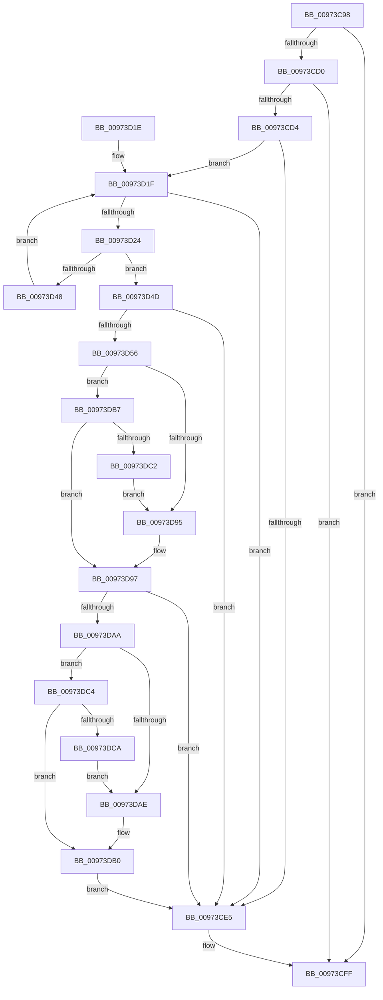

# SeExamineGlobalSacl

- RVA: `0x00973C98`–`0x00973DCC` (길이 `308` bytes)
- VA: `0x0000000140973C98`
- 실행 섹션: `PAGE`
- PDB 이름 있음: `예`; PDB Function 태그: `아니요`
- unwind 정보 RVA: `0x00096368`
- 디코드: `86`개 명령, `308/308` bytes 표시
- 미해석 바이트: `0` (있으면 어셈블리에 `.byte`로 보존)

> 이 문서는 커널 이미지의 기계어와 PDB 기호를 분석해 생성했습니다. 4번과 5번은 함수 원형과 자료형을 바이너리 사용 방식에서 추정한 C 해석이며 원본 소스 복구 결과는 아닙니다.

## 1. Dependencies

- 직접 호출 지점: **5**; 고유 호출 대상: **5**
- 직접 호출자로 확인된 함수: **5**
- RIP 상대 이미지 참조: **2**

### Outgoing calls
- `0x00973CD4` → [SepRmAcquireGlobalSaclReadLock](../../text/46/SepRmAcquireGlobalSaclReadLock_function_0046B608.md) (function, `0x0046B608`)
- `0x00973CEC` → [ExReleaseResourceLite](../../text/25/ExReleaseResourceLite_function_0025FA10.md) (function, `0x0025FA10`)
- `0x00973CFA` → [KeLeaveCriticalRegionThread](../../text/25/KeLeaveCriticalRegionThread_function_0025EFF0.md) (function, `0x0025EFF0`)
- `0x00973D3F` → [RtlCompareUnicodeStrings](RtlCompareUnicodeStrings_function_009727E0.md) (function, `0x009727E0`)
- `0x00973D8C` → [SeExamineSacl](SeExamineSacl_function_00973A30.md) (function, `0x00973A30`)

### Direct callers
- [SeAdtRegistryValueChangedAuditAlarm](../79/SeAdtRegistryValueChangedAuditAlarm_function_0079DDD4.md) at `0x0079DF81`
- [CmpExamineSaclForAuditEvent](../7E/CmpExamineSaclForAuditEvent_function_007ECDB0.md) at `0x007ECE7B`
- [ObpCheckObjectReference](../8C/ObpCheckObjectReference_function_008C6084.md) at `0x008C6291`
- [SeOpenObjectForDeleteAuditAlarmWithTransaction](SeOpenObjectForDeleteAuditAlarmWithTransaction_function_00973EC0.md) at `0x00973FE6`
- [sub_00B46176](../B4/Unknown_function_00B46176.md) at `0x00B4623F`

### Static image references
- `0x00973CD9` → RVA `0x00E680F8` (`.data`; read)
- `0x00973CE5` → RVA `0x00E68100` (`.data`; read)

## 2. Other-region calls and transfers

- 다른 실행 섹션으로 향하는 call: **3**
  - `0x00973CD4` → [SepRmAcquireGlobalSaclReadLock](../../text/46/SepRmAcquireGlobalSaclReadLock_function_0046B608.md) (`PAGE` → `.text`)
  - `0x00973CEC` → [ExReleaseResourceLite](../../text/25/ExReleaseResourceLite_function_0025FA10.md) (`PAGE` → `.text`)
  - `0x00973CFA` → [KeLeaveCriticalRegionThread](../../text/25/KeLeaveCriticalRegionThread_function_0025EFF0.md) (`PAGE` → `.text`)
- 별도 외부 분기/꼬리 이동을 확인하지 못했습니다.

## 3. Assembly (complete function range)

```asm
00973C98  48 8B C4                        mov rax, rsp
00973C9B  48 89 58 08                     mov qword ptr [rax + 8], rbx
00973C9F  48 89 68 10                     mov qword ptr [rax + 0x10], rbp
00973CA3  48 89 70 18                     mov qword ptr [rax + 0x18], rsi
00973CA7  48 89 78 20                     mov qword ptr [rax + 0x20], rdi
00973CAB  41 54                           push r12
00973CAD  41 56                           push r14
00973CAF  41 57                           push r15
00973CB1  48 83 EC 50                     sub rsp, 0x50
00973CB5  48 8B B4 24 98 00 00 00         mov rsi, qword ptr [rsp + 0x98]
00973CBD  33 DB                           xor ebx, ebx
00973CBF  45 8B F1                        mov r14d, r9d
00973CC2  4D 8B F8                        mov r15, r8
00973CC5  4C 8B E2                        mov r12, rdx
00973CC8  48 8B E9                        mov rbp, rcx
00973CCB  48 85 F6                        test rsi, rsi
00973CCE  74 2F                           je 0x140973cff
00973CD0  38 1E                           cmp byte ptr [rsi], bl
00973CD2  75 2B                           jne 0x140973cff
00973CD4  E8 2F 79 AF FF                  call 0x14046b608
00973CD9  48 8B 3D 18 44 4F 00            mov rdi, qword ptr [rip + 0x4f4418]
00973CE0  48 85 FF                        test rdi, rdi
00973CE3  75 3A                           jne 0x140973d1f
00973CE5  48 8D 0D 14 44 4F 00            lea rcx, [rip + 0x4f4414]
00973CEC  E8 1F BD 8E FF                  call 0x14025fa10
00973CF1  65 48 8B 0C 25 88 01 00 00      mov rcx, qword ptr gs:[0x188]
00973CFA  E8 F1 B2 8E FF                  call 0x14025eff0
00973CFF  4C 8D 5C 24 50                  lea r11, [rsp + 0x50]
00973D04  49 8B 5B 20                     mov rbx, qword ptr [r11 + 0x20]
00973D08  49 8B 6B 28                     mov rbp, qword ptr [r11 + 0x28]
00973D0C  49 8B 73 30                     mov rsi, qword ptr [r11 + 0x30]
00973D10  49 8B 7B 38                     mov rdi, qword ptr [r11 + 0x38]
00973D14  49 8B E3                        mov rsp, r11
00973D17  41 5F                           pop r15
00973D19  41 5E                           pop r14
00973D1B  41 5C                           pop r12
00973D1D  C3                              ret
00973D1E  CC                              int3
00973D1F  48 85 FF                        test rdi, rdi
00973D22  74 C1                           je 0x140973ce5
00973D24  44 0F B7 4F 08                  movzx r9d, word ptr [rdi + 8]
00973D29  0F B7 55 00                     movzx edx, word ptr [rbp]
00973D2D  4C 8B 47 10                     mov r8, qword ptr [rdi + 0x10]
00973D31  48 8B 4D 08                     mov rcx, qword ptr [rbp + 8]
00973D35  49 D1 E9                        shr r9, 1
00973D38  48 D1 EA                        shr rdx, 1
00973D3B  88 5C 24 20                     mov byte ptr [rsp + 0x20], bl
00973D3F  E8 9C EA FF FF                  call 0x1409727e0
00973D44  85 C0                           test eax, eax
00973D46  74 05                           je 0x140973d4d
00973D48  48 8B 3F                        mov rdi, qword ptr [rdi]
00973D4B  EB D2                           jmp 0x140973d1f
00973D4D  48 8B 4F 18                     mov rcx, qword ptr [rdi + 0x18]
00973D51  48 85 C9                        test rcx, rcx
00973D54  74 8F                           je 0x140973ce5
00973D56  48 8D 44 24 40                  lea rax, [rsp + 0x40]
00973D5B  88 9C 24 98 00 00 00            mov byte ptr [rsp + 0x98], bl
00973D62  48 89 44 24 30                  mov qword ptr [rsp + 0x30], rax
00973D67  45 8B CE                        mov r9d, r14d
00973D6A  48 8D 84 24 98 00 00 00         lea rax, [rsp + 0x98]
00973D72  88 5C 24 40                     mov byte ptr [rsp + 0x40], bl
00973D76  48 89 44 24 28                  mov qword ptr [rsp + 0x28], rax
00973D7B  4D 8B C7                        mov r8, r15
00973D7E  8A 84 24 90 00 00 00            mov al, byte ptr [rsp + 0x90]
00973D85  49 8B D4                        mov rdx, r12
00973D88  88 44 24 20                     mov byte ptr [rsp + 0x20], al
00973D8C  E8 9F FC FF FF                  call 0x140973a30
00973D91  38 1E                           cmp byte ptr [rsi], bl
00973D93  74 22                           je 0x140973db7
00973D95  B0 01                           mov al, 1
00973D97  88 06                           mov byte ptr [rsi], al
00973D99  48 8B 84 24 A0 00 00 00         mov rax, qword ptr [rsp + 0xa0]
00973DA1  48 85 C0                        test rax, rax
00973DA4  0F 84 3B FF FF FF               je 0x140973ce5
00973DAA  38 18                           cmp byte ptr [rax], bl
00973DAC  74 16                           je 0x140973dc4
00973DAE  B3 01                           mov bl, 1
00973DB0  88 18                           mov byte ptr [rax], bl
00973DB2  E9 2E FF FF FF                  jmp 0x140973ce5
00973DB7  8A C3                           mov al, bl
00973DB9  38 9C 24 98 00 00 00            cmp byte ptr [rsp + 0x98], bl
00973DC0  74 D5                           je 0x140973d97
00973DC2  EB D1                           jmp 0x140973d95
00973DC4  38 5C 24 40                     cmp byte ptr [rsp + 0x40], bl
00973DC8  74 E6                           je 0x140973db0
00973DCA  EB E2                           jmp 0x140973dae
```

## 4. C-style interpretation (structured pseudocode)

```c
__int64 __fastcall SeExamineGlobalSacl(__int64 a1, __int64 a2, __int64 a3, int a4, unsigned __int8 a5, unsigned __int8 a6, __int64 a7)
{
    __int64 result;
    __int64 v_rbx;
    __int64 v_rsp;
    unsigned __int64 v_stack_m10;
    unsigned __int64 v_stack_m18;
    unsigned __int64 v_stack_m20;
    unsigned __int64 v_stack_m28;
    unsigned __int8 v_stack_m30;
    unsigned __int8 v_stack_p48;

    *(unsigned __int64 *)(v_rsp + 8) = v_rbx;
    *(unsigned __int64 *)(v_rsp + 16) = v_rbp;
    *(unsigned __int64 *)(v_rsp + 24) = v_rsi;
    *(unsigned __int64 *)(v_rsp + 32) = v_rdi;
    v_rsp = (v_rsp) - (80);
    v_rbx = 0;
    if (a6 == 0) goto loc_00973CFF;
    if ((*(unsigned __int8 *)(a6)) != 0) goto loc_00973CFF;
    result = SepRmAcquireGlobalSaclReadLock(a1, a2, a3, a4);
    if (*(unsigned __int64 *)(v_rip + 5194776) != 0) goto loc_00973D1F;
loc_00973CE5:
    result = ExReleaseResourceLite(v_rip + 5194772, a2, a3, a4);
    result = KeLeaveCriticalRegionThread(*(unsigned __int64 *)(gs_base + (0 + 392)), a2, a3, a4);
loc_00973CFF:
    return result;
loc_00973D1F:
    if (*(unsigned __int64 *)(v_stack_m18 + 56) == 0) goto loc_00973CE5;
    a4 = (*(unsigned __int16 *)(*(unsigned __int64 *)(v_stack_m18 + 56) + 8)) >> (1);
    a2 = (*(unsigned __int16 *)(*(unsigned __int64 *)(v_stack_m18 + 40))) >> (1);
    v_stack_m30 = (unsigned __int8)(*(unsigned __int64 *)(v_stack_m18 + 32));
    result = RtlCompareUnicodeStrings(*(unsigned __int64 *)(*(unsigned __int64 *)(v_stack_m18 + 40) + 8), a2, *(unsigned __int64 *)(*(unsigned __int64 *)(v_stack_m18 + 56) + 16), a4);
    if ((unsigned int)(result) == 0) goto loc_00973D4D;
    goto loc_00973D1F;
loc_00973D4D:
    if (*(unsigned __int64 *)(*(unsigned __int64 *)(*(unsigned __int64 *)(v_stack_m18 + 56)) + 24) == 0) goto loc_00973CE5;
    v_stack_p48 = (unsigned __int8)(*(unsigned __int64 *)(v_stack_m18 + 32));
    v_stack_m20 = v_stack_m10;
    v_stack_m10 = (unsigned __int8)(*(unsigned __int64 *)(v_stack_m18 + 32));
    v_stack_m28 = a6;
    v_stack_m30 = a5;
    result = SeExamineSacl(*(unsigned __int64 *)(*(unsigned __int64 *)(*(unsigned __int64 *)(v_stack_m18 + 56)) + 24), a2, a3, (unsigned int)((unsigned int)((unsigned int)(a4))));
    if ((*(unsigned __int8 *)(*(unsigned __int64 *)(v_stack_m18 + 48))) == ((unsigned __int8)(*(unsigned __int64 *)(v_stack_m18 + 32)))) goto loc_00973DB7;
loc_00973D95:
loc_00973D97:
    *(unsigned __int8 *)(*(unsigned __int64 *)(v_stack_m18 + 48)) = 1;
    if (a7 == 0) goto loc_00973CE5;
    if ((*(unsigned __int8 *)(a7)) == ((unsigned __int8)(*(unsigned __int64 *)(v_stack_m18 + 32)))) goto loc_00973DC4;
loc_00973DAE:
loc_00973DB0:
    *(unsigned __int8 *)(a7) = 1;
    goto loc_00973CE5;
loc_00973DB7:
    if (a6 == 1) goto loc_00973D97;
    goto loc_00973D95;
loc_00973DC4:
    if (v_stack_m10 == 1) goto loc_00973DB0;
    goto loc_00973DAE;
}
```

## 5. (Beta) C Style

```c
int64_t SeExamineGlobalSacl(void *Arg1, int64_t Arg2, int64_t Arg3, int32_t Arg4, uint8_t Arg5, uint8_t Arg6, int64_t Arg7)
{
    uint8_t *arg1 = (uint8_t *)Arg1;

    int64_t result;
    int64_t local_rbx;
    int64_t local_rsp;
    uint64_t v_stack_m10;
    uint64_t v_stack_m18;
    uint64_t v_stack_m20;
    uint64_t v_stack_m28;
    uint8_t v_stack_m30;
    uint8_t v_stack_p48;

    *(uint64_t *)(local_rsp + 0x8) = local_rbx;
    *(uint64_t *)(local_rsp + 0x10) = local_rbp;
    *(uint64_t *)(local_rsp + 0x18) = local_rsi;
    *(uint64_t *)(local_rsp + 0x20) = local_rdi;
    local_rsp = (local_rsp) - (80);
    local_rbx = 0;
    if (Arg6 == 0) goto loc_00973CFF;
    if ((*(uint8_t *)(Arg6)) != 0) goto loc_00973CFF;
    result = SepRmAcquireGlobalSaclReadLock(Arg1, Arg2, Arg3, Arg4);
    if (*(uint64_t *)(v_rip + 0x4F4418) != 0) goto loc_00973D1F;
loc_00973CE5:
    result = ExReleaseResourceLite(v_rip + 5194772, Arg2, Arg3, Arg4);
    result = KeLeaveCriticalRegionThread(*(uint64_t *)(gs_base + (0 + 0x188)), Arg2, Arg3, Arg4);
loc_00973CFF:
    return result;
loc_00973D1F:
    if (*(uint64_t *)(v_stack_m18 + 0x38) == 0) goto loc_00973CE5;
    Arg4 = (*(uint16_t *)(*(uint64_t *)(v_stack_m18 + 0x38) + 0x8)) >> (1);
    Arg2 = (*(uint16_t *)(*(uint64_t *)(v_stack_m18 + 0x28))) >> (1);
    v_stack_m30 = (uint8_t)(*(uint64_t *)(v_stack_m18 + 0x20));
    result = RtlCompareUnicodeStrings(*(uint64_t *)(*(uint64_t *)(v_stack_m18 + 0x28) + 0x8), Arg2, *(uint64_t *)(*(uint64_t *)(v_stack_m18 + 0x38) + 0x10), Arg4);
    if ((uint32_t)(result) == 0) goto loc_00973D4D;
    goto loc_00973D1F;
loc_00973D4D:
    if (*(uint64_t *)(*(uint64_t *)(*(uint64_t *)(v_stack_m18 + 0x38)) + 0x18) == 0) goto loc_00973CE5;
    v_stack_p48 = (uint8_t)(*(uint64_t *)(v_stack_m18 + 0x20));
    v_stack_m20 = v_stack_m10;
    v_stack_m10 = (uint8_t)(*(uint64_t *)(v_stack_m18 + 0x20));
    v_stack_m28 = Arg6;
    v_stack_m30 = Arg5;
    result = SeExamineSacl(*(uint64_t *)(*(uint64_t *)(*(uint64_t *)(v_stack_m18 + 0x38)) + 0x18), Arg2, Arg3, (uint32_t)((uint32_t)((uint32_t)(Arg4))));
    if ((*(uint8_t *)(*(uint64_t *)(v_stack_m18 + 0x30))) == ((uint8_t)(*(uint64_t *)(v_stack_m18 + 0x20)))) goto loc_00973DB7;
loc_00973D95:
loc_00973D97:
    *(uint8_t *)(*(uint64_t *)(v_stack_m18 + 0x30)) = 1;
    if (Arg7 == 0) goto loc_00973CE5;
    if ((*(uint8_t *)(Arg7)) == ((uint8_t)(*(uint64_t *)(v_stack_m18 + 0x20)))) goto loc_00973DC4;
loc_00973DAE:
loc_00973DB0:
    *(uint8_t *)(Arg7) = 1;
    goto loc_00973CE5;
loc_00973DB7:
    if (Arg6 == 1) goto loc_00973D97;
    goto loc_00973D95;
loc_00973DC4:
    if (v_stack_m10 == 1) goto loc_00973DB0;
    goto loc_00973DAE;
}
```

### 관측된 메모리 오프셋

구조체 형식이 확인되지 않은 접근은 인자 기준의 오프셋으로만 기록했습니다.

| 기준 인자 | 오프셋 표현 | 폭 (bit) | 접근 |
|---|---:|---:|---|
| `Arg1` | `+ 0x0` | `16` | `R` |
| `Arg1` | `+ 0x8` | `64` | `R` |

## 6. Execution-region graph

[열기: 2D/3D 그래프와 함수 탐색 컨트롤 패널](../../../control-panel.html?section=page&rva=0x00973C98&view=graph)

- 2D 그래프는 위에서 아래로 흐르고, 3D 그래프는 빈 공간을 드래그해 회전합니다. Shift+드래그는 이동, 휠은 확대·축소, 함수 노드 선택은 대상 보고서 이동입니다.

### Static fallback


