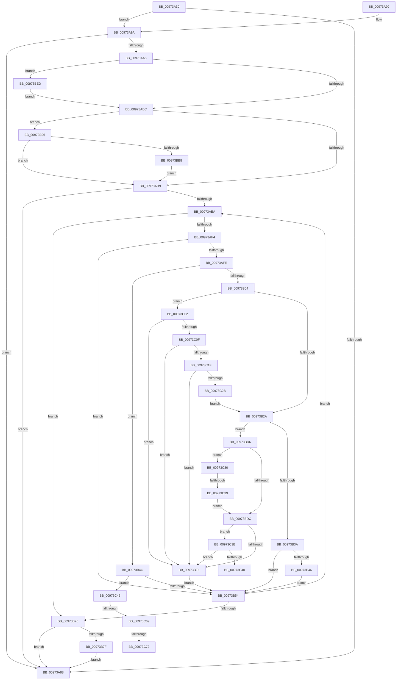

# SeExamineSacl

- RVA: `0x00973A30`–`0x00973C90` (길이 `608` bytes)
- VA: `0x0000000140973A30`
- 실행 섹션: `PAGE`
- PDB 이름 있음: `예`; PDB Function 태그: `예`
- unwind 정보 RVA: `0x0009633C`
- 디코드: `156`개 명령, `608/608` bytes 표시
- 미해석 바이트: `0` (있으면 어셈블리에 `.byte`로 보존)

> 이 문서는 커널 이미지의 기계어와 PDB 기호를 분석해 생성했습니다. 4번과 5번은 함수 원형과 자료형을 바이너리 사용 방식에서 추정한 C 해석이며 원본 소스 복구 결과는 아닙니다.

## 1. Dependencies

- 직접 호출 지점: **6**; 고유 호출 대상: **5**
- 직접 호출자로 확인된 함수: **8**
- RIP 상대 이미지 참조: **2**

### Outgoing calls
- `0x00973B1D` → [SepSidInToken](../../text/3D/SepSidInToken_function_003D0430.md) (function, `0x003D0430`)
- `0x00973B82` → [AuthzBasepFreeSecurityAttributesList](../../text/30/AuthzBasepFreeSecurityAttributesList_function_00301230.md) (function, `0x00301230`)
- `0x00973B8C` → [ExFreePoolWithTag](../../poolcode/B8/ExFreePoolWithTag_function_00B82870.md) (function, `0x00B82870`)
- `0x00973BA3` → [memcmp](../../text/6C/memcmp_function_006C6B10.md) (function, `0x006C6B10`)
- `0x00973C22` → [memcmp](../../text/6C/memcmp_function_006C6B10.md) (function, `0x006C6B10`)
- `0x00973C7A` → [AuthzBasepInitializeResourceClaimsFromSacl](../../text/30/AuthzBasepInitializeResourceClaimsFromSacl_function_00302E84.md) (function, `0x00302E84`)

### Direct callers
- [SeAdtRegistryValueChangedAuditAlarm](../79/SeAdtRegistryValueChangedAuditAlarm_function_0079DDD4.md) at `0x0079DF1A`
- [CmpExamineSaclForAuditEvent](../7E/CmpExamineSaclForAuditEvent_function_007ECDB0.md) at `0x007ECE34`
- [sub_0086E95E](../86/Unknown_function_0086E95E.md) at `0x0086E9A0`
- [sub_0086E95E](../86/Unknown_function_0086E95E.md) at `0x0086EDEE`
- [ObpCheckObjectReference](../8C/ObpCheckObjectReference_function_008C6084.md) at `0x008C621C`
- [SeExamineGlobalSacl](SeExamineGlobalSacl_function_00973C98.md) at `0x00973D8C`
- [SeOpenObjectForDeleteAuditAlarmWithTransaction](SeOpenObjectForDeleteAuditAlarmWithTransaction_function_00973EC0.md) at `0x00974086`
- [NtOpenObjectAuditAlarm](NtOpenObjectAuditAlarm_function_00974700.md) at `0x00974D79`
- [sub_00B46176](../B4/Unknown_function_00B46176.md) at `0x00B461EE`

### Static image references
- `0x00973AC3` → RVA `0x00FD9AC8` (`PAGEDATA`; read)
- `0x00973BB8` → RVA `0x00E67D48` (`.data`; read)

## 2. Other-region calls and transfers

- 다른 실행 섹션으로 향하는 call: **6**
  - `0x00973B1D` → [SepSidInToken](../../text/3D/SepSidInToken_function_003D0430.md) (`PAGE` → `.text`)
  - `0x00973B82` → [AuthzBasepFreeSecurityAttributesList](../../text/30/AuthzBasepFreeSecurityAttributesList_function_00301230.md) (`PAGE` → `.text`)
  - `0x00973B8C` → [ExFreePoolWithTag](../../poolcode/B8/ExFreePoolWithTag_function_00B82870.md) (`PAGE` → `POOLCODE`)
  - `0x00973BA3` → [memcmp](../../text/6C/memcmp_function_006C6B10.md) (`PAGE` → `.text`)
  - `0x00973C22` → [memcmp](../../text/6C/memcmp_function_006C6B10.md) (`PAGE` → `.text`)
  - `0x00973C7A` → [AuthzBasepInitializeResourceClaimsFromSacl](../../text/30/AuthzBasepInitializeResourceClaimsFromSacl_function_00302E84.md) (`PAGE` → `.text`)
- call이 아닌 외부 분기/꼬리 이동: **5**
  - `0x00973C33` → [sub_00B2940C + 0x11F](../B2/Unknown_function_00B2940C.md) (`tail-transfer`)
  - `0x00973C40` → [sub_00B2940C + 0x11F](../B2/Unknown_function_00B2940C.md) (`tail-transfer`)
  - `0x00973C63` → [sub_00B2940C](../B2/Unknown_function_00B2940C.md) (`tail-transfer`)
  - `0x00973C6C` → [sub_00B2940C](../B2/Unknown_function_00B2940C.md) (`tail-transfer`)
  - `0x00973C8B` → [sub_00B2940C](../B2/Unknown_function_00B2940C.md) (`tail-transfer`)

## 3. Assembly (complete function range)

```asm
00973A30  48 8B C4                        mov rax, rsp
00973A33  44 89 48 20                     mov dword ptr [rax + 0x20], r9d
00973A37  4C 89 40 18                     mov qword ptr [rax + 0x18], r8
00973A3B  48 89 50 10                     mov qword ptr [rax + 0x10], rdx
00973A3F  53                              push rbx
00973A40  55                              push rbp
00973A41  56                              push rsi
00973A42  57                              push rdi
00973A43  41 54                           push r12
00973A45  41 55                           push r13
00973A47  41 56                           push r14
00973A49  41 57                           push r15
00973A4B  48 83 EC 78                     sub rsp, 0x78
00973A4F  83 48 A8 FF                     or dword ptr [rax - 0x58], 0xffffffff
00973A53  33 ED                           xor ebp, ebp
00973A55  4C 8B B4 24 E8 00 00 00         mov r14, qword ptr [rsp + 0xe8]
00973A5D  4D 8B E8                        mov r13, r8
00973A60  45 33 C0                        xor r8d, r8d
00973A63  48 89 68 B0                     mov qword ptr [rax - 0x50], rbp
00973A67  48 8B 84 24 F0 00 00 00         mov rax, qword ptr [rsp + 0xf0]
00973A6F  4C 8B D2                        mov r10, rdx
00973A72  44 89 84 24 C0 00 00 00         mov dword ptr [rsp + 0xc0], r8d
00973A7A  48 8B D9                        mov rbx, rcx
00973A7D  41 88 2E                        mov byte ptr [r14], bpl
00973A80  40 88 28                        mov byte ptr [rax], bpl
00973A83  48 85 C9                        test rcx, rcx
00973A86  75 12                           jne 0x140973a9a
00973A88  48 83 C4 78                     add rsp, 0x78
00973A8C  41 5F                           pop r15
00973A8E  41 5E                           pop r14
00973A90  41 5D                           pop r13
00973A92  41 5C                           pop r12
00973A94  5F                              pop rdi
00973A95  5E                              pop rsi
00973A96  5D                              pop rbp
00973A97  5B                              pop rbx
00973A98  C3                              ret
00973A99  CC                              int3
00973A9A  0F B7 79 04                     movzx edi, word ptr [rcx + 4]
00973A9E  89 7C 24 64                     mov dword ptr [rsp + 0x64], edi
00973AA2  85 FF                           test edi, edi
00973AA4  74 E2                           je 0x140973a88
00973AA6  44 8A A4 24 E0 00 00 00         mov r12b, byte ptr [rsp + 0xe0]
00973AAE  40 32 F6                        xor sil, sil
00973AB1  41 0F BA E1 19                  bt r9d, 0x19
00973AB6  0F 82 31 01 00 00               jb 0x140973bed
00973ABC  49 8B 85 98 00 00 00            mov rax, qword ptr [r13 + 0x98]
00973AC3  48 8B 15 FE 5F 66 00            mov rdx, qword ptr [rip + 0x665ffe]
00973ACA  48 8B 08                        mov rcx, qword ptr [rax]
00973ACD  0F B7 02                        movzx eax, word ptr [rdx]
00973AD0  66 39 01                        cmp word ptr [rcx], ax
00973AD3  0F 84 BD 00 00 00               je 0x140973b96
00973AD9  33 C9                           xor ecx, ecx
00973ADB  48 83 C3 08                     add rbx, 8
00973ADF  89 8C 24 E8 00 00 00            mov dword ptr [rsp + 0xe8], ecx
00973AE6  85 FF                           test edi, edi
00973AE8  74 9E                           je 0x140973a88
00973AEA  41 80 3E 00                     cmp byte ptr [r14], 0
00973AEE  0F 85 82 00 00 00               jne 0x140973b76
00973AF4  40 8A 7B 01                     mov dil, byte ptr [rbx + 1]
00973AF8  40 F6 C7 08                     test dil, 8
00973AFC  75 56                           jne 0x140973b54
00973AFE  8A 03                           mov al, byte ptr [rbx]
00973B00  3C 02                           cmp al, 2
00973B02  75 48                           jne 0x140973b4c
00973B04  4C 8D 7B 08                     lea r15, [rbx + 8]
00973B08  C6 44 24 28 00                  mov byte ptr [rsp + 0x28], 0
00973B0D  4D 8B C7                        mov r8, r15
00973B10  C6 44 24 20 00                  mov byte ptr [rsp + 0x20], 0
00973B15  41 B1 01                        mov r9b, 1
00973B18  33 D2                           xor edx, edx
00973B1A  49 8B CD                        mov rcx, r13
00973B1D  E8 0E C9 A5 FF                  call 0x1403d0430
00973B22  84 C0                           test al, al
00973B24  0F 84 D8 00 00 00               je 0x140973c02
00973B2A  8B 43 04                        mov eax, dword ptr [rbx + 4]
00973B2D  85 84 24 D8 00 00 00            test dword ptr [rsp + 0xd8], eax
00973B34  0F 85 9C 00 00 00               jne 0x140973bd6
00973B3A  8B 8C 24 E8 00 00 00            mov ecx, dword ptr [rsp + 0xe8]
00973B41  40 84 F7                        test dil, sil
00973B44  74 0E                           je 0x140973b54
00973B46  41 C6 06 01                     mov byte ptr [r14], 1
00973B4A  EB 08                           jmp 0x140973b54
00973B4C  3C 0D                           cmp al, 0xd
00973B4E  0F 84 F1 00 00 00               je 0x140973c45
00973B54  0F B7 43 02                     movzx eax, word ptr [rbx + 2]
00973B58  FF C1                           inc ecx
00973B5A  4C 8B 94 24 C8 00 00 00         mov r10, qword ptr [rsp + 0xc8]
00973B62  48 03 D8                        add rbx, rax
00973B65  89 8C 24 E8 00 00 00            mov dword ptr [rsp + 0xe8], ecx
00973B6C  3B 4C 24 64                     cmp ecx, dword ptr [rsp + 0x64]
00973B70  0F 82 74 FF FF FF               jb 0x140973aea
00973B76  48 85 ED                        test rbp, rbp
00973B79  0F 84 09 FF FF FF               je 0x140973a88
00973B7F  48 8B CD                        mov rcx, rbp
00973B82  E8 A9 D6 98 FF                  call 0x140301230
00973B87  33 D2                           xor edx, edx
00973B89  48 8B CD                        mov rcx, rbp
00973B8C  E8 DF EC 20 00                  call 0x140b82870
00973B91  E9 F2 FE FF FF                  jmp 0x140973a88
00973B96  44 0F B6 42 01                  movzx r8d, byte ptr [rdx + 1]
00973B9B  4E 8D 04 85 08 00 00 00         lea r8, [r8*4 + 8]
00973BA3  E8 68 2F D5 FF                  call 0x1406c6b10
00973BA8  4C 8B 94 24 C8 00 00 00         mov r10, qword ptr [rsp + 0xc8]
00973BB0  85 C0                           test eax, eax
00973BB2  0F 85 21 FF FF FF               jne 0x140973ad9
00973BB8  48 8B 05 89 41 4F 00            mov rax, qword ptr [rip + 0x4f4189]
00973BBF  0F B6 48 01                     movzx ecx, byte ptr [rax + 1]
00973BC3  8D 0C 8D 08 00 00 00            lea ecx, [rcx*4 + 8]
00973BCA  89 8C 24 C0 00 00 00            mov dword ptr [rsp + 0xc0], ecx
00973BD1  E9 03 FF FF FF                  jmp 0x140973ad9
00973BD6  40 F6 C7 40                     test dil, 0x40
00973BDA  75 54                           jne 0x140973c30
00973BDC  40 84 FF                        test dil, dil
00973BDF  78 5A                           js 0x140973c3b
00973BE1  8B 8C 24 E8 00 00 00            mov ecx, dword ptr [rsp + 0xe8]
00973BE8  E9 67 FF FF FF                  jmp 0x140973b54
00973BED  41 8A C4                        mov al, r12b
00973BF0  F6 D8                           neg al
00973BF2  40 1A F6                        sbb sil, sil
00973BF5  40 80 E6 C0                     and sil, 0xc0
00973BF9  40 80 C6 80                     add sil, 0x80
00973BFD  E9 BA FE FF FF                  jmp 0x140973abc
00973C02  44 8B 84 24 C0 00 00 00         mov r8d, dword ptr [rsp + 0xc0]
00973C0A  45 85 C0                        test r8d, r8d
00973C0D  74 D2                           je 0x140973be1
00973C0F  48 8B 0D 32 41 4F 00            mov rcx, qword ptr [rip + 0x4f4132]
00973C16  41 0F B7 07                     movzx eax, word ptr [r15]
00973C1A  66 39 01                        cmp word ptr [rcx], ax
00973C1D  75 C2                           jne 0x140973be1
00973C1F  49 8B D7                        mov rdx, r15
00973C22  E8 E9 2E D5 FF                  call 0x1406c6b10
00973C27  85 C0                           test eax, eax
00973C29  75 B6                           jne 0x140973be1
00973C2B  E9 FA FE FF FF                  jmp 0x140973b2a
00973C30  45 84 E4                        test r12b, r12b
00973C33  0F 85 F2 58 1B 00               jne 0x140b2952b
00973C39  EB A1                           jmp 0x140973bdc
00973C3B  45 84 E4                        test r12b, r12b
00973C3E  75 A1                           jne 0x140973be1
00973C40  E9 E6 58 1B 00                  jmp 0x140b2952b
00973C45  4C 8D 7B 08                     lea r15, [rbx + 8]
00973C49  41 0F B6 47 01                  movzx eax, byte ptr [r15 + 1]
00973C4E  44 8D 2C 85 08 00 00 00         lea r13d, [rax*4 + 8]
00973C56  8B 43 04                        mov eax, dword ptr [rbx + 4]
00973C59  89 84 24 F0 00 00 00            mov dword ptr [rsp + 0xf0], eax
00973C60  4D 85 D2                        test r10, r10
00973C63  0F 84 A3 57 1B 00               je 0x140b2940c
00973C69  48 85 ED                        test rbp, rbp
00973C6C  0F 85 9A 57 1B 00               jne 0x140b2940c
00973C72  48 8D 54 24 68                  lea rdx, [rsp + 0x68]
00973C77  49 8B CA                        mov rcx, r10
00973C7A  E8 05 F2 98 FF                  call 0x140302e84
00973C7F  8B 8C 24 E8 00 00 00            mov ecx, dword ptr [rsp + 0xe8]
00973C86  48 8B 6C 24 68                  mov rbp, qword ptr [rsp + 0x68]
00973C8B  E9 7C 57 1B 00                  jmp 0x140b2940c
```

## 4. C-style interpretation (structured pseudocode)

```c
__int64 __fastcall SeExamineSacl(__int64 a1, __int64 a2, __int64 a3, int a4, unsigned __int8 a5, unsigned int a6, __int64 a7)
{
    __int64 result;
    __int64 v_rbp;
    __int64 v_rbx;
    __int64 v_rsi;
    __int64 v_rsp;
    unsigned __int8 v_stack_p20;
    unsigned __int8 v_stack_p28;
    unsigned int v_stack_p64;
    unsigned __int64 v_stack_p68;
    unsigned int v_stack_p8;
    unsigned int v_stack_pC0;
    unsigned __int64 v_stack_pC8;
    unsigned int v_stack_pD8;
    unsigned int v_stack_pE8;
    unsigned int v_stack_pF0;

    *(unsigned int *)(v_rsp + 32) = a4;
    *(unsigned __int64 *)(v_rsp + 24) = a3;
    *(unsigned __int64 *)(v_rsp + 16) = a2;
    v_rsp = (v_rsp) - (120);
    v_rbp = 0;
    a3 = 0;
    *(unsigned __int64 *)(v_rsp - 80) = 0;
    v_stack_p8 = 0;
    *(unsigned __int8 *)(a6) = 0;
    *(unsigned __int8 *)(a7) = 0;
    if (a1 != 0) goto loc_00973A9A;
loc_00973A88:
    v_rsp = (v_rsp) + (120);
    return a7;
loc_00973A9A:
    v_stack_p64 = (unsigned int)(*(unsigned __int16 *)(a1 + 4));
    if ((unsigned int)(*(unsigned __int16 *)(a1 + 4)) == 0) goto loc_00973A88;
    v_rsi = 0;
    if (condition_is_below) goto loc_00973BED;
loc_00973ABC:
    if ((*(unsigned __int16 *)(*(unsigned __int64 *)(*(unsigned __int64 *)(a3 + 152)))) == ((unsigned __int16)(*(unsigned __int16 *)(*(unsigned __int64 *)(v_rip + 6709246))))) goto loc_00973B96;
loc_00973AD9:
    a1 = 0;
    v_rbx = (a1) + (8);
    v_stack_pE8 = 0;
    if ((unsigned int)(*(unsigned __int16 *)(a1 + 4)) == 0) goto loc_00973A88;
loc_00973AEA:
    if ((*(unsigned __int8 *)(a6)) != 0) goto loc_00973B76;
    if ((((unsigned __int8)(*(unsigned __int8 *)(v_rbx + 1))) & (8)) != 0) goto loc_00973B54;
    if (((unsigned __int8)(*(unsigned __int8 *)(v_rbx))) != 2) goto loc_00973B4C;
    v_stack_p28 = 0;
    v_stack_p20 = 0;
    a2 = 0;
    result = SepSidInToken(0, a2, v_rbx + 8, 1);
    if ((unsigned __int8)(result) == 0) goto loc_00973C02;
loc_00973B2A:
    if (((v_stack_pD8) & ((unsigned int)((unsigned int)(*(unsigned int *)(v_rbx + 4))))) != 0) goto loc_00973BD6;
    if ((((unsigned __int8)(*(unsigned __int8 *)(v_rbx + 1))) & (0)) == 0) goto loc_00973B54;
    *(unsigned __int8 *)(a6) = 1;
    goto loc_00973B54;
loc_00973B4C:
    if (((unsigned __int8)((unsigned int)(*(unsigned int *)(v_rbx + 4)))) == 13) goto loc_00973C45;
loc_00973B54:
    a1 = (unsigned int)(((unsigned int)(a6)) + 1);
    v_rbx = (v_rbx) + (*(unsigned __int16 *)(v_rbx + 2));
    v_stack_pE8 = (unsigned int)(a1);
    if (((unsigned int)(a1)) < v_stack_p64) goto loc_00973AEA;
loc_00973B76:
    if (0 == 0) goto loc_00973A88;
    result = AuthzBasepFreeSecurityAttributesList(0, a2, v_rbx + 8, 1);
    a2 = 0;
    result = ExFreePoolWithTag(0, a2, v_rbx + 8, 1);
    goto loc_00973A88;
loc_00973B96:
    result = memcmp(0, a2, *(unsigned __int8 *)(a2 + 1) * 4 + 8, 1);
    if ((unsigned int)(result) != 0) goto loc_00973AD9;
    v_stack_pC0 = (unsigned int)(*(unsigned __int8 *)(*(unsigned __int64 *)(v_rip + 5194121) + 1) * 4 + 8);
    goto loc_00973AD9;
loc_00973BD6:
    if ((((unsigned __int8)(*(unsigned __int8 *)(v_rbx + 1))) & (64)) != 0) goto loc_00973C30;
loc_00973BDC:
    if (sign_flag) goto loc_00973C3B;
loc_00973BE1:
    goto loc_00973B54;
loc_00973BED:
    result = (unsigned __int8)(-(a5));
    v_rsi = (unsigned __int8)((v_rsi) & (192));
    v_rsi = (unsigned __int8)((v_rsi) + (128));
    goto loc_00973ABC;
loc_00973C02:
    if ((unsigned int)((unsigned int)(v_stack_pC0)) == 0) goto loc_00973BE1;
    if ((*(unsigned __int16 *)(*(unsigned __int64 *)(v_rip + 5194034))) != ((unsigned __int16)(*(unsigned __int16 *)(v_rbx + 8)))) goto loc_00973BE1;
    result = memcmp(*(unsigned __int64 *)(v_rip + 5194034), v_rbx + 8, (unsigned int)(v_stack_pC0), 1);
    if ((unsigned int)(result) != 0) goto loc_00973BE1;
    goto loc_00973B2A;
loc_00973C30:
    goto loc_00973BDC;
loc_00973C3B:
    if (a5 != 0) goto loc_00973BE1;
loc_00973C45:
    v_stack_pF0 = (unsigned int)((unsigned int)(*(unsigned int *)(v_rbx + 4)));
    result = AuthzBasepInitializeResourceClaimsFromSacl(v_stack_pC8, v_stack_p68, (unsigned int)(v_stack_pC0), 1);
}
```

## 5. (Beta) C Style

```c
void *SeExamineSacl(void *Arg1, int64_t Arg2, void *Arg3, int32_t Arg4, uint8_t Arg5, void *Arg6, void *Arg7)
{
    uint8_t *arg1 = (uint8_t *)Arg1;
    uint8_t *arg3 = (uint8_t *)Arg3;
    uint8_t *arg6 = (uint8_t *)Arg6;
    uint8_t *arg7 = (uint8_t *)Arg7;

    int64_t result;
    int64_t local_rbp;
    int64_t local_rbx;
    int64_t local_rsi;
    int64_t local_rsp;
    uint8_t v_stack_p20;
    uint8_t v_stack_p28;
    uint32_t v_stack_p64;
    uint64_t v_stack_p68;
    uint32_t v_stack_p8;
    uint32_t v_stack_pC0;
    uint64_t v_stack_pC8;
    uint32_t v_stack_pD8;
    uint32_t v_stack_pE8;
    uint32_t v_stack_pF0;

    *(uint32_t *)(local_rsp + 0x20) = Arg4;
    *(void **)(local_rsp + 0x18) = Arg3;
    *(uint64_t *)(local_rsp + 0x10) = Arg2;
    local_rsp = (local_rsp) - (120);
    local_rbp = 0;
    Arg3 = 0;
    *(uint64_t *)(local_rsp - 0x50) = 0;
    v_stack_p8 = 0;
    *(uint8_t *)(arg6) = 0;
    *(uint8_t *)(arg7) = 0;
    if (Arg1 != NULL) goto loc_00973A9A;
loc_00973A88:
    local_rsp = (local_rsp) + (120);
    return Arg7;
loc_00973A9A:
    v_stack_p64 = (uint32_t)(*(uint16_t *)(arg1 + 0x4));
    if ((uint32_t)(*(uint16_t *)(arg1 + 0x4)) == 0) goto loc_00973A88;
    local_rsi = 0;
    if (condition_is_below) goto loc_00973BED;
loc_00973ABC:
    if ((*(uint16_t *)(*(uint64_t *)(*(uint64_t *)(arg3 + 0x98)))) == ((uint16_t)(*(uint16_t *)(*(uint64_t *)(v_rip + 0x665FFE))))) goto loc_00973B96;
loc_00973AD9:
    Arg1 = 0;
    local_rbx = (Arg1) + (8);
    v_stack_pE8 = 0;
    if ((uint32_t)(*(uint16_t *)(arg1 + 0x4)) == 0) goto loc_00973A88;
loc_00973AEA:
    if ((*(uint8_t *)(arg6)) != 0) goto loc_00973B76;
    if ((((uint8_t)(*(uint8_t *)(local_rbx + 0x1))) & (8)) != 0) goto loc_00973B54;
    if (((uint8_t)(*(uint8_t *)(local_rbx))) != 2) goto loc_00973B4C;
    v_stack_p28 = 0;
    v_stack_p20 = 0;
    Arg2 = 0;
    result = SepSidInToken(0, Arg2, local_rbx + 8, 1);
    if ((uint8_t)(result) == 0) goto loc_00973C02;
loc_00973B2A:
    if (((v_stack_pD8) & ((uint32_t)((uint32_t)(*(uint32_t *)(local_rbx + 0x4))))) != 0) goto loc_00973BD6;
    if ((((uint8_t)(*(uint8_t *)(local_rbx + 0x1))) & (0)) == 0) goto loc_00973B54;
    *(uint8_t *)(arg6) = 1;
    goto loc_00973B54;
loc_00973B4C:
    if (((uint8_t)((uint32_t)(*(uint32_t *)(local_rbx + 0x4)))) == 13) goto loc_00973C45;
loc_00973B54:
    Arg1 = (uint32_t)(((uint32_t)(Arg6)) + 1);
    local_rbx = (local_rbx) + (*(uint16_t *)(local_rbx + 0x2));
    v_stack_pE8 = (uint32_t)(Arg1);
    if (((uint32_t)(Arg1)) < v_stack_p64) goto loc_00973AEA;
loc_00973B76:
    if (0 == 0) goto loc_00973A88;
    result = AuthzBasepFreeSecurityAttributesList(0, Arg2, local_rbx + 8, 1);
    Arg2 = 0;
    result = ExFreePoolWithTag(0, Arg2, local_rbx + 8, 1);
    goto loc_00973A88;
loc_00973B96:
    result = memcmp(0, Arg2, *(uint8_t *)(Arg2 + 0x1) * 4 + 8, 1);
    if ((uint32_t)(result) != 0) goto loc_00973AD9;
    v_stack_pC0 = (uint32_t)(*(uint8_t *)(*(uint64_t *)(v_rip + 0x4F4189) + 0x1) * 4 + 8);
    goto loc_00973AD9;
loc_00973BD6:
    if ((((uint8_t)(*(uint8_t *)(local_rbx + 0x1))) & (64)) != 0) goto loc_00973C30;
loc_00973BDC:
    if (sign_flag) goto loc_00973C3B;
loc_00973BE1:
    goto loc_00973B54;
loc_00973BED:
    result = (uint8_t)(-(Arg5));
    local_rsi = (uint8_t)((local_rsi) & (192));
    local_rsi = (uint8_t)((local_rsi) + (128));
    goto loc_00973ABC;
loc_00973C02:
    if ((uint32_t)((uint32_t)(v_stack_pC0)) == 0) goto loc_00973BE1;
    if ((*(uint16_t *)(*(uint64_t *)(v_rip + 0x4F4132))) != ((uint16_t)(*(uint16_t *)(local_rbx + 0x8)))) goto loc_00973BE1;
    result = memcmp(*(uint64_t *)(v_rip + 0x4F4132), local_rbx + 8, (uint32_t)(v_stack_pC0), 1);
    if ((uint32_t)(result) != 0) goto loc_00973BE1;
    goto loc_00973B2A;
loc_00973C30:
    goto loc_00973BDC;
loc_00973C3B:
    if (Arg5 != 0) goto loc_00973BE1;
loc_00973C45:
    v_stack_pF0 = (uint32_t)((uint32_t)(*(uint32_t *)(local_rbx + 0x4)));
    result = AuthzBasepInitializeResourceClaimsFromSacl(v_stack_pC8, v_stack_p68, (uint32_t)(v_stack_pC0), 1);
}
```

### 관측된 메모리 오프셋

구조체 형식이 확인되지 않은 접근은 인자 기준의 오프셋으로만 기록했습니다.

| 기준 인자 | 오프셋 표현 | 폭 (bit) | 접근 |
|---|---:|---:|---|
| `Arg1` | `+ 0x0` | `8` | `R` |
| `Arg1` | `+ 0x0` | `16` | `R` |
| `Arg1` | `+ 0x1` | `8` | `R` |
| `Arg1` | `+ 0x2` | `16` | `R` |
| `Arg1` | `+ 0x4` | `32` | `R` |
| `Arg1` | `+ 0x8` | `64` | `R` |
| `Arg3` | `+ 0x98` | `64` | `R` |
| `Arg6` | `+ 0x0` | `8` | `R` |
| `Arg6` | `+ 0x0` | `8` | `W` |
| `Arg7` | `+ 0x0` | `8` | `W` |

## 6. Execution-region graph

[열기: 2D/3D 그래프와 함수 탐색 컨트롤 패널](../../../control-panel.html?section=page&rva=0x00973A30&view=graph)

- 2D 그래프는 위에서 아래로 흐르고, 3D 그래프는 빈 공간을 드래그해 회전합니다. Shift+드래그는 이동, 휠은 확대·축소, 함수 노드 선택은 대상 보고서 이동입니다.

### Static fallback


