# SeOpenObjectForDeleteAuditAlarmWithTransaction

- RVA: `0x00973EC0`–`0x00974163` (길이 `675` bytes)
- VA: `0x0000000140973EC0`
- 실행 섹션: `PAGE`
- PDB 이름 있음: `예`; PDB Function 태그: `예`
- unwind 정보 RVA: `0x000963A4`
- 디코드: `181`개 명령, `675/675` bytes 표시
- 미해석 바이트: `0` (있으면 어셈블리에 `.byte`로 보존)

> 이 문서는 커널 이미지의 기계어와 PDB 기호를 분석해 생성했습니다. 4번과 5번은 함수 원형과 자료형을 바이너리 사용 방식에서 추정한 C 해석이며 원본 소스 복구 결과는 아닙니다.

## 1. Dependencies

- 직접 호출 지점: **6**; 고유 호출 대상: **6**
- 직접 호출자로 확인된 함수: **1**
- RIP 상대 이미지 참조: **0**

### Outgoing calls
- `0x00973FE6` → [SeExamineGlobalSacl](SeExamineGlobalSacl_function_00973C98.md) (function, `0x00973C98`)
- `0x00974028` → [SepAdtAuditObjectAccessWithContext](../86/SepAdtAuditObjectAccessWithContext_function_0086EEF0.md) (function, `0x0086EEF0`)
- `0x00974086` → [SeExamineSacl](SeExamineSacl_function_00973A30.md) (function, `0x00973A30`)
- `0x009740C6` → [SepQueryTypeString](../92/SepQueryTypeString_function_00920420.md) (function, `0x00920420`)
- `0x00974132` → [SepAdtAuditPrivilegeUseWithContext](../87/SepAdtAuditPrivilegeUseWithContext_function_00870BD0.md) (function, `0x00870BD0`)
- `0x00974159` → [SepAuditFailed](../86/SepAuditFailed_function_0086EE20.md) (function, `0x0086EE20`)

### Direct callers
- [SeOpenObjectForDeleteAuditAlarm](SeOpenObjectForDeleteAuditAlarm_function_009751C0.md) at `0x00975212`

### Static image references
- 디코드된 RIP-relative 메모리 참조가 없습니다.

## 2. Other-region calls and transfers

- 다른 실행 섹션으로 향하는 call: **0**
- call이 아닌 외부 분기/꼬리 이동: **7**
  - `0x0097409C` → [sub_00B29542 + 0x2C](../B2/Unknown_function_00B29542.md) (`tail-transfer`)
  - `0x009740D7` → [sub_00B29542 + 0x240](../B2/Unknown_function_00B29542.md) (`tail-transfer`)
  - `0x009740F8` → [sub_00B29542 + 0x6](../B2/Unknown_function_00B29542.md) (`tail-transfer`)
  - `0x00974103` → [sub_00B29542](../B2/Unknown_function_00B29542.md) (`tail-transfer`)
  - `0x0097410C` → [sub_00B29542 + 0xA](../B2/Unknown_function_00B29542.md) (`tail-transfer`)
  - `0x0097411B` → [sub_00B29542 + 0x35](../B2/Unknown_function_00B29542.md) (`tail-transfer`)
  - `0x00974152` → [sub_00B29542 + 0x35](../B2/Unknown_function_00B29542.md) (`tail-transfer`)

## 3. Assembly (complete function range)

```asm
00973EC0  48 8B C4                        mov rax, rsp
00973EC3  48 89 58 20                     mov qword ptr [rax + 0x20], rbx
00973EC7  4C 89 40 18                     mov qword ptr [rax + 0x18], r8
00973ECB  48 89 50 10                     mov qword ptr [rax + 0x10], rdx
00973ECF  48 89 48 08                     mov qword ptr [rax + 8], rcx
00973ED3  55                              push rbp
00973ED4  56                              push rsi
00973ED5  57                              push rdi
00973ED6  41 54                           push r12
00973ED8  41 55                           push r13
00973EDA  41 56                           push r14
00973EDC  41 57                           push r15
00973EDE  48 8D 68 C1                     lea rbp, [rax - 0x3f]
00973EE2  48 81 EC D0 00 00 00            sub rsp, 0xd0
00973EE9  48 8B 5D 67                     mov rbx, qword ptr [rbp + 0x67]
00973EED  49 8B F1                        mov rsi, r9
00973EF0  45 33 C9                        xor r9d, r9d
00973EF3  48 8B C1                        mov rax, rcx
00973EF6  B9 E7 03 00 00                  mov ecx, 0x3e7
00973EFB  4C 8B D2                        mov r10, rdx
00973EFE  45 8A F9                        mov r15b, r9b
00973F01  44 88 4D D7                     mov byte ptr [rbp - 0x29], r9b
00973F05  45 8A E1                        mov r12b, r9b
00973F08  44 88 4D D8                     mov byte ptr [rbp - 0x28], r9b
00973F0C  45 8B E9                        mov r13d, r9d
00973F0F  4C 89 4D F7                     mov qword ptr [rbp - 9], r9
00973F13  41 8B F9                        mov edi, r9d
00973F16  4C 89 4D EF                     mov qword ptr [rbp - 0x11], r9
00973F1A  45 8B F1                        mov r14d, r9d
00973F1D  44 89 4D DF                     mov dword ptr [rbp - 0x21], r9d
00973F21  66 89 4D DB                     mov word ptr [rbp - 0x25], cx
00973F25  44 38 4D 7F                     cmp byte ptr [rbp + 0x7f], r9b
00973F29  74 70                           je 0x140973f9b
00973F2B  48 8B 4B 48                     mov rcx, qword ptr [rbx + 0x48]
00973F2F  48 8D 53 20                     lea rdx, [rbx + 0x20]
00973F33  48 89 4D E7                     mov qword ptr [rbp - 0x19], rcx
00973F37  48 8B 0A                        mov rcx, qword ptr [rdx]
00973F3A  48 89 4D FF                     mov qword ptr [rbp - 1], rcx
00973F3E  48 85 C9                        test rcx, rcx
00973F41  74 74                           je 0x140973fb7
00973F43  48 85 C0                        test rax, rax
00973F46  0F 84 6A 01 00 00               je 0x1409740b6
00973F4C  66 44 39 08                     cmp word ptr [rax], r9w
00973F50  0F 84 60 01 00 00               je 0x1409740b6
00973F56  4C 8B F0                        mov r14, rax
00973F59  48 85 F6                        test rsi, rsi
00973F5C  0F 85 A2 00 00 00               jne 0x140974004
00973F62  8A 45 77                        mov al, byte ptr [rbp + 0x77]
00973F65  84 C0                           test al, al
00973F67  74 15                           je 0x140973f7e
00973F69  48 8B 4D E7                     mov rcx, qword ptr [rbp - 0x19]
00973F6D  48 8B 09                        mov rcx, qword ptr [rcx]
00973F70  48 85 C9                        test rcx, rcx
00973F73  74 09                           je 0x140973f7e
00973F75  44 39 09                        cmp dword ptr [rcx], r9d
00973F78  0F 87 A2 01 00 00               ja 0x140974120
00973F7E  45 84 FF                        test r15b, r15b
00973F81  0F 85 C7 01 00 00               jne 0x14097414e
00973F87  45 84 E4                        test r12b, r12b
00973F8A  0F 85 BE 01 00 00               jne 0x14097414e
00973F90  8B 45 DF                        mov eax, dword ptr [rbp - 0x21]
00973F93  85 C0                           test eax, eax
00973F95  0F 88 BC 01 00 00               js 0x140974157
00973F9B  48 8B 9C 24 28 01 00 00         mov rbx, qword ptr [rsp + 0x128]
00973FA3  48 81 C4 D0 00 00 00            add rsp, 0xd0
00973FAA  41 5F                           pop r15
00973FAC  41 5E                           pop r14
00973FAE  41 5D                           pop r13
00973FB0  41 5C                           pop r12
00973FB2  5F                              pop rdi
00973FB3  5E                              pop rsi
00973FB4  5D                              pop rbp
00973FB5  C3                              ret
00973FB6  CC                              int3
00973FB7  48 8B 4B 30                     mov rcx, qword ptr [rbx + 0x30]
00973FBB  48 89 4D FF                     mov qword ptr [rbp - 1], rcx
00973FBF  EB 82                           jmp 0x140973f43
00973FC1  48 8B D1                        mov rdx, rcx
00973FC4  44 8B 4D 7F                     mov r9d, dword ptr [rbp + 0x7f]
00973FC8  48 8D 45 D8                     lea rax, [rbp - 0x28]
00973FCC  48 8B 4D 47                     mov rcx, qword ptr [rbp + 0x47]
00973FD0  4D 8B C7                        mov r8, r15
00973FD3  48 89 44 24 30                  mov qword ptr [rsp + 0x30], rax
00973FD8  48 8D 45 D7                     lea rax, [rbp - 0x29]
00973FDC  48 89 44 24 28                  mov qword ptr [rsp + 0x28], rax
00973FE1  44 88 64 24 20                  mov byte ptr [rsp + 0x20], r12b
00973FE6  E8 AD FC FF FF                  call 0x140973c98
00973FEB  44 8A 7D D7                     mov r15b, byte ptr [rbp - 0x29]
00973FEF  45 33 C9                        xor r9d, r9d
00973FF2  45 84 FF                        test r15b, r15b
00973FF5  0F 85 16 01 00 00               jne 0x140974111
00973FFB  44 8A 65 D8                     mov r12b, byte ptr [rbp - 0x28]
00973FFF  E9 5E FF FF FF                  jmp 0x140973f62
00974004  44 8A 45 77                     mov r8b, byte ptr [rbp + 0x77]
00974008  48 8D 4D DB                     lea rcx, [rbp - 0x25]
0097400C  48 89 4C 24 30                  mov qword ptr [rsp + 0x30], rcx
00974011  45 84 C0                        test r8b, r8b
00974014  C6 44 24 28 01                  mov byte ptr [rsp + 0x28], 1
00974019  49 8B CA                        mov rcx, r10
0097401C  48 89 54 24 20                  mov qword ptr [rsp + 0x20], rdx
00974021  41 0F 94 C1                     sete r9b
00974025  48 8B D0                        mov rdx, rax
00974028  E8 C3 AE EF FF                  call 0x14086eef0
0097402D  45 33 C9                        xor r9d, r9d
00974030  84 C0                           test al, al
00974032  0F 84 2A FF FF FF               je 0x140973f62
00974038  0F B7 46 02                     movzx eax, word ptr [rsi + 2]
0097403C  BA 00 80 00 00                  mov edx, 0x8000
00974041  44 8B 43 14                     mov r8d, dword ptr [rbx + 0x14]
00974045  0F B7 C8                        movzx ecx, ax
00974048  44 0B 43 10                     or r8d, dword ptr [rbx + 0x10]
0097404C  66 23 CA                        and cx, dx
0097404F  44 89 45 7F                     mov dword ptr [rbp + 0x7f], r8d
00974053  A8 10                           test al, 0x10
00974055  0F 85 9A 00 00 00               jne 0x1409740f5
0097405B  41 8B D1                        mov edx, r9d
0097405E  49 8B C9                        mov rcx, r9
00974061  4C 8B 7D FF                     mov r15, qword ptr [rbp - 1]
00974065  48 8D 45 D8                     lea rax, [rbp - 0x28]
00974069  44 8A 65 77                     mov r12b, byte ptr [rbp + 0x77]
0097406D  45 8B C8                        mov r9d, r8d
00974070  48 89 44 24 30                  mov qword ptr [rsp + 0x30], rax
00974075  4D 8B C7                        mov r8, r15
00974078  48 8D 45 D7                     lea rax, [rbp - 0x29]
0097407C  48 89 44 24 28                  mov qword ptr [rsp + 0x28], rax
00974081  44 88 64 24 20                  mov byte ptr [rsp + 0x20], r12b
00974086  E8 A5 F9 FF FF                  call 0x140973a30
0097408B  0F B7 46 02                     movzx eax, word ptr [rsi + 2]
0097408F  33 C9                           xor ecx, ecx
00974091  A8 10                           test al, 0x10
00974093  0F 84 28 FF FF FF               je 0x140973fc1
00974099  66 85 C0                        test ax, ax
0097409C  0F 89 CC 54 1B 00               jns 0x140b2956e
009740A2  8B 46 0C                        mov eax, dword ptr [rsi + 0xc]
009740A5  85 C0                           test eax, eax
009740A7  0F 84 14 FF FF FF               je 0x140973fc1
009740AD  48 8D 14 06                     lea rdx, [rsi + rax]
009740B1  E9 0E FF FF FF                  jmp 0x140973fc4
009740B6  4D 85 D2                        test r10, r10
009740B9  0F 84 9A FE FF FF               je 0x140973f59
009740BF  48 8D 55 EF                     lea rdx, [rbp - 0x11]
009740C3  49 8B CA                        mov rcx, r10
009740C6  E8 55 C3 FA FF                  call 0x140920420
009740CB  4C 8B 6D EF                     mov r13, qword ptr [rbp - 0x11]
009740CF  45 33 C9                        xor r9d, r9d
009740D2  89 45 DF                        mov dword ptr [rbp - 0x21], eax
009740D5  85 C0                           test eax, eax
009740D7  0F 88 A5 56 1B 00               js 0x140b29782
009740DD  48 8B 45 47                     mov rax, qword ptr [rbp + 0x47]
009740E1  48 8D 53 20                     lea rdx, [rbx + 0x20]
009740E5  4C 8B 55 4F                     mov r10, qword ptr [rbp + 0x4f]
009740E9  4D 85 ED                        test r13, r13
009740EC  4D 0F 45 F5                     cmovne r14, r13
009740F0  E9 64 FE FF FF                  jmp 0x140973f59
009740F5  66 85 C9                        test cx, cx
009740F8  0F 84 4A 54 1B 00               je 0x140b29548
009740FE  8B 46 0C                        mov eax, dword ptr [rsi + 0xc]
00974101  85 C0                           test eax, eax
00974103  0F 85 39 54 1B 00               jne 0x140b29542
00974109  49 8B D1                        mov rdx, r9
0097410C  E9 3B 54 1B 00                  jmp 0x140b2954c
00974111  48 8B 85 8F 00 00 00            mov rax, qword ptr [rbp + 0x8f]
00974118  C6 00 01                        mov byte ptr [rax], 1
0097411B  E9 57 54 1B 00                  jmp 0x140b29577
00974120  48 8D 55 DB                     lea rdx, [rbp - 0x25]
00974124  45 33 C0                        xor r8d, r8d
00974127  48 89 54 24 20                  mov qword ptr [rsp + 0x20], rdx
0097412C  4C 8D 4B 20                     lea r9, [rbx + 0x20]
00974130  8A D0                           mov dl, al
00974132  E8 99 CA EF FF                  call 0x140870bd0
00974137  45 33 C9                        xor r9d, r9d
0097413A  84 C0                           test al, al
0097413C  0F 84 3C FE FF FF               je 0x140973f7e
00974142  41 B7 01                        mov r15b, 1
00974145  44 88 7B 7C                     mov byte ptr [rbx + 0x7c], r15b
00974149  E9 30 FE FF FF                  jmp 0x140973f7e
0097414E  44 8A 65 77                     mov r12b, byte ptr [rbp + 0x77]
00974152  E9 20 54 1B 00                  jmp 0x140b29577
00974157  8B C8                           mov ecx, eax
00974159  E8 C2 AC EF FF                  call 0x14086ee20
0097415E  E9 38 FE FF FF                  jmp 0x140973f9b
```

## 4. C-style interpretation (structured pseudocode)

```c
__int64 __fastcall SeOpenObjectForDeleteAuditAlarmWithTransaction(__int64 a1, __int64 a2, __int64 a3, __int64 a4)
{
    __int64 result;
    __int64 v_rsp;
    unsigned __int64 v_stack_p20;
    unsigned __int64 v_stack_p28;
    unsigned __int64 v_stack_p30;

    *(unsigned __int64 *)(v_rsp + 32) = v_rbx;
    *(unsigned __int64 *)(v_rsp + 24) = a3;
    *(unsigned __int64 *)(v_rsp + 16) = a2;
    *(unsigned __int64 *)(v_rsp + 8) = a1;
    v_rsp = (v_rsp) - (208);
    a4 = 0;
    *(unsigned __int8 *)(v_rsp - 63 - 41) = 0;
    *(unsigned __int8 *)(v_rsp - 63 - 40) = 0;
    *(unsigned __int64 *)(v_rsp - 63 - 9) = 0;
    *(unsigned __int64 *)(v_rsp - 63 - 17) = 0;
    *(unsigned int *)(v_rsp - 63 - 33) = 0;
    *(unsigned __int16 *)(v_rsp - 63 - 37) = 999;
    if ((*(unsigned __int8 *)(v_rsp - 63 + 127)) == 0) goto loc_00973F9B;
    *(unsigned __int64 *)(v_rsp - 63 - 25) = *(unsigned __int64 *)(*(unsigned __int64 *)(v_rsp - 63 + 103) + 72);
    *(unsigned __int64 *)(v_rsp - 63 - 1) = *(unsigned __int64 *)(*(unsigned __int64 *)(v_rsp - 63 + 103) + 32);
    if (*(unsigned __int64 *)(*(unsigned __int64 *)(v_rsp - 63 + 103) + 32) == 0) goto loc_00973FB7;
loc_00973F43:
    if (a1 == 0) goto loc_009740B6;
    if ((*(unsigned __int16 *)(a1)) == 0) goto loc_009740B6;
loc_00973F59:
    if (0 != 0) goto loc_00974004;
loc_00973F62:
    if ((unsigned __int8)(*(unsigned __int8 *)(v_rsp - 63 + 119)) == 0) goto loc_00973F7E;
    if (*(unsigned __int64 *)(*(unsigned __int64 *)(v_rsp - 63 - 25)) == 0) goto loc_00973F7E;
    if ((*(unsigned int *)(*(unsigned __int64 *)(*(unsigned __int64 *)(v_rsp - 63 - 25)))) > 0) goto loc_00974120;
loc_00973F7E:
    if (0 != 0) goto loc_0097414E;
    if (0 != 0) goto loc_0097414E;
    if (sign_flag) goto loc_00974157;
loc_00973F9B:
    v_rsp = (v_rsp) + (208);
    return (unsigned int)(*(unsigned int *)(v_rsp - 63 - 33));
loc_00973FB7:
    *(unsigned __int64 *)(v_rsp - 63 - 1) = *(unsigned __int64 *)(v_stack_p20 + 48);
    goto loc_00973F43;
loc_00973FC1:
loc_00973FC4:
    v_stack_p30 = v_rsp - 63 - 40;
    v_stack_p28 = v_rsp - 63 - 41;
    v_stack_p20 = 0;
    result = SeExamineGlobalSacl(*(unsigned __int64 *)(v_rsp - 63 + 71), *(unsigned __int64 *)(v_stack_p20 + 48), 0, (unsigned int)(*(unsigned int *)(v_rsp - 63 + 127)));
    a4 = 0;
    if ((unsigned __int8)(*(unsigned __int8 *)(v_rsp - 63 - 41)) != 0) goto loc_00974111;
    goto loc_00973F62;
loc_00974004:
    v_stack_p30 = v_rsp - 63 - 37;
    v_stack_p28 = 1;
    v_stack_p20 = *(unsigned __int64 *)(v_stack_p20 + 48);
    a4 = ((unsigned __int8)(*(unsigned __int8 *)(v_rsp - 63 + 119)) == 0) ? 1 : 0;
    result = SepAdtAuditObjectAccessWithContext(a2, result, *(unsigned __int8 *)(v_rsp - 63 + 119), a4);
    a4 = 0;
    if ((unsigned __int8)(result) == 0) goto loc_00973F62;
    a3 = (unsigned int)(((unsigned int)(*(unsigned int *)(v_stack_p20 + 20))) | (*(unsigned int *)(v_stack_p20 + 16)));
    a1 = (unsigned __int16)(((unsigned __int16)(*(unsigned __int16 *)(a4 + 2))) & ((unsigned __int16)((unsigned int)(0x8000ULL))));
    *(unsigned int *)(v_rsp - 63 + 127) = (unsigned int)(a3);
    if ((((unsigned __int8)(*(unsigned __int16 *)(a4 + 2))) & (16)) != 0) goto loc_009740F5;
    v_stack_p30 = v_rsp - 63 - 40;
    v_stack_p28 = v_rsp - 63 - 41;
    v_stack_p20 = (unsigned __int8)(*(unsigned __int8 *)(v_rsp - 63 + 119));
    result = SeExamineSacl(0, 0, *(unsigned __int64 *)(v_rsp - 63 - 1), (unsigned int)((unsigned int)(a3)));
    a1 = 0;
    if ((((unsigned __int8)(*(unsigned __int16 *)(a4 + 2))) & (16)) == 0) goto loc_00973FC1;
    if ((unsigned int)((unsigned int)(*(unsigned int *)(a4 + 12))) == 0) goto loc_00973FC1;
    goto loc_00973FC4;
loc_009740B6:
    if (a2 == 0) goto loc_00973F59;
    result = SepQueryTypeString(a2, v_rsp - 63 - 17, *(unsigned __int64 *)(v_rsp - 63 - 1), (unsigned int)((unsigned int)(a3)));
    a4 = 0;
    *(unsigned int *)(v_rsp - 63 - 33) = (unsigned int)(result);
    if (*(unsigned __int64 *)(v_rsp - 63 - 17) != 0) { a1 = *(unsigned __int64 *)(v_rsp - 63 - 17); }
    goto loc_00973F59;
loc_009740F5:
loc_00974111:
    *(unsigned __int8 *)(*(unsigned __int64 *)(v_rsp - 63 + 143)) = 1;
loc_00974120:
    a3 = 0;
    v_stack_p20 = v_rsp - 63 - 37;
    result = SepAdtAuditPrivilegeUseWithContext(a2, (unsigned __int8)(*(unsigned __int64 *)(v_rsp - 63 + 143)), a3, v_stack_p20 + 32);
    a4 = 0;
    if ((unsigned __int8)(result) == 0) goto loc_00973F7E;
    *(unsigned __int8 *)(v_stack_p20 + 124) = 1;
    goto loc_00973F7E;
loc_0097414E:
loc_00974157:
    result = SepAuditFailed((unsigned int)((unsigned int)(result)), (unsigned __int8)(*(unsigned __int64 *)(v_rsp - 63 + 143)), a3, a4);
    goto loc_00973F9B;
}
```

## 5. (Beta) C Style

```c
int64_t SeOpenObjectForDeleteAuditAlarmWithTransaction(int64_t Arg1, int64_t Arg2, int64_t Arg3, int64_t Arg4)
{
    int64_t result;
    int64_t local_rsp;
    uint64_t v_stack_p20;
    uint64_t v_stack_p28;
    uint64_t v_stack_p30;

    *(uint64_t *)(local_rsp + 0x20) = local_rbx;
    *(uint64_t *)(local_rsp + 0x18) = Arg3;
    *(uint64_t *)(local_rsp + 0x10) = Arg2;
    *(uint64_t *)(local_rsp + 0x8) = Arg1;
    local_rsp = (local_rsp) - (208);
    Arg4 = 0;
    *(uint8_t *)(local_rsp - 0x3F - 0x29) = 0;
    *(uint8_t *)(local_rsp - 0x3F - 0x28) = 0;
    *(uint64_t *)(local_rsp - 0x3F - 0x9) = 0;
    *(uint64_t *)(local_rsp - 0x3F - 0x11) = 0;
    *(uint32_t *)(local_rsp - 0x3F - 0x21) = 0;
    *(uint16_t *)(local_rsp - 0x3F - 0x25) = 999;
    if ((*(uint8_t *)(local_rsp - 0x3F + 0x7F)) == 0) goto loc_00973F9B;
    *(uint64_t *)(local_rsp - 0x3F - 0x19) = *(uint64_t *)(*(uint64_t *)(local_rsp - 0x3F + 0x67) + 0x48);
    *(uint64_t *)(local_rsp - 0x3F - 0x1) = *(uint64_t *)(*(uint64_t *)(local_rsp - 0x3F + 0x67) + 0x20);
    if (*(uint64_t *)(*(uint64_t *)(local_rsp - 0x3F + 0x67) + 0x20) == 0) goto loc_00973FB7;
loc_00973F43:
    if (Arg1 == 0) goto loc_009740B6;
    if ((*(uint16_t *)(Arg1)) == 0) goto loc_009740B6;
loc_00973F59:
    if (0 != 0) goto loc_00974004;
loc_00973F62:
    if ((uint8_t)(*(uint8_t *)(local_rsp - 0x3F + 0x77)) == 0) goto loc_00973F7E;
    if (*(uint64_t *)(*(uint64_t *)(local_rsp - 0x3F - 0x19)) == 0) goto loc_00973F7E;
    if ((*(uint32_t *)(*(uint64_t *)(*(uint64_t *)(local_rsp - 0x3F - 0x19)))) > 0) goto loc_00974120;
loc_00973F7E:
    if (0 != 0) goto loc_0097414E;
    if (0 != 0) goto loc_0097414E;
    if (sign_flag) goto loc_00974157;
loc_00973F9B:
    local_rsp = (local_rsp) + (208);
    return (uint32_t)(*(uint32_t *)(local_rsp - 0x3F - 0x21));
loc_00973FB7:
    *(uint64_t *)(local_rsp - 0x3F - 0x1) = *(uint64_t *)(v_stack_p20 + 0x30);
    goto loc_00973F43;
loc_00973FC1:
loc_00973FC4:
    v_stack_p30 = local_rsp - 63 - 40;
    v_stack_p28 = local_rsp - 63 - 41;
    v_stack_p20 = 0;
    result = SeExamineGlobalSacl(*(uint64_t *)(local_rsp - 0x3F + 0x47), *(uint64_t *)(v_stack_p20 + 0x30), 0, (uint32_t)(*(uint32_t *)(local_rsp - 0x3F + 0x7F)));
    Arg4 = 0;
    if ((uint8_t)(*(uint8_t *)(local_rsp - 0x3F - 0x29)) != 0) goto loc_00974111;
    goto loc_00973F62;
loc_00974004:
    v_stack_p30 = local_rsp - 63 - 37;
    v_stack_p28 = 1;
    v_stack_p20 = *(uint64_t *)(v_stack_p20 + 0x30);
    Arg4 = ((uint8_t)(*(uint8_t *)(local_rsp - 0x3F + 0x77)) == 0) ? 1 : 0;
    result = SepAdtAuditObjectAccessWithContext(Arg2, result, *(uint8_t *)(local_rsp - 0x3F + 0x77), Arg4);
    Arg4 = 0;
    if ((uint8_t)(result) == 0) goto loc_00973F62;
    Arg3 = (uint32_t)(((uint32_t)(*(uint32_t *)(v_stack_p20 + 0x14))) | (*(uint32_t *)(v_stack_p20 + 0x10)));
    Arg1 = (uint16_t)(((uint16_t)(*(uint16_t *)(Arg4 + 0x2))) & ((uint16_t)((uint32_t)(0x8000ULL))));
    *(uint32_t *)(local_rsp - 0x3F + 0x7F) = (uint32_t)(Arg3);
    if ((((uint8_t)(*(uint16_t *)(Arg4 + 0x2))) & (16)) != 0) goto loc_009740F5;
    v_stack_p30 = local_rsp - 63 - 40;
    v_stack_p28 = local_rsp - 63 - 41;
    v_stack_p20 = (uint8_t)(*(uint8_t *)(local_rsp - 0x3F + 0x77));
    result = SeExamineSacl(0, 0, *(uint64_t *)(local_rsp - 0x3F - 0x1), (uint32_t)((uint32_t)(Arg3)));
    Arg1 = 0;
    if ((((uint8_t)(*(uint16_t *)(Arg4 + 0x2))) & (16)) == 0) goto loc_00973FC1;
    if ((uint32_t)((uint32_t)(*(uint32_t *)(Arg4 + 0xC))) == 0) goto loc_00973FC1;
    goto loc_00973FC4;
loc_009740B6:
    if (Arg2 == 0) goto loc_00973F59;
    result = SepQueryTypeString(Arg2, local_rsp - 63 - 17, *(uint64_t *)(local_rsp - 0x3F - 0x1), (uint32_t)((uint32_t)(Arg3)));
    Arg4 = 0;
    *(uint32_t *)(local_rsp - 0x3F - 0x21) = (uint32_t)(result);
    if (*(uint64_t *)(local_rsp - 0x3F - 0x11) != 0) { Arg1 = *(uint64_t *)(local_rsp - 0x3F - 0x11); }
    goto loc_00973F59;
loc_009740F5:
loc_00974111:
    *(uint8_t *)(*(uint64_t *)(local_rsp - 0x3F + 0x8F)) = 1;
loc_00974120:
    Arg3 = 0;
    v_stack_p20 = local_rsp - 63 - 37;
    result = SepAdtAuditPrivilegeUseWithContext(Arg2, (uint8_t)(*(uint64_t *)(local_rsp - 0x3F + 0x8F)), Arg3, v_stack_p20 + 32);
    Arg4 = 0;
    if ((uint8_t)(result) == 0) goto loc_00973F7E;
    *(uint8_t *)(v_stack_p20 + 0x7C) = 1;
    goto loc_00973F7E;
loc_0097414E:
loc_00974157:
    result = SepAuditFailed((uint32_t)((uint32_t)(result)), (uint8_t)(*(uint64_t *)(local_rsp - 0x3F + 0x8F)), Arg3, Arg4);
    goto loc_00973F9B;
}
```

## 6. Execution-region graph

[열기: 2D/3D 그래프와 함수 탐색 컨트롤 패널](../../../control-panel.html?section=page&rva=0x00973EC0&view=graph)

- 2D 그래프는 위에서 아래로 흐르고, 3D 그래프는 빈 공간을 드래그해 회전합니다. Shift+드래그는 이동, 휠은 확대·축소, 함수 노드 선택은 대상 보고서 이동입니다.

### Static fallback

```mermaid
flowchart TD
  bb_00973EC0[BB_00973EC0]
  bb_00973F2B[BB_00973F2B]
  bb_00973F43[BB_00973F43]
  bb_00973F4C[BB_00973F4C]
  bb_00973F56[BB_00973F56]
  bb_00973F59[BB_00973F59]
  bb_00973F62[BB_00973F62]
  bb_00973F69[BB_00973F69]
  bb_00973F75[BB_00973F75]
  bb_00973F7E[BB_00973F7E]
  bb_00973F87[BB_00973F87]
  bb_00973F90[BB_00973F90]
  bb_00973F9B[BB_00973F9B]
  bb_00973FB6[BB_00973FB6]
  bb_00973FB7[BB_00973FB7]
  bb_00973FC1[BB_00973FC1]
  bb_00973FC4[BB_00973FC4]
  bb_00973FFB[BB_00973FFB]
  bb_00974004[BB_00974004]
  bb_00974038[BB_00974038]
  bb_0097405B[BB_0097405B]
  bb_00974099[BB_00974099]
  bb_009740A2[BB_009740A2]
  bb_009740AD[BB_009740AD]
  bb_009740B6[BB_009740B6]
  bb_009740BF[BB_009740BF]
  bb_009740DD[BB_009740DD]
  bb_009740F5[BB_009740F5]
  bb_009740FE[BB_009740FE]
  bb_00974109[BB_00974109]
  bb_00974111[BB_00974111]
  bb_00974120[BB_00974120]
  bb_00974142[BB_00974142]
  bb_0097414E[BB_0097414E]
  bb_00974157[BB_00974157]
  bb_00973EC0 -->|branch| bb_00973F9B
  bb_00973EC0 -->|fallthrough| bb_00973F2B
  bb_00973F2B -->|branch| bb_00973FB7
  bb_00973F2B -->|fallthrough| bb_00973F43
  bb_00973F43 -->|branch| bb_009740B6
  bb_00973F43 -->|fallthrough| bb_00973F4C
  bb_00973F4C -->|branch| bb_009740B6
  bb_00973F4C -->|fallthrough| bb_00973F56
  bb_00973F56 -->|flow| bb_00973F59
  bb_00973F59 -->|branch| bb_00974004
  bb_00973F59 -->|fallthrough| bb_00973F62
  bb_00973F62 -->|branch| bb_00973F7E
  bb_00973F62 -->|fallthrough| bb_00973F69
  bb_00973F69 -->|branch| bb_00973F7E
  bb_00973F69 -->|fallthrough| bb_00973F75
  bb_00973F75 -->|branch| bb_00974120
  bb_00973F75 -->|fallthrough| bb_00973F7E
  bb_00973F7E -->|branch| bb_0097414E
  bb_00973F7E -->|fallthrough| bb_00973F87
  bb_00973F87 -->|branch| bb_0097414E
  bb_00973F87 -->|fallthrough| bb_00973F90
  bb_00973F90 -->|branch| bb_00974157
  bb_00973F90 -->|fallthrough| bb_00973F9B
  bb_00973FB6 -->|flow| bb_00973FB7
  bb_00973FB7 -->|branch| bb_00973F43
  bb_00973FC1 -->|flow| bb_00973FC4
  bb_00973FC4 -->|branch| bb_00974111
  bb_00973FC4 -->|fallthrough| bb_00973FFB
  bb_00973FFB -->|branch| bb_00973F62
  bb_00974004 -->|branch| bb_00973F62
  bb_00974004 -->|fallthrough| bb_00974038
  bb_00974038 -->|branch| bb_009740F5
  bb_00974038 -->|fallthrough| bb_0097405B
  bb_0097405B -->|branch| bb_00973FC1
  bb_0097405B -->|fallthrough| bb_00974099
  bb_00974099 -->|fallthrough| bb_009740A2
  bb_009740A2 -->|branch| bb_00973FC1
  bb_009740A2 -->|fallthrough| bb_009740AD
  bb_009740AD -->|branch| bb_00973FC4
  bb_009740B6 -->|branch| bb_00973F59
  bb_009740B6 -->|fallthrough| bb_009740BF
  bb_009740BF -->|fallthrough| bb_009740DD
  bb_009740DD -->|branch| bb_00973F59
  bb_009740F5 -->|fallthrough| bb_009740FE
  bb_009740FE -->|fallthrough| bb_00974109
  bb_00974120 -->|branch| bb_00973F7E
  bb_00974120 -->|fallthrough| bb_00974142
  bb_00974142 -->|branch| bb_00973F7E
  bb_00974157 -->|branch| bb_00973F9B
```


