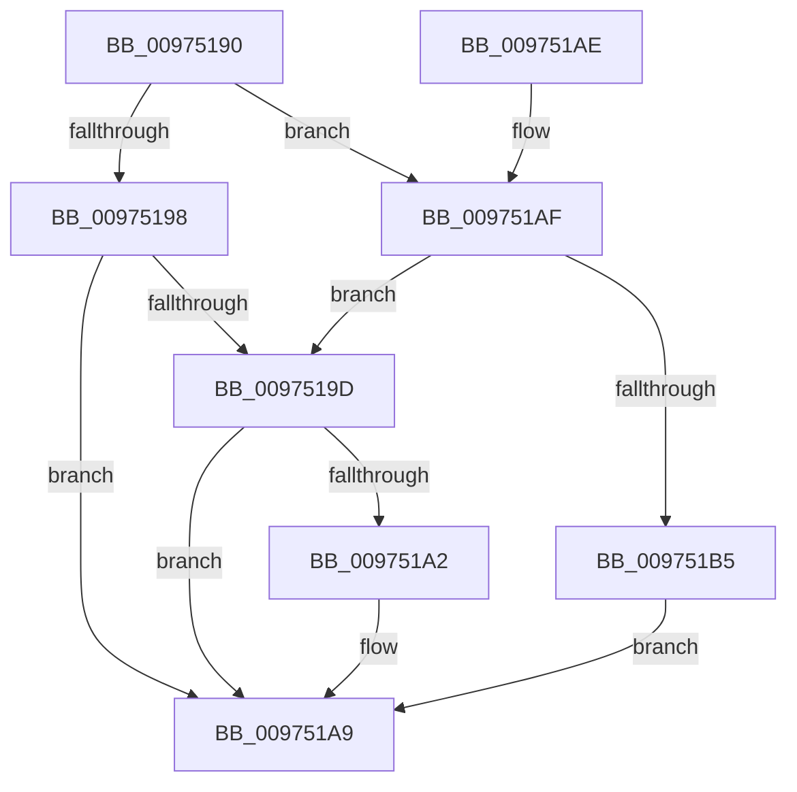

# SeReleaseSecurityDescriptor

- RVA: `0x00975190`–`0x009751B7` (길이 `39` bytes)
- VA: `0x0000000140975190`
- 실행 섹션: `PAGE`
- PDB 이름 있음: `예`; PDB Function 태그: `아니요`
- unwind 정보 RVA: `0x0009654C`
- 디코드: `15`개 명령, `39/39` bytes 표시
- 미해석 바이트: `0` (있으면 어셈블리에 `.byte`로 보존)

> 이 문서는 커널 이미지의 기계어와 PDB 기호를 분석해 생성했습니다. 4번과 5번은 함수 원형과 자료형을 바이너리 사용 방식에서 추정한 C 해석이며 원본 소스 복구 결과는 아닙니다.

## 1. Dependencies

- 직접 호출 지점: **1**; 고유 호출 대상: **1**
- 직접 호출자로 확인된 함수: **9**
- RIP 상대 이미지 참조: **0**

### Outgoing calls
- `0x009751A4` → [ExFreePoolWithTag](../../poolcode/B8/ExFreePoolWithTag_function_00B82870.md) (function, `0x00B82870`)

### Direct callers
- [SeAccessCheckByType](../../text/44/SeAccessCheckByType_function_00440BC8.md) at `0x00442733`
- [CmpCopySaclToVirtualKey](../7E/CmpCopySaclToVirtualKey_function_007ECA6C.md) at `0x007ECD1D`
- [ObDeleteCapturedInsertInfo](../87/ObDeleteCapturedInsertInfo_function_00876E90.md) at `0x00876F1B`
- [ObInsertObjectEx](../8B/ObInsertObjectEx_function_008B97A0.md) at `0x008BA043`
- [ObReferenceObjectByNameEx](../8B/ObReferenceObjectByNameEx_function_008BD524.md) at `0x008BD855`
- [NtOpenObjectAuditAlarm](NtOpenObjectAuditAlarm_function_00974700.md) at `0x00974A10`
- [NtOpenObjectAuditAlarm](NtOpenObjectAuditAlarm_function_00974700.md) at `0x00974CB3`
- [ObpInsertOrLocateNamedObject](../99/ObpInsertOrLocateNamedObject_function_0099F2C0.md) at `0x0099F86F`
- [SepAccessCheckAndAuditAlarm](../A1/SepAccessCheckAndAuditAlarm_function_00A1AF4C.md) at `0x00A1D74F`
- [NtSetSecurityObject](../AD/NtSetSecurityObject_function_00ADE2B0.md) at `0x00ADE414`
- [NtSetSecurityObject](../AD/NtSetSecurityObject_function_00ADE2B0.md) at `0x00ADE6B7`

### Static image references
- 디코드된 RIP-relative 메모리 참조가 없습니다.

## 2. Other-region calls and transfers

- 다른 실행 섹션으로 향하는 call: **1**
  - `0x009751A4` → [ExFreePoolWithTag](../../poolcode/B8/ExFreePoolWithTag_function_00B82870.md) (`PAGE` → `POOLCODE`)
- 별도 외부 분기/꼬리 이동을 확인하지 못했습니다.

## 3. Assembly (complete function range)

```asm
00975190  48 83 EC 28                     sub rsp, 0x28
00975194  84 D2                           test dl, dl
00975196  74 17                           je 0x1409751af
00975198  80 FA 01                        cmp dl, 1
0097519B  75 0C                           jne 0x1409751a9
0097519D  48 85 C9                        test rcx, rcx
009751A0  74 07                           je 0x1409751a9
009751A2  33 D2                           xor edx, edx
009751A4  E8 C7 D6 20 00                  call 0x140b82870
009751A9  48 83 C4 28                     add rsp, 0x28
009751AD  C3                              ret
009751AE  CC                              int3
009751AF  41 80 F8 01                     cmp r8b, 1
009751B3  74 E8                           je 0x14097519d
009751B5  EB F2                           jmp 0x1409751a9
```

## 4. C-style interpretation (structured pseudocode)

```c
__int64 __fastcall SeReleaseSecurityDescriptor(__int64 a1, int a2, unsigned __int8 a3)
{
    __int64 result;
    __int64 v_rsp;

    v_rsp = (v_rsp) - (40);
    if ((unsigned __int8)(a2) == 0) goto loc_009751AF;
    if (((unsigned __int8)(a2)) != 1) goto loc_009751A9;
loc_0097519D:
    if (a1 != 0) {
        a2 = 0;
        result = ExFreePoolWithTag(a1, a2, a3, a4);
    }
    v_rsp = (v_rsp) + (40);
    return result;
loc_009751AF:
    if (a3 == 1) goto loc_0097519D;
    goto loc_009751A9;
}
```

## 5. (Beta) C Style

```c
int64_t SeReleaseSecurityDescriptor(int64_t Arg1, int32_t Arg2, uint8_t Arg3)
{
    int64_t result;
    int64_t local_rsp;

    local_rsp = (local_rsp) - (40);
    if ((uint8_t)(Arg2) == 0) goto loc_009751AF;
    if (((uint8_t)(Arg2)) != 1) goto loc_009751A9;
loc_0097519D:
    if (Arg1 != 0) {
        Arg2 = 0;
        result = ExFreePoolWithTag(Arg1, Arg2, Arg3, a4);
    }
    local_rsp = (local_rsp) + (40);
    return result;
loc_009751AF:
    if (Arg3 == 1) goto loc_0097519D;
    goto loc_009751A9;
}
```

## 6. Execution-region graph

[열기: 2D/3D 그래프와 함수 탐색 컨트롤 패널](../../../control-panel.html?section=page&rva=0x00975190&view=graph)

- 2D 그래프는 위에서 아래로 흐르고, 3D 그래프는 빈 공간을 드래그해 회전합니다. Shift+드래그는 이동, 휠은 확대·축소, 함수 노드 선택은 대상 보고서 이동입니다.

### Static fallback


