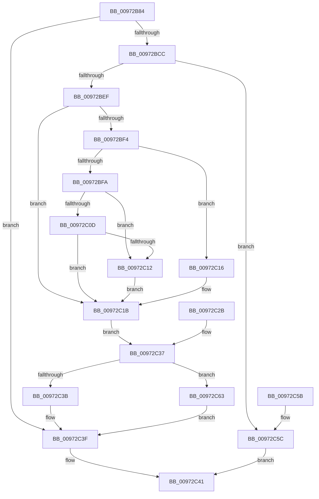

# SepCaptureInt64Array

- RVA: `0x00972B84`–`0x00972C6F` (길이 `235` bytes)
- VA: `0x0000000140972B84`
- 실행 섹션: `PAGE`
- PDB 이름 있음: `예`; PDB Function 태그: `아니요`
- unwind 정보 RVA: `0x00096184`
- 디코드: `71`개 명령, `235/235` bytes 표시
- 미해석 바이트: `0` (있으면 어셈블리에 `.byte`로 보존)

> 이 문서는 커널 이미지의 기계어와 PDB 기호를 분석해 생성했습니다. 4번과 5번은 함수 원형과 자료형을 바이너리 사용 방식에서 추정한 C 해석이며 원본 소스 복구 결과는 아닙니다.

## 1. Dependencies

- 직접 호출 지점: **4**; 고유 호출 대상: **4**
- 직접 호출자로 확인된 함수: **1**
- RIP 상대 이미지 참조: **0**

### Outgoing calls
- `0x00972BDD` → [ExAllocatePool2](../../poolcode/B8/ExAllocatePool2_function_00B820F0.md) (function, `0x00B820F0`)
- `0x00972C16` → [ExRaiseDatatypeMisalignment](../89/ExRaiseDatatypeMisalignment_function_00899FD0.md) (function, `0x00899FD0`)
- `0x00972C24` → [memcpy](../../text/6C/memcpy_function_006C6840.md) (function, `0x006C6840`)
- `0x00972C68` → [ExFreePoolWithTag](../../poolcode/B8/ExFreePoolWithTag_function_00B82870.md) (function, `0x00B82870`)

### Direct callers
- [SepCaptureTokenSecurityAttributesInformation](SepCaptureTokenSecurityAttributesInformation_function_00971FB8.md) at `0x009722C0`

### Static image references
- 디코드된 RIP-relative 메모리 참조가 없습니다.

## 2. Other-region calls and transfers

- 다른 실행 섹션으로 향하는 call: **3**
  - `0x00972BDD` → [ExAllocatePool2](../../poolcode/B8/ExAllocatePool2_function_00B820F0.md) (`PAGE` → `POOLCODE`)
  - `0x00972C24` → [memcpy](../../text/6C/memcpy_function_006C6840.md) (`PAGE` → `.text`)
  - `0x00972C68` → [ExFreePoolWithTag](../../poolcode/B8/ExFreePoolWithTag_function_00B82870.md) (`PAGE` → `POOLCODE`)
- 별도 외부 분기/꼬리 이동을 확인하지 못했습니다.

## 3. Assembly (complete function range)

```asm
00972B84  48 8B C4                        mov rax, rsp
00972B87  48 89 58 08                     mov qword ptr [rax + 8], rbx
00972B8B  48 89 70 10                     mov qword ptr [rax + 0x10], rsi
00972B8F  48 89 78 18                     mov qword ptr [rax + 0x18], rdi
00972B93  4C 89 48 20                     mov qword ptr [rax + 0x20], r9
00972B97  41 54                           push r12
00972B99  41 56                           push r14
00972B9B  41 57                           push r15
00972B9D  48 83 EC 30                     sub rsp, 0x30
00972BA1  4D 8B E1                        mov r12, r9
00972BA4  48 8B F1                        mov rsi, rcx
00972BA7  8B C2                           mov eax, edx
00972BA9  48 C1 E0 03                     shl rax, 3
00972BAD  B9 FF FF FF FF                  mov ecx, 0xffffffff
00972BB2  44 8B F9                        mov r15d, ecx
00972BB5  48 3B C1                        cmp rax, rcx
00972BB8  44 0F 46 F8                     cmovbe r15d, eax
00972BBC  48 3B C8                        cmp rcx, rax
00972BBF  1B FF                           sbb edi, edi
00972BC1  81 E7 95 00 00 C0               and edi, 0xc0000095
00972BC7  48 3B C1                        cmp rax, rcx
00972BCA  77 73                           ja 0x140972c3f
00972BCC  45 8B F7                        mov r14d, r15d
00972BCF  41 B8 53 65 41 74               mov r8d, 0x74416553
00972BD5  41 8B D7                        mov edx, r15d
00972BD8  B9 00 01 00 00                  mov ecx, 0x100
00972BDD  E8 0E F5 20 00                  call 0x140b820f0
00972BE2  48 8B D8                        mov rbx, rax
00972BE5  48 89 44 24 20                  mov qword ptr [rsp + 0x20], rax
00972BEA  48 85 C0                        test rax, rax
00972BED  74 6D                           je 0x140972c5c
00972BEF  45 85 FF                        test r15d, r15d
00972BF2  74 27                           je 0x140972c1b
00972BF4  40 F6 C6 03                     test sil, 3
00972BF8  75 1C                           jne 0x140972c16
00972BFA  49 8D 04 37                     lea rax, [r15 + rsi]
00972BFE  48 B9 00 00 FF FF FF 7F 00 00   movabs rcx, 0x7fffffff0000
00972C08  48 3B C1                        cmp rax, rcx
00972C0B  77 05                           ja 0x140972c12
00972C0D  48 3B C6                        cmp rax, rsi
00972C10  73 09                           jae 0x140972c1b
00972C12  8A 01                           mov al, byte ptr [rcx]
00972C14  EB 05                           jmp 0x140972c1b
00972C16  E8 B5 73 F2 FF                  call 0x140899fd0
00972C1B  4D 8B C6                        mov r8, r14
00972C1E  48 8B D6                        mov rdx, rsi
00972C21  48 8B CB                        mov rcx, rbx
00972C24  E8 17 3C D5 FF                  call 0x1406c6840
00972C29  EB 0C                           jmp 0x140972c37
00972C2B  8B F8                           mov edi, eax
00972C2D  4C 8B 64 24 68                  mov r12, qword ptr [rsp + 0x68]
00972C32  48 8B 5C 24 20                  mov rbx, qword ptr [rsp + 0x20]
00972C37  85 FF                           test edi, edi
00972C39  78 28                           js 0x140972c63
00972C3B  49 89 1C 24                     mov qword ptr [r12], rbx
00972C3F  8B C7                           mov eax, edi
00972C41  48 8B 5C 24 50                  mov rbx, qword ptr [rsp + 0x50]
00972C46  48 8B 74 24 58                  mov rsi, qword ptr [rsp + 0x58]
00972C4B  48 8B 7C 24 60                  mov rdi, qword ptr [rsp + 0x60]
00972C50  48 83 C4 30                     add rsp, 0x30
00972C54  41 5F                           pop r15
00972C56  41 5E                           pop r14
00972C58  41 5C                           pop r12
00972C5A  C3                              ret
00972C5B  CC                              int3
00972C5C  B8 9A 00 00 C0                  mov eax, 0xc000009a
00972C61  EB DE                           jmp 0x140972c41
00972C63  33 D2                           xor edx, edx
00972C65  48 8B CB                        mov rcx, rbx
00972C68  E8 03 FC 20 00                  call 0x140b82870
00972C6D  EB D0                           jmp 0x140972c3f
```

## 4. C-style interpretation (structured pseudocode)

```c
__int64 __fastcall SepCaptureInt64Array(__int64 a1, int a2, __int64 a3, __int64 a4)
{
    __int64 result;
    __int64 v_r15;
    __int64 v_rdi;
    __int64 v_rsp;
    unsigned __int64 v_stack_m28;
    unsigned __int64 v_stack_p10;
    unsigned __int64 v_stack_p18;
    unsigned __int64 v_stack_p20;
    unsigned __int64 v_stack_p8;

    *(unsigned __int64 *)(v_rsp + 8) = v_rbx;
    *(unsigned __int64 *)(v_rsp + 16) = v_rsi;
    *(unsigned __int64 *)(v_rsp + 24) = v_rdi;
    *(unsigned __int64 *)(v_rsp + 32) = a4;
    v_rsp = (v_rsp) - (48);
    result = ((unsigned int)(a2)) << (3);
    v_r15 = (unsigned int)((unsigned int)((unsigned int)(0xFFFFFFFFULL)));
    if (result <= ((unsigned int)(0xFFFFFFFFULL))) { v_r15 = (unsigned int)(result); }
    v_rdi = (unsigned int)((v_rdi) & (0xC0000095ULL));
    if (result > ((unsigned int)(0xFFFFFFFFULL))) goto loc_00972C3F;
    result = ExAllocatePool2(256, (unsigned int)((unsigned int)(v_r15)), (unsigned int)(0x74416553ULL), a4);
    v_stack_m28 = result;
    if (result == 0) goto loc_00972C5C;
    if ((unsigned int)(v_r15) == 0) goto loc_00972C1B;
    if ((((unsigned __int8)(a1)) & (3)) != 0) goto loc_00972C16;
    if ((v_r15 + a1 * 1) > 256) goto loc_00972C12;
    if ((v_r15 + a1 * 1) >= a1) goto loc_00972C1B;
loc_00972C12:
    goto loc_00972C1B;
loc_00972C16:
    result = ExRaiseDatatypeMisalignment(256, (unsigned int)((unsigned int)(v_r15)), (unsigned int)(0x74416553ULL), a4);
loc_00972C1B:
    result = memcpy(result, a1, (unsigned int)((unsigned int)(v_r15)), a4);
    goto loc_00972C37;
loc_00972C37:
    if (sign_flag) goto loc_00972C63;
    *(unsigned __int64 *)(a4) = result;
loc_00972C3F:
loc_00972C41:
    v_rsp = (v_rsp) + (48);
    return (unsigned int)((unsigned int)(v_rdi));
loc_00972C5C:
    goto loc_00972C41;
loc_00972C63:
    a2 = 0;
    result = ExFreePoolWithTag(v_stack_p8, a2, (unsigned int)((unsigned int)(v_r15)), a4);
    goto loc_00972C3F;
}
```

## 5. (Beta) C Style

```c
int64_t SepCaptureInt64Array(int64_t Arg1, int32_t Arg2, int64_t Arg3, void *Arg4)
{
    uint8_t *arg4 = (uint8_t *)Arg4;

    int64_t result;
    int64_t local_r15;
    int64_t local_rdi;
    int64_t local_rsp;
    uint64_t v_stack_m28;
    uint64_t v_stack_p10;
    uint64_t v_stack_p18;
    uint64_t v_stack_p20;
    uint64_t v_stack_p8;

    *(uint64_t *)(local_rsp + 0x8) = local_rbx;
    *(uint64_t *)(local_rsp + 0x10) = local_rsi;
    *(uint64_t *)(local_rsp + 0x18) = local_rdi;
    *(void **)(local_rsp + 0x20) = Arg4;
    local_rsp = (local_rsp) - (48);
    result = ((uint32_t)(Arg2)) << (3);
    local_r15 = (uint32_t)((uint32_t)((uint32_t)(0xFFFFFFFFULL)));
    if (result <= ((uint32_t)(0xFFFFFFFFULL))) { local_r15 = (uint32_t)(result); }
    local_rdi = (uint32_t)((local_rdi) & (0xC0000095ULL));
    if (result > ((uint32_t)(0xFFFFFFFFULL))) goto loc_00972C3F;
    result = ExAllocatePool2(256, (uint32_t)((uint32_t)(local_r15)), (uint32_t)(0x74416553ULL), Arg4);
    v_stack_m28 = result;
    if (result == 0) goto loc_00972C5C;
    if ((uint32_t)(local_r15) == 0) goto loc_00972C1B;
    if ((((uint8_t)(Arg1)) & (3)) != 0) goto loc_00972C16;
    if ((local_r15 + Arg1 * 1) > 256) goto loc_00972C12;
    if ((local_r15 + Arg1 * 1) >= Arg1) goto loc_00972C1B;
loc_00972C12:
    goto loc_00972C1B;
loc_00972C16:
    result = ExRaiseDatatypeMisalignment(256, (uint32_t)((uint32_t)(local_r15)), (uint32_t)(0x74416553ULL), Arg4);
loc_00972C1B:
    result = memcpy(result, Arg1, (uint32_t)((uint32_t)(local_r15)), Arg4);
    goto loc_00972C37;
loc_00972C37:
    if (sign_flag) goto loc_00972C63;
    *(uint64_t *)(arg4) = result;
loc_00972C3F:
loc_00972C41:
    local_rsp = (local_rsp) + (48);
    return (uint32_t)((uint32_t)(local_rdi));
loc_00972C5C:
    goto loc_00972C41;
loc_00972C63:
    Arg2 = 0;
    result = ExFreePoolWithTag(v_stack_p8, Arg2, (uint32_t)((uint32_t)(local_r15)), Arg4);
    goto loc_00972C3F;
}
```

### 관측된 메모리 오프셋

구조체 형식이 확인되지 않은 접근은 인자 기준의 오프셋으로만 기록했습니다.

| 기준 인자 | 오프셋 표현 | 폭 (bit) | 접근 |
|---|---:|---:|---|
| `Arg4` | `+ 0x0` | `64` | `W` |

## 6. Execution-region graph

[열기: 2D/3D 그래프와 함수 탐색 컨트롤 패널](../../../control-panel.html?section=page&rva=0x00972B84&view=graph)

- 2D 그래프는 위에서 아래로 흐르고, 3D 그래프는 빈 공간을 드래그해 회전합니다. Shift+드래그는 이동, 휠은 확대·축소, 함수 노드 선택은 대상 보고서 이동입니다.

### Static fallback


