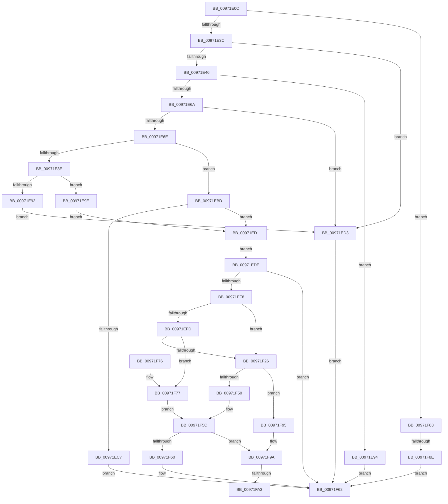

# SepCaptureTokenSecurityAttributesAndOperationsInformation

- RVA: `0x00971E0C`–`0x00971FB0` (길이 `420` bytes)
- VA: `0x0000000140971E0C`
- 실행 섹션: `PAGE`
- PDB 이름 있음: `예`; PDB Function 태그: `예`
- unwind 정보 RVA: `0x000960B4`
- 디코드: `120`개 명령, `420/420` bytes 표시
- 미해석 바이트: `0` (있으면 어셈블리에 `.byte`로 보존)

> 이 문서는 커널 이미지의 기계어와 PDB 기호를 분석해 생성했습니다. 4번과 5번은 함수 원형과 자료형을 바이너리 사용 방식에서 추정한 C 해석이며 원본 소스 복구 결과는 아닙니다.

## 1. Dependencies

- 직접 호출 지점: **5**; 고유 호출 대상: **5**
- 직접 호출자로 확인된 함수: **1**
- RIP 상대 이미지 참조: **0**

### Outgoing calls
- `0x00971ED3` → [ExRaiseDatatypeMisalignment](../89/ExRaiseDatatypeMisalignment_function_00899FD0.md) (function, `0x00899FD0`)
- `0x00971EEF` → [SepCaptureTokenSecurityOperations](../../text/48/SepCaptureTokenSecurityOperations_function_004883D4.md) (function, `0x004883D4`)
- `0x00971F1B` → [SepCaptureTokenSecurityAttributesInformation](SepCaptureTokenSecurityAttributesInformation_function_00971FB8.md) (function, `0x00971FB8`)
- `0x00971F36` → [ExAllocatePool2](../../poolcode/B8/ExAllocatePool2_function_00B820F0.md) (function, `0x00B820F0`)
- `0x00971FA5` → [ExFreePoolWithTag](../../poolcode/B8/ExFreePoolWithTag_function_00B82870.md) (function, `0x00B82870`)

### Direct callers
- [NtSetInformationToken](../AF/NtSetInformationToken_function_00AF0530.md) at `0x00AF154B`

### Static image references
- 디코드된 RIP-relative 메모리 참조가 없습니다.

## 2. Other-region calls and transfers

- 다른 실행 섹션으로 향하는 call: **3**
  - `0x00971EEF` → [SepCaptureTokenSecurityOperations](../../text/48/SepCaptureTokenSecurityOperations_function_004883D4.md) (`PAGE` → `.text`)
  - `0x00971F36` → [ExAllocatePool2](../../poolcode/B8/ExAllocatePool2_function_00B820F0.md) (`PAGE` → `POOLCODE`)
  - `0x00971FA5` → [ExFreePoolWithTag](../../poolcode/B8/ExFreePoolWithTag_function_00B82870.md) (`PAGE` → `POOLCODE`)
- call이 아닌 외부 분기/꼬리 이동: **3**
  - `0x00971F88` → [sub_00B29154](../B2/Unknown_function_00B29154.md) (`tail-transfer`)
  - `0x00971F9D` → [sub_00B29154 + 0xA](../B2/Unknown_function_00B29154.md) (`tail-transfer`)
  - `0x00971FAB` → [sub_00B29154 + 0xA](../B2/Unknown_function_00B29154.md) (`tail-transfer`)

## 3. Assembly (complete function range)

```asm
00971E0C  4C 8B DC                        mov r11, rsp
00971E0F  49 89 5B 08                     mov qword ptr [r11 + 8], rbx
00971E13  49 89 73 10                     mov qword ptr [r11 + 0x10], rsi
00971E17  57                              push rdi
00971E18  41 56                           push r14
00971E1A  41 57                           push r15
00971E1C  48 83 EC 50                     sub rsp, 0x50
00971E20  49 8B F0                        mov rsi, r8
00971E23  44 8A FA                        mov r15b, dl
00971E26  49 83 63 20 00                  and qword ptr [r11 + 0x20], 0
00971E2B  49 83 63 18 00                  and qword ptr [r11 + 0x18], 0
00971E30  49 83 20 00                     and qword ptr [r8], 0
00971E34  84 D2                           test dl, dl
00971E36  0F 84 47 01 00 00               je 0x140971f83
00971E3C  B2 03                           mov dl, 3
00971E3E  84 CA                           test dl, cl
00971E40  0F 85 8D 00 00 00               jne 0x140971ed3
00971E46  49 B8 00 00 FF FF FF 7F 00 00   movabs r8, 0x7fffffff0000
00971E50  49 8B C0                        mov rax, r8
00971E53  49 3B C8                        cmp rcx, r8
00971E56  48 0F 42 C1                     cmovb rax, rcx
00971E5A  90                              nop
00971E5B  8A 00                           mov al, byte ptr [rax]
00971E5D  48 8B 41 08                     mov rax, qword ptr [rcx + 8]
00971E61  49 89 43 D0                     mov qword ptr [r11 - 0x30], rax
00971E65  48 85 C0                        test rax, rax
00971E68  74 2A                           je 0x140971e94
00971E6A  84 C2                           test dl, al
00971E6C  75 65                           jne 0x140971ed3
00971E6E  49 3B C0                        cmp rax, r8
00971E71  49 0F 43 C0                     cmovae rax, r8
00971E75  90                              nop
00971E76  8A 00                           mov al, byte ptr [rax]
00971E78  48 8B 01                        mov rax, qword ptr [rcx]
00971E7B  49 89 43 D8                     mov qword ptr [r11 - 0x28], rax
00971E7F  45 33 F6                        xor r14d, r14d
00971E82  45 89 73 C8                     mov dword ptr [r11 - 0x38], r14d
00971E86  48 8B D8                        mov rbx, rax
00971E89  48 85 C0                        test rax, rax
00971E8C  74 2F                           je 0x140971ebd
00971E8E  84 DA                           test dl, bl
00971E90  74 0C                           je 0x140971e9e
00971E92  EB 3F                           jmp 0x140971ed3
00971E94  B8 0D 00 00 C0                  mov eax, 0xc000000d
00971E99  E9 C4 00 00 00                  jmp 0x140971f62
00971E9E  49 3B D8                        cmp rbx, r8
00971EA1  49 0F 43 D8                     cmovae rbx, r8
00971EA5  90                              nop
00971EA6  8A 03                           mov al, byte ptr [rbx]
00971EA8  48 8B 5C 24 40                  mov rbx, qword ptr [rsp + 0x40]
00971EAD  44 8B 73 04                     mov r14d, dword ptr [rbx + 4]
00971EB1  44 89 74 24 30                  mov dword ptr [rsp + 0x30], r14d
00971EB6  48 8B 7C 24 38                  mov rdi, qword ptr [rsp + 0x38]
00971EBB  EB 14                           jmp 0x140971ed1
00971EBD  48 8B 7C 24 38                  mov rdi, qword ptr [rsp + 0x38]
00971EC2  83 3F 01                        cmp dword ptr [rdi], 1
00971EC5  74 0A                           je 0x140971ed1
00971EC7  B8 0D 00 00 C0                  mov eax, 0xc000000d
00971ECC  E9 91 00 00 00                  jmp 0x140971f62
00971ED1  EB 0B                           jmp 0x140971ede
00971ED3  E8 F8 80 F2 FF                  call 0x140899fd0
00971ED8  90                              nop
00971ED9  E9 84 00 00 00                  jmp 0x140971f62
00971EDE  4C 8D 8C 24 80 00 00 00         lea r9, [rsp + 0x80]
00971EE6  45 8A C7                        mov r8b, r15b
00971EE9  41 8B D6                        mov edx, r14d
00971EEC  48 8B CF                        mov rcx, rdi
00971EEF  E8 E0 64 B1 FF                  call 0x1404883d4
00971EF4  85 C0                           test eax, eax
00971EF6  78 6A                           js 0x140971f62
00971EF8  48 85 DB                        test rbx, rbx
00971EFB  74 29                           je 0x140971f26
00971EFD  48 8D 84 24 88 00 00 00         lea rax, [rsp + 0x88]
00971F05  48 89 44 24 28                  mov qword ptr [rsp + 0x28], rax
00971F0A  C6 44 24 20 01                  mov byte ptr [rsp + 0x20], 1
00971F0F  45 8A CF                        mov r9b, r15b
00971F12  45 8B C6                        mov r8d, r14d
00971F15  48 8B D7                        mov rdx, rdi
00971F18  48 8B CB                        mov rcx, rbx
00971F1B  E8 98 00 00 00                  call 0x140971fb8
00971F20  8B F8                           mov edi, eax
00971F22  85 C0                           test eax, eax
00971F24  78 51                           js 0x140971f77
00971F26  BA 10 00 00 00                  mov edx, 0x10
00971F2B  B9 00 01 00 00                  mov ecx, 0x100
00971F30  41 B8 53 65 41 6F               mov r8d, 0x6f416553
00971F36  E8 B5 01 21 00                  call 0x140b820f0
00971F3B  48 8B 9C 24 88 00 00 00         mov rbx, qword ptr [rsp + 0x88]
00971F43  48 8B 8C 24 80 00 00 00         mov rcx, qword ptr [rsp + 0x80]
00971F4B  48 85 C0                        test rax, rax
00971F4E  74 45                           je 0x140971f95
00971F50  48 89 48 08                     mov qword ptr [rax + 8], rcx
00971F54  48 89 18                        mov qword ptr [rax], rbx
00971F57  48 89 06                        mov qword ptr [rsi], rax
00971F5A  33 FF                           xor edi, edi
00971F5C  85 FF                           test edi, edi
00971F5E  78 3A                           js 0x140971f9a
00971F60  8B C7                           mov eax, edi
00971F62  48 8B 5C 24 70                  mov rbx, qword ptr [rsp + 0x70]
00971F67  48 8B 74 24 78                  mov rsi, qword ptr [rsp + 0x78]
00971F6C  48 83 C4 50                     add rsp, 0x50
00971F70  41 5F                           pop r15
00971F72  41 5E                           pop r14
00971F74  5F                              pop rdi
00971F75  C3                              ret
00971F76  CC                              int3
00971F77  33 DB                           xor ebx, ebx
00971F79  48 8B 8C 24 80 00 00 00         mov rcx, qword ptr [rsp + 0x80]
00971F81  EB D9                           jmp 0x140971f5c
00971F83  48 83 79 08 00                  cmp qword ptr [rcx + 8], 0
00971F88  0F 85 C6 71 1B 00               jne 0x140b29154
00971F8E  B8 0D 00 00 C0                  mov eax, 0xc000000d
00971F93  EB CD                           jmp 0x140971f62
00971F95  BF 17 00 00 C0                  mov edi, 0xc0000017
00971F9A  48 85 C9                        test rcx, rcx
00971F9D  0F 84 BB 71 1B 00               je 0x140b2915e
00971FA3  33 D2                           xor edx, edx
00971FA5  E8 C6 08 21 00                  call 0x140b82870
00971FAA  90                              nop
00971FAB  E9 AE 71 1B 00                  jmp 0x140b2915e
```

## 4. C-style interpretation (structured pseudocode)

```c
__int64 __fastcall SepCaptureTokenSecurityAttributesAndOperationsInformation(__int64 a1, unsigned __int8 a2, __int64 a3)
{
    __int64 result;
    __int64 v_r14;
    __int64 v_rbx;
    __int64 v_rdi;
    __int64 v_rsp;
    unsigned __int64 v_stack_m28;
    unsigned __int64 v_stack_m30;
    unsigned int v_stack_m38;
    unsigned __int64 v_stack_m40;
    unsigned __int8 v_stack_m48;
    unsigned __int64 v_stack_p10;
    unsigned __int64 v_stack_p18;
    unsigned __int64 v_stack_p20;
    unsigned __int64 v_stack_p8;
    unsigned __int64 v_stack_p80;

    *(unsigned __int64 *)(v_rsp + 8) = v_rbx;
    *(unsigned __int64 *)(v_rsp + 16) = v_rsi;
    v_rsp = (v_rsp) - (80);
    if (a2 == 0) goto loc_00971F83;
    if (((3) & ((unsigned __int8)(a1))) != 0) goto loc_00971ED3;
    if (a1 < a3) { a3 = a1; }
    *(unsigned __int64 *)(v_rsp - 48) = *(unsigned __int64 *)(a1 + 8);
    if (*(unsigned __int64 *)(a1 + 8) == 0) goto loc_00971E94;
    if (((3) & ((unsigned __int8)(*(unsigned __int64 *)(a1 + 8)))) != 0) goto loc_00971ED3;
    result = *(unsigned __int64 *)(a1 + 8);
    if ((*(unsigned __int64 *)(a1 + 8)) >= a3) { result = a3; }
    *(unsigned __int64 *)(v_rsp - 40) = *(unsigned __int64 *)(a1);
    v_r14 = 0;
    *(unsigned int *)(v_rsp - 56) = 0;
    if (*(unsigned __int64 *)(a1) == 0) goto loc_00971EBD;
    if (((3) & ((unsigned __int8)(*(unsigned __int64 *)(a1)))) == 0) goto loc_00971E9E;
    goto loc_00971ED3;
loc_00971E94:
    goto loc_00971F62;
loc_00971E9E:
    v_rbx = *(unsigned __int64 *)(a1);
    if ((*(unsigned __int64 *)(a1)) >= a3) { v_rbx = a3; }
    v_stack_m38 = (unsigned int)((unsigned int)(*(unsigned int *)(v_stack_m28 + 4)));
    goto loc_00971ED1;
loc_00971EBD:
    if ((*(unsigned int *)(v_stack_m30)) == 1) goto loc_00971ED1;
    goto loc_00971F62;
loc_00971ED1:
    goto loc_00971EDE;
loc_00971ED3:
    result = ExRaiseDatatypeMisalignment(a1, 3, a3, a4);
    goto loc_00971F62;
loc_00971EDE:
    result = SepCaptureTokenSecurityOperations(v_stack_m30, (unsigned int)((unsigned int)((unsigned int)(*(unsigned int *)(v_stack_m28 + 4)))), a2, v_stack_p18);
    if (sign_flag) goto loc_00971F62;
    if (v_stack_m28 == 0) goto loc_00971F26;
    v_stack_m40 = v_stack_p20;
    v_stack_m48 = 1;
    result = SepCaptureTokenSecurityAttributesInformation(v_stack_m28, v_stack_m30, (unsigned int)((unsigned int)((unsigned int)(*(unsigned int *)(v_stack_m28 + 4)))), a2);
    if (sign_flag) goto loc_00971F77;
loc_00971F26:
    result = ExAllocatePool2(256, 16, (unsigned int)(0x6F416553ULL), a2);
    if (result == 0) goto loc_00971F95;
    *(unsigned __int64 *)(result + 8) = v_stack_p18;
    *(unsigned __int64 *)(result) = v_stack_p20;
    *(unsigned __int64 *)(a3) = result;
    v_rdi = 0;
loc_00971F5C:
    if (sign_flag) goto loc_00971F9A;
loc_00971F62:
    v_rsp = (v_rsp) + (80);
    return 0;
loc_00971F77:
    v_rbx = 0;
    goto loc_00971F5C;
loc_00971F83:
    goto loc_00971F62;
loc_00971F95:
loc_00971F9A:
    a2 = 0;
    result = ExFreePoolWithTag(v_stack_p80, a2, (unsigned int)(0x6F416553ULL), a2);
}
```

## 5. (Beta) C Style

```c
int64_t SepCaptureTokenSecurityAttributesAndOperationsInformation(void *Arg1, uint8_t Arg2, void *Arg3)
{
    uint8_t *arg1 = (uint8_t *)Arg1;
    uint8_t *arg3 = (uint8_t *)Arg3;

    int64_t result;
    int64_t local_r14;
    int64_t local_rbx;
    int64_t local_rdi;
    int64_t local_rsp;
    uint64_t v_stack_m28;
    uint64_t v_stack_m30;
    uint32_t v_stack_m38;
    uint64_t v_stack_m40;
    uint8_t v_stack_m48;
    uint64_t v_stack_p10;
    uint64_t v_stack_p18;
    uint64_t v_stack_p20;
    uint64_t v_stack_p8;
    uint64_t v_stack_p80;

    *(uint64_t *)(local_rsp + 0x8) = local_rbx;
    *(uint64_t *)(local_rsp + 0x10) = local_rsi;
    local_rsp = (local_rsp) - (80);
    if (Arg2 == 0) goto loc_00971F83;
    if (((3) & ((uint8_t)(Arg1))) != 0) goto loc_00971ED3;
    if (Arg1 < Arg3) { Arg3 = Arg1; }
    *(uint64_t *)(local_rsp - 0x30) = *(uint64_t *)(arg1 + 0x8);
    if (*(uint64_t *)(arg1 + 0x8) == 0) goto loc_00971E94;
    if (((3) & ((uint8_t)(*(uint64_t *)(arg1 + 0x8)))) != 0) goto loc_00971ED3;
    result = *(uint64_t *)(arg1 + 0x8);
    if ((*(uint64_t *)(arg1 + 0x8)) >= Arg3) { result = Arg3; }
    *(uint64_t *)(local_rsp - 0x28) = *(uint64_t *)(arg1);
    local_r14 = 0;
    *(uint32_t *)(local_rsp - 0x38) = 0;
    if (*(uint64_t *)(arg1) == 0) goto loc_00971EBD;
    if (((3) & ((uint8_t)(*(uint64_t *)(arg1)))) == 0) goto loc_00971E9E;
    goto loc_00971ED3;
loc_00971E94:
    goto loc_00971F62;
loc_00971E9E:
    local_rbx = *(uint64_t *)(arg1);
    if ((*(uint64_t *)(arg1)) >= Arg3) { local_rbx = Arg3; }
    v_stack_m38 = (uint32_t)((uint32_t)(*(uint32_t *)(v_stack_m28 + 0x4)));
    goto loc_00971ED1;
loc_00971EBD:
    if ((*(uint32_t *)(v_stack_m30)) == 1) goto loc_00971ED1;
    goto loc_00971F62;
loc_00971ED1:
    goto loc_00971EDE;
loc_00971ED3:
    result = ExRaiseDatatypeMisalignment(Arg1, 3, Arg3, a4);
    goto loc_00971F62;
loc_00971EDE:
    result = SepCaptureTokenSecurityOperations(v_stack_m30, (uint32_t)((uint32_t)((uint32_t)(*(uint32_t *)(v_stack_m28 + 0x4)))), Arg2, v_stack_p18);
    if (sign_flag) goto loc_00971F62;
    if (v_stack_m28 == 0) goto loc_00971F26;
    v_stack_m40 = v_stack_p20;
    v_stack_m48 = 1;
    result = SepCaptureTokenSecurityAttributesInformation(v_stack_m28, v_stack_m30, (uint32_t)((uint32_t)((uint32_t)(*(uint32_t *)(v_stack_m28 + 0x4)))), Arg2);
    if (sign_flag) goto loc_00971F77;
loc_00971F26:
    result = ExAllocatePool2(256, 16, (uint32_t)(0x6F416553ULL), Arg2);
    if (result == 0) goto loc_00971F95;
    *(uint64_t *)(result + 0x8) = v_stack_p18;
    *(uint64_t *)(result) = v_stack_p20;
    *(uint64_t *)(arg3) = result;
    local_rdi = 0;
loc_00971F5C:
    if (sign_flag) goto loc_00971F9A;
loc_00971F62:
    local_rsp = (local_rsp) + (80);
    return 0;
loc_00971F77:
    local_rbx = 0;
    goto loc_00971F5C;
loc_00971F83:
    goto loc_00971F62;
loc_00971F95:
loc_00971F9A:
    Arg2 = 0;
    result = ExFreePoolWithTag(v_stack_p80, Arg2, (uint32_t)(0x6F416553ULL), Arg2);
}
```

### 관측된 메모리 오프셋

구조체 형식이 확인되지 않은 접근은 인자 기준의 오프셋으로만 기록했습니다.

| 기준 인자 | 오프셋 표현 | 폭 (bit) | 접근 |
|---|---:|---:|---|
| `Arg1` | `+ 0x8` | `64` | `R` |
| `Arg3` | `+ 0x0` | `64` | `R/W` |
| `Arg3` | `+ 0x0` | `64` | `W` |

## 6. Execution-region graph

[열기: 2D/3D 그래프와 함수 탐색 컨트롤 패널](../../../control-panel.html?section=page&rva=0x00971E0C&view=graph)

- 2D 그래프는 위에서 아래로 흐르고, 3D 그래프는 빈 공간을 드래그해 회전합니다. Shift+드래그는 이동, 휠은 확대·축소, 함수 노드 선택은 대상 보고서 이동입니다.

### Static fallback


