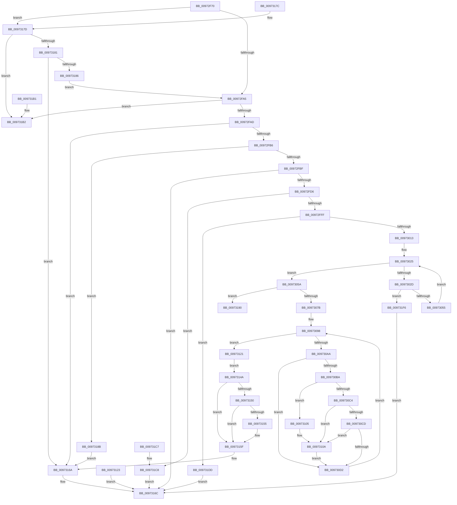

# SepCaptureUnicodeStringArray

- RVA: `0x00972F70`–`0x00973209` (길이 `665` bytes)
- VA: `0x0000000140972F70`
- 실행 섹션: `PAGE`
- PDB 이름 있음: `예`; PDB Function 태그: `아니요`
- unwind 정보 RVA: `0x000961FC`
- 디코드: `192`개 명령, `665/665` bytes 표시
- 미해석 바이트: `0` (있으면 어셈블리에 `.byte`로 보존)

> 이 문서는 커널 이미지의 기계어와 PDB 기호를 분석해 생성했습니다. 4번과 5번은 함수 원형과 자료형을 바이너리 사용 방식에서 추정한 C 해석이며 원본 소스 복구 결과는 아닙니다.

## 1. Dependencies

- 직접 호출 지점: **12**; 고유 호출 대상: **6**
- 직접 호출자로 확인된 함수: **4**
- RIP 상대 이미지 참조: **0**

### Outgoing calls
- `0x00972FC9` → [SeCaptureUnicodeStringStructures](SeCaptureUnicodeStringStructures_function_00973210.md) (function, `0x00973210`)
- `0x00973065` → [ExAllocatePool2](../../poolcode/B8/ExAllocatePool2_function_00B820F0.md) (function, `0x00B820F0`)
- `0x00973084` → [memcpy](../../text/6C/memcpy_function_006C6840.md) (function, `0x006C6840`)
- `0x009730DF` → [memcpy](../../text/6C/memcpy_function_006C6840.md) (function, `0x006C6840`)
- `0x00973105` → [ExRaiseDatatypeMisalignment](../89/ExRaiseDatatypeMisalignment_function_00899FD0.md) (function, `0x00899FD0`)
- `0x00973135` → [SeReleaseUnicodeStringStructures](SeReleaseUnicodeStringStructures_function_00973360.md) (function, `0x00973360`)
- `0x00973141` → [ExFreePoolWithTag](../../poolcode/B8/ExFreePoolWithTag_function_00B82870.md) (function, `0x00B82870`)
- `0x0097315A` → [ExFreePoolWithTag](../../poolcode/B8/ExFreePoolWithTag_function_00B82870.md) (function, `0x00B82870`)
- `0x00973197` → [SeReleaseUnicodeStringStructures](SeReleaseUnicodeStringStructures_function_00973360.md) (function, `0x00973360`)
- `0x009731D4` → [SeReleaseUnicodeStringStructures](SeReleaseUnicodeStringStructures_function_00973360.md) (function, `0x00973360`)
- `0x009731E9` → [SeReleaseUnicodeStringStructures](SeReleaseUnicodeStringStructures_function_00973360.md) (function, `0x00973360`)
- `0x009731FD` → [SeReleaseUnicodeStringStructures](SeReleaseUnicodeStringStructures_function_00973360.md) (function, `0x00973360`)

### Direct callers
- [SepCaptureTokenSecurityAttributesInformation](SepCaptureTokenSecurityAttributesInformation_function_00971FB8.md) at `0x009722FD`
- [NtQuerySecurityAttributesToken](NtQuerySecurityAttributesToken_function_00972C80.md) at `0x00972DD2`
- [NtQuerySecurityPolicy](NtQuerySecurityPolicy_function_00973410.md) at `0x00973470`
- [NtQuerySecurityPolicy](NtQuerySecurityPolicy_function_00973410.md) at `0x0097348D`
- [NtQuerySecurityPolicy](NtQuerySecurityPolicy_function_00973410.md) at `0x009734AA`
- [NtSetCachedSigningLevel2](NtSetCachedSigningLevel2_function_00973720.md) at `0x009738FB`

### Static image references
- 디코드된 RIP-relative 메모리 참조가 없습니다.

## 2. Other-region calls and transfers

- 다른 실행 섹션으로 향하는 call: **5**
  - `0x00973065` → [ExAllocatePool2](../../poolcode/B8/ExAllocatePool2_function_00B820F0.md) (`PAGE` → `POOLCODE`)
  - `0x00973084` → [memcpy](../../text/6C/memcpy_function_006C6840.md) (`PAGE` → `.text`)
  - `0x009730DF` → [memcpy](../../text/6C/memcpy_function_006C6840.md) (`PAGE` → `.text`)
  - `0x00973141` → [ExFreePoolWithTag](../../poolcode/B8/ExFreePoolWithTag_function_00B82870.md) (`PAGE` → `POOLCODE`)
  - `0x0097315A` → [ExFreePoolWithTag](../../poolcode/B8/ExFreePoolWithTag_function_00B82870.md) (`PAGE` → `POOLCODE`)
- 별도 외부 분기/꼬리 이동을 확인하지 못했습니다.

## 3. Assembly (complete function range)

```asm
00972F70  4C 89 4C 24 20                  mov qword ptr [rsp + 0x20], r9
00972F75  44 88 44 24 18                  mov byte ptr [rsp + 0x18], r8b
00972F7A  53                              push rbx
00972F7B  56                              push rsi
00972F7C  57                              push rdi
00972F7D  41 54                           push r12
00972F7F  41 55                           push r13
00972F81  41 56                           push r14
00972F83  41 57                           push r15
00972F85  48 83 EC 40                     sub rsp, 0x40
00972F89  45 0F B6 E8                     movzx r13d, r8b
00972F8D  8B FA                           mov edi, edx
00972F8F  33 DB                           xor ebx, ebx
00972F91  48 89 9C 24 80 00 00 00         mov qword ptr [rsp + 0x80], rbx
00972F99  49 89 19                        mov qword ptr [r9], rbx
00972F9C  48 85 C9                        test rcx, rcx
00972F9F  0F 84 D8 01 00 00               je 0x14097317d
00972FA5  85 D2                           test edx, edx
00972FA7  0F 84 05 02 00 00               je 0x1409731b2
00972FAD  48 85 C9                        test rcx, rcx
00972FB0  0F 84 B4 01 00 00               je 0x14097316a
00972FB6  45 84 ED                        test r13b, r13b
00972FB9  0F 84 CC 01 00 00               je 0x14097318b
00972FBF  4C 8D 8C 24 80 00 00 00         lea r9, [rsp + 0x80]
00972FC7  8B D7                           mov edx, edi
00972FC9  E8 42 02 00 00                  call 0x140973210
00972FCE  85 C0                           test eax, eax
00972FD0  0F 88 96 01 00 00               js 0x14097316c
00972FD6  4C 8B F7                        mov r14, rdi
00972FD9  49 C1 E6 04                     shl r14, 4
00972FDD  41 BA FF FF FF FF               mov r10d, 0xffffffff
00972FE3  45 8B C2                        mov r8d, r10d
00972FE6  4D 3B F2                        cmp r14, r10
00972FE9  45 0F 46 C6                     cmovbe r8d, r14d
00972FED  8B F3                           mov esi, ebx
00972FEF  41 BC 95 00 00 C0               mov r12d, 0xc0000095
00972FF5  41 0F 47 F4                     cmova esi, r12d
00972FF9  0F 87 C9 01 00 00               ja 0x1409731c8
00972FFF  41 8B D0                        mov edx, r8d
00973002  49 8D 48 01                     lea rcx, [r8 + 1]
00973006  48 83 E1 FE                     and rcx, 0xfffffffffffffffe
0097300A  48 3B CA                        cmp rcx, rdx
0097300D  0F 82 CA 01 00 00               jb 0x1409731dd
00973013  41 8D 50 01                     lea edx, [r8 + 1]
00973017  83 E2 FE                        and edx, 0xfffffffe
0097301A  44 8B C3                        mov r8d, ebx
0097301D  4C 8B BC 24 80 00 00 00         mov r15, qword ptr [rsp + 0x80]
00973025  44 8B CA                        mov r9d, edx
00973028  44 3B C7                        cmp r8d, edi
0097302B  73 2D                           jae 0x14097305a
0097302D  41 8B C0                        mov eax, r8d
00973030  48 03 C0                        add rax, rax
00973033  41 0F B7 0C C7                  movzx ecx, word ptr [r15 + rax*8]
00973038  03 CA                           add ecx, edx
0097303A  41 8B C2                        mov eax, r10d
0097303D  3B CA                           cmp ecx, edx
0097303F  0F 43 C1                        cmovae eax, ecx
00973042  8B D0                           mov edx, eax
00973044  41 3B C9                        cmp ecx, r9d
00973047  1B F6                           sbb esi, esi
00973049  41 23 F4                        and esi, r12d
0097304C  41 3B C9                        cmp ecx, r9d
0097304F  0F 82 A1 01 00 00               jb 0x1409731f6
00973055  41 FF C0                        inc r8d
00973058  EB CB                           jmp 0x140973025
0097305A  B9 00 01 00 00                  mov ecx, 0x100
0097305F  41 B8 53 65 41 74               mov r8d, 0x74416553
00973065  E8 86 F0 20 00                  call 0x140b820f0
0097306A  48 8B F0                        mov rsi, rax
0097306D  48 89 44 24 30                  mov qword ptr [rsp + 0x30], rax
00973072  48 85 C0                        test rax, rax
00973075  0F 84 15 01 00 00               je 0x140973190
0097307B  4D 8B C6                        mov r8, r14
0097307E  49 8B D7                        mov rdx, r15
00973081  48 8B C8                        mov rcx, rax
00973084  E8 B7 37 D5 FF                  call 0x1406c6840
00973089  49 FF C6                        inc r14
0097308C  4C 03 F6                        add r14, rsi
0097308F  49 83 E6 FE                     and r14, 0xfffffffffffffffe
00973093  4C 89 74 24 28                  mov qword ptr [rsp + 0x28], r14
00973098  49 B8 00 00 FF FF FF 7F 00 00   movabs r8, 0x7fffffff0000
009730A2  89 5C 24 20                     mov dword ptr [rsp + 0x20], ebx
009730A6  3B DF                           cmp ebx, edi
009730A8  73 77                           jae 0x140973121
009730AA  44 8B E3                        mov r12d, ebx
009730AD  4D 03 E4                        add r12, r12
009730B0  43 0F B7 04 E7                  movzx eax, word ptr [r15 + r12*8]
009730B5  66 85 C0                        test ax, ax
009730B8  74 18                           je 0x1409730d2
009730BA  4B 8B 4C E7 08                  mov rcx, qword ptr [r15 + r12*8 + 8]
009730BF  F6 C1 01                        test cl, 1
009730C2  75 41                           jne 0x140973105
009730C4  48 8D 14 01                     lea rdx, [rcx + rax]
009730C8  49 3B D0                        cmp rdx, r8
009730CB  77 3D                           ja 0x14097310a
009730CD  48 3B D1                        cmp rdx, rcx
009730D0  72 38                           jb 0x14097310a
009730D2  47 0F B7 04 E7                  movzx r8d, word ptr [r15 + r12*8]
009730D7  4B 8B 54 E7 08                  mov rdx, qword ptr [r15 + r12*8 + 8]
009730DC  49 8B CE                        mov rcx, r14
009730DF  E8 5C 37 D5 FF                  call 0x1406c6840
009730E4  4E 89 74 E6 08                  mov qword ptr [rsi + r12*8 + 8], r14
009730E9  42 0F B7 04 E6                  movzx eax, word ptr [rsi + r12*8]
009730EE  66 42 89 44 E6 02               mov word ptr [rsi + r12*8 + 2], ax
009730F4  43 0F B7 04 E7                  movzx eax, word ptr [r15 + r12*8]
009730F9  4C 03 F0                        add r14, rax
009730FC  4C 89 74 24 28                  mov qword ptr [rsp + 0x28], r14
00973101  FF C3                           inc ebx
00973103  EB 93                           jmp 0x140973098
00973105  E8 C6 6E F2 FF                  call 0x140899fd0
0097310A  41 0F B6 00                     movzx eax, byte ptr [r8]
0097310E  4C 8B BC 24 80 00 00 00         mov r15, qword ptr [rsp + 0x80]
00973116  4C 8B 74 24 28                  mov r14, qword ptr [rsp + 0x28]
0097311B  8B 5C 24 20                     mov ebx, dword ptr [rsp + 0x20]
0097311F  EB B1                           jmp 0x1409730d2
00973121  EB 27                           jmp 0x14097314a
00973123  8B D8                           mov ebx, eax
00973125  0F B6 94 24 90 00 00 00         movzx edx, byte ptr [rsp + 0x90]
0097312D  48 8B 8C 24 80 00 00 00         mov rcx, qword ptr [rsp + 0x80]
00973135  E8 26 02 00 00                  call 0x140973360
0097313A  33 D2                           xor edx, edx
0097313C  48 8B 4C 24 30                  mov rcx, qword ptr [rsp + 0x30]
00973141  E8 2A F7 20 00                  call 0x140b82870
00973146  8B C3                           mov eax, ebx
00973148  EB 22                           jmp 0x14097316c
0097314A  41 80 FD 01                     cmp r13b, 1
0097314E  75 0F                           jne 0x14097315f
00973150  4D 85 FF                        test r15, r15
00973153  74 0A                           je 0x14097315f
00973155  33 D2                           xor edx, edx
00973157  49 8B CF                        mov rcx, r15
0097315A  E8 11 F7 20 00                  call 0x140b82870
0097315F  48 8B 84 24 98 00 00 00         mov rax, qword ptr [rsp + 0x98]
00973167  48 89 30                        mov qword ptr [rax], rsi
0097316A  33 C0                           xor eax, eax
0097316C  48 83 C4 40                     add rsp, 0x40
00973170  41 5F                           pop r15
00973172  41 5E                           pop r14
00973174  41 5D                           pop r13
00973176  41 5C                           pop r12
00973178  5F                              pop rdi
00973179  5E                              pop rsi
0097317A  5B                              pop rbx
0097317B  C3                              ret
0097317C  CC                              int3
0097317D  85 D2                           test edx, edx
0097317F  75 31                           jne 0x1409731b2
00973181  48 85 C9                        test rcx, rcx
00973184  74 E4                           je 0x14097316a
00973186  E9 1A FE FF FF                  jmp 0x140972fa5
0097318B  49 89 09                        mov qword ptr [r9], rcx
0097318E  EB DA                           jmp 0x14097316a
00973190  41 0F B6 D5                     movzx edx, r13b
00973194  49 8B CF                        mov rcx, r15
00973197  E8 C4 01 00 00                  call 0x140973360
0097319C  B8 9A 00 00 C0                  mov eax, 0xc000009a
009731A1  48 83 C4 40                     add rsp, 0x40
009731A5  41 5F                           pop r15
009731A7  41 5E                           pop r14
009731A9  41 5D                           pop r13
009731AB  41 5C                           pop r12
009731AD  5F                              pop rdi
009731AE  5E                              pop rsi
009731AF  5B                              pop rbx
009731B0  C3                              ret
009731B1  CC                              int3
009731B2  B8 0D 00 00 C0                  mov eax, 0xc000000d
009731B7  48 83 C4 40                     add rsp, 0x40
009731BB  41 5F                           pop r15
009731BD  41 5E                           pop r14
009731BF  41 5D                           pop r13
009731C1  41 5C                           pop r12
009731C3  5F                              pop rdi
009731C4  5E                              pop rsi
009731C5  5B                              pop rbx
009731C6  C3                              ret
009731C7  CC                              int3
009731C8  41 0F B6 D5                     movzx edx, r13b
009731CC  48 8B 8C 24 80 00 00 00         mov rcx, qword ptr [rsp + 0x80]
009731D4  E8 87 01 00 00                  call 0x140973360
009731D9  8B C6                           mov eax, esi
009731DB  EB 8F                           jmp 0x14097316c
009731DD  41 0F B6 D5                     movzx edx, r13b
009731E1  48 8B 8C 24 80 00 00 00         mov rcx, qword ptr [rsp + 0x80]
009731E9  E8 72 01 00 00                  call 0x140973360
009731EE  41 8B C4                        mov eax, r12d
009731F1  E9 76 FF FF FF                  jmp 0x14097316c
009731F6  41 0F B6 D5                     movzx edx, r13b
009731FA  49 8B CF                        mov rcx, r15
009731FD  E8 5E 01 00 00                  call 0x140973360
00973202  8B C6                           mov eax, esi
00973204  E9 63 FF FF FF                  jmp 0x14097316c
```

## 4. C-style interpretation (structured pseudocode)

```c
__int64 __fastcall SepCaptureUnicodeStringArray(__int64 a1, int a2, unsigned __int8 a3, __int64 a4)
{
    __int64 result;
    __int64 v_r12;
    __int64 v_r14;
    __int64 v_rbx;
    __int64 v_rsi;
    __int64 v_rsp;
    unsigned __int64 v_stack_m48;
    unsigned __int64 v_stack_m50;
    unsigned int v_stack_m58;
    unsigned __int64 v_stack_p170;
    unsigned __int8 v_stack_p18;
    unsigned __int64 v_stack_p20;
    unsigned __int64 v_stack_p8;

    v_stack_p20 = a4;
    v_stack_p18 = a3;
    v_rsp = (v_rsp) - (64);
    v_rbx = 0;
    v_stack_p8 = 0;
    *(unsigned __int64 *)(a4) = 0;
    if (a1 == 0) goto loc_0097317D;
loc_00972FA5:
    if (a2 == 0) goto loc_009731B2;
    if (a1 == 0) goto loc_0097316A;
    if (a3 == 0) goto loc_0097318B;
    result = SeCaptureUnicodeStringStructures(a1, (unsigned int)((unsigned int)((unsigned int)(a2))), a3, v_stack_p8);
    if (sign_flag) goto loc_0097316C;
    v_r14 = ((unsigned int)(a2)) << (4);
    a3 = (unsigned int)((unsigned int)((unsigned int)(0xFFFFFFFFULL)));
    if (v_r14 <= ((unsigned int)(0xFFFFFFFFULL))) { a3 = (unsigned int)(v_r14); }
    v_rsi = 0;
    if (v_r14 > ((unsigned int)(0xFFFFFFFFULL))) { v_rsi = (unsigned int)((unsigned int)(0xC0000095ULL)); }
    if (v_r14 > ((unsigned int)(0xFFFFFFFFULL))) goto loc_009731C8;
    a1 = (a3 + 1) & (-2);
    if (a1 < ((unsigned int)(a3))) goto loc_009731DD;
    a2 = (unsigned int)((a3 + 1) & (0xFFFFFFFEULL));
loc_00973025:
    if (0 >= ((unsigned int)((unsigned int)(a2)))) goto loc_0097305A;
    result = (0) + (0);
    a1 = (unsigned int)((*(unsigned __int16 *)(v_stack_p8 + result * 8)) + (a2));
    result = (unsigned int)((unsigned int)((unsigned int)(0xFFFFFFFFULL)));
    if (((unsigned int)(a1)) >= a2) { result = (unsigned int)(a1); }
    v_rsi = (unsigned int)((v_rsi) & ((unsigned int)((unsigned int)(0xC0000095ULL))));
    if (((unsigned int)(a1)) < ((unsigned int)((unsigned int)(a2)))) goto loc_009731F6;
    a3 = (unsigned int)((0) + 1);
    goto loc_00973025;
loc_0097305A:
    result = ExAllocatePool2(256, (unsigned int)((unsigned int)(result)), (unsigned int)(0x74416553ULL), (unsigned int)(a2));
    v_stack_m48 = result;
    if (result == 0) goto loc_00973190;
    result = memcpy(result, v_stack_p8, v_r14, (unsigned int)(a2));
    v_r14 = (v_r14) + 1;
    v_r14 = (v_r14) + (result);
    v_r14 = (v_r14) & (-2);
    v_stack_m50 = v_r14;
loc_00973098:
    v_stack_m58 = 0;
    if (0 >= ((unsigned int)((unsigned int)(a2)))) goto loc_00973121;
    v_r12 = (0) + (0);
    if ((unsigned __int16)(*(unsigned __int16 *)(v_stack_p8 + v_r12 * 8)) == 0) goto loc_009730D2;
    if ((((unsigned __int8)(*(unsigned __int64 *)(v_stack_p8 + v_r12 * 8 + 8))) & (1)) != 0) goto loc_00973105;
    if ((*(unsigned __int64 *)(v_stack_p8 + v_r12 * 8 + 8) + *(unsigned __int16 *)(v_stack_p8 + v_r12 * 8) * 1) > v_r14) goto loc_0097310A;
    if ((*(unsigned __int64 *)(v_stack_p8 + v_r12 * 8 + 8) + *(unsigned __int16 *)(v_stack_p8 + v_r12 * 8) * 1) < (*(unsigned __int64 *)(v_stack_p8 + v_r12 * 8 + 8))) goto loc_0097310A;
loc_009730D2:
    result = memcpy(v_r14, *(unsigned __int64 *)(v_stack_p8 + v_r12 * 8 + 8), *(unsigned __int16 *)(v_stack_p8 + v_r12 * 8), (unsigned int)(a2));
    *(unsigned __int64 *)(result + v_r12 * 8 + 8) = v_r14;
    *(unsigned __int16 *)(result + v_r12 * 8 + 2) = (unsigned __int16)(*(unsigned __int16 *)(result + v_r12 * 8));
    v_r14 = (v_r14) + (*(unsigned __int16 *)(v_stack_p8 + v_r12 * 8));
    v_stack_m50 = v_r14;
    v_rbx = (unsigned int)((v_rbx) + 1);
    goto loc_00973098;
loc_00973105:
    result = ExRaiseDatatypeMisalignment(v_r14, *(unsigned __int64 *)(v_stack_p8 + v_r12 * 8 + 8), *(unsigned __int16 *)(v_stack_p8 + v_r12 * 8), (unsigned int)(a2));
loc_0097310A:
    goto loc_009730D2;
loc_00973121:
    goto loc_0097314A;
loc_0097314A:
    if (a3 != 1) goto loc_0097315F;
    result = *(unsigned __int8 *)(*(unsigned __int16 *)(v_stack_p8 + v_r12 * 8));
    if (v_stack_p8 != 0) {
        a2 = 0;
        a1 = v_stack_p8;
        result = ExFreePoolWithTag(a1, a2, *(unsigned __int16 *)(v_stack_p8 + v_r12 * 8), (unsigned int)(a2));
    }
    *(unsigned __int64 *)(v_stack_p20) = result;
loc_0097316A:
    result = 0;
loc_0097316C:
    v_rsp = (v_rsp) + (64);
    return result;
loc_0097317D:
    if (0 != 0) goto loc_009731B2;
    if (a1 == 0) goto loc_0097316A;
    goto loc_00972FA5;
loc_0097318B:
    *(unsigned __int64 *)((unsigned int)(a2)) = a1;
    goto loc_0097316A;
loc_00973190:
    result = SeReleaseUnicodeStringStructures(v_stack_p8, a3, *(unsigned __int16 *)(v_stack_p8 + v_r12 * 8), (unsigned int)(a2));
    v_rsp = (v_rsp) + (64);
    return (unsigned int)(0xC000009AULL);
loc_009731B2:
    v_rsp = (v_rsp) + (64);
    return (unsigned int)(0xC000000DULL);
loc_009731C8:
    result = SeReleaseUnicodeStringStructures(v_stack_p170, a3, *(unsigned __int16 *)(v_stack_p8 + v_r12 * 8), (unsigned int)(a2));
    goto loc_0097316C;
loc_009731DD:
    result = SeReleaseUnicodeStringStructures(v_stack_p170, a3, *(unsigned __int16 *)(v_stack_p8 + v_r12 * 8), (unsigned int)(a2));
    goto loc_0097316C;
loc_009731F6:
    result = SeReleaseUnicodeStringStructures(v_stack_p8, a3, *(unsigned __int16 *)(v_stack_p8 + v_r12 * 8), (unsigned int)(a2));
    goto loc_0097316C;
}
```

## 5. (Beta) C Style

```c
int64_t SepCaptureUnicodeStringArray(int64_t Arg1, int32_t Arg2, uint8_t Arg3, void *Arg4)
{
    uint8_t *arg4 = (uint8_t *)Arg4;

    int64_t result;
    int64_t local_r12;
    int64_t local_r14;
    int64_t local_rbx;
    int64_t local_rsi;
    int64_t local_rsp;
    uint64_t v_stack_m48;
    uint64_t v_stack_m50;
    uint32_t v_stack_m58;
    uint64_t v_stack_p170;
    uint8_t v_stack_p18;
    uint64_t v_stack_p20;
    uint64_t v_stack_p8;

    v_stack_p20 = Arg4;
    v_stack_p18 = Arg3;
    local_rsp = (local_rsp) - (64);
    local_rbx = 0;
    v_stack_p8 = 0;
    *(uint64_t *)(arg4) = 0;
    if (Arg1 == 0) goto loc_0097317D;
loc_00972FA5:
    if (Arg2 == 0) goto loc_009731B2;
    if (Arg1 == 0) goto loc_0097316A;
    if (Arg3 == 0) goto loc_0097318B;
    result = SeCaptureUnicodeStringStructures(Arg1, (uint32_t)((uint32_t)((uint32_t)(Arg2))), Arg3, v_stack_p8);
    if (sign_flag) goto loc_0097316C;
    local_r14 = ((uint32_t)(Arg2)) << (4);
    Arg3 = (uint32_t)((uint32_t)((uint32_t)(0xFFFFFFFFULL)));
    if (local_r14 <= ((uint32_t)(0xFFFFFFFFULL))) { Arg3 = (uint32_t)(local_r14); }
    local_rsi = 0;
    if (local_r14 > ((uint32_t)(0xFFFFFFFFULL))) { local_rsi = (uint32_t)((uint32_t)(0xC0000095ULL)); }
    if (local_r14 > ((uint32_t)(0xFFFFFFFFULL))) goto loc_009731C8;
    Arg1 = (Arg3 + 1) & (-2);
    if (Arg1 < ((uint32_t)(Arg3))) goto loc_009731DD;
    Arg2 = (uint32_t)((Arg3 + 1) & (0xFFFFFFFEULL));
loc_00973025:
    if (0 >= ((uint32_t)((uint32_t)(Arg2)))) goto loc_0097305A;
    result = (0) + (0);
    Arg1 = (uint32_t)((*(uint16_t *)(v_stack_p8 + result * 8)) + (Arg2));
    result = (uint32_t)((uint32_t)((uint32_t)(0xFFFFFFFFULL)));
    if (((uint32_t)(Arg1)) >= Arg2) { result = (uint32_t)(Arg1); }
    local_rsi = (uint32_t)((local_rsi) & ((uint32_t)((uint32_t)(0xC0000095ULL))));
    if (((uint32_t)(Arg1)) < ((uint32_t)((uint32_t)(Arg2)))) goto loc_009731F6;
    Arg3 = (uint32_t)((0) + 1);
    goto loc_00973025;
loc_0097305A:
    result = ExAllocatePool2(256, (uint32_t)((uint32_t)(result)), (uint32_t)(0x74416553ULL), (uint32_t)(Arg2));
    v_stack_m48 = result;
    if (result == 0) goto loc_00973190;
    result = memcpy(result, v_stack_p8, local_r14, (uint32_t)(Arg2));
    local_r14 = (local_r14) + 1;
    local_r14 = (local_r14) + (result);
    local_r14 = (local_r14) & (-2);
    v_stack_m50 = local_r14;
loc_00973098:
    v_stack_m58 = 0;
    if (0 >= ((uint32_t)((uint32_t)(Arg2)))) goto loc_00973121;
    local_r12 = (0) + (0);
    if ((uint16_t)(*(uint16_t *)(v_stack_p8 + local_r12 * 8)) == 0) goto loc_009730D2;
    if ((((uint8_t)(*(uint64_t *)(v_stack_p8 + local_r12 * 8 + 0x8))) & (1)) != 0) goto loc_00973105;
    if ((*(uint64_t *)(v_stack_p8 + local_r12 * 8 + 0x8) + *(uint16_t *)(v_stack_p8 + local_r12 * 8) * 1) > local_r14) goto loc_0097310A;
    if ((*(uint64_t *)(v_stack_p8 + local_r12 * 8 + 0x8) + *(uint16_t *)(v_stack_p8 + local_r12 * 8) * 1) < (*(uint64_t *)(v_stack_p8 + local_r12 * 8 + 0x8))) goto loc_0097310A;
loc_009730D2:
    result = memcpy(local_r14, *(uint64_t *)(v_stack_p8 + local_r12 * 8 + 0x8), *(uint16_t *)(v_stack_p8 + local_r12 * 8), (uint32_t)(Arg2));
    *(uint64_t *)(result + local_r12 * 8 + 0x8) = local_r14;
    *(uint16_t *)(result + local_r12 * 8 + 0x2) = (uint16_t)(*(uint16_t *)(result + local_r12 * 8));
    local_r14 = (local_r14) + (*(uint16_t *)(v_stack_p8 + local_r12 * 8));
    v_stack_m50 = local_r14;
    local_rbx = (uint32_t)((local_rbx) + 1);
    goto loc_00973098;
loc_00973105:
    result = ExRaiseDatatypeMisalignment(local_r14, *(uint64_t *)(v_stack_p8 + local_r12 * 8 + 0x8), *(uint16_t *)(v_stack_p8 + local_r12 * 8), (uint32_t)(Arg2));
loc_0097310A:
    goto loc_009730D2;
loc_00973121:
    goto loc_0097314A;
loc_0097314A:
    if (Arg3 != 1) goto loc_0097315F;
    result = *(uint8_t *)(*(uint16_t *)(v_stack_p8 + local_r12 * 8));
    if (v_stack_p8 != 0) {
        Arg2 = 0;
        Arg1 = v_stack_p8;
        result = ExFreePoolWithTag(Arg1, Arg2, *(uint16_t *)(v_stack_p8 + local_r12 * 8), (uint32_t)(Arg2));
    }
    *(uint64_t *)(v_stack_p20) = result;
loc_0097316A:
    result = 0;
loc_0097316C:
    local_rsp = (local_rsp) + (64);
    return result;
loc_0097317D:
    if (0 != 0) goto loc_009731B2;
    if (Arg1 == 0) goto loc_0097316A;
    goto loc_00972FA5;
loc_0097318B:
    *(uint64_t *)((uint32_t)(Arg2)) = Arg1;
    goto loc_0097316A;
loc_00973190:
    result = SeReleaseUnicodeStringStructures(v_stack_p8, Arg3, *(uint16_t *)(v_stack_p8 + local_r12 * 8), (uint32_t)(Arg2));
    local_rsp = (local_rsp) + (64);
    return (uint32_t)(0xC000009AULL);
loc_009731B2:
    local_rsp = (local_rsp) + (64);
    return (uint32_t)(0xC000000DULL);
loc_009731C8:
    result = SeReleaseUnicodeStringStructures(v_stack_p170, Arg3, *(uint16_t *)(v_stack_p8 + local_r12 * 8), (uint32_t)(Arg2));
    goto loc_0097316C;
loc_009731DD:
    result = SeReleaseUnicodeStringStructures(v_stack_p170, Arg3, *(uint16_t *)(v_stack_p8 + local_r12 * 8), (uint32_t)(Arg2));
    goto loc_0097316C;
loc_009731F6:
    result = SeReleaseUnicodeStringStructures(v_stack_p8, Arg3, *(uint16_t *)(v_stack_p8 + local_r12 * 8), (uint32_t)(Arg2));
    goto loc_0097316C;
}
```

### 관측된 메모리 오프셋

구조체 형식이 확인되지 않은 접근은 인자 기준의 오프셋으로만 기록했습니다.

| 기준 인자 | 오프셋 표현 | 폭 (bit) | 접근 |
|---|---:|---:|---|
| `Arg4` | `+ 0x0` | `64` | `W` |

## 6. Execution-region graph

[열기: 2D/3D 그래프와 함수 탐색 컨트롤 패널](../../../control-panel.html?section=page&rva=0x00972F70&view=graph)

- 2D 그래프는 위에서 아래로 흐르고, 3D 그래프는 빈 공간을 드래그해 회전합니다. Shift+드래그는 이동, 휠은 확대·축소, 함수 노드 선택은 대상 보고서 이동입니다.

### Static fallback


