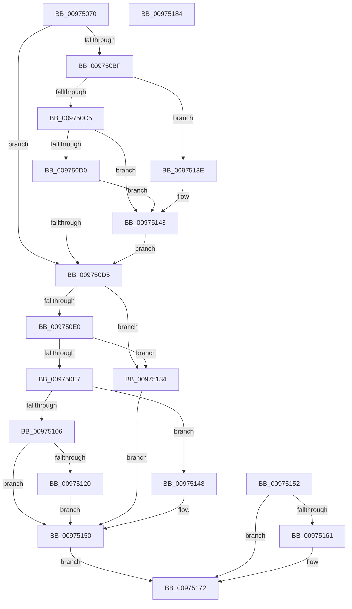

# SepProbeAndCaptureString_U

- RVA: `0x00975070`–`0x00975185` (길이 `277` bytes)
- VA: `0x0000000140975070`
- 실행 섹션: `PAGE`
- PDB 이름 있음: `예`; PDB Function 태그: `아니요`
- unwind 정보 RVA: `0x00096514`
- 디코드: `82`개 명령, `277/277` bytes 표시
- 미해석 바이트: `0` (있으면 어셈블리에 `.byte`로 보존)

> 이 문서는 커널 이미지의 기계어와 PDB 기호를 분석해 생성했습니다. 4번과 5번은 함수 원형과 자료형을 바이너리 사용 방식에서 추정한 C 해석이며 원본 소스 복구 결과는 아닙니다.

## 1. Dependencies

- 직접 호출 지점: **4**; 고유 호출 대상: **4**
- 직접 호출자로 확인된 함수: **6**
- RIP 상대 이미지 참조: **0**

### Outgoing calls
- `0x009750F9` → [ExAllocatePool2](../../poolcode/B8/ExAllocatePool2_function_00B820F0.md) (function, `0x00B820F0`)
- `0x0097512D` → [memcpy](../../text/6C/memcpy_function_006C6840.md) (function, `0x006C6840`)
- `0x0097513E` → [ExRaiseDatatypeMisalignment](../89/ExRaiseDatatypeMisalignment_function_00899FD0.md) (function, `0x00899FD0`)
- `0x00975166` → [ExFreePoolWithTag](../../poolcode/B8/ExFreePoolWithTag_function_00B82870.md) (function, `0x00B82870`)

### Direct callers
- [NtDeleteObjectAuditAlarm](../7A/NtDeleteObjectAuditAlarm_function_007A03C0.md) at `0x007A0445`
- [NtPrivilegeObjectAuditAlarm](NtPrivilegeObjectAuditAlarm_function_00974170.md) at `0x00974262`
- [NtPrivilegedServiceAuditAlarm](NtPrivilegedServiceAuditAlarm_function_00974430.md) at `0x00974506`
- [NtPrivilegedServiceAuditAlarm](NtPrivilegedServiceAuditAlarm_function_00974430.md) at `0x00974529`
- [NtOpenObjectAuditAlarm](NtOpenObjectAuditAlarm_function_00974700.md) at `0x00974969`
- [NtOpenObjectAuditAlarm](NtOpenObjectAuditAlarm_function_00974700.md) at `0x0097498F`
- [NtOpenObjectAuditAlarm](NtOpenObjectAuditAlarm_function_00974700.md) at `0x009749B5`
- [SepAccessCheckAndAuditAlarm](../A1/SepAccessCheckAndAuditAlarm_function_00A1AF4C.md) at `0x00A1B692`
- [SepAccessCheckAndAuditAlarm](../A1/SepAccessCheckAndAuditAlarm_function_00A1AF4C.md) at `0x00A1B6B4`
- [SepAccessCheckAndAuditAlarm](../A1/SepAccessCheckAndAuditAlarm_function_00A1AF4C.md) at `0x00A1B6D6`
- [sub_00B379EA](../B3/Unknown_function_00B379EA.md) at `0x00B379F5`

### Static image references
- 디코드된 RIP-relative 메모리 참조가 없습니다.

## 2. Other-region calls and transfers

- 다른 실행 섹션으로 향하는 call: **3**
  - `0x009750F9` → [ExAllocatePool2](../../poolcode/B8/ExAllocatePool2_function_00B820F0.md) (`PAGE` → `POOLCODE`)
  - `0x0097512D` → [memcpy](../../text/6C/memcpy_function_006C6840.md) (`PAGE` → `.text`)
  - `0x00975166` → [ExFreePoolWithTag](../../poolcode/B8/ExFreePoolWithTag_function_00B82870.md) (`PAGE` → `POOLCODE`)
- 별도 외부 분기/꼬리 이동을 확인하지 못했습니다.

## 3. Assembly (complete function range)

```asm
00975070  48 89 5C 24 08                  mov qword ptr [rsp + 8], rbx
00975075  48 89 54 24 10                  mov qword ptr [rsp + 0x10], rdx
0097507A  56                              push rsi
0097507B  57                              push rdi
0097507C  41 56                           push r14
0097507E  48 83 EC 40                     sub rsp, 0x40
00975082  48 8B DA                        mov rbx, rdx
00975085  0F 57 C0                        xorps xmm0, xmm0
00975088  0F 11 44 24 30                  movups xmmword ptr [rsp + 0x30], xmm0
0097508D  33 C0                           xor eax, eax
0097508F  48 89 02                        mov qword ptr [rdx], rax
00975092  89 44 24 24                     mov dword ptr [rsp + 0x24], eax
00975096  48 BA 00 00 FF FF FF 7F 00 00   movabs rdx, 0x7fffffff0000
009750A0  48 8B C2                        mov rax, rdx
009750A3  48 3B CA                        cmp rcx, rdx
009750A6  48 0F 42 C1                     cmovb rax, rcx
009750AA  90                              nop
009750AB  8B 38                           mov edi, dword ptr [rax]
009750AD  89 7C 24 30                     mov dword ptr [rsp + 0x30], edi
009750B1  4C 8B 70 08                     mov r14, qword ptr [rax + 8]
009750B5  4C 89 74 24 38                  mov qword ptr [rsp + 0x38], r14
009750BA  66 85 FF                        test di, di
009750BD  74 16                           je 0x1409750d5
009750BF  41 F6 C6 01                     test r14b, 1
009750C3  75 79                           jne 0x14097513e
009750C5  0F B7 CF                        movzx ecx, di
009750C8  49 03 CE                        add rcx, r14
009750CB  48 3B CA                        cmp rcx, rdx
009750CE  77 73                           ja 0x140975143
009750D0  49 3B CE                        cmp rcx, r14
009750D3  72 6E                           jb 0x140975143
009750D5  0F B7 C7                        movzx eax, di
009750D8  89 44 24 70                     mov dword ptr [rsp + 0x70], eax
009750DC  A8 01                           test al, 1
009750DE  75 54                           jne 0x140975134
009750E0  3D FE FF 00 00                  cmp eax, 0xfffe
009750E5  74 4D                           je 0x140975134
009750E7  0F B7 F7                        movzx esi, di
009750EA  48 8D 56 10                     lea rdx, [rsi + 0x10]
009750EE  B9 00 01 00 00                  mov ecx, 0x100
009750F3  41 B8 53 65 55 73               mov r8d, 0x73556553
009750F9  E8 F2 CF 20 00                  call 0x140b820f0
009750FE  48 89 03                        mov qword ptr [rbx], rax
00975101  48 85 C0                        test rax, rax
00975104  74 42                           je 0x140975148
00975106  66 89 38                        mov word ptr [rax], di
00975109  48 8B 03                        mov rax, qword ptr [rbx]
0097510C  66 89 78 02                     mov word ptr [rax + 2], di
00975110  48 8B 0B                        mov rcx, qword ptr [rbx]
00975113  48 8D 41 10                     lea rax, [rcx + 0x10]
00975117  48 89 41 08                     mov qword ptr [rcx + 8], rax
0097511B  66 85 FF                        test di, di
0097511E  74 30                           je 0x140975150
00975120  48 8B 0B                        mov rcx, qword ptr [rbx]
00975123  44 8B C6                        mov r8d, esi
00975126  49 8B D6                        mov rdx, r14
00975129  48 8B 49 08                     mov rcx, qword ptr [rcx + 8]
0097512D  E8 0E 17 D5 FF                  call 0x1406c6840
00975132  EB 1C                           jmp 0x140975150
00975134  C7 44 24 24 0D 00 00 C0         mov dword ptr [rsp + 0x24], 0xc000000d
0097513C  EB 12                           jmp 0x140975150
0097513E  E8 8D 4E F2 FF                  call 0x140899fd0
00975143  0F B6 02                        movzx eax, byte ptr [rdx]
00975146  EB 8D                           jmp 0x1409750d5
00975148  C7 44 24 24 9A 00 00 C0         mov dword ptr [rsp + 0x24], 0xc000009a
00975150  EB 20                           jmp 0x140975172
00975152  89 44 24 24                     mov dword ptr [rsp + 0x24], eax
00975156  48 8B 5C 24 68                  mov rbx, qword ptr [rsp + 0x68]
0097515B  48 83 3B 00                     cmp qword ptr [rbx], 0
0097515F  74 11                           je 0x140975172
00975161  33 D2                           xor edx, edx
00975163  48 8B 0B                        mov rcx, qword ptr [rbx]
00975166  E8 05 D7 20 00                  call 0x140b82870
0097516B  48 C7 03 00 00 00 00            mov qword ptr [rbx], 0
00975172  8B 44 24 24                     mov eax, dword ptr [rsp + 0x24]
00975176  48 8B 5C 24 60                  mov rbx, qword ptr [rsp + 0x60]
0097517B  48 83 C4 40                     add rsp, 0x40
0097517F  41 5E                           pop r14
00975181  5F                              pop rdi
00975182  5E                              pop rsi
00975183  C3                              ret
00975184  CC                              int3
```

## 4. C-style interpretation (structured pseudocode)

```c
__int64 __fastcall SepProbeAndCaptureString_U(__int64 a1, __int64 a2)
{
    __int64 result;
    __int64 v_rsp;
    unsigned __int64 v_stack_m20;
    unsigned __int64 v_stack_m28;
    unsigned int v_stack_m34;
    unsigned __int64 v_stack_p10;
    unsigned int v_stack_p18;
    unsigned __int64 v_stack_p8;

    v_stack_p8 = v_rbx;
    v_stack_p10 = a2;
    v_rsp = (v_rsp) - (64);
    v_stack_m28 = v_xmm0;
    result = 0;
    *(unsigned __int64 *)(a2) = 0;
    v_stack_m34 = 0;
    if (a1 < a2) { a2 = a1; }
    v_stack_m28 = (unsigned int)((unsigned int)(*(unsigned int *)(a2)));
    v_stack_m20 = *(unsigned __int64 *)(a2 + 8);
    if ((unsigned __int16)((unsigned int)(*(unsigned int *)(a2))) == 0) goto loc_009750D5;
    if ((((unsigned __int8)(*(unsigned __int64 *)(a2 + 8))) & (1)) != 0) goto loc_0097513E;
    a1 = ((unsigned __int16)((unsigned int)(*(unsigned int *)(a2)))) + (*(unsigned __int64 *)(a2 + 8));
    if (a1 > a2) goto loc_00975143;
    if (a1 < (*(unsigned __int64 *)(a2 + 8))) goto loc_00975143;
loc_009750D5:
    v_stack_p18 = (unsigned int)((unsigned __int16)((unsigned int)(*(unsigned int *)(a2))));
    if ((((unsigned __int8)((unsigned __int16)((unsigned int)(*(unsigned int *)(a2))))) & (1)) != 0) goto loc_00975134;
    if (((unsigned int)((unsigned __int16)((unsigned int)(*(unsigned int *)(a2))))) == 0xFFFEULL) goto loc_00975134;
    result = ExAllocatePool2(256, (unsigned __int16)((unsigned int)(*(unsigned int *)(a2))) + 16, (unsigned int)(0x73556553ULL), a4);
    *(unsigned __int64 *)(a2) = result;
    if (result == 0) goto loc_00975148;
    *(unsigned __int16 *)(result) = (unsigned __int16)((unsigned int)(*(unsigned int *)(a2)));
    *(unsigned __int16 *)(*(unsigned __int64 *)(a2) + 2) = (unsigned __int16)((unsigned int)(*(unsigned int *)(a2)));
    *(unsigned __int64 *)(*(unsigned __int64 *)(a2) + 8) = *(unsigned __int64 *)(a2) + 16;
    if ((unsigned __int16)((unsigned int)(*(unsigned int *)(a2))) == 0) goto loc_00975150;
    result = memcpy(*(unsigned __int64 *)(*(unsigned __int64 *)(a2) + 8), *(unsigned __int64 *)(a2 + 8), (unsigned int)((unsigned int)((unsigned __int16)((unsigned int)(*(unsigned int *)(a2))))), a4);
    goto loc_00975150;
loc_00975134:
    v_stack_m34 = 0xC000000DULL;
    goto loc_00975150;
loc_0097513E:
    result = ExRaiseDatatypeMisalignment(*(unsigned __int64 *)(*(unsigned __int64 *)(a2) + 8), *(unsigned __int64 *)(a2 + 8), (unsigned int)((unsigned int)((unsigned __int16)((unsigned int)(*(unsigned int *)(a2))))), a4);
loc_00975143:
    goto loc_009750D5;
loc_00975148:
    v_stack_m34 = 0xC000009AULL;
loc_00975150:
    goto loc_00975172;
loc_00975172:
    v_rsp = (v_rsp) + (64);
    return (unsigned int)(v_stack_m34);
}
```

## 5. (Beta) C Style

```c
int64_t SepProbeAndCaptureString_U(int64_t Arg1, void *Arg2)
{
    uint8_t *arg2 = (uint8_t *)Arg2;

    int64_t result;
    int64_t local_rsp;
    uint64_t v_stack_m20;
    uint64_t v_stack_m28;
    uint32_t v_stack_m34;
    uint64_t v_stack_p10;
    uint32_t v_stack_p18;
    uint64_t v_stack_p8;

    v_stack_p8 = local_rbx;
    v_stack_p10 = Arg2;
    local_rsp = (local_rsp) - (64);
    v_stack_m28 = v_xmm0;
    result = 0;
    *(uint64_t *)(arg2) = 0;
    v_stack_m34 = 0;
    if (Arg1 < Arg2) { Arg2 = Arg1; }
    v_stack_m28 = (uint32_t)((uint32_t)(*(uint32_t *)(arg2)));
    v_stack_m20 = *(uint64_t *)(arg2 + 0x8);
    if ((uint16_t)((uint32_t)(*(uint32_t *)(arg2))) == 0) goto loc_009750D5;
    if ((((uint8_t)(*(uint64_t *)(arg2 + 0x8))) & (1)) != 0) goto loc_0097513E;
    Arg1 = ((uint16_t)((uint32_t)(*(uint32_t *)(arg2)))) + (*(uint64_t *)(arg2 + 0x8));
    if (Arg1 > Arg2) goto loc_00975143;
    if (Arg1 < (*(uint64_t *)(arg2 + 0x8))) goto loc_00975143;
loc_009750D5:
    v_stack_p18 = (uint32_t)((uint16_t)((uint32_t)(*(uint32_t *)(arg2))));
    if ((((uint8_t)((uint16_t)((uint32_t)(*(uint32_t *)(arg2))))) & (1)) != 0) goto loc_00975134;
    if (((uint32_t)((uint16_t)((uint32_t)(*(uint32_t *)(arg2))))) == 0xFFFEULL) goto loc_00975134;
    result = ExAllocatePool2(256, (uint16_t)((uint32_t)(*(uint32_t *)(arg2))) + 16, (uint32_t)(0x73556553ULL), a4);
    *(uint64_t *)(arg2) = result;
    if (result == 0) goto loc_00975148;
    *(uint16_t *)(result) = (uint16_t)((uint32_t)(*(uint32_t *)(arg2)));
    *(uint16_t *)(*(uint64_t *)(arg2) + 0x2) = (uint16_t)((uint32_t)(*(uint32_t *)(arg2)));
    *(uint64_t *)(*(uint64_t *)(arg2) + 0x8) = *(uint64_t *)(arg2) + 16;
    if ((uint16_t)((uint32_t)(*(uint32_t *)(arg2))) == 0) goto loc_00975150;
    result = memcpy(*(uint64_t *)(*(uint64_t *)(arg2) + 0x8), *(uint64_t *)(arg2 + 0x8), (uint32_t)((uint32_t)((uint16_t)((uint32_t)(*(uint32_t *)(arg2))))), a4);
    goto loc_00975150;
loc_00975134:
    v_stack_m34 = 0xC000000DULL;
    goto loc_00975150;
loc_0097513E:
    result = ExRaiseDatatypeMisalignment(*(uint64_t *)(*(uint64_t *)(arg2) + 0x8), *(uint64_t *)(arg2 + 0x8), (uint32_t)((uint32_t)((uint16_t)((uint32_t)(*(uint32_t *)(arg2))))), a4);
loc_00975143:
    goto loc_009750D5;
loc_00975148:
    v_stack_m34 = 0xC000009AULL;
loc_00975150:
    goto loc_00975172;
loc_00975172:
    local_rsp = (local_rsp) + (64);
    return (uint32_t)(v_stack_m34);
}
```

### 관측된 메모리 오프셋

구조체 형식이 확인되지 않은 접근은 인자 기준의 오프셋으로만 기록했습니다.

| 기준 인자 | 오프셋 표현 | 폭 (bit) | 접근 |
|---|---:|---:|---|
| `Arg2` | `+ 0x0` | `64` | `R` |
| `Arg2` | `+ 0x0` | `64` | `W` |

## 6. Execution-region graph

[열기: 2D/3D 그래프와 함수 탐색 컨트롤 패널](../../../control-panel.html?section=page&rva=0x00975070&view=graph)

- 2D 그래프는 위에서 아래로 흐르고, 3D 그래프는 빈 공간을 드래그해 회전합니다. Shift+드래그는 이동, 휠은 확대·축소, 함수 노드 선택은 대상 보고서 이동입니다.

### Static fallback


