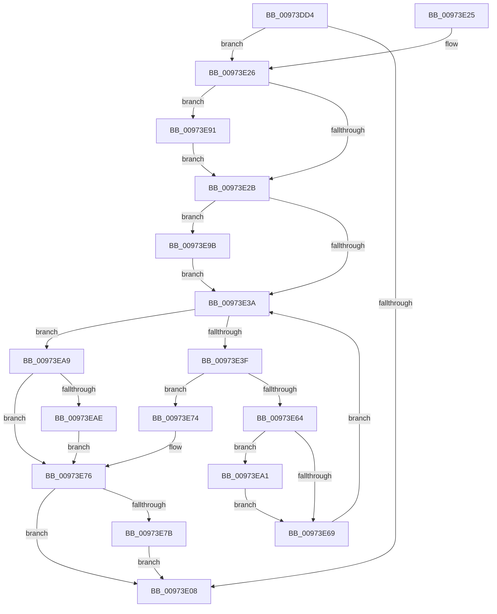

# SepRmGlobalSaclFind

- RVA: `0x00973DD4`–`0x00973EB4` (길이 `224` bytes)
- VA: `0x0000000140973DD4`
- 실행 섹션: `PAGE`
- PDB 이름 있음: `예`; PDB Function 태그: `아니요`
- unwind 정보 RVA: `0x00096388`
- 디코드: `66`개 명령, `224/224` bytes 표시
- 미해석 바이트: `0` (있으면 어셈블리에 `.byte`로 보존)

> 이 문서는 커널 이미지의 기계어와 PDB 기호를 분석해 생성했습니다. 4번과 5번은 함수 원형과 자료형을 바이너리 사용 방식에서 추정한 C 해석이며 원본 소스 복구 결과는 아닙니다.

## 1. Dependencies

- 직접 호출 지점: **4**; 고유 호출 대상: **4**
- 직접 호출자로 확인된 함수: **4**
- RIP 상대 이미지 참조: **2**

### Outgoing calls
- `0x00973E5B` → [RtlCompareUnicodeStrings](RtlCompareUnicodeStrings_function_009727E0.md) (function, `0x009727E0`)
- `0x00973E82` → [ExReleaseResourceLite](../../text/25/ExReleaseResourceLite_function_0025FA10.md) (function, `0x0025FA10`)
- `0x00973E87` → [KeLeaveCriticalRegion](../../text/25/KeLeaveCriticalRegion_function_0025D8B0.md) (function, `0x0025D8B0`)
- `0x00973E91` → [SepRmAcquireGlobalSaclReadLock](../../text/46/SepRmAcquireGlobalSaclReadLock_function_0046B608.md) (function, `0x0046B608`)

### Direct callers
- [SepExamineGlobalSaclEx](../../text/46/SepExamineGlobalSaclEx_function_0046B550.md) at `0x0046B5B4`
- [SeAuditingFileOrGlobalEvents](../79/SeAuditingFileOrGlobalEvents_function_0079FAD0.md) at `0x0079FB19`
- [SepRmGlobalSaclSetWrkr](../7A/SepRmGlobalSaclSetWrkr_function_007A2B60.md) at `0x007A2BF5`
- [NtSetSecurityObject](../AD/NtSetSecurityObject_function_00ADE2B0.md) at `0x00ADE4C5`

### Static image references
- `0x00973DF3` → RVA `0x00E680F8` (`.data`; read)
- `0x00973E7B` → RVA `0x00E68100` (`.data`; read)

## 2. Other-region calls and transfers

- 다른 실행 섹션으로 향하는 call: **3**
  - `0x00973E82` → [ExReleaseResourceLite](../../text/25/ExReleaseResourceLite_function_0025FA10.md) (`PAGE` → `.text`)
  - `0x00973E87` → [KeLeaveCriticalRegion](../../text/25/KeLeaveCriticalRegion_function_0025D8B0.md) (`PAGE` → `.text`)
  - `0x00973E91` → [SepRmAcquireGlobalSaclReadLock](../../text/46/SepRmAcquireGlobalSaclReadLock_function_0046B608.md) (`PAGE` → `.text`)
- 별도 외부 분기/꼬리 이동을 확인하지 못했습니다.

## 3. Assembly (complete function range)

```asm
00973DD4  48 8B C4                        mov rax, rsp
00973DD7  48 89 58 08                     mov qword ptr [rax + 8], rbx
00973DDB  48 89 68 10                     mov qword ptr [rax + 0x10], rbp
00973DDF  48 89 70 18                     mov qword ptr [rax + 0x18], rsi
00973DE3  48 89 78 20                     mov qword ptr [rax + 0x20], rdi
00973DE7  41 56                           push r14
00973DE9  48 83 EC 30                     sub rsp, 0x30
00973DED  40 32 ED                        xor bpl, bpl
00973DF0  4D 8B F0                        mov r14, r8
00973DF3  48 83 3D FD 42 4F 00 00         cmp qword ptr [rip + 0x4f42fd], 0
00973DFB  48 8B DA                        mov rbx, rdx
00973DFE  48 8B F9                        mov rdi, rcx
00973E01  BE 34 00 00 C0                  mov esi, 0xc0000034
00973E06  75 1E                           jne 0x140973e26
00973E08  48 8B 5C 24 40                  mov rbx, qword ptr [rsp + 0x40]
00973E0D  8B C6                           mov eax, esi
00973E0F  48 8B 74 24 50                  mov rsi, qword ptr [rsp + 0x50]
00973E14  48 8B 6C 24 48                  mov rbp, qword ptr [rsp + 0x48]
00973E19  48 8B 7C 24 58                  mov rdi, qword ptr [rsp + 0x58]
00973E1E  48 83 C4 30                     add rsp, 0x30
00973E22  41 5E                           pop r14
00973E24  C3                              ret
00973E25  CC                              int3
00973E26  45 84 C9                        test r9b, r9b
00973E29  75 66                           jne 0x140973e91
00973E2B  48 8B 05 C6 42 4F 00            mov rax, qword ptr [rip + 0x4f42c6]
00973E32  48 89 07                        mov qword ptr [rdi], rax
00973E35  48 85 DB                        test rbx, rbx
00973E38  75 61                           jne 0x140973e9b
00973E3A  48 85 C0                        test rax, rax
00973E3D  74 6A                           je 0x140973ea9
00973E3F  44 0F B7 48 08                  movzx r9d, word ptr [rax + 8]
00973E44  41 0F B7 16                     movzx edx, word ptr [r14]
00973E48  4C 8B 40 10                     mov r8, qword ptr [rax + 0x10]
00973E4C  49 8B 4E 08                     mov rcx, qword ptr [r14 + 8]
00973E50  49 D1 E9                        shr r9, 1
00973E53  48 D1 EA                        shr rdx, 1
00973E56  C6 44 24 20 00                  mov byte ptr [rsp + 0x20], 0
00973E5B  E8 80 E9 FF FF                  call 0x1409727e0
00973E60  85 C0                           test eax, eax
00973E62  74 10                           je 0x140973e74
00973E64  48 85 DB                        test rbx, rbx
00973E67  75 38                           jne 0x140973ea1
00973E69  48 8B 07                        mov rax, qword ptr [rdi]
00973E6C  48 8B 00                        mov rax, qword ptr [rax]
00973E6F  48 89 07                        mov qword ptr [rdi], rax
00973E72  EB C6                           jmp 0x140973e3a
00973E74  33 F6                           xor esi, esi
00973E76  40 84 ED                        test bpl, bpl
00973E79  74 8D                           je 0x140973e08
00973E7B  48 8D 0D 7E 42 4F 00            lea rcx, [rip + 0x4f427e]
00973E82  E8 89 BB 8E FF                  call 0x14025fa10
00973E87  E8 24 9A 8E FF                  call 0x14025d8b0
00973E8C  E9 77 FF FF FF                  jmp 0x140973e08
00973E91  E8 72 77 AF FF                  call 0x14046b608
00973E96  40 B5 01                        mov bpl, 1
00973E99  EB 90                           jmp 0x140973e2b
00973E9B  48 83 23 00                     and qword ptr [rbx], 0
00973E9F  EB 99                           jmp 0x140973e3a
00973EA1  48 8B 07                        mov rax, qword ptr [rdi]
00973EA4  48 89 03                        mov qword ptr [rbx], rax
00973EA7  EB C0                           jmp 0x140973e69
00973EA9  48 85 DB                        test rbx, rbx
00973EAC  74 C8                           je 0x140973e76
00973EAE  48 83 23 00                     and qword ptr [rbx], 0
00973EB2  EB C2                           jmp 0x140973e76
```

## 4. C-style interpretation (structured pseudocode)

```c
__int64 __fastcall SepRmGlobalSaclFind(__int64 a1, __int64 a2, __int64 a3, unsigned __int8 a4)
{
    __int64 result;
    __int64 v_rbp;
    __int64 v_rsi;
    __int64 v_rsp;
    unsigned __int64 v_stack_p10;
    unsigned __int64 v_stack_p18;
    unsigned __int64 v_stack_p20;
    unsigned __int64 v_stack_p8;

    *(unsigned __int64 *)(v_rsp + 8) = v_rbx;
    *(unsigned __int64 *)(v_rsp + 16) = v_rbp;
    *(unsigned __int64 *)(v_rsp + 24) = v_rsi;
    *(unsigned __int64 *)(v_rsp + 32) = v_rdi;
    v_rsp = (v_rsp) - (48);
    v_rbp = 0;
    if ((*(unsigned __int64 *)(v_rip + 5194493)) != 0) goto loc_00973E26;
loc_00973E08:
    v_rsp = (v_rsp) + (48);
    return (unsigned int)((unsigned int)((unsigned int)(0xC0000034ULL)));
loc_00973E26:
    if (a4 != 0) goto loc_00973E91;
loc_00973E2B:
    *(unsigned __int64 *)(v_stack_p20) = *(unsigned __int64 *)(v_rip + 5194438);
    if (v_stack_p8 != 0) goto loc_00973E9B;
loc_00973E3A:
    if (*(unsigned __int64 *)(v_rip + 5194438) == 0) goto loc_00973EA9;
    a4 = (*(unsigned __int16 *)(*(unsigned __int64 *)(v_rip + 5194438) + 8)) >> (1);
    a2 = (*(unsigned __int16 *)(a3)) >> (1);
    v_stack_p20 = 0;
    result = RtlCompareUnicodeStrings(*(unsigned __int64 *)(a3 + 8), a2, *(unsigned __int64 *)(*(unsigned __int64 *)(v_rip + 5194438) + 16), a4);
    if ((unsigned int)(result) == 0) goto loc_00973E74;
    if (v_stack_p8 != 0) goto loc_00973EA1;
loc_00973E69:
    *(unsigned __int64 *)(v_stack_p20) = *(unsigned __int64 *)(*(unsigned __int64 *)(v_stack_p20));
    goto loc_00973E3A;
loc_00973E74:
    v_rsi = 0;
loc_00973E76:
    if ((unsigned __int8)(v_stack_p10) == 0) goto loc_00973E08;
    result = ExReleaseResourceLite(v_rip + 5194366, a2, *(unsigned __int64 *)(*(unsigned __int64 *)(v_rip + 5194438) + 16), a4);
    result = KeLeaveCriticalRegion(v_rip + 5194366, a2, *(unsigned __int64 *)(*(unsigned __int64 *)(v_rip + 5194438) + 16), a4);
    goto loc_00973E08;
loc_00973E91:
    result = SepRmAcquireGlobalSaclReadLock(v_rip + 5194366, a2, *(unsigned __int64 *)(*(unsigned __int64 *)(v_rip + 5194438) + 16), a4);
    goto loc_00973E2B;
loc_00973E9B:
    goto loc_00973E3A;
loc_00973EA1:
    *(unsigned __int64 *)(v_stack_p8) = *(unsigned __int64 *)(v_stack_p20);
    goto loc_00973E69;
loc_00973EA9:
    if (v_stack_p8 == 0) goto loc_00973E76;
    goto loc_00973E76;
}
```

## 5. (Beta) C Style

```c
int64_t SepRmGlobalSaclFind(void *Arg1, int64_t Arg2, void *Arg3, uint8_t Arg4)
{
    uint8_t *arg1 = (uint8_t *)Arg1;
    uint8_t *arg3 = (uint8_t *)Arg3;

    int64_t result;
    int64_t local_rbp;
    int64_t local_rsi;
    int64_t local_rsp;
    uint64_t v_stack_p10;
    uint64_t v_stack_p18;
    uint64_t v_stack_p20;
    uint64_t v_stack_p8;

    *(uint64_t *)(local_rsp + 0x8) = local_rbx;
    *(uint64_t *)(local_rsp + 0x10) = local_rbp;
    *(uint64_t *)(local_rsp + 0x18) = local_rsi;
    *(uint64_t *)(local_rsp + 0x20) = local_rdi;
    local_rsp = (local_rsp) - (48);
    local_rbp = 0;
    if ((*(uint64_t *)(v_rip + 0x4F42FD)) != 0) goto loc_00973E26;
loc_00973E08:
    local_rsp = (local_rsp) + (48);
    return (uint32_t)((uint32_t)((uint32_t)(0xC0000034ULL)));
loc_00973E26:
    if (Arg4 != 0) goto loc_00973E91;
loc_00973E2B:
    *(uint64_t *)(v_stack_p20) = *(uint64_t *)(v_rip + 0x4F42C6);
    if (v_stack_p8 != 0) goto loc_00973E9B;
loc_00973E3A:
    if (*(uint64_t *)(v_rip + 0x4F42C6) == 0) goto loc_00973EA9;
    Arg4 = (*(uint16_t *)(*(uint64_t *)(v_rip + 0x4F42C6) + 0x8)) >> (1);
    Arg2 = (*(uint16_t *)(arg3)) >> (1);
    v_stack_p20 = 0;
    result = RtlCompareUnicodeStrings(*(uint64_t *)(arg3 + 0x8), Arg2, *(uint64_t *)(*(uint64_t *)(v_rip + 0x4F42C6) + 0x10), Arg4);
    if ((uint32_t)(result) == 0) goto loc_00973E74;
    if (v_stack_p8 != 0) goto loc_00973EA1;
loc_00973E69:
    *(uint64_t *)(v_stack_p20) = *(uint64_t *)(*(uint64_t *)(v_stack_p20));
    goto loc_00973E3A;
loc_00973E74:
    local_rsi = 0;
loc_00973E76:
    if ((uint8_t)(v_stack_p10) == 0) goto loc_00973E08;
    result = ExReleaseResourceLite(v_rip + 5194366, Arg2, *(uint64_t *)(*(uint64_t *)(v_rip + 0x4F42C6) + 0x10), Arg4);
    result = KeLeaveCriticalRegion(v_rip + 5194366, Arg2, *(uint64_t *)(*(uint64_t *)(v_rip + 0x4F42C6) + 0x10), Arg4);
    goto loc_00973E08;
loc_00973E91:
    result = SepRmAcquireGlobalSaclReadLock(v_rip + 5194366, Arg2, *(uint64_t *)(*(uint64_t *)(v_rip + 0x4F42C6) + 0x10), Arg4);
    goto loc_00973E2B;
loc_00973E9B:
    goto loc_00973E3A;
loc_00973EA1:
    *(uint64_t *)(v_stack_p8) = *(uint64_t *)(v_stack_p20);
    goto loc_00973E69;
loc_00973EA9:
    if (v_stack_p8 == 0) goto loc_00973E76;
    goto loc_00973E76;
}
```

### 관측된 메모리 오프셋

구조체 형식이 확인되지 않은 접근은 인자 기준의 오프셋으로만 기록했습니다.

| 기준 인자 | 오프셋 표현 | 폭 (bit) | 접근 |
|---|---:|---:|---|
| `Arg1` | `+ 0x0` | `64` | `R` |
| `Arg1` | `+ 0x0` | `64` | `W` |
| `Arg3` | `+ 0x0` | `16` | `R` |
| `Arg3` | `+ 0x8` | `64` | `R` |

## 6. Execution-region graph

[열기: 2D/3D 그래프와 함수 탐색 컨트롤 패널](../../../control-panel.html?section=page&rva=0x00973DD4&view=graph)

- 2D 그래프는 위에서 아래로 흐르고, 3D 그래프는 빈 공간을 드래그해 회전합니다. Shift+드래그는 이동, 휠은 확대·축소, 함수 노드 선택은 대상 보고서 이동입니다.

### Static fallback


