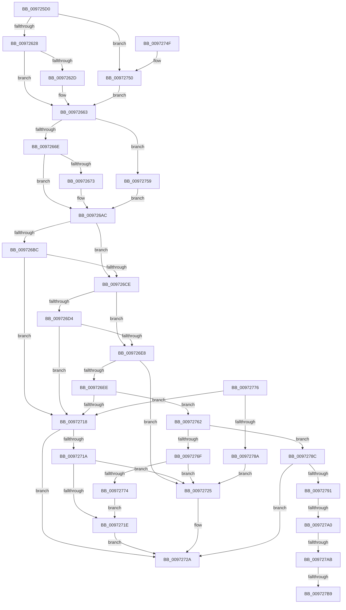

# SshpCacheDatabaseCompare

- RVA: `0x009725D0`–`0x009727CF` (길이 `511` bytes)
- VA: `0x00000001409725D0`
- 실행 섹션: `PAGE`
- PDB 이름 있음: `예`; PDB Function 태그: `예`
- unwind 정보 RVA: `0x00096134`
- 디코드: `144`개 명령, `511/511` bytes 표시
- 미해석 바이트: `0` (있으면 어셈블리에 `.byte`로 보존)

> 이 문서는 커널 이미지의 기계어와 PDB 기호를 분석해 생성했습니다. 4번과 5번은 함수 원형과 자료형을 바이너리 사용 방식에서 추정한 C 해석이며 원본 소스 복구 결과는 아닙니다.

## 1. Dependencies

- 직접 호출 지점: **5**; 고유 호출 대상: **3**
- 직접 호출자로 확인된 함수: **0**
- RIP 상대 이미지 참조: **1**

### Outgoing calls
- `0x009726C5` → [memcmp](../../text/6C/memcmp_function_006C6B10.md) (function, `0x006C6B10`)
- `0x009726DF` → [memcmp](../../text/6C/memcmp_function_006C6B10.md) (function, `0x006C6B10`)
- `0x0097270F` → [RtlCompareUnicodeStrings](RtlCompareUnicodeStrings_function_009727E0.md) (function, `0x009727E0`)
- `0x00972733` → [_security_check_cookie](../../text/6A/_security_check_cookie_function_006AC640.md) (function, `0x006AC640`)
- `0x00972781` → [memcmp](../../text/6C/memcmp_function_006C6B10.md) (function, `0x006C6B10`)

### Direct callers
- 이 함수 시작 RVA로 연결되는 직접 call은 확인되지 않았습니다. 간접 호출은 완전히 역산할 수 없습니다.

### Static image references
- `0x009725E8` → RVA `0x00E0A740` (`.data`; read)

## 2. Other-region calls and transfers

- 다른 실행 섹션으로 향하는 call: **4**
  - `0x009726C5` → [memcmp](../../text/6C/memcmp_function_006C6B10.md) (`PAGE` → `.text`)
  - `0x009726DF` → [memcmp](../../text/6C/memcmp_function_006C6B10.md) (`PAGE` → `.text`)
  - `0x00972733` → [_security_check_cookie](../../text/6A/_security_check_cookie_function_006AC640.md) (`PAGE` → `.text`)
  - `0x00972781` → [memcmp](../../text/6C/memcmp_function_006C6B10.md) (`PAGE` → `.text`)
- call이 아닌 외부 분기/꼬리 이동: **4**
  - `0x0097279A` → [sub_00B291EC + 0x20](../B2/Unknown_function_00B291EC.md) (`tail-transfer`)
  - `0x009727A5` → [sub_00B291EC + 0x20](../B2/Unknown_function_00B291EC.md) (`tail-transfer`)
  - `0x009727B3` → [sub_00B291EC + 0x20](../B2/Unknown_function_00B291EC.md) (`tail-transfer`)
  - `0x009727CA` → [sub_00B291EC](../B2/Unknown_function_00B291EC.md) (`tail-transfer`)

## 3. Assembly (complete function range)

```asm
009725D0  48 89 5C 24 08                  mov qword ptr [rsp + 8], rbx
009725D5  55                              push rbp
009725D6  56                              push rsi
009725D7  57                              push rdi
009725D8  41 56                           push r14
009725DA  41 57                           push r15
009725DC  48 8D 6C 24 C9                  lea rbp, [rsp - 0x37]
009725E1  48 81 EC A0 00 00 00            sub rsp, 0xa0
009725E8  48 8B 05 51 81 49 00            mov rax, qword ptr [rip + 0x498151]
009725EF  48 33 C4                        xor rax, rsp
009725F2  48 89 45 27                     mov qword ptr [rbp + 0x27], rax
009725F6  4C 8B 71 60                     mov r14, qword ptr [rcx + 0x60]
009725FA  33 DB                           xor ebx, ebx
009725FC  8B 0A                           mov ecx, dword ptr [rdx]
009725FE  0F 57 C0                        xorps xmm0, xmm0
00972601  0F 57 C9                        xorps xmm1, xmm1
00972604  8B F3                           mov esi, ebx
00972606  8B FB                           mov edi, ebx
00972608  0F 11 45 C7                     movups xmmword ptr [rbp - 0x39], xmm0
0097260C  0F 11 45 D7                     movups xmmword ptr [rbp - 0x29], xmm0
00972610  0F 11 45 E7                     movups xmmword ptr [rbp - 0x19], xmm0
00972614  0F 11 4D F7                     movups xmmword ptr [rbp - 9], xmm1
00972618  0F 11 4D 07                     movups xmmword ptr [rbp + 7], xmm1
0097261C  0F 11 4D 17                     movups xmmword ptr [rbp + 0x17], xmm1
00972620  85 C9                           test ecx, ecx
00972622  0F 84 28 01 00 00               je 0x140972750
00972628  83 F9 01                        cmp ecx, 1
0097262B  75 36                           jne 0x140972663
0097262D  48 8B 42 08                     mov rax, qword ptr [rdx + 8]
00972631  48 8D 75 C7                     lea rsi, [rbp - 0x39]
00972635  F3 0F 7F 45 CF                  movdqu xmmword ptr [rbp - 0x31], xmm0
0097263A  48 8B 88 30 01 00 00            mov rcx, qword ptr [rax + 0x130]
00972641  0F 10 41 40                     movups xmm0, xmmword ptr [rcx + 0x40]
00972645  48 8D 41 50                     lea rax, [rcx + 0x50]
00972649  0F 10 49 30                     movups xmm1, xmmword ptr [rcx + 0x30]
0097264D  48 89 45 E7                     mov qword ptr [rbp - 0x19], rax
00972651  48 8B 41 60                     mov rax, qword ptr [rcx + 0x60]
00972655  48 89 45 EF                     mov qword ptr [rbp - 0x11], rax
00972659  F3 0F 7F 45 C7                  movdqu xmmword ptr [rbp - 0x39], xmm0
0097265E  F3 0F 7F 4D D7                  movdqu xmmword ptr [rbp - 0x29], xmm1
00972663  41 8B 08                        mov ecx, dword ptr [r8]
00972666  85 C9                           test ecx, ecx
00972668  0F 84 EB 00 00 00               je 0x140972759
0097266E  83 F9 01                        cmp ecx, 1
00972671  75 39                           jne 0x1409726ac
00972673  49 8B 40 08                     mov rax, qword ptr [r8 + 8]
00972677  48 8D 7D F7                     lea rdi, [rbp - 9]
0097267B  0F 57 C0                        xorps xmm0, xmm0
0097267E  F3 0F 7F 45 FF                  movdqu xmmword ptr [rbp - 1], xmm0
00972683  48 8B 88 30 01 00 00            mov rcx, qword ptr [rax + 0x130]
0097268A  0F 10 41 40                     movups xmm0, xmmword ptr [rcx + 0x40]
0097268E  48 8D 41 50                     lea rax, [rcx + 0x50]
00972692  0F 10 49 30                     movups xmm1, xmmword ptr [rcx + 0x30]
00972696  48 89 45 17                     mov qword ptr [rbp + 0x17], rax
0097269A  48 8B 41 60                     mov rax, qword ptr [rcx + 0x60]
0097269E  48 89 45 1F                     mov qword ptr [rbp + 0x1f], rax
009726A2  F3 0F 7F 45 F7                  movdqu xmmword ptr [rbp - 9], xmm0
009726A7  F3 0F 7F 4D 07                  movdqu xmmword ptr [rbp + 7], xmm1
009726AC  45 8B 76 2C                     mov r14d, dword ptr [r14 + 0x2c]
009726B0  41 BF 10 00 00 00               mov r15d, 0x10
009726B6  41 F6 C6 01                     test r14b, 1
009726BA  74 12                           je 0x1409726ce
009726BC  45 8B C7                        mov r8d, r15d
009726BF  48 8B D7                        mov rdx, rdi
009726C2  48 8B CE                        mov rcx, rsi
009726C5  E8 46 44 D5 FF                  call 0x1406c6b10
009726CA  85 C0                           test eax, eax
009726CC  75 4A                           jne 0x140972718
009726CE  41 F6 C6 02                     test r14b, 2
009726D2  74 14                           je 0x1409726e8
009726D4  48 8D 57 10                     lea rdx, [rdi + 0x10]
009726D8  4D 8B C7                        mov r8, r15
009726DB  48 8D 4E 10                     lea rcx, [rsi + 0x10]
009726DF  E8 2C 44 D5 FF                  call 0x1406c6b10
009726E4  85 C0                           test eax, eax
009726E6  75 30                           jne 0x140972718
009726E8  41 F6 C6 04                     test r14b, 4
009726EC  74 37                           je 0x140972725
009726EE  4C 8B 47 20                     mov r8, qword ptr [rdi + 0x20]
009726F2  48 8B 4E 20                     mov rcx, qword ptr [rsi + 0x20]
009726F6  88 5C 24 20                     mov byte ptr [rsp + 0x20], bl
009726FA  45 0F B7 08                     movzx r9d, word ptr [r8]
009726FE  0F B7 11                        movzx edx, word ptr [rcx]
00972701  4D 8B 40 08                     mov r8, qword ptr [r8 + 8]
00972705  48 8B 49 08                     mov rcx, qword ptr [rcx + 8]
00972709  49 D1 E9                        shr r9, 1
0097270C  48 D1 EA                        shr rdx, 1
0097270F  E8 CC 00 00 00                  call 0x1409727e0
00972714  85 C0                           test eax, eax
00972716  74 4A                           je 0x140972762
00972718  78 10                           js 0x14097272a
0097271A  85 C0                           test eax, eax
0097271C  7E 07                           jle 0x140972725
0097271E  BB 01 00 00 00                  mov ebx, 1
00972723  EB 05                           jmp 0x14097272a
00972725  BB 02 00 00 00                  mov ebx, 2
0097272A  8B C3                           mov eax, ebx
0097272C  48 8B 4D 27                     mov rcx, qword ptr [rbp + 0x27]
00972730  48 33 CC                        xor rcx, rsp
00972733  E8 08 9F D3 FF                  call 0x1406ac640
00972738  48 8B 9C 24 D0 00 00 00         mov rbx, qword ptr [rsp + 0xd0]
00972740  48 81 C4 A0 00 00 00            add rsp, 0xa0
00972747  41 5F                           pop r15
00972749  41 5E                           pop r14
0097274B  5F                              pop rdi
0097274C  5E                              pop rsi
0097274D  5D                              pop rbp
0097274E  C3                              ret
0097274F  CC                              int3
00972750  48 8B 72 08                     mov rsi, qword ptr [rdx + 8]
00972754  E9 0A FF FF FF                  jmp 0x140972663
00972759  49 8B 78 08                     mov rdi, qword ptr [r8 + 8]
0097275D  E9 4A FF FF FF                  jmp 0x1409726ac
00972762  4C 8B 4E 28                     mov r9, qword ptr [rsi + 0x28]
00972766  48 8B 57 28                     mov rdx, qword ptr [rdi + 0x28]
0097276A  4D 85 C9                        test r9, r9
0097276D  75 1D                           jne 0x14097278c
0097276F  48 85 D2                        test rdx, rdx
00972772  74 B1                           je 0x140972725
00972774  EB A8                           jmp 0x14097271e
00972776  8B CF                           mov ecx, edi
00972778  45 03 C0                        add r8d, r8d
0097277B  48 03 D1                        add rdx, rcx
0097277E  49 03 C9                        add rcx, r9
00972781  E8 8A 43 D5 FF                  call 0x1406c6b10
00972786  85 C0                           test eax, eax
00972788  75 8E                           jne 0x140972718
0097278A  EB 99                           jmp 0x140972725
0097278C  48 85 D2                        test rdx, rdx
0097278F  74 99                           je 0x14097272a
00972791  41 0F B7 41 04                  movzx eax, word ptr [r9 + 4]
00972796  66 3B 42 04                     cmp ax, word ptr [rdx + 4]
0097279A  0F 85 6C 6A 1B 00               jne 0x140b2920c
009727A0  41 8B 09                        mov ecx, dword ptr [r9]
009727A3  3B 0A                           cmp ecx, dword ptr [rdx]
009727A5  0F 85 61 6A 1B 00               jne 0x140b2920c
009727AB  45 8B 41 08                     mov r8d, dword ptr [r9 + 8]
009727AF  44 3B 42 08                     cmp r8d, dword ptr [rdx + 8]
009727B3  0F 85 53 6A 1B 00               jne 0x140b2920c
009727B9  8D 3C 8D 0C 00 00 00            lea edi, [rcx*4 + 0xc]
009727C0  44 8B D3                        mov r10d, ebx
009727C3  41 3B FF                        cmp edi, r15d
009727C6  41 0F 46 FF                     cmovbe edi, r15d
009727CA  E9 1D 6A 1B 00                  jmp 0x140b291ec
```

## 4. C-style interpretation (structured pseudocode)

```c
__int64 __fastcall SshpCacheDatabaseCompare(__int64 a1, __int64 a2, __int64 a3)
{
    __int64 result;
    __int64 v_rbx;
    __int64 v_rdi;
    __int64 v_rsi;
    __int64 v_rsp;
    unsigned __int64 v_stack_m38;
    unsigned __int64 v_stack_m40;
    unsigned __int64 v_stack_m48;
    unsigned __int64 v_stack_m58;
    unsigned __int64 v_stack_m5F;
    unsigned __int64 v_stack_m60;
    unsigned __int64 v_stack_m68;
    unsigned __int64 v_stack_m70;
    unsigned __int64 v_stack_m78;
    unsigned __int64 v_stack_m88;
    unsigned __int64 v_stack_m90;
    unsigned __int64 v_stack_m98;
    unsigned __int8 v_stack_mA8;
    unsigned __int64 v_stack_p8;

    v_stack_p8 = v_rbx;
    v_rsp = (v_rsp) - (160);
    result = (*(unsigned __int64 *)(v_rip + 4817233)) ^ (v_rsp);
    v_stack_m38 = result;
    v_rbx = 0;
    v_stack_m98 = v_xmm0;
    v_stack_m88 = v_xmm0;
    v_stack_m78 = v_xmm0;
    v_stack_m68 = v_xmm1;
    v_stack_m58 = v_xmm1;
    v_stack_m48 = v_xmm1;
    if ((unsigned int)((unsigned int)(*(unsigned int *)(a2))) == 0) goto loc_00972750;
    v_rsi = 0;
    if (((unsigned int)((unsigned int)(*(unsigned int *)(a2)))) == 1) {
        result = *(unsigned __int64 *)(a2 + 8);
        v_rsi = v_stack_m98;
        v_stack_m90 = v_xmm0;
        a1 = *(unsigned __int64 *)(result + 304);
        result = a1 + 80;
        v_stack_m78 = result;
        result = *(unsigned __int64 *)(a1 + 96);
        v_stack_m70 = result;
        v_stack_m98 = v_xmm0;
        v_stack_m88 = v_xmm1;
    }
    if ((unsigned int)((unsigned int)(*(unsigned int *)(a3))) == 0) goto loc_00972759;
    v_rdi = 0;
    if (((unsigned int)((unsigned int)(*(unsigned int *)(a3)))) == 1) {
        result = *(unsigned __int64 *)(a3 + 8);
        v_rdi = v_stack_m68;
        v_stack_m60 = v_xmm0;
        a1 = *(unsigned __int64 *)(result + 304);
        result = a1 + 80;
        v_stack_m48 = result;
        result = *(unsigned __int64 *)(a1 + 96);
        v_stack_m40 = result;
        v_stack_m68 = v_xmm0;
        v_stack_m58 = v_xmm1;
    }
    if ((((unsigned __int8)((unsigned int)(*(unsigned int *)(*(unsigned __int64 *)(a1 + 96) + 44)))) & (1)) == 0) goto loc_009726CE;
    result = memcmp(v_rsi, v_rdi, 16, a4);
    if ((unsigned int)(result) != 0) goto loc_00972718;
loc_009726CE:
    if ((((unsigned __int8)((unsigned int)(*(unsigned int *)(*(unsigned __int64 *)(a1 + 96) + 44)))) & (2)) == 0) goto loc_009726E8;
    result = memcmp(v_rsi + 16, v_rdi + 16, 16, a4);
    if ((unsigned int)(result) != 0) goto loc_00972718;
loc_009726E8:
    if ((((unsigned __int8)((unsigned int)(*(unsigned int *)(*(unsigned __int64 *)(a1 + 96) + 44)))) & (4)) == 0) goto loc_00972725;
    v_stack_mA8 = 0;
    a4 = (*(unsigned __int16 *)(*(unsigned __int64 *)(v_rdi + 32))) >> (1);
    a2 = (*(unsigned __int16 *)(*(unsigned __int64 *)(v_rsi + 32))) >> (1);
    result = RtlCompareUnicodeStrings(*(unsigned __int64 *)(*(unsigned __int64 *)(v_rsi + 32) + 8), a2, *(unsigned __int64 *)(*(unsigned __int64 *)(v_rdi + 32) + 8), a4);
    if ((unsigned int)(result) == 0) goto loc_00972762;
loc_00972718:
    if (sign_flag) goto loc_0097272A;
    if (condition_is_less_or_equal) goto loc_00972725;
loc_0097271E:
    goto loc_0097272A;
loc_00972725:
loc_0097272A:
    a1 = (v_stack_m38) ^ (v_rsp);
    result = _security_check_cookie(a1, a2, *(unsigned __int64 *)(*(unsigned __int64 *)(v_rdi + 32) + 8), a4);
    v_rsp = (v_rsp) + (160);
    return result;
loc_00972750:
    goto loc_00972663;
loc_00972759:
    goto loc_009726AC;
loc_00972762:
    if (*(unsigned __int64 *)(*(unsigned __int64 *)(a2 + 8) + 40) != 0) goto loc_0097278C;
    if (*(unsigned __int64 *)(*(unsigned __int64 *)(*(unsigned __int64 *)(*(unsigned __int64 *)(v_rdi + 32) + 8) + 8) + 40) == 0) goto loc_00972725;
    goto loc_0097271E;
loc_0097278C:
    if (*(unsigned __int64 *)(*(unsigned __int64 *)(*(unsigned __int64 *)(*(unsigned __int64 *)(v_rdi + 32) + 8) + 8) + 40) == 0) goto loc_0097272A;
    v_rdi = (unsigned int)(*(unsigned int *)(*(unsigned __int64 *)(*(unsigned __int64 *)(a2 + 8) + 40))) * 4 + 12;
    if (((unsigned int)((unsigned int)(*(unsigned int *)(*(unsigned __int64 *)(*(unsigned __int64 *)(a2 + 8) + 40))) * 4 + 12)) <= 16) { v_rdi = 16; }
}
```

## 5. (Beta) C Style

```c
int64_t SshpCacheDatabaseCompare(void *Arg1, void *Arg2, void *Arg3)
{
    uint8_t *arg1 = (uint8_t *)Arg1;
    uint8_t *arg2 = (uint8_t *)Arg2;
    uint8_t *arg3 = (uint8_t *)Arg3;

    int64_t result;
    int64_t local_rbx;
    int64_t local_rdi;
    int64_t local_rsi;
    int64_t local_rsp;
    uint64_t v_stack_m38;
    uint64_t v_stack_m40;
    uint64_t v_stack_m48;
    uint64_t v_stack_m58;
    uint64_t v_stack_m5F;
    uint64_t v_stack_m60;
    uint64_t v_stack_m68;
    uint64_t v_stack_m70;
    uint64_t v_stack_m78;
    uint64_t v_stack_m88;
    uint64_t v_stack_m90;
    uint64_t v_stack_m98;
    uint8_t v_stack_mA8;
    uint64_t v_stack_p8;

    v_stack_p8 = local_rbx;
    local_rsp = (local_rsp) - (160);
    result = (*(uint64_t *)(v_rip + 0x498151)) ^ (local_rsp);
    v_stack_m38 = result;
    local_rbx = 0;
    v_stack_m98 = v_xmm0;
    v_stack_m88 = v_xmm0;
    v_stack_m78 = v_xmm0;
    v_stack_m68 = v_xmm1;
    v_stack_m58 = v_xmm1;
    v_stack_m48 = v_xmm1;
    if ((uint32_t)((uint32_t)(*(uint32_t *)(arg2))) == 0) goto loc_00972750;
    local_rsi = 0;
    if (((uint32_t)((uint32_t)(*(uint32_t *)(arg2)))) == 1) {
        result = *(uint64_t *)(arg2 + 0x8);
        local_rsi = v_stack_m98;
        v_stack_m90 = v_xmm0;
        Arg1 = *(uint64_t *)(result + 0x130);
        result = Arg1 + 80;
        v_stack_m78 = result;
        result = *(uint64_t *)(arg1 + 0x60);
        v_stack_m70 = result;
        v_stack_m98 = v_xmm0;
        v_stack_m88 = v_xmm1;
    }
    if ((uint32_t)((uint32_t)(*(uint32_t *)(arg3))) == 0) goto loc_00972759;
    local_rdi = 0;
    if (((uint32_t)((uint32_t)(*(uint32_t *)(arg3)))) == 1) {
        result = *(uint64_t *)(arg3 + 0x8);
        local_rdi = v_stack_m68;
        v_stack_m60 = v_xmm0;
        Arg1 = *(uint64_t *)(result + 0x130);
        result = Arg1 + 80;
        v_stack_m48 = result;
        result = *(uint64_t *)(arg1 + 0x60);
        v_stack_m40 = result;
        v_stack_m68 = v_xmm0;
        v_stack_m58 = v_xmm1;
    }
    if ((((uint8_t)((uint32_t)(*(uint32_t *)(*(uint64_t *)(arg1 + 0x60) + 0x2C)))) & (1)) == 0) goto loc_009726CE;
    result = memcmp(local_rsi, local_rdi, 16, a4);
    if ((uint32_t)(result) != 0) goto loc_00972718;
loc_009726CE:
    if ((((uint8_t)((uint32_t)(*(uint32_t *)(*(uint64_t *)(arg1 + 0x60) + 0x2C)))) & (2)) == 0) goto loc_009726E8;
    result = memcmp(local_rsi + 16, local_rdi + 16, 16, a4);
    if ((uint32_t)(result) != 0) goto loc_00972718;
loc_009726E8:
    if ((((uint8_t)((uint32_t)(*(uint32_t *)(*(uint64_t *)(arg1 + 0x60) + 0x2C)))) & (4)) == 0) goto loc_00972725;
    v_stack_mA8 = 0;
    a4 = (*(uint16_t *)(*(uint64_t *)(local_rdi + 0x20))) >> (1);
    Arg2 = (*(uint16_t *)(*(uint64_t *)(local_rsi + 0x20))) >> (1);
    result = RtlCompareUnicodeStrings(*(uint64_t *)(*(uint64_t *)(local_rsi + 0x20) + 0x8), Arg2, *(uint64_t *)(*(uint64_t *)(local_rdi + 0x20) + 0x8), a4);
    if ((uint32_t)(result) == 0) goto loc_00972762;
loc_00972718:
    if (sign_flag) goto loc_0097272A;
    if (condition_is_less_or_equal) goto loc_00972725;
loc_0097271E:
    goto loc_0097272A;
loc_00972725:
loc_0097272A:
    Arg1 = (v_stack_m38) ^ (local_rsp);
    result = _security_check_cookie(Arg1, Arg2, *(uint64_t *)(*(uint64_t *)(local_rdi + 0x20) + 0x8), a4);
    local_rsp = (local_rsp) + (160);
    return result;
loc_00972750:
    goto loc_00972663;
loc_00972759:
    goto loc_009726AC;
loc_00972762:
    if (*(uint64_t *)(*(uint64_t *)(arg2 + 0x8) + 0x28) != 0) goto loc_0097278C;
    if (*(uint64_t *)(*(uint64_t *)(*(uint64_t *)(*(uint64_t *)(local_rdi + 0x20) + 0x8) + 0x8) + 0x28) == 0) goto loc_00972725;
    goto loc_0097271E;
loc_0097278C:
    if (*(uint64_t *)(*(uint64_t *)(*(uint64_t *)(*(uint64_t *)(local_rdi + 0x20) + 0x8) + 0x8) + 0x28) == 0) goto loc_0097272A;
    local_rdi = (uint32_t)(*(uint32_t *)(*(uint64_t *)(*(uint64_t *)(arg2 + 0x8) + 0x28))) * 4 + 12;
    if (((uint32_t)((uint32_t)(*(uint32_t *)(*(uint64_t *)(*(uint64_t *)(arg2 + 0x8) + 0x28))) * 4 + 12)) <= 16) { local_rdi = 16; }
}
```

### 관측된 메모리 오프셋

구조체 형식이 확인되지 않은 접근은 인자 기준의 오프셋으로만 기록했습니다.

| 기준 인자 | 오프셋 표현 | 폭 (bit) | 접근 |
|---|---:|---:|---|
| `Arg1` | `+ 0x60` | `64` | `R` |
| `Arg2` | `+ 0x0` | `32` | `R` |
| `Arg2` | `+ 0x8` | `64` | `R` |
| `Arg3` | `+ 0x0` | `32` | `R` |
| `Arg3` | `+ 0x8` | `64` | `R` |

## 6. Execution-region graph

[열기: 2D/3D 그래프와 함수 탐색 컨트롤 패널](../../../control-panel.html?section=page&rva=0x009725D0&view=graph)

- 2D 그래프는 위에서 아래로 흐르고, 3D 그래프는 빈 공간을 드래그해 회전합니다. Shift+드래그는 이동, 휠은 확대·축소, 함수 노드 선택은 대상 보고서 이동입니다.

### Static fallback


