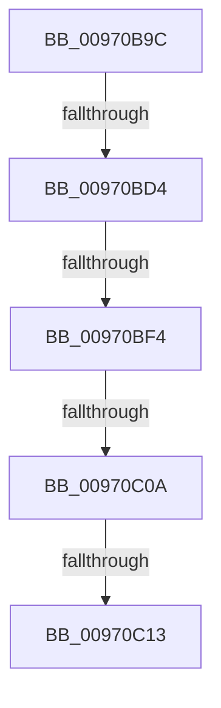

# sub_00970B9C

- RVA: `0x00970B9C`–`0x00970C17` (길이 `123` bytes)
- VA: `0x0000000140970B9C`
- 실행 섹션: `PAGE`
- PDB 이름 있음: `아니요`; PDB Function 태그: `아니요`
- unwind 정보 RVA: `0x00095FA4`
- 디코드: `27`개 명령, `123/123` bytes 표시
- 미해석 바이트: `0` (있으면 어셈블리에 `.byte`로 보존)

> 이 문서는 커널 이미지의 기계어와 PDB 기호를 분석해 생성했습니다. 4번과 5번은 함수 원형과 자료형을 바이너리 사용 방식에서 추정한 C 해석이며 원본 소스 복구 결과는 아닙니다.

## 1. Dependencies

- 직접 호출 지점: **2**; 고유 호출 대상: **1**
- 직접 호출자로 확인된 함수: **0**
- RIP 상대 이미지 참조: **0**

### Outgoing calls
- `0x00970BD4` → [HvpGetCellFlat](../85/HvpGetCellFlat_function_00854C60.md) (function, `0x00854C60`)
- `0x00970BF4` → [HvpGetCellFlat](../85/HvpGetCellFlat_function_00854C60.md) (function, `0x00854C60`)

### Direct callers
- 이 함수 시작 RVA로 연결되는 직접 call은 확인되지 않았습니다. 간접 호출은 완전히 역산할 수 없습니다.

### Static image references
- 디코드된 RIP-relative 메모리 참조가 없습니다.

## 2. Other-region calls and transfers

- 다른 실행 섹션으로 향하는 call: **0**
- call이 아닌 외부 분기/꼬리 이동: **4**
  - `0x00970BCE` → [sub_00970CCF](Unknown_function_00970CCF.md) (`tail-transfer`)
  - `0x00970BEE` → [sub_00970CCF + 0xA](Unknown_function_00970CCF.md) (`tail-transfer`)
  - `0x00970C04` → [sub_00970DEC](Unknown_function_00970DEC.md) (`tail-transfer`)
  - `0x00970C0D` → [sub_00970DEC](Unknown_function_00970DEC.md) (`tail-transfer`)

## 3. Assembly (complete function range)

```asm
00970B9C  49 89 7B E0                     mov qword ptr [r11 - 0x20], rdi
00970BA0  F6 81 8C 00 00 00 01            test byte ptr [rcx + 0x8c], 1
00970BA7  45 8B C8                        mov r9d, r8d
00970BAA  8B DA                           mov ebx, edx
00970BAC  41 C7 43 20 FF FF FF FF         mov dword ptr [r11 + 0x20], 0xffffffff
00970BB4  4C 8B E9                        mov r13, rcx
00970BB7  41 89 43 24                     mov dword ptr [r11 + 0x24], eax
00970BBB  C7 44 24 30 FF FF FF FF         mov dword ptr [rsp + 0x30], 0xffffffff
00970BC3  4D 8D 43 20                     lea r8, [r11 + 0x20]
00970BC7  89 44 24 34                     mov dword ptr [rsp + 0x34], eax
00970BCB  41 8B D1                        mov edx, r9d
00970BCE  0F 84 FB 00 00 00               je 0x140970ccf
00970BD4  E8 87 40 EE FF                  call 0x140854c60
00970BD9  41 F6 85 8C 00 00 00 01         test byte ptr [r13 + 0x8c], 1
00970BE1  4C 8D 44 24 30                  lea r8, [rsp + 0x30]
00970BE6  48 8B F8                        mov rdi, rax
00970BE9  8B D3                           mov edx, ebx
00970BEB  49 8B CD                        mov rcx, r13
00970BEE  0F 84 E5 00 00 00               je 0x140970cd9
00970BF4  E8 67 40 EE FF                  call 0x140854c60
00970BF9  48 89 44 24 38                  mov qword ptr [rsp + 0x38], rax
00970BFE  48 8B D0                        mov rdx, rax
00970C01  48 85 FF                        test rdi, rdi
00970C04  0F 84 E2 01 00 00               je 0x140970dec
00970C0A  48 85 C0                        test rax, rax
00970C0D  0F 84 D9 01 00 00               je 0x140970dec
00970C13  0F B7 48 02                     movzx ecx, word ptr [rax + 2]
```

## 4. C-style interpretation (structured pseudocode)

```c
__int64 __fastcall sub_00970B9C(__int64 a1, int a2, int a3, __int64 a4, __int64 a5, __int64 a6)
{
    __int64 result;
    unsigned int v_stack_p30;
    unsigned int v_stack_p34;
    unsigned __int64 v_stack_p38;

    *(unsigned __int64 *)(v_r11 - 32) = v_rdi;
    *(unsigned int *)(v_r11 + 32) = 0xFFFFFFFFULL;
    *(unsigned int *)(v_r11 + 36) = (unsigned int)(result);
    v_stack_p30 = 0xFFFFFFFFULL;
    v_stack_p34 = (unsigned int)(result);
    result = HvpGetCellFlat(a1, (unsigned int)((unsigned int)((unsigned int)(a3))), v_r11 + 32, (unsigned int)(a3));
    result = HvpGetCellFlat(a1, (unsigned int)((unsigned int)((unsigned int)(a2))), a6, (unsigned int)(a3));
    v_stack_p38 = result;
    return result;
}
```

## 5. (Beta) C Style

```c
int64_t sub_00970B9C(void *Arg1, int32_t Arg2, int32_t Arg3, int64_t Arg4, uint64_t Arg5, int64_t Arg6)
{
    uint8_t *arg1 = (uint8_t *)Arg1;

    int64_t result;
    uint32_t v_stack_p30;
    uint32_t v_stack_p34;
    uint64_t v_stack_p38;

    *(uint64_t *)(local_r11 - 0x20) = local_rdi;
    *(uint32_t *)(local_r11 + 0x20) = 0xFFFFFFFFULL;
    *(uint32_t *)(local_r11 + 0x24) = (uint32_t)(result);
    v_stack_p30 = 0xFFFFFFFFULL;
    v_stack_p34 = (uint32_t)(result);
    result = HvpGetCellFlat(Arg1, (uint32_t)((uint32_t)((uint32_t)(Arg3))), local_r11 + 32, (uint32_t)(Arg3));
    result = HvpGetCellFlat(Arg1, (uint32_t)((uint32_t)((uint32_t)(Arg2))), Arg6, (uint32_t)(Arg3));
    v_stack_p38 = result;
    return result;
}
```

### 관측된 메모리 오프셋

구조체 형식이 확인되지 않은 접근은 인자 기준의 오프셋으로만 기록했습니다.

| 기준 인자 | 오프셋 표현 | 폭 (bit) | 접근 |
|---|---:|---:|---|
| `Arg1` | `+ 0x8C` | `8` | `R` |

## 6. Execution-region graph

[열기: 2D/3D 그래프와 함수 탐색 컨트롤 패널](../../../control-panel.html?section=page&rva=0x00970B9C&view=graph)

- 2D 그래프는 위에서 아래로 흐르고, 3D 그래프는 빈 공간을 드래그해 회전합니다. Shift+드래그는 이동, 휠은 확대·축소, 함수 노드 선택은 대상 보고서 이동입니다.

### Static fallback


