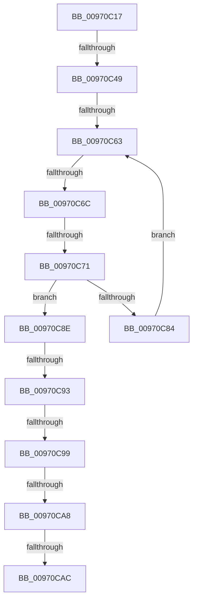

# sub_00970C17

- RVA: `0x00970C17`–`0x00970CCF` (길이 `184` bytes)
- VA: `0x0000000140970C17`
- 실행 섹션: `PAGE`
- PDB 이름 있음: `아니요`; PDB Function 태그: `아니요`
- unwind 정보 RVA: `0x00095FB8`
- 디코드: `46`개 명령, `184/184` bytes 표시
- 미해석 바이트: `0` (있으면 어셈블리에 `.byte`로 보존)

> 이 문서는 커널 이미지의 기계어와 PDB 기호를 분석해 생성했습니다. 4번과 5번은 함수 원형과 자료형을 바이너리 사용 방식에서 추정한 C 해석이며 원본 소스 복구 결과는 아닙니다.

## 1. Dependencies

- 직접 호출 지점: **0**; 고유 호출 대상: **0**
- 직접 호출자로 확인된 함수: **0**
- RIP 상대 이미지 참조: **0**

### Outgoing calls
- 직접 디코드된 call 명령이 없습니다.

### Direct callers
- 이 함수 시작 RVA로 연결되는 직접 call은 확인되지 않았습니다. 간접 호출은 완전히 역산할 수 없습니다.

### Static image references
- 디코드된 RIP-relative 메모리 참조가 없습니다.

## 2. Other-region calls and transfers

- 다른 실행 섹션으로 향하는 call: **0**
- call이 아닌 외부 분기/꼬리 이동: **9**
  - `0x00970C43` → [sub_00970CE3 + 0x20](Unknown_function_00970CE3.md) (`tail-transfer`)
  - `0x00970C5D` → [sub_00970E56](Unknown_function_00970E56.md) (`tail-transfer`)
  - `0x00970C66` → [sub_00970CE3 + 0xC](Unknown_function_00970CE3.md) (`tail-transfer`)
  - `0x00970C6F` → [sub_00970CE3 + 0xC](Unknown_function_00970CE3.md) (`tail-transfer`)
  - `0x00970C91` → [sub_00970CE3 + 0x16](Unknown_function_00970CE3.md) (`tail-transfer`)
  - `0x00970C97` → [sub_00970CE3](Unknown_function_00970CE3.md) (`tail-transfer`)
  - `0x00970CA2` → [sub_00970CE3 + 0x52](Unknown_function_00970CE3.md) (`tail-transfer`)
  - `0x00970CAA` → [sub_00970CE3 + 0x48](Unknown_function_00970CE3.md) (`tail-transfer`)
  - `0x00970CCA` → [sub_00970DEC + 0xA](Unknown_function_00970DEC.md) (`tail-transfer`)

## 3. Assembly (complete function range)

```asm
00970C17  48 89 74 24 60                  mov qword ptr [rsp + 0x60], rsi
00970C1C  66 83 E1 20                     and cx, 0x20
00970C20  F6 47 02 20                     test byte ptr [rdi + 2], 0x20
00970C24  48 8D 70 4C                     lea rsi, [rax + 0x4c]
00970C28  4C 89 74 24 48                  mov qword ptr [rsp + 0x48], r14
00970C2D  4C 8D 77 4C                     lea r14, [rdi + 0x4c]
00970C31  48 89 AC 24 88 00 00 00         mov qword ptr [rsp + 0x88], rbp
00970C39  4C 89 64 24 50                  mov qword ptr [rsp + 0x50], r12
00970C3E  4C 89 7C 24 40                  mov qword ptr [rsp + 0x40], r15
00970C43  0F 84 BA 00 00 00               je 0x140970d03
00970C49  0F B7 58 48                     movzx ebx, word ptr [rax + 0x48]
00970C4D  B8 E0 FF 00 00                  mov eax, 0xffe0
00970C52  0F B7 7F 48                     movzx edi, word ptr [rdi + 0x48]
00970C56  44 8D 60 1F                     lea r12d, [rax + 0x1f]
00970C5A  66 85 C9                        test cx, cx
00970C5D  0F 84 F3 01 00 00               je 0x140970e56
00970C63  66 85 DB                        test bx, bx
00970C66  0F 84 83 00 00 00               je 0x140970cef
00970C6C  66 85 FF                        test di, di
00970C6F  74 7E                           je 0x140970cef
00970C71  0F B6 2E                        movzx ebp, byte ptr [rsi]
00970C74  48 FF C6                        inc rsi
00970C77  45 0F B6 3E                     movzx r15d, byte ptr [r14]
00970C7B  49 FF C6                        inc r14
00970C7E  66 41 3B EF                     cmp bp, r15w
00970C82  75 0A                           jne 0x140970c8e
00970C84  66 41 03 DC                     add bx, r12w
00970C88  66 41 03 FC                     add di, r12w
00970C8C  EB D5                           jmp 0x140970c63
00970C8E  83 FD 61                        cmp ebp, 0x61
00970C91  73 66                           jae 0x140970cf9
00970C93  41 83 FF 61                     cmp r15d, 0x61
00970C97  73 4A                           jae 0x140970ce3
00970C99  41 0F B7 C7                     movzx eax, r15w
00970C9D  0F B7 CD                        movzx ecx, bp
00970CA0  2B C8                           sub ecx, eax
00970CA2  0F 84 8D 00 00 00               je 0x140970d35
00970CA8  85 C9                           test ecx, ecx
00970CAA  79 7F                           jns 0x140970d2b
00970CAC  33 DB                           xor ebx, ebx
00970CAE  48 8B AC 24 88 00 00 00         mov rbp, qword ptr [rsp + 0x88]
00970CB6  4C 8B 64 24 50                  mov r12, qword ptr [rsp + 0x50]
00970CBB  4C 8B 7C 24 40                  mov r15, qword ptr [rsp + 0x40]
00970CC0  48 8B 74 24 60                  mov rsi, qword ptr [rsp + 0x60]
00970CC5  4C 8B 74 24 48                  mov r14, qword ptr [rsp + 0x48]
00970CCA  E9 27 01 00 00                  jmp 0x140970df6
```

## 4. C-style interpretation (structured pseudocode)

```c
__int64 __fastcall sub_00970C17(unsigned __int16 a1, __int64 a2, __int64 a3, __int64 a4, __int64 a5, __int64 a6, __int64 a7, __int64 a8, __int64 a9, __int64 a10, __int64 a11, __int64 a12, __int64 a13, __int64 a14, __int64 a15, __int64 a16, __int64 a17)
{
    __int64 v_r14;
    __int64 v_rbx;
    __int64 v_rdi;
    __int64 v_rsi;
    unsigned __int64 v_stack_p40;
    unsigned __int64 v_stack_p48;
    unsigned __int64 v_stack_p50;
    unsigned __int64 v_stack_p60;
    unsigned __int64 v_stack_p88;

    v_stack_p60 = v_rsi;
    a1 = (unsigned __int16)((a1) & (32));
    v_stack_p48 = v_r14;
    v_stack_p88 = v_rbp;
    v_stack_p50 = v_r12;
    v_stack_p40 = v_r15;
loc_00970C63:
    v_rsi = (result + 76) + 1;
    v_r14 = (v_rdi + 76) + 1;
    if (((unsigned __int16)(*(unsigned __int8 *)(result + 76))) != ((unsigned __int16)(*(unsigned __int8 *)(v_rdi + 76)))) goto loc_00970C8E;
    v_rbx = (unsigned __int16)((*(unsigned __int16 *)(result + 72)) + ((unsigned __int16)((unsigned int)(0xFFE0ULL) + 31)));
    v_rdi = (unsigned __int16)((*(unsigned __int16 *)(v_rdi + 72)) + ((unsigned __int16)((unsigned int)(0xFFE0ULL) + 31)));
    goto loc_00970C63;
loc_00970C8E:
    a1 = (unsigned int)(((unsigned __int16)(*(unsigned __int8 *)(result + 76))) - ((unsigned int)((unsigned __int16)(*(unsigned __int8 *)(v_rdi + 76)))));
    v_rbx = 0;
}
```

## 5. (Beta) C Style

```c
int64_t sub_00970C17(uint16_t Arg1, int64_t Arg2, int64_t Arg3, int64_t Arg4, uint64_t Arg5, uint64_t Arg6, uint64_t Arg7, int64_t Arg8, int64_t Arg9, int64_t Arg10, uint64_t Arg11, int64_t Arg12, uint64_t Arg13, uint64_t Arg14, uint64_t Arg15, uint64_t Arg16, int64_t Arg17)
{
    int64_t local_r14;
    int64_t local_rbx;
    int64_t local_rdi;
    int64_t local_rsi;
    uint64_t v_stack_p40;
    uint64_t v_stack_p48;
    uint64_t v_stack_p50;
    uint64_t v_stack_p60;
    uint64_t v_stack_p88;

    v_stack_p60 = local_rsi;
    Arg1 = (uint16_t)((Arg1) & (32));
    v_stack_p48 = local_r14;
    v_stack_p88 = local_rbp;
    v_stack_p50 = local_r12;
    v_stack_p40 = local_r15;
loc_00970C63:
    local_rsi = (result + 76) + 1;
    local_r14 = (local_rdi + 76) + 1;
    if (((uint16_t)(*(uint8_t *)(result + 0x4C))) != ((uint16_t)(*(uint8_t *)(local_rdi + 0x4C)))) goto loc_00970C8E;
    local_rbx = (uint16_t)((*(uint16_t *)(result + 0x48)) + ((uint16_t)((uint32_t)(0xFFE0ULL) + 31)));
    local_rdi = (uint16_t)((*(uint16_t *)(local_rdi + 0x48)) + ((uint16_t)((uint32_t)(0xFFE0ULL) + 31)));
    goto loc_00970C63;
loc_00970C8E:
    Arg1 = (uint32_t)(((uint16_t)(*(uint8_t *)(result + 0x4C))) - ((uint32_t)((uint16_t)(*(uint8_t *)(local_rdi + 0x4C)))));
    local_rbx = 0;
}
```

## 6. Execution-region graph

[열기: 2D/3D 그래프와 함수 탐색 컨트롤 패널](../../../control-panel.html?section=page&rva=0x00970C17&view=graph)

- 2D 그래프는 위에서 아래로 흐르고, 3D 그래프는 빈 공간을 드래그해 회전합니다. Shift+드래그는 이동, 휠은 확대·축소, 함수 노드 선택은 대상 보고서 이동입니다.

### Static fallback


