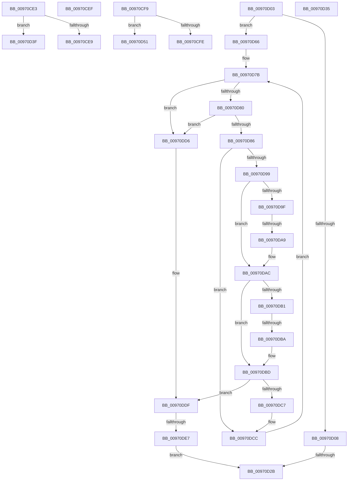

# sub_00970CE3

- RVA: `0x00970CE3`–`0x00970DEC` (길이 `265` bytes)
- VA: `0x0000000140970CE3`
- 실행 섹션: `PAGE`
- PDB 이름 있음: `아니요`; PDB Function 태그: `아니요`
- unwind 정보 RVA: `0x00095FEC`
- 디코드: `76`개 명령, `265/265` bytes 표시
- 미해석 바이트: `0` (있으면 어셈블리에 `.byte`로 보존)

> 이 문서는 커널 이미지의 기계어와 PDB 기호를 분석해 생성했습니다. 4번과 5번은 함수 원형과 자료형을 바이너리 사용 방식에서 추정한 C 해석이며 원본 소스 복구 결과는 아닙니다.

## 1. Dependencies

- 직접 호출 지점: **3**; 고유 호출 대상: **2**
- 직접 호출자로 확인된 함수: **0**
- RIP 상대 이미지 참조: **0**

### Outgoing calls
- `0x00970D22` → [RtlCompareUnicodeStrings](RtlCompareUnicodeStrings_function_009727E0.md) (function, `0x009727E0`)
- `0x00970D43` → [RtlUpcaseUnicodeChar](../85/RtlUpcaseUnicodeChar_function_0085F0F0.md) (function, `0x0085F0F0`)
- `0x00970D54` → [RtlUpcaseUnicodeChar](../85/RtlUpcaseUnicodeChar_function_0085F0F0.md) (function, `0x0085F0F0`)

### Direct callers
- 이 함수 시작 RVA로 연결되는 직접 call은 확인되지 않았습니다. 간접 호출은 완전히 역산할 수 없습니다.

### Static image references
- 디코드된 RIP-relative 메모리 참조가 없습니다.

## 2. Other-region calls and transfers

- 다른 실행 섹션으로 향하는 call: **0**
- call이 아닌 외부 분기/꼬리 이동: **11**
  - `0x00970CED` → [sub_00970C17 + 0x82](Unknown_function_00970C17.md) (`tail-transfer`)
  - `0x00970CF7` → [sub_00970C17 + 0x91](Unknown_function_00970C17.md) (`tail-transfer`)
  - `0x00970D01` → [sub_00970C17 + 0x7C](Unknown_function_00970C17.md) (`tail-transfer`)
  - `0x00970D29` → [sub_00970C17 + 0x95](Unknown_function_00970C17.md) (`tail-transfer`)
  - `0x00970D30` → [sub_00970C17 + 0x97](Unknown_function_00970C17.md) (`tail-transfer`)
  - `0x00970D3A` → [sub_00970C17 + 0x6D](Unknown_function_00970C17.md) (`tail-transfer`)
  - `0x00970D4C` → [sub_00970C17 + 0x82](Unknown_function_00970C17.md) (`tail-transfer`)
  - `0x00970D61` → [sub_00970C17 + 0x7C](Unknown_function_00970C17.md) (`tail-transfer`)
  - `0x00970DA3` → [sub_00970E56 + 0x66](Unknown_function_00970E56.md) (`tail-transfer`)
  - `0x00970DB4` → [sub_00970E56 + 0x8D](Unknown_function_00970E56.md) (`tail-transfer`)
  - `0x00970DE1` → [sub_00970C17 + 0x95](Unknown_function_00970C17.md) (`tail-transfer`)

## 3. Assembly (complete function range)

```asm
00970CE3  41 83 FF 7A                     cmp r15d, 0x7a
00970CE7  77 56                           ja 0x140970d3f
00970CE9  66 44 03 F8                     add r15w, ax
00970CED  EB AA                           jmp 0x140970c99
00970CEF  0F B7 C7                        movzx eax, di
00970CF2  0F B7 CB                        movzx ecx, bx
00970CF5  2B C8                           sub ecx, eax
00970CF7  EB AF                           jmp 0x140970ca8
00970CF9  83 FD 7A                        cmp ebp, 0x7a
00970CFC  77 53                           ja 0x140970d51
00970CFE  66 03 E8                        add bp, ax
00970D01  EB 90                           jmp 0x140970c93
00970D03  66 85 C9                        test cx, cx
00970D06  75 5E                           jne 0x140970d66
00970D08  44 0F B7 4F 48                  movzx r9d, word ptr [rdi + 0x48]
00970D0D  4D 8B C6                        mov r8, r14
00970D10  0F B7 52 48                     movzx edx, word ptr [rdx + 0x48]
00970D14  48 8B CE                        mov rcx, rsi
00970D17  49 D1 E9                        shr r9, 1
00970D1A  48 D1 EA                        shr rdx, 1
00970D1D  C6 44 24 20 01                  mov byte ptr [rsp + 0x20], 1
00970D22  E8 B9 1A 00 00                  call 0x1409727e0
00970D27  85 C0                           test eax, eax
00970D29  78 81                           js 0x140970cac
00970D2B  BB 4C 01 00 C0                  mov ebx, 0xc000014c
00970D30  E9 79 FF FF FF                  jmp 0x140970cae
00970D35  B8 E0 FF 00 00                  mov eax, 0xffe0
00970D3A  E9 45 FF FF FF                  jmp 0x140970c84
00970D3F  41 0F B7 CF                     movzx ecx, r15w
00970D43  E8 A8 E3 EE FF                  call 0x14085f0f0
00970D48  44 0F B7 F8                     movzx r15d, ax
00970D4C  E9 48 FF FF FF                  jmp 0x140970c99
00970D51  0F B7 CD                        movzx ecx, bp
00970D54  E8 97 E3 EE FF                  call 0x14085f0f0
00970D59  0F B7 E8                        movzx ebp, ax
00970D5C  B8 E0 FF 00 00                  mov eax, 0xffe0
00970D61  E9 2D FF FF FF                  jmp 0x140970c93
00970D66  0F B7 6F 48                     movzx ebp, word ptr [rdi + 0x48]
00970D6A  B8 E0 FF 00 00                  mov eax, 0xffe0
00970D6F  44 0F B7 7A 48                  movzx r15d, word ptr [rdx + 0x48]
00970D74  66 D1 ED                        shr bp, 1
00970D77  44 8D 60 1F                     lea r12d, [rax + 0x1f]
00970D7B  66 85 ED                        test bp, bp
00970D7E  74 56                           je 0x140970dd6
00970D80  66 45 85 FF                     test r15w, r15w
00970D84  74 50                           je 0x140970dd6
00970D86  41 0F B7 1E                     movzx ebx, word ptr [r14]
00970D8A  49 83 C6 02                     add r14, 2
00970D8E  0F B6 3E                        movzx edi, byte ptr [rsi]
00970D91  48 FF C6                        inc rsi
00970D94  66 3B DF                        cmp bx, di
00970D97  74 33                           je 0x140970dcc
00970D99  66 83 FB 61                     cmp bx, 0x61
00970D9D  72 0D                           jb 0x140970dac
00970D9F  66 83 FB 7A                     cmp bx, 0x7a
00970DA3  0F 87 13 01 00 00               ja 0x140970ebc
00970DA9  66 03 D8                        add bx, ax
00970DAC  83 FF 61                        cmp edi, 0x61
00970DAF  72 0C                           jb 0x140970dbd
00970DB1  83 FF 7A                        cmp edi, 0x7a
00970DB4  0F 87 29 01 00 00               ja 0x140970ee3
00970DBA  66 03 F8                        add di, ax
00970DBD  0F B7 C7                        movzx eax, di
00970DC0  0F B7 CB                        movzx ecx, bx
00970DC3  2B C8                           sub ecx, eax
00970DC5  75 18                           jne 0x140970ddf
00970DC7  B8 E0 FF 00 00                  mov eax, 0xffe0
00970DCC  66 41 03 EC                     add bp, r12w
00970DD0  66 45 03 FC                     add r15w, r12w
00970DD4  EB A5                           jmp 0x140970d7b
00970DD6  41 0F B7 C7                     movzx eax, r15w
00970DDA  0F B7 CD                        movzx ecx, bp
00970DDD  2B C8                           sub ecx, eax
00970DDF  85 C9                           test ecx, ecx
00970DE1  0F 8F C5 FE FF FF               jg 0x140970cac
00970DE7  E9 3F FF FF FF                  jmp 0x140970d2b
```

## 4. C-style interpretation (structured pseudocode)

```c
__int64 __fastcall sub_00970CE3(__int64 a1, __int64 a2)
{
    __int64 result;
    __int64 v_r15;
    unsigned __int8 v_stack_p20;

    if (((unsigned int)(v_r15)) > 122) goto loc_00970D3F;
    v_r15 = (unsigned __int16)((v_r15) + ((unsigned __int16)(result)));
loc_00970D3F:
    result = RtlUpcaseUnicodeChar((unsigned __int16)(v_r15), a2, a3, a4);
}
```

## 5. (Beta) C Style

```c
int64_t sub_00970CE3(int64_t Arg1, int64_t Arg2)
{
    int64_t result;
    int64_t local_r15;
    uint8_t v_stack_p20;

    if (((uint32_t)(local_r15)) > 122) goto loc_00970D3F;
    local_r15 = (uint16_t)((local_r15) + ((uint16_t)(result)));
loc_00970D3F:
    result = RtlUpcaseUnicodeChar((uint16_t)(local_r15), Arg2, a3, a4);
}
```

## 6. Execution-region graph

[열기: 2D/3D 그래프와 함수 탐색 컨트롤 패널](../../../control-panel.html?section=page&rva=0x00970CE3&view=graph)

- 2D 그래프는 위에서 아래로 흐르고, 3D 그래프는 빈 공간을 드래그해 회전합니다. Shift+드래그는 이동, 휠은 확대·축소, 함수 노드 선택은 대상 보고서 이동입니다.

### Static fallback


