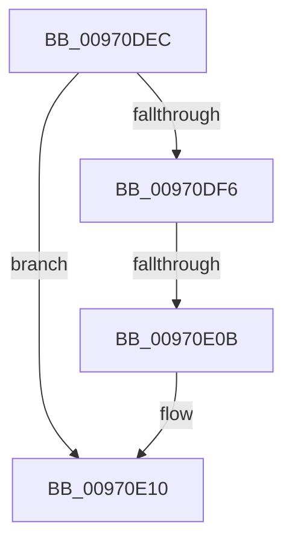

# sub_00970DEC

- RVA: `0x00970DEC`–`0x00970E1D` (길이 `49` bytes)
- VA: `0x0000000140970DEC`
- 실행 섹션: `PAGE`
- PDB 이름 있음: `아니요`; PDB Function 태그: `아니요`
- unwind 정보 RVA: `0x00096010`
- 디코드: `11`개 명령, `49/49` bytes 표시
- 미해석 바이트: `0` (있으면 어셈블리에 `.byte`로 보존)

> 이 문서는 커널 이미지의 기계어와 PDB 기호를 분석해 생성했습니다. 4번과 5번은 함수 원형과 자료형을 바이너리 사용 방식에서 추정한 C 해석이며 원본 소스 복구 결과는 아닙니다.

## 1. Dependencies

- 직접 호출 지점: **1**; 고유 호출 대상: **1**
- 직접 호출자로 확인된 함수: **0**
- RIP 상대 이미지 참조: **0**

### Outgoing calls
- `0x00970E0B` → [HvpReleaseCellPaged](../85/HvpReleaseCellPaged_function_00855F40.md) (function, `0x00855F40`)

### Direct callers
- 이 함수 시작 RVA로 연결되는 직접 call은 확인되지 않았습니다. 간접 호출은 완전히 역산할 수 없습니다.

### Static image references
- 디코드된 RIP-relative 메모리 참조가 없습니다.

## 2. Other-region calls and transfers

- 다른 실행 섹션으로 향하는 call: **0**
- call이 아닌 외부 분기/꼬리 이동: **2**
  - `0x00970E09` → [sub_00970E3F](Unknown_function_00970E3F.md) (`tail-transfer`)
  - `0x00970E1B` → [sub_00970E1D + 0x17](Unknown_function_00970E1D.md) (`tail-transfer`)

## 3. Assembly (complete function range)

```asm
00970DEC  BB 9A 00 00 C0                  mov ebx, 0xc000009a
00970DF1  48 85 FF                        test rdi, rdi
00970DF4  74 1A                           je 0x140970e10
00970DF6  41 F6 85 8C 00 00 00 01         test byte ptr [r13 + 0x8c], 1
00970DFE  48 8D 94 24 98 00 00 00         lea rdx, [rsp + 0x98]
00970E06  49 8B CD                        mov rcx, r13
00970E09  75 34                           jne 0x140970e3f
00970E0B  E8 30 51 EE FF                  call 0x140855f40
00970E10  48 83 7C 24 38 00               cmp qword ptr [rsp + 0x38], 0
00970E16  48 8B 7C 24 58                  mov rdi, qword ptr [rsp + 0x58]
00970E1B  74 17                           je 0x140970e34
```

## 4. C-style interpretation (structured pseudocode)

```c
__int64 __fastcall sub_00970DEC(__int64 a1, __int64 a2, __int64 a3, __int64 a4, __int64 a5, __int64 a6, __int64 a7, __int64 a8, __int64 a9, __int64 a10, __int64 a11, __int64 a12, __int64 a13, __int64 a14, __int64 a15, __int64 a16, __int64 a17, __int64 a18, __int64 a19)
{
    __int64 result;

    if (v_rdi == 0) goto loc_00970E10;
    result = HvpReleaseCellPaged(v_r13, a19, a3, a4);
loc_00970E10:
}
```

## 5. (Beta) C Style

```c
int64_t sub_00970DEC(int64_t Arg1, int64_t Arg2, int64_t Arg3, int64_t Arg4, uint64_t Arg5, uint64_t Arg6, int64_t Arg7, uint64_t Arg8, uint64_t Arg9, uint64_t Arg10, int64_t Arg11, uint64_t Arg12, uint64_t Arg13, uint64_t Arg14, uint64_t Arg15, uint64_t Arg16, uint64_t Arg17, uint64_t Arg18, int64_t Arg19)
{
    int64_t result;

    if (local_rdi == 0) goto loc_00970E10;
    result = HvpReleaseCellPaged(local_r13, Arg19, Arg3, Arg4);
loc_00970E10:
}
```

## 6. Execution-region graph

[열기: 2D/3D 그래프와 함수 탐색 컨트롤 패널](../../../control-panel.html?section=page&rva=0x00970DEC&view=graph)

- 2D 그래프는 위에서 아래로 흐르고, 3D 그래프는 빈 공간을 드래그해 회전합니다. Shift+드래그는 이동, 휠은 확대·축소, 함수 노드 선택은 대상 보고서 이동입니다.

### Static fallback


