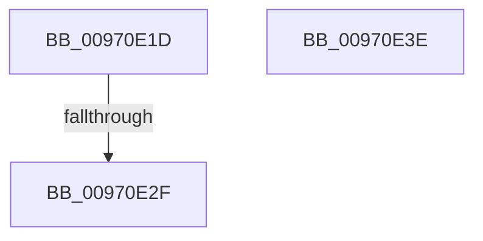

# sub_00970E1D

- RVA: `0x00970E1D`–`0x00970E3F` (길이 `34` bytes)
- VA: `0x0000000140970E1D`
- 실행 섹션: `PAGE`
- PDB 이름 있음: `아니요`; PDB Function 태그: `아니요`
- unwind 정보 RVA: `0x00096020`
- 디코드: `11`개 명령, `34/34` bytes 표시
- 미해석 바이트: `0` (있으면 어셈블리에 `.byte`로 보존)

> 이 문서는 커널 이미지의 기계어와 PDB 기호를 분석해 생성했습니다. 4번과 5번은 함수 원형과 자료형을 바이너리 사용 방식에서 추정한 C 해석이며 원본 소스 복구 결과는 아닙니다.

## 1. Dependencies

- 직접 호출 지점: **1**; 고유 호출 대상: **1**
- 직접 호출자로 확인된 함수: **0**
- RIP 상대 이미지 참조: **0**

### Outgoing calls
- `0x00970E2F` → [HvpReleaseCellPaged](../85/HvpReleaseCellPaged_function_00855F40.md) (function, `0x00855F40`)

### Direct callers
- 이 함수 시작 RVA로 연결되는 직접 call은 확인되지 않았습니다. 간접 호출은 완전히 역산할 수 없습니다.

### Static image references
- 디코드된 RIP-relative 메모리 참조가 없습니다.

## 2. Other-region calls and transfers

- 다른 실행 섹션으로 향하는 call: **0**
- call이 아닌 외부 분기/꼬리 이동: **1**
  - `0x00970E2D` → [sub_00970E46](Unknown_function_00970E46.md) (`tail-transfer`)

## 3. Assembly (complete function range)

```asm
00970E1D  41 F6 85 8C 00 00 00 01         test byte ptr [r13 + 0x8c], 1
00970E25  48 8D 54 24 30                  lea rdx, [rsp + 0x30]
00970E2A  49 8B CD                        mov rcx, r13
00970E2D  75 17                           jne 0x140970e46
00970E2F  E8 0C 51 EE FF                  call 0x140855f40
00970E34  8B C3                           mov eax, ebx
00970E36  48 83 C4 68                     add rsp, 0x68
00970E3A  41 5D                           pop r13
00970E3C  5B                              pop rbx
00970E3D  C3                              ret
00970E3E  CC                              int3
```

## 4. C-style interpretation (structured pseudocode)

```c
__int64 __fastcall sub_00970E1D(__int64 a1, __int64 a2, __int64 a3, __int64 a4, __int64 a5, __int64 a6)
{
    __int64 result;
    __int64 v_rsp;

    result = HvpReleaseCellPaged(v_r13, a6, a3, a4);
    v_rsp = (v_rsp) + (104);
    return (unsigned int)((unsigned int)(v_rbx));
}
```

## 5. (Beta) C Style

```c
int64_t sub_00970E1D(int64_t Arg1, int64_t Arg2, int64_t Arg3, int64_t Arg4, uint64_t Arg5, int64_t Arg6)
{
    int64_t result;
    int64_t local_rsp;

    result = HvpReleaseCellPaged(local_r13, Arg6, Arg3, Arg4);
    local_rsp = (local_rsp) + (104);
    return (uint32_t)((uint32_t)(local_rbx));
}
```

## 6. Execution-region graph

[열기: 2D/3D 그래프와 함수 탐색 컨트롤 패널](../../../control-panel.html?section=page&rva=0x00970E1D&view=graph)

- 2D 그래프는 위에서 아래로 흐르고, 3D 그래프는 빈 공간을 드래그해 회전합니다. Shift+드래그는 이동, 휠은 확대·축소, 함수 노드 선택은 대상 보고서 이동입니다.

### Static fallback


