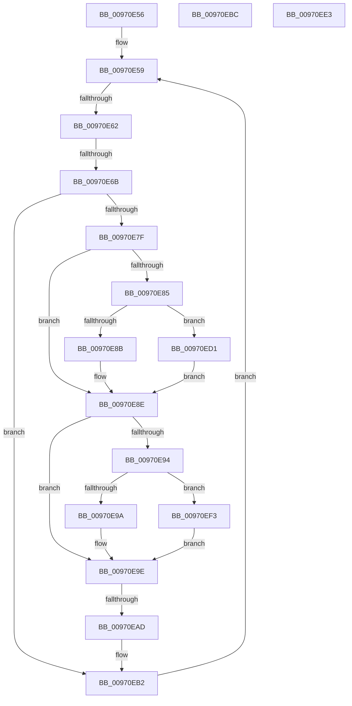

# sub_00970E56

- RVA: `0x00970E56`–`0x00970F02` (길이 `172` bytes)
- VA: `0x0000000140970E56`
- 실행 섹션: `PAGE`
- PDB 이름 있음: `아니요`; PDB Function 태그: `아니요`
- unwind 정보 RVA: `0x0009605C`
- 디코드: `47`개 명령, `172/172` bytes 표시
- 미해석 바이트: `0` (있으면 어셈블리에 `.byte`로 보존)

> 이 문서는 커널 이미지의 기계어와 PDB 기호를 분석해 생성했습니다. 4번과 5번은 함수 원형과 자료형을 바이너리 사용 방식에서 추정한 C 해석이며 원본 소스 복구 결과는 아닙니다.

## 1. Dependencies

- 직접 호출 지점: **4**; 고유 호출 대상: **1**
- 직접 호출자로 확인된 함수: **0**
- RIP 상대 이미지 참조: **0**

### Outgoing calls
- `0x00970EBF` → [RtlUpcaseUnicodeChar](../85/RtlUpcaseUnicodeChar_function_0085F0F0.md) (function, `0x0085F0F0`)
- `0x00970ED4` → [RtlUpcaseUnicodeChar](../85/RtlUpcaseUnicodeChar_function_0085F0F0.md) (function, `0x0085F0F0`)
- `0x00970EE6` → [RtlUpcaseUnicodeChar](../85/RtlUpcaseUnicodeChar_function_0085F0F0.md) (function, `0x0085F0F0`)
- `0x00970EF7` → [RtlUpcaseUnicodeChar](../85/RtlUpcaseUnicodeChar_function_0085F0F0.md) (function, `0x0085F0F0`)

### Direct callers
- 이 함수 시작 RVA로 연결되는 직접 call은 확인되지 않았습니다. 간접 호출은 완전히 역산할 수 없습니다.

### Static image references
- 디코드된 RIP-relative 메모리 참조가 없습니다.

## 2. Other-region calls and transfers

- 다른 실행 섹션으로 향하는 call: **0**
- call이 아닌 외부 분기/꼬리 이동: **5**
  - `0x00970E5C` → [sub_00970CE3 + 0xC](Unknown_function_00970CE3.md) (`tail-transfer`)
  - `0x00970E65` → [sub_00970CE3 + 0xC](Unknown_function_00970CE3.md) (`tail-transfer`)
  - `0x00970EA7` → [sub_00970C17 + 0x91](Unknown_function_00970C17.md) (`tail-transfer`)
  - `0x00970ECC` → [sub_00970CE3 + 0xC9](Unknown_function_00970CE3.md) (`tail-transfer`)
  - `0x00970EEE` → [sub_00970CE3 + 0xDA](Unknown_function_00970CE3.md) (`tail-transfer`)

## 3. Assembly (complete function range)

```asm
00970E56  66 D1 EB                        shr bx, 1
00970E59  66 85 DB                        test bx, bx
00970E5C  0F 84 8D FE FF FF               je 0x140970cef
00970E62  66 85 FF                        test di, di
00970E65  0F 84 84 FE FF FF               je 0x140970cef
00970E6B  0F B7 2E                        movzx ebp, word ptr [rsi]
00970E6E  48 83 C6 02                     add rsi, 2
00970E72  45 0F B6 3E                     movzx r15d, byte ptr [r14]
00970E76  49 FF C6                        inc r14
00970E79  66 41 3B EF                     cmp bp, r15w
00970E7D  74 33                           je 0x140970eb2
00970E7F  66 83 FD 61                     cmp bp, 0x61
00970E83  72 09                           jb 0x140970e8e
00970E85  66 83 FD 7A                     cmp bp, 0x7a
00970E89  77 46                           ja 0x140970ed1
00970E8B  66 03 E8                        add bp, ax
00970E8E  41 83 FF 61                     cmp r15d, 0x61
00970E92  72 0A                           jb 0x140970e9e
00970E94  41 83 FF 7A                     cmp r15d, 0x7a
00970E98  77 59                           ja 0x140970ef3
00970E9A  66 44 03 F8                     add r15w, ax
00970E9E  41 0F B7 C7                     movzx eax, r15w
00970EA2  0F B7 CD                        movzx ecx, bp
00970EA5  2B C8                           sub ecx, eax
00970EA7  0F 85 FB FD FF FF               jne 0x140970ca8
00970EAD  B8 E0 FF 00 00                  mov eax, 0xffe0
00970EB2  66 41 03 DC                     add bx, r12w
00970EB6  66 41 03 FC                     add di, r12w
00970EBA  EB 9D                           jmp 0x140970e59
00970EBC  0F B7 CB                        movzx ecx, bx
00970EBF  E8 2C E2 EE FF                  call 0x14085f0f0
00970EC4  0F B7 D8                        movzx ebx, ax
00970EC7  B8 E0 FF 00 00                  mov eax, 0xffe0
00970ECC  E9 DB FE FF FF                  jmp 0x140970dac
00970ED1  0F B7 CD                        movzx ecx, bp
00970ED4  E8 17 E2 EE FF                  call 0x14085f0f0
00970ED9  0F B7 E8                        movzx ebp, ax
00970EDC  B8 E0 FF 00 00                  mov eax, 0xffe0
00970EE1  EB AB                           jmp 0x140970e8e
00970EE3  0F B7 CF                        movzx ecx, di
00970EE6  E8 05 E2 EE FF                  call 0x14085f0f0
00970EEB  0F B7 F8                        movzx edi, ax
00970EEE  E9 CA FE FF FF                  jmp 0x140970dbd
00970EF3  41 0F B7 CF                     movzx ecx, r15w
00970EF7  E8 F4 E1 EE FF                  call 0x14085f0f0
00970EFC  44 0F B7 F8                     movzx r15d, ax
00970F00  EB 9C                           jmp 0x140970e9e
```

## 4. C-style interpretation (structured pseudocode)

```c
__int64 __fastcall sub_00970E56(void)
{
    __int64 result;
    __int64 v_r14;
    __int64 v_r15;
    __int64 v_rbp;
    __int64 v_rbx;
    __int64 v_rdi;
    __int64 v_rsi;

    v_rbx = (unsigned __int16)((v_rbx) >> (1));
loc_00970E59:
    v_rsi = (v_rsi) + (2);
    v_r14 = (v_r14) + 1;
    if (((unsigned __int16)(*(unsigned __int16 *)(v_rsi))) == ((unsigned __int16)(*(unsigned __int8 *)(v_r14)))) goto loc_00970EB2;
    if (((unsigned __int16)(*(unsigned __int16 *)(v_rsi))) < 97) goto loc_00970E8E;
    if (((unsigned __int16)(*(unsigned __int16 *)(v_rsi))) > 122) goto loc_00970ED1;
    v_rbp = (unsigned __int16)((*(unsigned __int16 *)(v_rsi)) + ((unsigned __int16)(result)));
loc_00970E8E:
    if (((unsigned int)(*(unsigned __int8 *)(v_r14))) < 97) goto loc_00970E9E;
    if (((unsigned int)(*(unsigned __int8 *)(v_r14))) > 122) goto loc_00970EF3;
    v_r15 = (unsigned __int16)((*(unsigned __int8 *)(v_r14)) + ((unsigned __int16)(result)));
loc_00970E9E:
    a1 = (unsigned int)(((unsigned __int16)(v_rbp)) - ((unsigned int)((unsigned __int16)(v_r15))));
loc_00970EB2:
    v_rbx = (unsigned __int16)((v_rbx) + ((unsigned __int16)(v_r12)));
    v_rdi = (unsigned __int16)((v_rdi) + ((unsigned __int16)(v_r12)));
    goto loc_00970E59;
loc_00970ED1:
    result = RtlUpcaseUnicodeChar((unsigned __int16)(v_rbp), a2, a3, a4);
    goto loc_00970E8E;
loc_00970EF3:
    result = RtlUpcaseUnicodeChar((unsigned __int16)(v_r15), a2, a3, a4);
    goto loc_00970E9E;
}
```

## 5. (Beta) C Style

```c
void sub_00970E56(void)
{
    int64_t result;
    int64_t local_r14;
    int64_t local_r15;
    int64_t local_rbp;
    int64_t local_rbx;
    int64_t local_rdi;
    int64_t local_rsi;

    local_rbx = (uint16_t)((local_rbx) >> (1));
loc_00970E59:
    local_rsi = (local_rsi) + (2);
    local_r14 = (local_r14) + 1;
    if (((uint16_t)(*(uint16_t *)(local_rsi))) == ((uint16_t)(*(uint8_t *)(local_r14)))) goto loc_00970EB2;
    if (((uint16_t)(*(uint16_t *)(local_rsi))) < 97) goto loc_00970E8E;
    if (((uint16_t)(*(uint16_t *)(local_rsi))) > 122) goto loc_00970ED1;
    local_rbp = (uint16_t)((*(uint16_t *)(local_rsi)) + ((uint16_t)(result)));
loc_00970E8E:
    if (((uint32_t)(*(uint8_t *)(local_r14))) < 97) goto loc_00970E9E;
    if (((uint32_t)(*(uint8_t *)(local_r14))) > 122) goto loc_00970EF3;
    local_r15 = (uint16_t)((*(uint8_t *)(local_r14)) + ((uint16_t)(result)));
loc_00970E9E:
    a1 = (uint32_t)(((uint16_t)(local_rbp)) - ((uint32_t)((uint16_t)(local_r15))));
loc_00970EB2:
    local_rbx = (uint16_t)((local_rbx) + ((uint16_t)(local_r12)));
    local_rdi = (uint16_t)((local_rdi) + ((uint16_t)(local_r12)));
    goto loc_00970E59;
loc_00970ED1:
    result = RtlUpcaseUnicodeChar((uint16_t)(local_rbp), a2, a3, a4);
    goto loc_00970E8E;
loc_00970EF3:
    result = RtlUpcaseUnicodeChar((uint16_t)(local_r15), a2, a3, a4);
    goto loc_00970E9E;
}
```

## 6. Execution-region graph

[열기: 2D/3D 그래프와 함수 탐색 컨트롤 패널](../../../control-panel.html?section=page&rva=0x00970E56&view=graph)

- 2D 그래프는 위에서 아래로 흐르고, 3D 그래프는 빈 공간을 드래그해 회전합니다. Shift+드래그는 이동, 휠은 확대·축소, 함수 노드 선택은 대상 보고서 이동입니다.

### Static fallback


