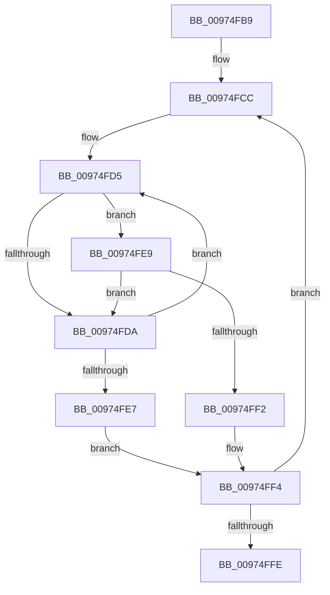

# sub_00974FB9

- RVA: `0x00974FB9`–`0x00975011` (길이 `88` bytes)
- VA: `0x0000000140974FB9`
- 실행 섹션: `PAGE`
- PDB 이름 있음: `아니요`; PDB Function 태그: `아니요`
- unwind 정보 RVA: `0x000964E8`
- 디코드: `27`개 명령, `88/88` bytes 표시
- 미해석 바이트: `0` (있으면 어셈블리에 `.byte`로 보존)

> 이 문서는 커널 이미지의 기계어와 PDB 기호를 분석해 생성했습니다. 4번과 5번은 함수 원형과 자료형을 바이너리 사용 방식에서 추정한 C 해석이며 원본 소스 복구 결과는 아닙니다.

## 1. Dependencies

- 직접 호출 지점: **0**; 고유 호출 대상: **0**
- 직접 호출자로 확인된 함수: **0**
- RIP 상대 이미지 참조: **0**

### Outgoing calls
- 직접 디코드된 call 명령이 없습니다.

### Direct callers
- 이 함수 시작 RVA로 연결되는 직접 call은 확인되지 않았습니다. 간접 호출은 완전히 역산할 수 없습니다.

### Static image references
- 디코드된 RIP-relative 메모리 참조가 없습니다.

## 2. Other-region calls and transfers

- 다른 실행 섹션으로 향하는 call: **0**
- call이 아닌 외부 분기/꼬리 이동: **1**
  - `0x0097500F` → [sub_00975011 + 0xF](Unknown_function_00975011.md) (`tail-transfer`)

## 3. Assembly (complete function range)

```asm
00974FB9  48 89 6C 24 10                  mov qword ptr [rsp + 0x10], rbp
00974FBE  4C 8D 52 08                     lea r10, [rdx + 8]
00974FC2  49 8B 2B                        mov rbp, qword ptr [r11]
00974FC5  48 89 74 24 18                  mov qword ptr [rsp + 0x18], rsi
00974FCA  8B F0                           mov esi, eax
00974FCC  45 8B 0A                        mov r9d, dword ptr [r10]
00974FCF  49 8B D3                        mov rdx, r11
00974FD2  48 8B C5                        mov rax, rbp
00974FD5  44 3B 08                        cmp r9d, dword ptr [rax]
00974FD8  74 0F                           je 0x140974fe9
00974FDA  48 8B 42 08                     mov rax, qword ptr [rdx + 8]
00974FDE  48 83 C2 08                     add rdx, 8
00974FE2  48 85 C0                        test rax, rax
00974FE5  75 EE                           jne 0x140974fd5
00974FE7  EB 0B                           jmp 0x140974ff4
00974FE9  8B 48 04                        mov ecx, dword ptr [rax + 4]
00974FEC  41 39 4A 04                     cmp dword ptr [r10 + 4], ecx
00974FF0  75 E8                           jne 0x140974fda
00974FF2  FF C3                           inc ebx
00974FF4  49 83 C2 0C                     add r10, 0xc
00974FF8  48 83 EE 01                     sub rsi, 1
00974FFC  75 CE                           jne 0x140974fcc
00974FFE  48 8B 74 24 18                  mov rsi, qword ptr [rsp + 0x18]
00975003  48 8B 6C 24 10                  mov rbp, qword ptr [rsp + 0x10]
00975008  41 8B 00                        mov eax, dword ptr [r8]
0097500B  40 F6 C7 01                     test dil, 1
0097500F  75 0F                           jne 0x140975020
```

## 4. C-style interpretation (structured pseudocode)

```c
__int64 __fastcall sub_00974FB9(__int64 a1, __int64 a2, __int64 a3)
{
    __int64 v_r10;
    __int64 v_rbx;
    __int64 v_rsi;
    unsigned __int64 v_stack_p10;
    unsigned __int64 v_stack_p18;

    v_stack_p10 = v_rbp;
    v_stack_p18 = v_rsi;
loc_00974FCC:
loc_00974FD5:
    if (((unsigned int)((unsigned int)(*(unsigned int *)(a2 + 8)))) == (*(unsigned int *)(*(unsigned __int64 *)(v_r11)))) goto loc_00974FE9;
loc_00974FDA:
    a2 = (v_r11) + (8);
    if (*(unsigned __int64 *)(v_r11 + 8) != 0) goto loc_00974FD5;
    goto loc_00974FF4;
loc_00974FE9:
    if ((*(unsigned int *)(a2 + 8 + 4)) != ((unsigned int)((unsigned int)(*(unsigned int *)(*(unsigned __int64 *)(v_r11 + 8) + 4))))) goto loc_00974FDA;
    v_rbx = (unsigned int)((v_rbx) + 1);
loc_00974FF4:
    v_r10 = (a2 + 8) + (12);
    v_rsi = ((unsigned int)((unsigned int)(result))) - (1);
    if (condition_is_not_equal) goto loc_00974FCC;
}
```

## 5. (Beta) C Style

```c
int64_t sub_00974FB9(int64_t Arg1, void *Arg2, void *Arg3)
{
    uint8_t *arg2 = (uint8_t *)Arg2;
    uint8_t *arg3 = (uint8_t *)Arg3;

    int64_t local_r10;
    int64_t local_rbx;
    int64_t local_rsi;
    uint64_t v_stack_p10;
    uint64_t v_stack_p18;

    v_stack_p10 = local_rbp;
    v_stack_p18 = local_rsi;
loc_00974FCC:
loc_00974FD5:
    if (((uint32_t)((uint32_t)(*(uint32_t *)(arg2 + 0x8)))) == (*(uint32_t *)(*(uint64_t *)(local_r11)))) goto loc_00974FE9;
loc_00974FDA:
    Arg2 = (local_r11) + (8);
    if (*(uint64_t *)(local_r11 + 0x8) != 0) goto loc_00974FD5;
    goto loc_00974FF4;
loc_00974FE9:
    if ((*(uint32_t *)(arg2 + 0x8 + 0x4)) != ((uint32_t)((uint32_t)(*(uint32_t *)(*(uint64_t *)(local_r11 + 0x8) + 0x4))))) goto loc_00974FDA;
    local_rbx = (uint32_t)((local_rbx) + 1);
loc_00974FF4:
    local_r10 = (Arg2 + 8) + (12);
    local_rsi = ((uint32_t)((uint32_t)(result))) - (1);
    if (condition_is_not_equal) goto loc_00974FCC;
}
```

### 관측된 메모리 오프셋

구조체 형식이 확인되지 않은 접근은 인자 기준의 오프셋으로만 기록했습니다.

| 기준 인자 | 오프셋 표현 | 폭 (bit) | 접근 |
|---|---:|---:|---|
| `Arg2` | `+ 0x0` | `32` | `R` |
| `Arg2` | `+ 0x4` | `32` | `R` |
| `Arg2` | `+ 0x8` | `64` | `R` |
| `Arg3` | `+ 0x0` | `32` | `R` |

## 6. Execution-region graph

[열기: 2D/3D 그래프와 함수 탐색 컨트롤 패널](../../../control-panel.html?section=page&rva=0x00974FB9&view=graph)

- 2D 그래프는 위에서 아래로 흐르고, 3D 그래프는 빈 공간을 드래그해 회전합니다. Shift+드래그는 이동, 휠은 확대·축소, 함수 노드 선택은 대상 보고서 이동입니다.

### Static fallback


