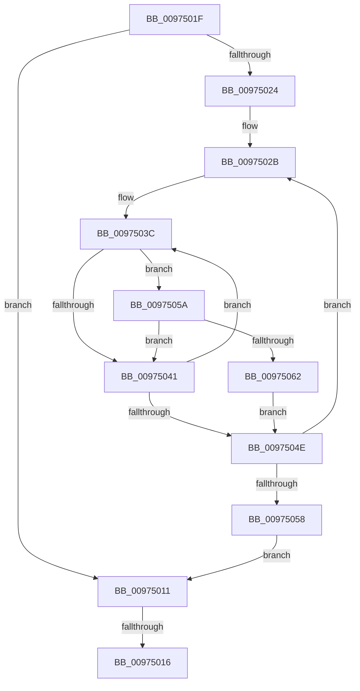

# sub_00975011

- RVA: `0x00975011`–`0x00975066` (길이 `85` bytes)
- VA: `0x0000000140975011`
- 실행 섹션: `PAGE`
- PDB 이름 있음: `아니요`; PDB Function 태그: `아니요`
- unwind 정보 RVA: `0x00096500`
- 디코드: `29`개 명령, `85/85` bytes 표시
- 미해석 바이트: `0` (있으면 어셈블리에 `.byte`로 보존)

> 이 문서는 커널 이미지의 기계어와 PDB 기호를 분석해 생성했습니다. 4번과 5번은 함수 원형과 자료형을 바이너리 사용 방식에서 추정한 C 해석이며 원본 소스 복구 결과는 아닙니다.

## 1. Dependencies

- 직접 호출 지점: **0**; 고유 호출 대상: **0**
- 직접 호출자로 확인된 함수: **0**
- RIP 상대 이미지 참조: **1**

### Outgoing calls
- 직접 디코드된 call 명령이 없습니다.

### Direct callers
- 이 함수 시작 RVA로 연결되는 직접 call은 확인되지 않았습니다. 간접 호출은 완전히 역산할 수 없습니다.

### Static image references
- `0x0097502E` → RVA `0x00B4BE28` (`SepServicesFilterPrivileges`; read)

## 2. Other-region calls and transfers

- 다른 실행 섹션으로 향하는 call: **0**
- call이 아닌 외부 분기/꼬리 이동: **1**
  - `0x00975014` → [SepFilterPrivilegeAudits + 0x19](SepFilterPrivilegeAudits_function_00974F90.md) (`tail-transfer`)

## 3. Assembly (complete function range)

```asm
00975011  41 3B 18                        cmp ebx, dword ptr [r8]
00975014  74 93                           je 0x140974fa9
00975016  48 8B 5C 24 20                  mov rbx, qword ptr [rsp + 0x20]
0097501B  B0 01                           mov al, 1
0097501D  5F                              pop rdi
0097501E  C3                              ret
0097501F  CC                              int3
00975020  85 C0                           test eax, eax
00975022  74 ED                           je 0x140975011
00975024  49 8D 50 08                     lea rdx, [r8 + 8]
00975028  44 8B D0                        mov r10d, eax
0097502B  44 8B 0A                        mov r9d, dword ptr [rdx]
0097502E  48 8D 0D F3 6D 1D 00            lea rcx, [rip + 0x1d6df3]
00975035  48 8B 05 EC 6D 1D 00            mov rax, qword ptr [rip + 0x1d6dec]
0097503C  44 3B 08                        cmp r9d, dword ptr [rax]
0097503F  74 19                           je 0x14097505a
00975041  48 8B 41 08                     mov rax, qword ptr [rcx + 8]
00975045  48 83 C1 08                     add rcx, 8
00975049  48 85 C0                        test rax, rax
0097504C  75 EE                           jne 0x14097503c
0097504E  48 83 C2 0C                     add rdx, 0xc
00975052  49 83 EA 01                     sub r10, 1
00975056  75 D3                           jne 0x14097502b
00975058  EB B7                           jmp 0x140975011
0097505A  8B 40 04                        mov eax, dword ptr [rax + 4]
0097505D  39 42 04                        cmp dword ptr [rdx + 4], eax
00975060  75 DF                           jne 0x140975041
00975062  FF C3                           inc ebx
00975064  EB E8                           jmp 0x14097504e
```

## 4. C-style interpretation (structured pseudocode)

```c
__int64 __fastcall sub_00975011(__int64 a1, __int64 a2, __int64 a3)
{
    unsigned __int64 v_stack_p20;

    return 1;
}
```

## 5. (Beta) C Style

```c
int64_t sub_00975011(int64_t Arg1, int64_t Arg2, void *Arg3)
{
    uint8_t *arg3 = (uint8_t *)Arg3;

    uint64_t v_stack_p20;

    return 1;
}
```

### 관측된 메모리 오프셋

구조체 형식이 확인되지 않은 접근은 인자 기준의 오프셋으로만 기록했습니다.

| 기준 인자 | 오프셋 표현 | 폭 (bit) | 접근 |
|---|---:|---:|---|
| `Arg3` | `+ 0x0` | `32` | `R` |

## 6. Execution-region graph

[열기: 2D/3D 그래프와 함수 탐색 컨트롤 패널](../../../control-panel.html?section=page&rva=0x00975011&view=graph)

- 2D 그래프는 위에서 아래로 흐르고, 3D 그래프는 빈 공간을 드래그해 회전합니다. Shift+드래그는 이동, 휠은 확대·축소, 함수 노드 선택은 대상 보고서 이동입니다.

### Static fallback


