# sub_0097525E

- RVA: `0x0097525E`–`0x00975429` (길이 `459` bytes)
- VA: `0x000000014097525E`
- 실행 섹션: `PAGE`
- PDB 이름 있음: `아니요`; PDB Function 태그: `아니요`
- unwind 정보 RVA: `0x000965F4`
- 디코드: `123`개 명령, `459/459` bytes 표시
- 미해석 바이트: `0` (있으면 어셈블리에 `.byte`로 보존)

> 이 문서는 커널 이미지의 기계어와 PDB 기호를 분석해 생성했습니다. 4번과 5번은 함수 원형과 자료형을 바이너리 사용 방식에서 추정한 C 해석이며 원본 소스 복구 결과는 아닙니다.

## 1. Dependencies

- 직접 호출 지점: **5**; 고유 호출 대상: **3**
- 직접 호출자로 확인된 함수: **0**
- RIP 상대 이미지 참조: **1**

### Outgoing calls
- `0x009752C6` → [PspChargeQuota](../../text/39/PspChargeQuota_function_00390330.md) (function, `0x00390330`)
- `0x0097530F` → [PspChargeQuota](../../text/39/PspChargeQuota_function_00390330.md) (function, `0x00390330`)
- `0x00975329` → [PspReturnQuota](../../text/39/PspReturnQuota_function_00390C40.md) (function, `0x00390C40`)
- `0x00975366` → [PsReturnSharedPoolQuota](../8B/PsReturnSharedPoolQuota_function_008BCC30.md) (function, `0x008BCC30`)
- `0x00975405` → [PspChargeQuota](../../text/39/PspChargeQuota_function_00390330.md) (function, `0x00390330`)

### Direct callers
- 이 함수 시작 RVA로 연결되는 직접 call은 확인되지 않았습니다. 간접 호출은 완전히 역산할 수 없습니다.

### Static image references
- `0x009752A1` → RVA `0x00FC6AB0` (`ALMOSTRO`; read)

## 2. Other-region calls and transfers

- 다른 실행 섹션으로 향하는 call: **4**
  - `0x009752C6` → [PspChargeQuota](../../text/39/PspChargeQuota_function_00390330.md) (`PAGE` → `.text`)
  - `0x0097530F` → [PspChargeQuota](../../text/39/PspChargeQuota_function_00390330.md) (`PAGE` → `.text`)
  - `0x00975329` → [PspReturnQuota](../../text/39/PspReturnQuota_function_00390C40.md) (`PAGE` → `.text`)
  - `0x00975405` → [PspChargeQuota](../../text/39/PspChargeQuota_function_00390330.md) (`PAGE` → `.text`)
- call이 아닌 외부 분기/꼬리 이동: **13**
  - `0x00975279` → [sub_00975430 + 0x7](Unknown_function_00975430.md) (`tail-transfer`)
  - `0x0097534D` → [sub_00975430 + 0x4F](Unknown_function_00975430.md) (`tail-transfer`)
  - `0x0097535A` → [sub_00975430 + 0x4F](Unknown_function_00975430.md) (`tail-transfer`)
  - `0x0097536B` → [sub_00975430 + 0x4F](Unknown_function_00975430.md) (`tail-transfer`)
  - `0x00975374` → [sub_00975430 + 0x60](Unknown_function_00975430.md) (`tail-transfer`)
  - `0x00975382` → [sub_00975430 + 0x6A](Unknown_function_00975430.md) (`tail-transfer`)
  - `0x0097538E` → [sub_00975430](Unknown_function_00975430.md) (`tail-transfer`)
  - `0x0097539A` → [sub_00975430 + 0x59](Unknown_function_00975430.md) (`tail-transfer`)
  - `0x009753A3` → [sub_00975430 + 0x7A](Unknown_function_00975430.md) (`tail-transfer`)
  - `0x009753AF` → [sub_00975430 + 0x73](Unknown_function_00975430.md) (`tail-transfer`)
  - `0x009753EE` → [sub_00975430 + 0x36](Unknown_function_00975430.md) (`tail-transfer`)
  - `0x0097540C` → [sub_00975430 + 0x47](Unknown_function_00975430.md) (`tail-transfer`)
  - `0x0097541E` → [sub_00975430 + 0x4F](Unknown_function_00975430.md) (`tail-transfer`)

## 3. Assembly (complete function range)

```asm
0097525E  48 89 6C 24 40                  mov qword ptr [rsp + 0x40], rbp
00975263  4C 89 64 24 48                  mov qword ptr [rsp + 0x48], r12
00975268  4C 89 74 24 50                  mov qword ptr [rsp + 0x50], r14
0097526D  A8 01                           test al, 1
0097526F  74 73                           je 0x1409752e4
00975271  24 FE                           and al, 0xfe
00975273  88 41 1B                        mov byte ptr [rcx + 0x1b], al
00975276  48 85 FF                        test rdi, rdi
00975279  0F 84 B8 01 00 00               je 0x140975437
0097527F  8B 2F                           mov ebp, dword ptr [rdi]
00975281  44 8B 77 04                     mov r14d, dword ptr [rdi + 4]
00975285  4D 85 C0                        test r8, r8
00975288  0F 85 E2 00 00 00               jne 0x140975370
0097528E  4C 8B 41 28                     mov r8, qword ptr [rcx + 0x28]
00975292  4D 85 C0                        test r8, r8
00975295  74 0A                           je 0x1409752a1
00975297  49 83 E0 F0                     and r8, 0xfffffffffffffff0
0097529B  0F 85 CF 00 00 00               jne 0x140975370
009752A1  48 3B 35 08 18 65 00            cmp rsi, qword ptr [rip + 0x651808]
009752A8  0F 84 8A 00 00 00               je 0x140975338
009752AE  48 8B B6 F8 02 00 00            mov rsi, qword ptr [rsi + 0x2f8]
009752B5  48 85 ED                        test rbp, rbp
009752B8  74 15                           je 0x1409752cf
009752BA  33 D2                           xor edx, edx
009752BC  4C 8B CD                        mov r9, rbp
009752BF  48 8B CE                        mov rcx, rsi
009752C2  44 8D 42 01                     lea r8d, [rdx + 1]
009752C6  E8 65 B0 A1 FF                  call 0x140390330
009752CB  85 C0                           test eax, eax
009752CD  78 73                           js 0x140975342
009752CF  4D 85 F6                        test r14, r14
009752D2  75 30                           jne 0x140975304
009752D4  F0 FF 86 00 02 00 00            lock inc dword ptr [rsi + 0x200]
009752DB  48 89 73 20                     mov qword ptr [rbx + 0x20], rsi
009752DF  48 85 F6                        test rsi, rsi
009752E2  74 66                           je 0x14097534a
009752E4  33 C0                           xor eax, eax
009752E6  4C 8B 74 24 50                  mov r14, qword ptr [rsp + 0x50]
009752EB  4C 8B 64 24 48                  mov r12, qword ptr [rsp + 0x48]
009752F0  48 8B 6C 24 40                  mov rbp, qword ptr [rsp + 0x40]
009752F5  48 8B 5C 24 58                  mov rbx, qword ptr [rsp + 0x58]
009752FA  48 83 C4 20                     add rsp, 0x20
009752FE  41 5F                           pop r15
00975300  5F                              pop rdi
00975301  5E                              pop rsi
00975302  C3                              ret
00975303  CC                              int3
00975304  4D 8B CE                        mov r9, r14
00975307  45 33 C0                        xor r8d, r8d
0097530A  33 D2                           xor edx, edx
0097530C  48 8B CE                        mov rcx, rsi
0097530F  E8 1C B0 A1 FF                  call 0x140390330
00975314  85 C0                           test eax, eax
00975316  79 BC                           jns 0x1409752d4
00975318  48 85 ED                        test rbp, rbp
0097531B  74 11                           je 0x14097532e
0097531D  33 D2                           xor edx, edx
0097531F  4C 8B CD                        mov r9, rbp
00975322  48 8B CE                        mov rcx, rsi
00975325  44 8D 42 01                     lea r8d, [rdx + 1]
00975329  E8 12 B9 A1 FF                  call 0x140390c40
0097532E  48 C7 43 20 00 00 00 00         mov qword ptr [rbx + 0x20], 0
00975336  EB 12                           jmp 0x14097534a
00975338  48 C7 43 20 01 00 00 00         mov qword ptr [rbx + 0x20], 1
00975340  EB A2                           jmp 0x1409752e4
00975342  48 C7 43 20 00 00 00 00         mov qword ptr [rbx + 0x20], 0
0097534A  48 85 FF                        test rdi, rdi
0097534D  0F 84 2C 01 00 00               je 0x14097547f
00975353  48 8B 4F 10                     mov rcx, qword ptr [rdi + 0x10]
00975357  48 85 C9                        test rcx, rcx
0097535A  0F 84 1F 01 00 00               je 0x14097547f
00975360  41 8B D7                        mov edx, r15d
00975363  45 33 C0                        xor r8d, r8d
00975366  E8 C5 78 F4 FF                  call 0x1408bcc30
0097536B  E9 0F 01 00 00                  jmp 0x14097547f
00975370  41 80 38 01                     cmp byte ptr [r8], 1
00975374  0F 85 16 01 00 00               jne 0x140975490
0097537A  41 0F B7 48 02                  movzx ecx, word ptr [r8 + 2]
0097537F  66 85 C9                        test cx, cx
00975382  0F 89 12 01 00 00               jns 0x14097549a
00975388  41 8B 40 08                     mov eax, dword ptr [r8 + 8]
0097538C  85 C0                           test eax, eax
0097538E  0F 84 9C 00 00 00               je 0x140975430
00975394  49 03 C0                        add rax, r8
00975397  F6 C1 04                        test cl, 4
0097539A  0F 84 E9 00 00 00               je 0x140975489
009753A0  66 85 C9                        test cx, cx
009753A3  0F 89 01 01 00 00               jns 0x1409754aa
009753A9  41 8B 48 10                     mov ecx, dword ptr [r8 + 0x10]
009753AD  85 C9                           test ecx, ecx
009753AF  0F 84 EE 00 00 00               je 0x1409754a3
009753B5  49 03 C8                        add rcx, r8
009753B8  48 85 C0                        test rax, rax
009753BB  74 10                           je 0x1409753cd
009753BD  0F B6 40 01                     movzx eax, byte ptr [rax + 1]
009753C1  44 8D 3C 85 0B 00 00 00         lea r15d, [rax*4 + 0xb]
009753C9  41 83 E7 FC                     and r15d, 0xfffffffc
009753CD  48 85 C9                        test rcx, rcx
009753D0  74 0D                           je 0x1409753df
009753D2  0F B7 41 02                     movzx eax, word ptr [rcx + 2]
009753D6  83 C0 03                        add eax, 3
009753D9  83 E0 FC                        and eax, 0xfffffffc
009753DC  44 03 F8                        add r15d, eax
009753DF  45 85 FF                        test r15d, r15d
009753E2  74 3C                           je 0x140975420
009753E4  48 3B 35 C5 16 65 00            cmp rsi, qword ptr [rip + 0x6516c5]
009753EB  45 8B CF                        mov r9d, r15d
009753EE  74 76                           je 0x140975466
009753F0  4C 8B A6 F8 02 00 00            mov r12, qword ptr [rsi + 0x2f8]
009753F7  45 85 FF                        test r15d, r15d
009753FA  74 12                           je 0x14097540e
009753FC  33 D2                           xor edx, edx
009753FE  49 8B CC                        mov rcx, r12
00975401  44 8D 42 01                     lea r8d, [rdx + 1]
00975405  E8 26 AF A1 FF                  call 0x140390330
0097540A  85 C0                           test eax, eax
0097540C  78 69                           js 0x140975477
0097540E  F0 41 FF 84 24 00 02 00 00      lock inc dword ptr [r12 + 0x200]
00975417  4C 89 67 10                     mov qword ptr [rdi + 0x10], r12
0097541B  4D 85 E4                        test r12, r12
0097541E  74 5F                           je 0x14097547f
00975420  44 89 7F 08                     mov dword ptr [rdi + 8], r15d
00975424  E9 78 FE FF FF                  jmp 0x1409752a1
```

## 4. C-style interpretation (structured pseudocode)

```c
__int64 __fastcall sub_0097525E(__int64 a1, int a2, __int64 a3, __int64 a4, __int64 a5, __int64 a6, __int64 a7, __int64 a8, __int64 a9, __int64 a10, __int64 a11)
{
    __int64 result;
    __int64 v_r15;
    __int64 v_rsp;
    unsigned __int64 v_stack_p40;
    unsigned __int64 v_stack_p48;
    unsigned __int64 v_stack_p50;

    v_stack_p40 = v_rbp;
    v_stack_p48 = v_r12;
    v_stack_p50 = v_r14;
    if ((((unsigned __int8)(result)) & (1)) == 0) goto loc_009752E4;
    result = (unsigned __int8)((result) & (254));
    *(unsigned __int8 *)(a1 + 27) = (unsigned __int8)(result);
    if (a3 != 0) goto loc_00975370;
    if (*(unsigned __int64 *)(a1 + 40) == 0) goto loc_009752A1;
    a3 = (*(unsigned __int64 *)(a1 + 40)) & (-16);
    if (condition_is_not_equal) goto loc_00975370;
loc_009752A1:
    if (v_rsi == (*(unsigned __int64 *)(v_rip + 6625288))) goto loc_00975338;
    if ((unsigned int)(*(unsigned int *)(v_rdi)) == 0) goto loc_009752CF;
    a2 = 0;
    result = PspChargeQuota(*(unsigned __int64 *)(v_rsi + 760), a2, a2 + 1, (unsigned int)(*(unsigned int *)(v_rdi)));
    if (sign_flag) goto loc_00975342;
loc_009752CF:
    if ((unsigned int)(*(unsigned int *)(v_rdi + 4)) != 0) goto loc_00975304;
loc_009752D4:
    *(unsigned __int64 *)(v_rbx + 32) = *(unsigned __int64 *)(v_rsi + 760);
    if (*(unsigned __int64 *)(v_rsi + 760) == 0) goto loc_0097534A;
loc_009752E4:
    result = 0;
    v_rsp = (v_rsp) + (32);
    return result;
loc_00975304:
    a3 = 0;
    a2 = 0;
    result = PspChargeQuota(*(unsigned __int64 *)(v_rsi + 760), a2, a3, a10);
    if (!sign_flag) goto loc_009752D4;
    if (a8 != 0) {
        a2 = 0;
        a4 = a8;
        a1 = *(unsigned __int64 *)(v_rsi + 760);
        a3 = a2 + 1;
        result = PspReturnQuota(a1, a2, a3, a4);
    }
    *(unsigned __int64 *)(a11 + 32) = 0;
    goto loc_0097534A;
loc_00975338:
    *(unsigned __int64 *)(a11 + 32) = 1;
    goto loc_009752E4;
loc_00975342:
    *(unsigned __int64 *)(a11 + 32) = 0;
loc_0097534A:
    a3 = 0;
    result = PsReturnSharedPoolQuota(*(unsigned __int64 *)(v_rdi + 16), (unsigned int)((unsigned int)(v_r15)), a3, a4);
loc_00975370:
    result = ((unsigned int)(*(unsigned int *)(a3 + 8))) + (0);
    a1 = ((unsigned int)(*(unsigned int *)(a3 + 16))) + (0);
    if (result != 0) {
        result = *(unsigned __int8 *)(result + 1);
        v_r15 = result * 4 + 11;
        v_r15 = (unsigned int)((v_r15) & (0xFFFFFFFCULL));
    }
    if (a1 != 0) {
        result = *(unsigned __int16 *)(a1 + 2);
        result = (unsigned int)((result) + (3));
        result = (unsigned int)((result) & (0xFFFFFFFCULL));
        v_r15 = (unsigned int)((v_r15) + ((unsigned int)(result)));
    }
    if ((unsigned int)(v_r15) == 0) goto loc_00975420;
    if ((unsigned int)(v_r15) == 0) goto loc_0097540E;
    a2 = 0;
    result = PspChargeQuota(*(unsigned __int64 *)(*(unsigned __int64 *)(v_rsi + 760) + 760), a2, a2 + 1, (unsigned int)((unsigned int)(v_r15)));
loc_0097540E:
    *(unsigned __int64 *)(v_rdi + 16) = *(unsigned __int64 *)(*(unsigned __int64 *)(v_rsi + 760) + 760);
loc_00975420:
    *(unsigned int *)(v_rdi + 8) = (unsigned int)(v_r15);
    goto loc_009752A1;
}
```

## 5. (Beta) C Style

```c
int64_t sub_0097525E(void *Arg1, int32_t Arg2, int64_t Arg3, int64_t Arg4, uint64_t Arg5, uint64_t Arg6, uint64_t Arg7, int64_t Arg8, int64_t Arg9, int64_t Arg10, int64_t Arg11)
{
    uint8_t *arg1 = (uint8_t *)Arg1;

    int64_t result;
    int64_t local_r15;
    int64_t local_rsp;
    uint64_t v_stack_p40;
    uint64_t v_stack_p48;
    uint64_t v_stack_p50;

    v_stack_p40 = local_rbp;
    v_stack_p48 = local_r12;
    v_stack_p50 = local_r14;
    if ((((uint8_t)(result)) & (1)) == 0) goto loc_009752E4;
    result = (uint8_t)((result) & (254));
    *(uint8_t *)(arg1 + 0x1B) = (uint8_t)(result);
    if (Arg3 != 0) goto loc_00975370;
    if (*(uint64_t *)(arg1 + 0x28) == 0) goto loc_009752A1;
    Arg3 = (*(uint64_t *)(arg1 + 0x28)) & (-16);
    if (condition_is_not_equal) goto loc_00975370;
loc_009752A1:
    if (local_rsi == (*(uint64_t *)(v_rip + 0x651808))) goto loc_00975338;
    if ((uint32_t)(*(uint32_t *)(local_rdi)) == 0) goto loc_009752CF;
    Arg2 = 0;
    result = PspChargeQuota(*(uint64_t *)(local_rsi + 0x2F8), Arg2, Arg2 + 1, (uint32_t)(*(uint32_t *)(local_rdi)));
    if (sign_flag) goto loc_00975342;
loc_009752CF:
    if ((uint32_t)(*(uint32_t *)(local_rdi + 0x4)) != 0) goto loc_00975304;
loc_009752D4:
    *(uint64_t *)(local_rbx + 0x20) = *(uint64_t *)(local_rsi + 0x2F8);
    if (*(uint64_t *)(local_rsi + 0x2F8) == 0) goto loc_0097534A;
loc_009752E4:
    result = 0;
    local_rsp = (local_rsp) + (32);
    return result;
loc_00975304:
    Arg3 = 0;
    Arg2 = 0;
    result = PspChargeQuota(*(uint64_t *)(local_rsi + 0x2F8), Arg2, Arg3, Arg10);
    if (!sign_flag) goto loc_009752D4;
    if (Arg8 != 0) {
        Arg2 = 0;
        Arg4 = Arg8;
        Arg1 = *(uint64_t *)(local_rsi + 0x2F8);
        Arg3 = Arg2 + 1;
        result = PspReturnQuota(Arg1, Arg2, Arg3, Arg4);
    }
    *(uint64_t *)(Arg11 + 0x20) = 0;
    goto loc_0097534A;
loc_00975338:
    *(uint64_t *)(Arg11 + 0x20) = 1;
    goto loc_009752E4;
loc_00975342:
    *(uint64_t *)(Arg11 + 0x20) = 0;
loc_0097534A:
    Arg3 = 0;
    result = PsReturnSharedPoolQuota(*(uint64_t *)(local_rdi + 0x10), (uint32_t)((uint32_t)(local_r15)), Arg3, Arg4);
loc_00975370:
    result = ((uint32_t)(*(uint32_t *)(Arg3 + 0x8))) + (0);
    Arg1 = ((uint32_t)(*(uint32_t *)(Arg3 + 0x10))) + (0);
    if (result != 0) {
        result = *(uint8_t *)(result + 0x1);
        local_r15 = result * 4 + 11;
        local_r15 = (uint32_t)((local_r15) & (0xFFFFFFFCULL));
    }
    if (Arg1 != NULL) {
        result = *(uint16_t *)(arg1 + 0x2);
        result = (uint32_t)((result) + (3));
        result = (uint32_t)((result) & (0xFFFFFFFCULL));
        local_r15 = (uint32_t)((local_r15) + ((uint32_t)(result)));
    }
    if ((uint32_t)(local_r15) == 0) goto loc_00975420;
    if ((uint32_t)(local_r15) == 0) goto loc_0097540E;
    Arg2 = 0;
    result = PspChargeQuota(*(uint64_t *)(*(uint64_t *)(local_rsi + 0x2F8) + 0x2F8), Arg2, Arg2 + 1, (uint32_t)((uint32_t)(local_r15)));
loc_0097540E:
    *(uint64_t *)(local_rdi + 0x10) = *(uint64_t *)(*(uint64_t *)(local_rsi + 0x2F8) + 0x2F8);
loc_00975420:
    *(uint32_t *)(local_rdi + 0x8) = (uint32_t)(local_r15);
    goto loc_009752A1;
}
```

### 관측된 메모리 오프셋

구조체 형식이 확인되지 않은 접근은 인자 기준의 오프셋으로만 기록했습니다.

| 기준 인자 | 오프셋 표현 | 폭 (bit) | 접근 |
|---|---:|---:|---|
| `Arg1` | `+ 0x1B` | `8` | `W` |
| `Arg1` | `+ 0x28` | `64` | `R` |

## 6. Execution-region graph

[열기: 2D/3D 그래프와 함수 탐색 컨트롤 패널](../../../control-panel.html?section=page&rva=0x0097525E&view=graph)

- 2D 그래프는 위에서 아래로 흐르고, 3D 그래프는 빈 공간을 드래그해 회전합니다. Shift+드래그는 이동, 휠은 확대·축소, 함수 노드 선택은 대상 보고서 이동입니다.

### Static fallback

```mermaid
flowchart TD
  bb_0097525E[BB_0097525E]
  bb_00975271[BB_00975271]
  bb_0097527F[BB_0097527F]
  bb_0097528E[BB_0097528E]
  bb_00975297[BB_00975297]
  bb_009752A1[BB_009752A1]
  bb_009752AE[BB_009752AE]
  bb_009752BA[BB_009752BA]
  bb_009752CF[BB_009752CF]
  bb_009752D4[BB_009752D4]
  bb_009752E4[BB_009752E4]
  bb_00975303[BB_00975303]
  bb_00975304[BB_00975304]
  bb_00975318[BB_00975318]
  bb_0097531D[BB_0097531D]
  bb_0097532E[BB_0097532E]
  bb_00975338[BB_00975338]
  bb_00975342[BB_00975342]
  bb_0097534A[BB_0097534A]
  bb_00975353[BB_00975353]
  bb_00975360[BB_00975360]
  bb_00975370[BB_00975370]
  bb_0097537A[BB_0097537A]
  bb_00975388[BB_00975388]
  bb_00975394[BB_00975394]
  bb_009753A0[BB_009753A0]
  bb_009753A9[BB_009753A9]
  bb_009753B5[BB_009753B5]
  bb_009753BD[BB_009753BD]
  bb_009753CD[BB_009753CD]
  bb_009753D2[BB_009753D2]
  bb_009753DF[BB_009753DF]
  bb_009753E4[BB_009753E4]
  bb_009753F0[BB_009753F0]
  bb_009753FC[BB_009753FC]
  bb_0097540E[BB_0097540E]
  bb_00975420[BB_00975420]
  bb_0097525E -->|branch| bb_009752E4
  bb_0097525E -->|fallthrough| bb_00975271
  bb_00975271 -->|fallthrough| bb_0097527F
  bb_0097527F -->|branch| bb_00975370
  bb_0097527F -->|fallthrough| bb_0097528E
  bb_0097528E -->|branch| bb_009752A1
  bb_0097528E -->|fallthrough| bb_00975297
  bb_00975297 -->|branch| bb_00975370
  bb_00975297 -->|fallthrough| bb_009752A1
  bb_009752A1 -->|branch| bb_00975338
  bb_009752A1 -->|fallthrough| bb_009752AE
  bb_009752AE -->|branch| bb_009752CF
  bb_009752AE -->|fallthrough| bb_009752BA
  bb_009752BA -->|branch| bb_00975342
  bb_009752BA -->|fallthrough| bb_009752CF
  bb_009752CF -->|branch| bb_00975304
  bb_009752CF -->|fallthrough| bb_009752D4
  bb_009752D4 -->|branch| bb_0097534A
  bb_009752D4 -->|fallthrough| bb_009752E4
  bb_00975303 -->|flow| bb_00975304
  bb_00975304 -->|branch| bb_009752D4
  bb_00975304 -->|fallthrough| bb_00975318
  bb_00975318 -->|branch| bb_0097532E
  bb_00975318 -->|fallthrough| bb_0097531D
  bb_0097531D -->|flow| bb_0097532E
  bb_0097532E -->|branch| bb_0097534A
  bb_00975338 -->|branch| bb_009752E4
  bb_00975342 -->|flow| bb_0097534A
  bb_0097534A -->|fallthrough| bb_00975353
  bb_00975353 -->|fallthrough| bb_00975360
  bb_00975370 -->|fallthrough| bb_0097537A
  bb_0097537A -->|fallthrough| bb_00975388
  bb_00975388 -->|fallthrough| bb_00975394
  bb_00975394 -->|fallthrough| bb_009753A0
  bb_009753A0 -->|fallthrough| bb_009753A9
  bb_009753A9 -->|fallthrough| bb_009753B5
  bb_009753B5 -->|branch| bb_009753CD
  bb_009753B5 -->|fallthrough| bb_009753BD
  bb_009753BD -->|flow| bb_009753CD
  bb_009753CD -->|branch| bb_009753DF
  bb_009753CD -->|fallthrough| bb_009753D2
  bb_009753D2 -->|flow| bb_009753DF
  bb_009753DF -->|branch| bb_00975420
  bb_009753DF -->|fallthrough| bb_009753E4
  bb_009753E4 -->|fallthrough| bb_009753F0
  bb_009753F0 -->|branch| bb_0097540E
  bb_009753F0 -->|fallthrough| bb_009753FC
  bb_009753FC -->|fallthrough| bb_0097540E
  bb_0097540E -->|fallthrough| bb_00975420
  bb_00975420 -->|branch| bb_009752A1
```


