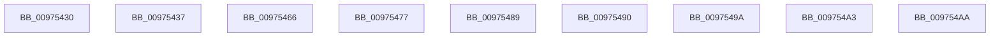

# sub_00975430

- RVA: `0x00975430`–`0x009754B3` (길이 `131` bytes)
- VA: `0x0000000140975430`
- 실행 섹션: `PAGE`
- PDB 이름 있음: `아니요`; PDB Function 태그: `아니요`
- unwind 정보 RVA: `0x00096624`
- 디코드: `29`개 명령, `131/131` bytes 표시
- 미해석 바이트: `0` (있으면 어셈블리에 `.byte`로 보존)

> 이 문서는 커널 이미지의 기계어와 PDB 기호를 분석해 생성했습니다. 4번과 5번은 함수 원형과 자료형을 바이너리 사용 방식에서 추정한 C 해석이며 원본 소스 복구 결과는 아닙니다.

## 1. Dependencies

- 직접 호출 지점: **0**; 고유 호출 대상: **0**
- 직접 호출자로 확인된 함수: **0**
- RIP 상대 이미지 참조: **1**

### Outgoing calls
- 직접 디코드된 call 명령이 없습니다.

### Direct callers
- 이 함수 시작 RVA로 연결되는 직접 call은 확인되지 않았습니다. 간접 호출은 완전히 역산할 수 없습니다.

### Static image references
- `0x00975448` → RVA `0x00FC6E4C` (`ALMOSTRO`; read)

## 2. Other-region calls and transfers

- 다른 실행 섹션으로 향하는 call: **0**
- call이 아닌 외부 분기/꼬리 이동: **9**
  - `0x00975432` → [sub_0097525E + 0x139](Unknown_function_0097525E.md) (`tail-transfer`)
  - `0x00975461` → [sub_0097525E + 0x43](Unknown_function_0097525E.md) (`tail-transfer`)
  - `0x00975472` → [sub_0097525E + 0x43](Unknown_function_0097525E.md) (`tail-transfer`)
  - `0x00975484` → [sub_0097525E + 0x88](Unknown_function_0097525E.md) (`tail-transfer`)
  - `0x0097548B` → [sub_0097525E + 0x15A](Unknown_function_0097525E.md) (`tail-transfer`)
  - `0x00975495` → [sub_0097525E + 0x88](Unknown_function_0097525E.md) (`tail-transfer`)
  - `0x0097549E` → [sub_0097525E + 0x139](Unknown_function_0097525E.md) (`tail-transfer`)
  - `0x009754A5` → [sub_0097525E + 0x15A](Unknown_function_0097525E.md) (`tail-transfer`)
  - `0x009754AE` → [sub_0097525E + 0x15A](Unknown_function_0097525E.md) (`tail-transfer`)

## 3. Assembly (complete function range)

```asm
00975430  33 C0                           xor eax, eax
00975432  E9 60 FF FF FF                  jmp 0x140975397
00975437  48 8B C3                        mov rax, rbx
0097543A  48 C1 E8 08                     shr rax, 8
0097543E  0F B6 C8                        movzx ecx, al
00975441  0F B6 43 18                     movzx eax, byte ptr [rbx + 0x18]
00975445  48 33 C8                        xor rcx, rax
00975448  0F B6 05 FD 19 65 00            movzx eax, byte ptr [rip + 0x6519fd]
0097544F  48 33 C8                        xor rcx, rax
00975452  48 8B 84 CA 00 78 FC 00         mov rax, qword ptr [rdx + rcx*8 + 0xfc7800]
0097545A  8B 68 68                        mov ebp, dword ptr [rax + 0x68]
0097545D  44 8B 70 6C                     mov r14d, dword ptr [rax + 0x6c]
00975461  E9 3B FE FF FF                  jmp 0x1409752a1
00975466  48 C7 47 10 01 00 00 00         mov qword ptr [rdi + 0x10], 1
0097546E  44 89 7F 08                     mov dword ptr [rdi + 8], r15d
00975472  E9 2A FE FF FF                  jmp 0x1409752a1
00975477  48 C7 47 10 00 00 00 00         mov qword ptr [rdi + 0x10], 0
0097547F  B8 44 00 00 C0                  mov eax, 0xc0000044
00975484  E9 5D FE FF FF                  jmp 0x1409752e6
00975489  33 C9                           xor ecx, ecx
0097548B  E9 28 FF FF FF                  jmp 0x1409753b8
00975490  B8 58 00 00 C0                  mov eax, 0xc0000058
00975495  E9 4C FE FF FF                  jmp 0x1409752e6
0097549A  49 8B 40 10                     mov rax, qword ptr [r8 + 0x10]
0097549E  E9 F4 FE FF FF                  jmp 0x140975397
009754A3  33 C9                           xor ecx, ecx
009754A5  E9 0E FF FF FF                  jmp 0x1409753b8
009754AA  49 8B 48 20                     mov rcx, qword ptr [r8 + 0x20]
009754AE  E9 05 FF FF FF                  jmp 0x1409753b8
```

## 4. C-style interpretation (structured pseudocode)

```c
__int64 __fastcall sub_00975430(__int64 a1, __int64 a2, __int64 a3)
{
    __int64 result;

    result = 0;
}
```

## 5. (Beta) C Style

```c
int64_t sub_00975430(int64_t Arg1, int64_t Arg2, int64_t Arg3)
{
    int64_t result;

    result = 0;
}
```

## 6. Execution-region graph

[열기: 2D/3D 그래프와 함수 탐색 컨트롤 패널](../../../control-panel.html?section=page&rva=0x00975430&view=graph)

- 2D 그래프는 위에서 아래로 흐르고, 3D 그래프는 빈 공간을 드래그해 회전합니다. Shift+드래그는 이동, 휠은 확대·축소, 함수 노드 선택은 대상 보고서 이동입니다.

### Static fallback


