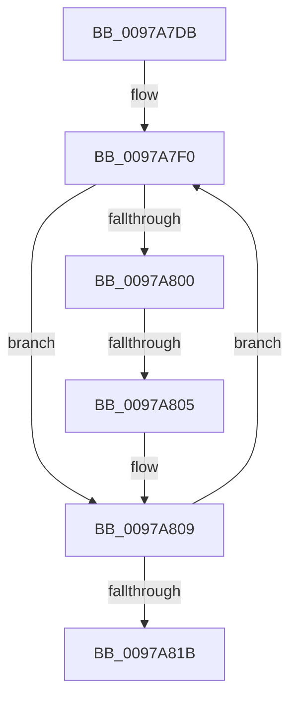

# sub_0097A7DB

- RVA: `0x0097A7DB`–`0x0097A820` (길이 `69` bytes)
- VA: `0x000000014097A7DB`
- 실행 섹션: `PAGE`
- PDB 이름 있음: `아니요`; PDB Function 태그: `아니요`
- unwind 정보 RVA: `0x00096820`
- 디코드: `17`개 명령, `69/69` bytes 표시
- 미해석 바이트: `0` (있으면 어셈블리에 `.byte`로 보존)

> 이 문서는 커널 이미지의 기계어와 PDB 기호를 분석해 생성했습니다. 4번과 5번은 함수 원형과 자료형을 바이너리 사용 방식에서 추정한 C 해석이며 원본 소스 복구 결과는 아닙니다.

## 1. Dependencies

- 직접 호출 지점: **0**; 고유 호출 대상: **0**
- 직접 호출자로 확인된 함수: **0**
- RIP 상대 이미지 참조: **0**

### Outgoing calls
- 직접 디코드된 call 명령이 없습니다.

### Direct callers
- 이 함수 시작 RVA로 연결되는 직접 call은 확인되지 않았습니다. 간접 호출은 완전히 역산할 수 없습니다.

### Static image references
- 디코드된 RIP-relative 메모리 참조가 없습니다.

## 2. Other-region calls and transfers

- 다른 실행 섹션으로 향하는 call: **0**
- call이 아닌 외부 분기/꼬리 이동: **1**
  - `0x0097A803` → [sub_0097A831](Unknown_function_0097A831.md) (`tail-transfer`)

## 3. Assembly (complete function range)

```asm
0097A7DB  48 89 74 24 30                  mov qword ptr [rsp + 0x30], rsi
0097A7E0  BE C0 00 00 00                  mov esi, 0xc0
0097A7E5  66 66 66 0F 1F 84 00 00 00 00 00  nop word ptr [rax + rax]
0097A7F0  41 0F B7 01                     movzx eax, word ptr [r9]
0097A7F4  4D 8D 49 02                     lea r9, [r9 + 2]
0097A7F8  41 FF CB                        dec r11d
0097A7FB  83 F8 61                        cmp eax, 0x61
0097A7FE  72 09                           jb 0x14097a809
0097A800  83 F8 7A                        cmp eax, 0x7a
0097A803  77 2C                           ja 0x14097a831
0097A805  66 83 E8 20                     sub ax, 0x20
0097A809  45 69 D2 3F 00 01 00            imul r10d, r10d, 0x1003f
0097A810  0F B7 C8                        movzx ecx, ax
0097A813  44 03 D1                        add r10d, ecx
0097A816  45 85 DB                        test r11d, r11d
0097A819  75 D5                           jne 0x14097a7f0
0097A81B  48 8B 74 24 30                  mov rsi, qword ptr [rsp + 0x30]
```

## 4. C-style interpretation (structured pseudocode)

```c
__int64 __fastcall sub_0097A7DB(__int64 a1, __int64 a2, __int64 a3, __int64 a4, __int64 a5, __int64 a6)
{
    __int64 result;
    __int64 v_r10;
    __int64 v_r11;
    unsigned __int64 v_stack_p30;

    v_stack_p30 = v_rsi;
loc_0097A7F0:
    v_r11 = (unsigned int)((v_r11) - 1);
    if (((unsigned int)(*(unsigned __int16 *)(a4))) < 97) goto loc_0097A809;
    result = (unsigned __int16)((*(unsigned __int16 *)(a4)) - (32));
loc_0097A809:
    v_r10 = (unsigned int)((v_r10) * ((unsigned int)(v_r10)));
    v_r10 = (unsigned int)((v_r10) + ((unsigned int)((unsigned __int16)(result))));
    if ((unsigned int)(v_r11) != 0) goto loc_0097A7F0;
    return result;
}
```

## 5. (Beta) C Style

```c
int64_t sub_0097A7DB(int64_t Arg1, int64_t Arg2, int64_t Arg3, void *Arg4, uint64_t Arg5, int64_t Arg6)
{
    uint8_t *arg4 = (uint8_t *)Arg4;

    int64_t result;
    int64_t local_r10;
    int64_t local_r11;
    uint64_t v_stack_p30;

    v_stack_p30 = local_rsi;
loc_0097A7F0:
    local_r11 = (uint32_t)((local_r11) - 1);
    if (((uint32_t)(*(uint16_t *)(arg4))) < 97) goto loc_0097A809;
    result = (uint16_t)((*(uint16_t *)(arg4)) - (32));
loc_0097A809:
    local_r10 = (uint32_t)((local_r10) * ((uint32_t)(local_r10)));
    local_r10 = (uint32_t)((local_r10) + ((uint32_t)((uint16_t)(result))));
    if ((uint32_t)(local_r11) != 0) goto loc_0097A7F0;
    return result;
}
```

### 관측된 메모리 오프셋

구조체 형식이 확인되지 않은 접근은 인자 기준의 오프셋으로만 기록했습니다.

| 기준 인자 | 오프셋 표현 | 폭 (bit) | 접근 |
|---|---:|---:|---|
| `Arg4` | `+ 0x0` | `16` | `R` |
| `Arg4` | `+ 0x2` | `64` | `R` |

## 6. Execution-region graph

[열기: 2D/3D 그래프와 함수 탐색 컨트롤 패널](../../../control-panel.html?section=page&rva=0x0097A7DB&view=graph)

- 2D 그래프는 위에서 아래로 흐르고, 3D 그래프는 빈 공간을 드래그해 회전합니다. Shift+드래그는 이동, 휠은 확대·축소, 함수 노드 선택은 대상 보고서 이동입니다.

### Static fallback


