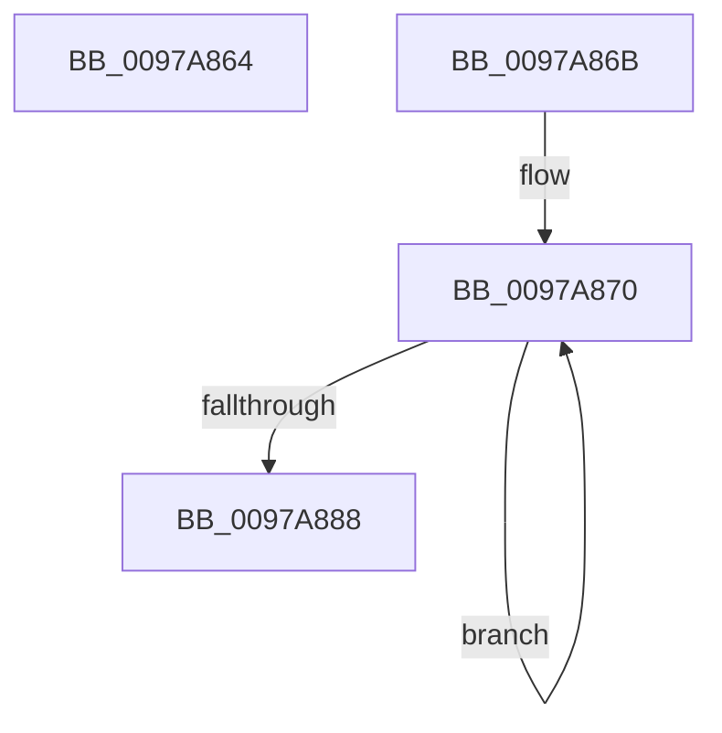

# sub_0097A864

- RVA: `0x0097A864`–`0x0097A88A` (길이 `38` bytes)
- VA: `0x000000014097A864`
- 실행 섹션: `PAGE`
- PDB 이름 있음: `아니요`; PDB Function 태그: `아니요`
- unwind 정보 RVA: `0x0009685C`
- 디코드: `10`개 명령, `38/38` bytes 표시
- 미해석 바이트: `0` (있으면 어셈블리에 `.byte`로 보존)

> 이 문서는 커널 이미지의 기계어와 PDB 기호를 분석해 생성했습니다. 4번과 5번은 함수 원형과 자료형을 바이너리 사용 방식에서 추정한 C 해석이며 원본 소스 복구 결과는 아닙니다.

## 1. Dependencies

- 직접 호출 지점: **0**; 고유 호출 대상: **0**
- 직접 호출자로 확인된 함수: **0**
- RIP 상대 이미지 참조: **0**

### Outgoing calls
- 직접 디코드된 call 명령이 없습니다.

### Direct callers
- 이 함수 시작 RVA로 연결되는 직접 call은 확인되지 않았습니다. 간접 호출은 완전히 역산할 수 없습니다.

### Static image references
- 디코드된 RIP-relative 메모리 참조가 없습니다.

## 2. Other-region calls and transfers

- 다른 실행 섹션으로 향하는 call: **0**
- call이 아닌 외부 분기/꼬리 이동: **2**
  - `0x0097A869` → [sub_0097A820 + 0x5](Unknown_function_0097A820.md) (`tail-transfer`)
  - `0x0097A888` → [sub_0097A820](Unknown_function_0097A820.md) (`tail-transfer`)

## 3. Assembly (complete function range)

```asm
0097A864  B8 0D 00 00 C0                  mov eax, 0xc000000d
0097A869  EB BA                           jmp 0x14097a825
0097A86B  0F 1F 44 00 00                  nop dword ptr [rax + rax]
0097A870  41 0F B7 09                     movzx ecx, word ptr [r9]
0097A874  4D 8D 49 02                     lea r9, [r9 + 2]
0097A878  45 69 D2 3F 00 01 00            imul r10d, r10d, 0x1003f
0097A87F  44 03 D1                        add r10d, ecx
0097A882  41 83 C3 FF                     add r11d, -1
0097A886  75 E8                           jne 0x14097a870
0097A888  EB 96                           jmp 0x14097a820
```

## 4. C-style interpretation (structured pseudocode)

```c
__int64 __fastcall sub_0097A864(__int64 a1, __int64 a2, __int64 a3, __int64 a4)
{
}
```

## 5. (Beta) C Style

```c
int64_t sub_0097A864(int64_t Arg1, int64_t Arg2, int64_t Arg3, int64_t Arg4)
{
}
```

## 6. Execution-region graph

[열기: 2D/3D 그래프와 함수 탐색 컨트롤 패널](../../../control-panel.html?section=page&rva=0x0097A864&view=graph)

- 2D 그래프는 위에서 아래로 흐르고, 3D 그래프는 빈 공간을 드래그해 회전합니다. Shift+드래그는 이동, 휠은 확대·축소, 함수 노드 선택은 대상 보고서 이동입니다.

### Static fallback


