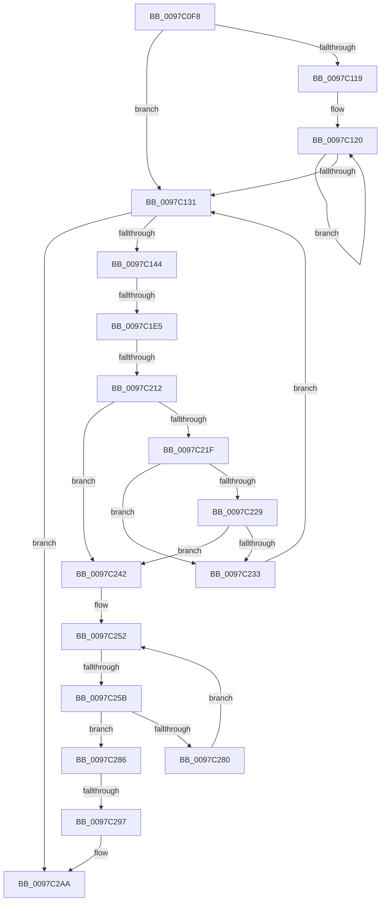

# sub_0097C0F8

- RVA: `0x0097C0F8`–`0x0097C2C3` (길이 `459` bytes)
- VA: `0x000000014097C0F8`
- 실행 섹션: `PAGE`
- PDB 이름 있음: `아니요`; PDB Function 태그: `아니요`
- unwind 정보 RVA: `0x00096E58`
- 디코드: `103`개 명령, `459/459` bytes 표시
- 미해석 바이트: `0` (있으면 어셈블리에 `.byte`로 보존)

> 이 문서는 커널 이미지의 기계어와 PDB 기호를 분석해 생성했습니다. 4번과 5번은 함수 원형과 자료형을 바이너리 사용 방식에서 추정한 C 해석이며 원본 소스 복구 결과는 아닙니다.

## 1. Dependencies

- 직접 호출 지점: **7**; 고유 호출 대상: **6**
- 직접 호출자로 확인된 함수: **0**
- RIP 상대 이미지 참조: **1**

### Outgoing calls
- `0x0097C10F` → [ExpInterlockedFlushSList](../../text/6B/ExpInterlockedFlushSList_function_006BA5F0.md) (function, `0x006BA5F0`)
- `0x0097C1D5` → [PfpCopyEvent](PfpCopyEvent_function_0097BE5C.md) (function, `0x0097BE5C`)
- `0x0097C202` → [PfpCopyEvent](PfpCopyEvent_function_0097BE5C.md) (function, `0x0097BE5C`)
- `0x0097C238` → [MmFreeAccessPfnBuffer](../../text/47/MmFreeAccessPfnBuffer_function_004751BC.md) (function, `0x004751BC`)
- `0x0097C276` → [PfpLogPageAccess](PfpLogPageAccess_function_0097C450.md) (function, `0x0097C450`)
- `0x0097C29A` → [CsanRead64NoCheck](../../text/4C/CsanRead64NoCheck_function_004C82C0.md) (function, `0x004C82C0`)
- `0x0097C2A5` → [PfpReturnAccessBuffer](../../text/48/PfpReturnAccessBuffer_function_00488A80.md) (function, `0x00488A80`)

### Direct callers
- 이 함수 시작 RVA로 연결되는 직접 call은 확인되지 않았습니다. 간접 호출은 완전히 역산할 수 없습니다.

### Static image references
- `0x0097C198` → RVA `0x00E670CC` (`.data`; read)

## 2. Other-region calls and transfers

- 다른 실행 섹션으로 향하는 call: **4**
  - `0x0097C10F` → [ExpInterlockedFlushSList](../../text/6B/ExpInterlockedFlushSList_function_006BA5F0.md) (`PAGE` → `.text`)
  - `0x0097C238` → [MmFreeAccessPfnBuffer](../../text/47/MmFreeAccessPfnBuffer_function_004751BC.md) (`PAGE` → `.text`)
  - `0x0097C29A` → [CsanRead64NoCheck](../../text/4C/CsanRead64NoCheck_function_004C82C0.md) (`PAGE` → `.text`)
  - `0x0097C2A5` → [PfpReturnAccessBuffer](../../text/48/PfpReturnAccessBuffer_function_00488A80.md) (`PAGE` → `.text`)
- call이 아닌 외부 분기/꼬리 이동: **5**
  - `0x0097C1DF` → [sub_0097C2ED](Unknown_function_0097C2ED.md) (`tail-transfer`)
  - `0x0097C20C` → [sub_0097C2ED](Unknown_function_0097C2ED.md) (`tail-transfer`)
  - `0x0097C255` → [sub_0097C2ED + 0x60](Unknown_function_0097C2ED.md) (`tail-transfer`)
  - `0x0097C291` → [sub_0097C412](Unknown_function_0097C412.md) (`tail-transfer`)
  - `0x0097C2BD` → [sub_0097C3DE](Unknown_function_0097C3DE.md) (`tail-transfer`)

## 3. Assembly (complete function range)

```asm
0097C0F8  4C 89 AC 24 C8 00 00 00         mov qword ptr [rsp + 0xc8], r13
0097C100  49 8D 8E 00 03 00 00            lea rcx, [r14 + 0x300]
0097C107  4C 89 BC 24 D0 00 00 00         mov qword ptr [rsp + 0xd0], r15
0097C10F  E8 DC E4 D3 FF                  call 0x1406ba5f0
0097C114  48 85 C0                        test rax, rax
0097C117  74 18                           je 0x14097c131
0097C119  0F 1F 80 00 00 00 00            nop dword ptr [rax]
0097C120  48 8B C8                        mov rcx, rax
0097C123  48 8B 00                        mov rax, qword ptr [rax]
0097C126  48 89 19                        mov qword ptr [rcx], rbx
0097C129  48 8B D9                        mov rbx, rcx
0097C12C  48 85 C0                        test rax, rax
0097C12F  75 EF                           jne 0x14097c120
0097C131  48 BD 04 00 00 00 80 F7 FF FF   movabs rbp, 0xfffff78000000004
0097C13B  48 85 DB                        test rbx, rbx
0097C13E  0F 84 66 01 00 00               je 0x14097c2aa
0097C144  44 8B 45 00                     mov r8d, dword ptr [rbp]
0097C148  48 8D 54 24 68                  lea rdx, [rsp + 0x68]
0097C14D  4C 8B EB                        mov r13, rbx
0097C150  48 89 74 24 74                  mov qword ptr [rsp + 0x74], rsi
0097C155  48 8B 1B                        mov rbx, qword ptr [rbx]
0097C158  48 89 B4 24 80 00 00 00         mov qword ptr [rsp + 0x80], rsi
0097C160  49 8B 45 10                     mov rax, qword ptr [r13 + 0x10]
0097C164  44 8B C8                        mov r9d, eax
0097C167  48 C1 E8 20                     shr rax, 0x20
0097C16B  49 0F AF C0                     imul rax, r8
0097C16F  4D 0F AF C8                     imul r9, r8
0097C173  48 C1 E0 08                     shl rax, 8
0097C177  49 C1 E9 18                     shr r9, 0x18
0097C17B  4C 03 C8                        add r9, rax
0097C17E  49 8B 45 18                     mov rax, qword ptr [r13 + 0x18]
0097C182  8B C8                           mov ecx, eax
0097C184  48 C1 E8 20                     shr rax, 0x20
0097C188  49 0F AF C8                     imul rcx, r8
0097C18C  49 0F AF C0                     imul rax, r8
0097C190  48 C1 E9 18                     shr rcx, 0x18
0097C194  49 C1 E9 0A                     shr r9, 0xa
0097C198  44 03 0D 2D AF 4E 00            add r9d, dword ptr [rip + 0x4eaf2d]
0097C19F  44 89 4C 24 78                  mov dword ptr [rsp + 0x78], r9d
0097C1A4  44 89 4C 24 70                  mov dword ptr [rsp + 0x70], r9d
0097C1A9  48 C1 E0 08                     shl rax, 8
0097C1AD  48 03 C8                        add rcx, rax
0097C1B0  48 8B C6                        mov rax, rsi
0097C1B3  48 C1 E9 0A                     shr rcx, 0xa
0097C1B7  48 25 0B 80 FE FF               and rax, 0xfffffffffffe800b
0097C1BD  03 0D 09 AF 4E 00               add ecx, dword ptr [rip + 0x4eaf09]
0097C1C3  48 0D 0B 80 02 00               or rax, 0x2800b
0097C1C9  89 4C 24 7C                     mov dword ptr [rsp + 0x7c], ecx
0097C1CD  49 8B CE                        mov rcx, r14
0097C1D0  48 89 44 24 68                  mov qword ptr [rsp + 0x68], rax
0097C1D5  E8 82 FC FF FF                  call 0x14097be5c
0097C1DA  41 83 7D 08 01                  cmp dword ptr [r13 + 8], 1
0097C1DF  0F 8F 08 01 00 00               jg 0x14097c2ed
0097C1E5  41 8B 45 0C                     mov eax, dword ptr [r13 + 0xc]
0097C1E9  48 8D 54 24 48                  lea rdx, [rsp + 0x48]
0097C1EE  49 8B CE                        mov rcx, r14
0097C1F1  89 44 24 50                     mov dword ptr [rsp + 0x50], eax
0097C1F5  89 74 24 54                     mov dword ptr [rsp + 0x54], esi
0097C1F9  48 C7 44 24 48 07 70 01 00      mov qword ptr [rsp + 0x48], 0x17007
0097C202  E8 55 FC FF FF                  call 0x14097be5c
0097C207  41 83 7D 08 01                  cmp dword ptr [r13 + 8], 1
0097C20C  0F 8F DB 00 00 00               jg 0x14097c2ed
0097C212  49 8B 6D 38                     mov rbp, qword ptr [r13 + 0x38]
0097C216  4D 8B 7D 30                     mov r15, qword ptr [r13 + 0x30]
0097C21A  48 85 ED                        test rbp, rbp
0097C21D  74 23                           je 0x14097c242
0097C21F  48 83 BD D0 01 00 00 00         cmp qword ptr [rbp + 0x1d0], 0
0097C227  74 0A                           je 0x14097c233
0097C229  48 83 BD F8 01 00 00 00         cmp qword ptr [rbp + 0x1f8], 0
0097C231  75 0F                           jne 0x14097c242
0097C233  33 D2                           xor edx, edx
0097C235  49 8B CD                        mov rcx, r13
0097C238  E8 7F 8F AF FF                  call 0x1404751bc
0097C23D  E9 EF FE FF FF                  jmp 0x14097c131
0097C242  49 8D 45 40                     lea rax, [r13 + 0x40]
0097C246  48 89 44 24 30                  mov qword ptr [rsp + 0x30], rax
0097C24B  49 8D 75 20                     lea rsi, [r13 + 0x20]
0097C24F  48 8B F8                        mov rdi, rax
0097C252  48 3B 3E                        cmp rdi, qword ptr [rsi]
0097C255  0F 83 F2 00 00 00               jae 0x14097c34d
0097C25B  C7 44 24 28 00 00 00 00         mov dword ptr [rsp + 0x28], 0
0097C263  4C 8D 4C 24 38                  lea r9, [rsp + 0x38]
0097C268  4C 8B C7                        mov r8, rdi
0097C26B  4C 89 7C 24 20                  mov qword ptr [rsp + 0x20], r15
0097C270  48 8B D5                        mov rdx, rbp
0097C273  49 8B CE                        mov rcx, r14
0097C276  E8 D5 01 00 00                  call 0x14097c450
0097C27B  48 85 C0                        test rax, rax
0097C27E  74 06                           je 0x14097c286
0097C280  48 83 C7 08                     add rdi, 8
0097C284  EB CC                           jmp 0x14097c252
0097C286  41 BC 88 01 00 C0               mov r12d, 0xc0000188
0097C28C  41 83 7D 08 01                  cmp dword ptr [r13 + 8], 1
0097C291  0F 8E 7B 01 00 00               jle 0x14097c412
0097C297  49 8B CE                        mov rcx, r14
0097C29A  E8 21 C0 B4 FF                  call 0x1404c82c0
0097C29F  48 8B C8                        mov rcx, rax
0097C2A2  49 8B D5                        mov rdx, r13
0097C2A5  E8 D6 C7 B0 FF                  call 0x140488a80
0097C2AA  4C 8B BC 24 D0 00 00 00         mov r15, qword ptr [rsp + 0xd0]
0097C2B2  4C 8B AC 24 C8 00 00 00         mov r13, qword ptr [rsp + 0xc8]
0097C2BA  45 85 E4                        test r12d, r12d
0097C2BD  0F 88 1B 01 00 00               js 0x14097c3de
```

## 4. C-style interpretation (structured pseudocode)

```c
__int64 __fastcall sub_0097C0F8(__int64 a1, __int64 a2, __int64 a3, __int64 a4, __int64 a5, __int64 a6, __int64 a7, __int64 a8, __int64 a9, __int64 a10, __int64 a11, __int64 a12, __int64 a13, __int64 a14, __int64 a15, __int64 a16, __int64 a17, __int64 a18, __int64 a19, __int64 a20, __int64 a21, __int64 a22, __int64 a23, __int64 a24, __int64 a25, __int64 a26)
{
    __int64 result;
    __int64 v_rdi;
    unsigned __int64 v_stack_p20;
    unsigned int v_stack_p28;
    unsigned __int64 v_stack_p30;
    unsigned __int64 v_stack_p48;
    unsigned int v_stack_p50;
    unsigned int v_stack_p54;
    unsigned __int64 v_stack_p68;
    unsigned int v_stack_p70;
    unsigned __int64 v_stack_p74;
    unsigned int v_stack_p78;
    unsigned int v_stack_p7C;
    unsigned __int64 v_stack_p80;
    unsigned __int64 v_stack_pC8;
    unsigned __int64 v_stack_pD0;

    v_stack_pC8 = v_r13;
    v_stack_pD0 = v_r15;
    result = ExpInterlockedFlushSList(v_r14 + 768, a2, a3, a4);
    if (result == 0) goto loc_0097C131;
loc_0097C120:
    *(unsigned __int64 *)(result) = v_rbx;
    if (*(unsigned __int64 *)(result) != 0) goto loc_0097C120;
loc_0097C131:
    if (result == 0) goto loc_0097C2AA;
    v_stack_p74 = v_rsi;
    v_stack_p80 = v_rsi;
    result = (*(unsigned __int64 *)(result + 16)) >> (32);
    result = (result) * ((unsigned int)(*(unsigned int *)(v_rbp)));
    a4 = ((unsigned int)((unsigned int)(*(unsigned __int64 *)(result + 16)))) * ((unsigned int)(*(unsigned int *)(v_rbp)));
    result = (result) << (8);
    a4 = (a4) >> (24);
    a4 = (a4) + (result);
    result = (*(unsigned __int64 *)(result + 24)) >> (32);
    a1 = ((unsigned int)((unsigned int)(*(unsigned __int64 *)(result + 24)))) * ((unsigned int)(*(unsigned int *)(v_rbp)));
    result = (result) * ((unsigned int)(*(unsigned int *)(v_rbp)));
    a1 = (a1) >> (24);
    a4 = (a4) >> (10);
    a4 = (unsigned int)((a4) + (*(unsigned int *)(v_rip + 5156653)));
    v_stack_p78 = (unsigned int)(a4);
    v_stack_p70 = (unsigned int)(a4);
    result = (result) << (8);
    a1 = (a1) + (result);
    a1 = (a1) >> (10);
    result = (v_rsi) & (0xFFFFFFFFFFFE800BULL);
    a1 = (unsigned int)((a1) + (*(unsigned int *)(v_rip + 5156617)));
    result = (result) | (0x2800BULL);
    v_stack_p7C = (unsigned int)(a1);
    v_stack_p68 = result;
    result = PfpCopyEvent(v_r14, a13, (unsigned int)(*(unsigned int *)(v_rbp)), a4);
    v_stack_p50 = (unsigned int)((unsigned int)(*(unsigned int *)(result + 12)));
    v_stack_p54 = (unsigned int)(v_rsi);
    v_stack_p48 = 0x17007ULL;
    result = PfpCopyEvent(v_r14, a9, (unsigned int)(*(unsigned int *)(v_rbp)), a4);
    if (*(unsigned __int64 *)(result + 56) == 0) goto loc_0097C242;
    if ((*(unsigned __int64 *)(*(unsigned __int64 *)(result + 56) + 464)) == 0) goto loc_0097C233;
    if ((*(unsigned __int64 *)(*(unsigned __int64 *)(result + 56) + 504)) != 0) goto loc_0097C242;
loc_0097C233:
    a2 = 0;
    result = MmFreeAccessPfnBuffer(result, a2, (unsigned int)(*(unsigned int *)(v_rbp)), a4);
    goto loc_0097C131;
loc_0097C242:
    v_stack_p30 = result + 64;
loc_0097C252:
    v_stack_p28 = 0;
    v_stack_p20 = *(unsigned __int64 *)(result + 48);
    result = PfpLogPageAccess(v_r14, *(unsigned __int64 *)(result + 56), result + 64, a7);
    if (result == 0) goto loc_0097C286;
    v_rdi = (result + 64) + (8);
    goto loc_0097C252;
loc_0097C286:
    result = CsanRead64NoCheck(v_r14, *(unsigned __int64 *)(result + 56), result + 64, a7);
    result = PfpReturnAccessBuffer(result, result, result + 64, a7);
loc_0097C2AA:
}
```

## 5. (Beta) C Style

```c
int64_t sub_0097C0F8(int64_t Arg1, int64_t Arg2, int64_t Arg3, int64_t Arg4, uint64_t Arg5, uint64_t Arg6, int64_t Arg7, uint64_t Arg8, int64_t Arg9, uint64_t Arg10, uint64_t Arg11, uint64_t Arg12, int64_t Arg13, uint64_t Arg14, uint64_t Arg15, uint64_t Arg16, uint64_t Arg17, uint64_t Arg18, uint64_t Arg19, uint64_t Arg20, uint64_t Arg21, uint64_t Arg22, uint64_t Arg23, uint64_t Arg24, int64_t Arg25, int64_t Arg26)
{
    int64_t result;
    int64_t local_rdi;
    uint64_t v_stack_p20;
    uint32_t v_stack_p28;
    uint64_t v_stack_p30;
    uint64_t v_stack_p48;
    uint32_t v_stack_p50;
    uint32_t v_stack_p54;
    uint64_t v_stack_p68;
    uint32_t v_stack_p70;
    uint64_t v_stack_p74;
    uint32_t v_stack_p78;
    uint32_t v_stack_p7C;
    uint64_t v_stack_p80;
    uint64_t v_stack_pC8;
    uint64_t v_stack_pD0;

    v_stack_pC8 = local_r13;
    v_stack_pD0 = local_r15;
    result = ExpInterlockedFlushSList(local_r14 + 768, Arg2, Arg3, Arg4);
    if (result == 0) goto loc_0097C131;
loc_0097C120:
    *(uint64_t *)(result) = local_rbx;
    if (*(uint64_t *)(result) != 0) goto loc_0097C120;
loc_0097C131:
    if (result == 0) goto loc_0097C2AA;
    v_stack_p74 = local_rsi;
    v_stack_p80 = local_rsi;
    result = (*(uint64_t *)(result + 0x10)) >> (32);
    result = (result) * ((uint32_t)(*(uint32_t *)(local_rbp)));
    Arg4 = ((uint32_t)((uint32_t)(*(uint64_t *)(result + 0x10)))) * ((uint32_t)(*(uint32_t *)(local_rbp)));
    result = (result) << (8);
    Arg4 = (Arg4) >> (24);
    Arg4 = (Arg4) + (result);
    result = (*(uint64_t *)(result + 0x18)) >> (32);
    Arg1 = ((uint32_t)((uint32_t)(*(uint64_t *)(result + 0x18)))) * ((uint32_t)(*(uint32_t *)(local_rbp)));
    result = (result) * ((uint32_t)(*(uint32_t *)(local_rbp)));
    Arg1 = (Arg1) >> (24);
    Arg4 = (Arg4) >> (10);
    Arg4 = (uint32_t)((Arg4) + (*(uint32_t *)(v_rip + 0x4EAF2D)));
    v_stack_p78 = (uint32_t)(Arg4);
    v_stack_p70 = (uint32_t)(Arg4);
    result = (result) << (8);
    Arg1 = (Arg1) + (result);
    Arg1 = (Arg1) >> (10);
    result = (local_rsi) & (0xFFFFFFFFFFFE800BULL);
    Arg1 = (uint32_t)((Arg1) + (*(uint32_t *)(v_rip + 0x4EAF09)));
    result = (result) | (0x2800BULL);
    v_stack_p7C = (uint32_t)(Arg1);
    v_stack_p68 = result;
    result = PfpCopyEvent(local_r14, Arg13, (uint32_t)(*(uint32_t *)(local_rbp)), Arg4);
    v_stack_p50 = (uint32_t)((uint32_t)(*(uint32_t *)(result + 0xC)));
    v_stack_p54 = (uint32_t)(local_rsi);
    v_stack_p48 = 0x17007ULL;
    result = PfpCopyEvent(local_r14, Arg9, (uint32_t)(*(uint32_t *)(local_rbp)), Arg4);
    if (*(uint64_t *)(result + 0x38) == 0) goto loc_0097C242;
    if ((*(uint64_t *)(*(uint64_t *)(result + 0x38) + 0x1D0)) == 0) goto loc_0097C233;
    if ((*(uint64_t *)(*(uint64_t *)(result + 0x38) + 0x1F8)) != 0) goto loc_0097C242;
loc_0097C233:
    Arg2 = 0;
    result = MmFreeAccessPfnBuffer(result, Arg2, (uint32_t)(*(uint32_t *)(local_rbp)), Arg4);
    goto loc_0097C131;
loc_0097C242:
    v_stack_p30 = result + 64;
loc_0097C252:
    v_stack_p28 = 0;
    v_stack_p20 = *(uint64_t *)(result + 0x30);
    result = PfpLogPageAccess(local_r14, *(uint64_t *)(result + 0x38), result + 64, Arg7);
    if (result == 0) goto loc_0097C286;
    local_rdi = (result + 64) + (8);
    goto loc_0097C252;
loc_0097C286:
    result = CsanRead64NoCheck(local_r14, *(uint64_t *)(result + 0x38), result + 64, Arg7);
    result = PfpReturnAccessBuffer(result, result, result + 64, Arg7);
loc_0097C2AA:
}
```

## 6. Execution-region graph

[열기: 2D/3D 그래프와 함수 탐색 컨트롤 패널](../../../control-panel.html?section=page&rva=0x0097C0F8&view=graph)

- 2D 그래프는 위에서 아래로 흐르고, 3D 그래프는 빈 공간을 드래그해 회전합니다. Shift+드래그는 이동, 휠은 확대·축소, 함수 노드 선택은 대상 보고서 이동입니다.

### Static fallback


