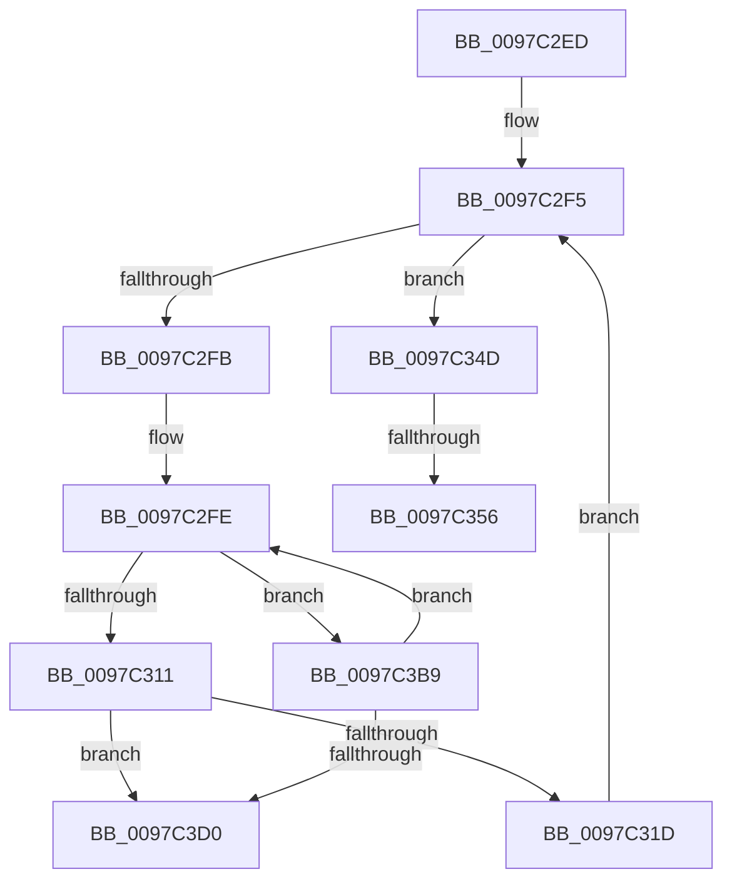

# sub_0097C2ED

- RVA: `0x0097C2ED`–`0x0097C3DE` (길이 `241` bytes)
- VA: `0x000000014097C2ED`
- 실행 섹션: `PAGE`
- PDB 이름 있음: `아니요`; PDB Function 태그: `아니요`
- unwind 정보 RVA: `0x00096E84`
- 디코드: `59`개 명령, `241/241` bytes 표시
- 미해석 바이트: `0` (있으면 어셈블리에 `.byte`로 보존)

> 이 문서는 커널 이미지의 기계어와 PDB 기호를 분석해 생성했습니다. 4번과 5번은 함수 원형과 자료형을 바이너리 사용 방식에서 추정한 C 해석이며 원본 소스 복구 결과는 아닙니다.

## 1. Dependencies

- 직접 호출 지점: **3**; 고유 호출 대상: **3**
- 직접 호출자로 확인된 함수: **0**
- RIP 상대 이미지 참조: **1**

### Outgoing calls
- `0x0097C3A5` → [PfpCopyEvent](PfpCopyEvent_function_0097BE5C.md) (function, `0x0097BE5C`)
- `0x0097C3AF` → [MmFreeAccessPfnBuffer](../../text/47/MmFreeAccessPfnBuffer_function_004751BC.md) (function, `0x004751BC`)
- `0x0097C3C0` → [PfTReplaceCurrentBuffer](PfTReplaceCurrentBuffer_function_0097CB14.md) (function, `0x0097CB14`)

### Direct callers
- 이 함수 시작 RVA로 연결되는 직접 call은 확인되지 않았습니다. 간접 호출은 완전히 역산할 수 없습니다.

### Static image references
- `0x0097C396` → RVA `0x00E670CC` (`.data`; read)

## 2. Other-region calls and transfers

- 다른 실행 섹션으로 향하는 call: **1**
  - `0x0097C3AF` → [MmFreeAccessPfnBuffer](../../text/47/MmFreeAccessPfnBuffer_function_004751BC.md) (`PAGE` → `.text`)
- call이 아닌 외부 분기/꼬리 이동: **3**
  - `0x0097C350` → [sub_0097C0F8 + 0x194](Unknown_function_0097C0F8.md) (`tail-transfer`)
  - `0x0097C3B4` → [sub_0097C0F8 + 0x43](Unknown_function_0097C0F8.md) (`tail-transfer`)
  - `0x0097C3D9` → [sub_0097C0F8 + 0x194](Unknown_function_0097C0F8.md) (`tail-transfer`)

## 3. Assembly (complete function range)

```asm
0097C2ED  4D 8B 7D 20                     mov r15, qword ptr [r13 + 0x20]
0097C2F1  49 8D 75 20                     lea rsi, [r13 + 0x20]
0097C2F5  4D 3B 7D 28                     cmp r15, qword ptr [r13 + 0x28]
0097C2F9  77 52                           ja 0x14097c34d
0097C2FB  4D 8B 27                        mov r12, qword ptr [r15]
0097C2FE  49 8B 46 70                     mov rax, qword ptr [r14 + 0x70]
0097C302  8B 50 10                        mov edx, dword ptr [rax + 0x10]
0097C305  8D 4A 01                        lea ecx, [rdx + 1]
0097C308  3B 48 14                        cmp ecx, dword ptr [rax + 0x14]
0097C30B  0F 87 A8 00 00 00               ja 0x14097c3b9
0097C311  89 48 10                        mov dword ptr [rax + 0x10], ecx
0097C314  48 85 C0                        test rax, rax
0097C317  0F 84 B3 00 00 00               je 0x14097c3d0
0097C31D  48 83 C0 1F                     add rax, 0x1f
0097C321  8B CA                           mov ecx, edx
0097C323  48 83 E0 F8                     and rax, 0xfffffffffffffff8
0097C327  48 C1 E1 04                     shl rcx, 4
0097C32B  48 03 C8                        add rcx, rax
0097C32E  48 8B 01                        mov rax, qword ptr [rcx]
0097C331  48 25 07 60 FC FF               and rax, 0xfffffffffffc6007
0097C337  4C 89 61 08                     mov qword ptr [rcx + 8], r12
0097C33B  48 0D 07 60 00 00               or rax, 0x6007
0097C341  45 33 E4                        xor r12d, r12d
0097C344  48 89 01                        mov qword ptr [rcx], rax
0097C347  49 83 C7 08                     add r15, 8
0097C34B  EB A8                           jmp 0x14097c2f5
0097C34D  45 85 E4                        test r12d, r12d
0097C350  0F 88 36 FF FF FF               js 0x14097c28c
0097C356  49 8B 4D 18                     mov rcx, qword ptr [r13 + 0x18]
0097C35A  48 BD 04 00 00 00 80 F7 FF FF   movabs rbp, 0xfffff78000000004
0097C364  8B D1                           mov edx, ecx
0097C366  33 F6                           xor esi, esi
0097C368  48 C1 E9 20                     shr rcx, 0x20
0097C36C  89 74 24 64                     mov dword ptr [rsp + 0x64], esi
0097C370  8B 45 00                        mov eax, dword ptr [rbp]
0097C373  48 0F AF D0                     imul rdx, rax
0097C377  48 0F AF C8                     imul rcx, rax
0097C37B  48 C1 EA 18                     shr rdx, 0x18
0097C37F  48 C7 44 24 58 07 40 02 00      mov qword ptr [rsp + 0x58], 0x24007
0097C388  48 C1 E1 08                     shl rcx, 8
0097C38C  48 03 D1                        add rdx, rcx
0097C38F  49 8B CE                        mov rcx, r14
0097C392  48 C1 EA 0A                     shr rdx, 0xa
0097C396  03 15 30 AD 4E 00               add edx, dword ptr [rip + 0x4ead30]
0097C39C  89 54 24 60                     mov dword ptr [rsp + 0x60], edx
0097C3A0  48 8D 54 24 58                  lea rdx, [rsp + 0x58]
0097C3A5  E8 B2 FA FF FF                  call 0x14097be5c
0097C3AA  33 D2                           xor edx, edx
0097C3AC  49 8B CD                        mov rcx, r13
0097C3AF  E8 08 8E AF FF                  call 0x1404751bc
0097C3B4  E9 82 FD FF FF                  jmp 0x14097c13b
0097C3B9  49 8D 56 58                     lea rdx, [r14 + 0x58]
0097C3BD  49 8B CE                        mov rcx, r14
0097C3C0  E8 4F 07 00 00                  call 0x14097cb14
0097C3C5  3D 01 00 00 C0                  cmp eax, 0xc0000001
0097C3CA  0F 85 2E FF FF FF               jne 0x14097c2fe
0097C3D0  41 BC 9A 00 00 C0               mov r12d, 0xc000009a
0097C3D6  4C 89 3E                        mov qword ptr [rsi], r15
0097C3D9  E9 AE FE FF FF                  jmp 0x14097c28c
```

## 4. C-style interpretation (structured pseudocode)

```c
__int64 __fastcall sub_0097C2ED(__int64 a1, __int64 a2, __int64 a3, __int64 a4, __int64 a5, __int64 a6, __int64 a7, __int64 a8, __int64 a9, __int64 a10, __int64 a11)
{
    __int64 result;
    __int64 v_r12;
    __int64 v_r15;
    __int64 v_rsi;
    unsigned __int64 v_stack_p58;
    unsigned int v_stack_p60;
    unsigned int v_stack_p64;

loc_0097C2F5:
    if ((*(unsigned __int64 *)(v_r13 + 32)) > (*(unsigned __int64 *)(v_r13 + 40))) goto loc_0097C34D;
loc_0097C2FE:
    if (((unsigned int)((unsigned int)(*(unsigned int *)(*(unsigned __int64 *)(v_r14 + 112) + 16)) + 1)) > (*(unsigned int *)(*(unsigned __int64 *)(v_r14 + 112) + 20))) goto loc_0097C3B9;
    *(unsigned int *)(*(unsigned __int64 *)(v_r14 + 112) + 16) = (unsigned int)((unsigned int)(*(unsigned int *)(*(unsigned __int64 *)(v_r14 + 112) + 16)) + 1);
    if (*(unsigned __int64 *)(v_r14 + 112) == 0) goto loc_0097C3D0;
    result = (*(unsigned __int64 *)(v_r14 + 112)) + (31);
    result = (result) & (-8);
    a1 = ((unsigned int)((unsigned int)((unsigned int)(*(unsigned int *)(*(unsigned __int64 *)(v_r14 + 112) + 16))))) << (4);
    a1 = (a1) + (result);
    result = (*(unsigned __int64 *)(a1)) & (0xFFFFFFFFFFFC6007ULL);
    *(unsigned __int64 *)(a1 + 8) = *(unsigned __int64 *)(*(unsigned __int64 *)(v_r13 + 32));
    result = (result) | (0x6007ULL);
    v_r12 = 0;
    *(unsigned __int64 *)(a1) = result;
    v_r15 = (*(unsigned __int64 *)(v_r13 + 32)) + (8);
    goto loc_0097C2F5;
loc_0097C34D:
    v_rsi = 0;
    a1 = (*(unsigned __int64 *)(v_r13 + 24)) >> (32);
    v_stack_p64 = 0;
    a2 = ((unsigned int)((unsigned int)(*(unsigned __int64 *)(v_r13 + 24)))) * ((unsigned int)(*(unsigned int *)(v_rbp)));
    a1 = (a1) * ((unsigned int)(*(unsigned int *)(v_rbp)));
    a2 = (a2) >> (24);
    v_stack_p58 = 0x24007ULL;
    a1 = (a1) << (8);
    a2 = (a2) + (a1);
    a2 = (a2) >> (10);
    a2 = (unsigned int)((a2) + (*(unsigned int *)(v_rip + 5156144)));
    v_stack_p60 = (unsigned int)(a2);
    result = PfpCopyEvent(v_r14, a11, a3, a4);
    a2 = 0;
    result = MmFreeAccessPfnBuffer(v_r13, a2, a3, a4);
loc_0097C3B9:
    result = PfTReplaceCurrentBuffer(v_r14, v_r14 + 88, a3, a4);
    if (((unsigned int)(result)) != 0xC0000001ULL) goto loc_0097C2FE;
loc_0097C3D0:
    *(unsigned __int64 *)(v_rsi) = v_r15;
}
```

## 5. (Beta) C Style

```c
int64_t sub_0097C2ED(int64_t Arg1, int64_t Arg2, int64_t Arg3, int64_t Arg4, uint64_t Arg5, uint64_t Arg6, uint64_t Arg7, uint64_t Arg8, uint64_t Arg9, uint64_t Arg10, int64_t Arg11)
{
    int64_t result;
    int64_t local_r12;
    int64_t local_r15;
    int64_t local_rsi;
    uint64_t v_stack_p58;
    uint32_t v_stack_p60;
    uint32_t v_stack_p64;

loc_0097C2F5:
    if ((*(uint64_t *)(local_r13 + 0x20)) > (*(uint64_t *)(local_r13 + 0x28))) goto loc_0097C34D;
loc_0097C2FE:
    if (((uint32_t)((uint32_t)(*(uint32_t *)(*(uint64_t *)(local_r14 + 0x70) + 0x10)) + 1)) > (*(uint32_t *)(*(uint64_t *)(local_r14 + 0x70) + 0x14))) goto loc_0097C3B9;
    *(uint32_t *)(*(uint64_t *)(local_r14 + 0x70) + 0x10) = (uint32_t)((uint32_t)(*(uint32_t *)(*(uint64_t *)(local_r14 + 0x70) + 0x10)) + 1);
    if (*(uint64_t *)(local_r14 + 0x70) == 0) goto loc_0097C3D0;
    result = (*(uint64_t *)(local_r14 + 0x70)) + (31);
    result = (result) & (-8);
    Arg1 = ((uint32_t)((uint32_t)((uint32_t)(*(uint32_t *)(*(uint64_t *)(local_r14 + 0x70) + 0x10))))) << (4);
    Arg1 = (Arg1) + (result);
    result = (*(uint64_t *)(Arg1)) & (0xFFFFFFFFFFFC6007ULL);
    *(uint64_t *)(Arg1 + 0x8) = *(uint64_t *)(*(uint64_t *)(local_r13 + 0x20));
    result = (result) | (0x6007ULL);
    local_r12 = 0;
    *(uint64_t *)(Arg1) = result;
    local_r15 = (*(uint64_t *)(local_r13 + 0x20)) + (8);
    goto loc_0097C2F5;
loc_0097C34D:
    local_rsi = 0;
    Arg1 = (*(uint64_t *)(local_r13 + 0x18)) >> (32);
    v_stack_p64 = 0;
    Arg2 = ((uint32_t)((uint32_t)(*(uint64_t *)(local_r13 + 0x18)))) * ((uint32_t)(*(uint32_t *)(local_rbp)));
    Arg1 = (Arg1) * ((uint32_t)(*(uint32_t *)(local_rbp)));
    Arg2 = (Arg2) >> (24);
    v_stack_p58 = 0x24007ULL;
    Arg1 = (Arg1) << (8);
    Arg2 = (Arg2) + (Arg1);
    Arg2 = (Arg2) >> (10);
    Arg2 = (uint32_t)((Arg2) + (*(uint32_t *)(v_rip + 0x4EAD30)));
    v_stack_p60 = (uint32_t)(Arg2);
    result = PfpCopyEvent(local_r14, Arg11, Arg3, Arg4);
    Arg2 = 0;
    result = MmFreeAccessPfnBuffer(local_r13, Arg2, Arg3, Arg4);
loc_0097C3B9:
    result = PfTReplaceCurrentBuffer(local_r14, local_r14 + 88, Arg3, Arg4);
    if (((uint32_t)(result)) != 0xC0000001ULL) goto loc_0097C2FE;
loc_0097C3D0:
    *(uint64_t *)(local_rsi) = local_r15;
}
```

## 6. Execution-region graph

[열기: 2D/3D 그래프와 함수 탐색 컨트롤 패널](../../../control-panel.html?section=page&rva=0x0097C2ED&view=graph)

- 2D 그래프는 위에서 아래로 흐르고, 3D 그래프는 빈 공간을 드래그해 회전합니다. Shift+드래그는 이동, 휠은 확대·축소, 함수 노드 선택은 대상 보고서 이동입니다.

### Static fallback


