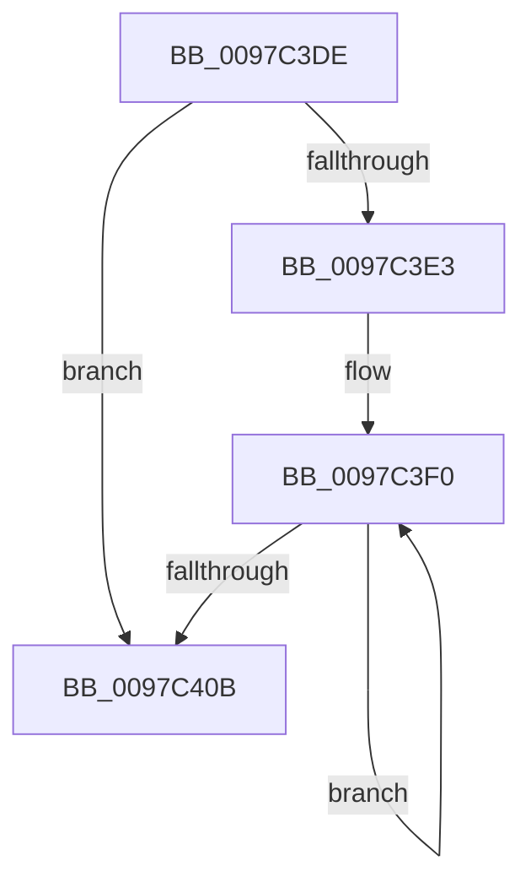

# sub_0097C3DE

- RVA: `0x0097C3DE`–`0x0097C412` (길이 `52` bytes)
- VA: `0x000000014097C3DE`
- 실행 섹션: `PAGE`
- PDB 이름 있음: `아니요`; PDB Function 태그: `아니요`
- unwind 정보 RVA: `0x00096E9C`
- 디코드: `14`개 명령, `52/52` bytes 표시
- 미해석 바이트: `0` (있으면 어셈블리에 `.byte`로 보존)

> 이 문서는 커널 이미지의 기계어와 PDB 기호를 분석해 생성했습니다. 4번과 5번은 함수 원형과 자료형을 바이너리 사용 방식에서 추정한 C 해석이며 원본 소스 복구 결과는 아닙니다.

## 1. Dependencies

- 직접 호출 지점: **2**; 고유 호출 대상: **2**
- 직접 호출자로 확인된 함수: **0**
- RIP 상대 이미지 참조: **0**

### Outgoing calls
- `0x0097C3F9` → [CsanRead64NoCheck](../../text/4C/CsanRead64NoCheck_function_004C82C0.md) (function, `0x004C82C0`)
- `0x0097C401` → [PfpReturnAccessBuffer](../../text/48/PfpReturnAccessBuffer_function_00488A80.md) (function, `0x00488A80`)

### Direct callers
- 이 함수 시작 RVA로 연결되는 직접 call은 확인되지 않았습니다. 간접 호출은 완전히 역산할 수 없습니다.

### Static image references
- 디코드된 RIP-relative 메모리 참조가 없습니다.

## 2. Other-region calls and transfers

- 다른 실행 섹션으로 향하는 call: **2**
  - `0x0097C3F9` → [CsanRead64NoCheck](../../text/4C/CsanRead64NoCheck_function_004C82C0.md) (`PAGE` → `.text`)
  - `0x0097C401` → [PfpReturnAccessBuffer](../../text/48/PfpReturnAccessBuffer_function_00488A80.md) (`PAGE` → `.text`)
- call이 아닌 외부 분기/꼬리 이동: **1**
  - `0x0097C40D` → [sub_0097C2C3 + 0x2](Unknown_function_0097C2C3.md) (`tail-transfer`)

## 3. Assembly (complete function range)

```asm
0097C3DE  48 85 DB                        test rbx, rbx
0097C3E1  74 28                           je 0x14097c40b
0097C3E3  0F 1F 40 00                     nop dword ptr [rax]
0097C3E7  66 0F 1F 84 00 00 00 00 00      nop word ptr [rax + rax]
0097C3F0  48 8B D3                        mov rdx, rbx
0097C3F3  49 8B CE                        mov rcx, r14
0097C3F6  48 8B 1B                        mov rbx, qword ptr [rbx]
0097C3F9  E8 C2 BE B4 FF                  call 0x1404c82c0
0097C3FE  48 8B C8                        mov rcx, rax
0097C401  E8 7A C6 B0 FF                  call 0x140488a80
0097C406  48 85 DB                        test rbx, rbx
0097C409  75 E5                           jne 0x14097c3f0
0097C40B  32 C0                           xor al, al
0097C40D  E9 B3 FE FF FF                  jmp 0x14097c2c5
```

## 4. C-style interpretation (structured pseudocode)

```c
__int64 __fastcall sub_0097C3DE(void)
{
    __int64 result;

    if (v_rbx == 0) goto loc_0097C40B;
loc_0097C3F0:
    result = CsanRead64NoCheck(v_r14, v_rbx, a3, a4);
    result = PfpReturnAccessBuffer(result, v_rbx, a3, a4);
    if (*(unsigned __int64 *)(v_rbx) != 0) goto loc_0097C3F0;
loc_0097C40B:
    result = 0;
}
```

## 5. (Beta) C Style

```c
void sub_0097C3DE(void)
{
    int64_t result;

    if (local_rbx == 0) goto loc_0097C40B;
loc_0097C3F0:
    result = CsanRead64NoCheck(local_r14, local_rbx, a3, a4);
    result = PfpReturnAccessBuffer(result, local_rbx, a3, a4);
    if (*(uint64_t *)(local_rbx) != 0) goto loc_0097C3F0;
loc_0097C40B:
    result = 0;
}
```

## 6. Execution-region graph

[열기: 2D/3D 그래프와 함수 탐색 컨트롤 패널](../../../control-panel.html?section=page&rva=0x0097C3DE&view=graph)

- 2D 그래프는 위에서 아래로 흐르고, 3D 그래프는 빈 공간을 드래그해 회전합니다. Shift+드래그는 이동, 휠은 확대·축소, 함수 노드 선택은 대상 보고서 이동입니다.

### Static fallback


