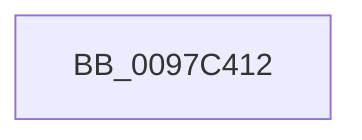

# sub_0097C412

- RVA: `0x0097C412`–`0x0097C441` (길이 `47` bytes)
- VA: `0x000000014097C412`
- 실행 섹션: `PAGE`
- PDB 이름 있음: `아니요`; PDB Function 태그: `아니요`
- unwind 정보 RVA: `0x00096EAC`
- 디코드: `12`개 명령, `47/47` bytes 표시
- 미해석 바이트: `0` (있으면 어셈블리에 `.byte`로 보존)

> 이 문서는 커널 이미지의 기계어와 PDB 기호를 분석해 생성했습니다. 4번과 5번은 함수 원형과 자료형을 바이너리 사용 방식에서 추정한 C 해석이며 원본 소스 복구 결과는 아닙니다.

## 1. Dependencies

- 직접 호출 지점: **1**; 고유 호출 대상: **1**
- 직접 호출자로 확인된 함수: **0**
- RIP 상대 이미지 참조: **0**

### Outgoing calls
- `0x0097C424` → [memcpy](../../text/6C/memcpy_function_006C6840.md) (function, `0x006C6840`)

### Direct callers
- 이 함수 시작 RVA로 연결되는 직접 call은 확인되지 않았습니다. 간접 호출은 완전히 역산할 수 없습니다.

### Static image references
- 디코드된 RIP-relative 메모리 참조가 없습니다.

## 2. Other-region calls and transfers

- 다른 실행 섹션으로 향하는 call: **1**
  - `0x0097C424` → [memcpy](../../text/6C/memcpy_function_006C6840.md) (`PAGE` → `.text`)
- call이 아닌 외부 분기/꼬리 이동: **1**
  - `0x0097C43C` → [sub_0097C0F8 + 0x19F](Unknown_function_0097C0F8.md) (`tail-transfer`)

## 3. Assembly (complete function range)

```asm
0097C412  4C 8B 06                        mov r8, qword ptr [rsi]
0097C415  48 8B D7                        mov rdx, rdi
0097C418  48 8B 4C 24 30                  mov rcx, qword ptr [rsp + 0x30]
0097C41D  4C 2B C7                        sub r8, rdi
0097C420  49 83 E0 F8                     and r8, 0xfffffffffffffff8
0097C424  E8 17 A4 D4 FF                  call 0x1406c6840
0097C429  48 2B 7C 24 30                  sub rdi, qword ptr [rsp + 0x30]
0097C42E  48 C1 FF 03                     sar rdi, 3
0097C432  48 F7 DF                        neg rdi
0097C435  48 C1 E7 03                     shl rdi, 3
0097C439  48 01 3E                        add qword ptr [rsi], rdi
0097C43C  E9 56 FE FF FF                  jmp 0x14097c297
```

## 4. C-style interpretation (structured pseudocode)

```c
__int64 __fastcall sub_0097C412(__int64 a1, __int64 a2, __int64 a3, __int64 a4, __int64 a5, __int64 a6)
{
    __int64 result;
    __int64 v_rdi;

    a3 = (*(unsigned __int64 *)(v_rsi)) - (v_rdi);
    a3 = (a3) & (-8);
    result = memcpy(a6, v_rdi, a3, a4);
    v_rdi = (v_rdi) - (a6);
    v_rdi = (v_rdi) >> (3);
    v_rdi = -(v_rdi);
    v_rdi = (v_rdi) << (3);
}
```

## 5. (Beta) C Style

```c
int64_t sub_0097C412(int64_t Arg1, int64_t Arg2, int64_t Arg3, int64_t Arg4, uint64_t Arg5, int64_t Arg6)
{
    int64_t result;
    int64_t local_rdi;

    Arg3 = (*(uint64_t *)(local_rsi)) - (local_rdi);
    Arg3 = (Arg3) & (-8);
    result = memcpy(Arg6, local_rdi, Arg3, Arg4);
    local_rdi = (local_rdi) - (Arg6);
    local_rdi = (local_rdi) >> (3);
    local_rdi = -(local_rdi);
    local_rdi = (local_rdi) << (3);
}
```

## 6. Execution-region graph

[열기: 2D/3D 그래프와 함수 탐색 컨트롤 패널](../../../control-panel.html?section=page&rva=0x0097C412&view=graph)

- 2D 그래프는 위에서 아래로 흐르고, 3D 그래프는 빈 공간을 드래그해 회전합니다. Shift+드래그는 이동, 휠은 확대·축소, 함수 노드 선택은 대상 보고서 이동입니다.

### Static fallback


