# sub_0097CDB6

- RVA: `0x0097CDB6`–`0x0097D0AD` (길이 `759` bytes)
- VA: `0x000000014097CDB6`
- 실행 섹션: `PAGE`
- PDB 이름 있음: `아니요`; PDB Function 태그: `아니요`
- unwind 정보 RVA: `0x00096EFC`
- 디코드: `175`개 명령, `759/759` bytes 표시
- 미해석 바이트: `0` (있으면 어셈블리에 `.byte`로 보존)

> 이 문서는 커널 이미지의 기계어와 PDB 기호를 분석해 생성했습니다. 4번과 5번은 함수 원형과 자료형을 바이너리 사용 방식에서 추정한 C 해석이며 원본 소스 복구 결과는 아닙니다.

## 1. Dependencies

- 직접 호출 지점: **1**; 고유 호출 대상: **1**
- 직접 호출자로 확인된 함수: **0**
- RIP 상대 이미지 참조: **1**

### Outgoing calls
- `0x0097D082` → [ExFreePoolWithTag](../../poolcode/B8/ExFreePoolWithTag_function_00B82870.md) (function, `0x00B82870`)

### Direct callers
- 이 함수 시작 RVA로 연결되는 직접 call은 확인되지 않았습니다. 간접 호출은 완전히 역산할 수 없습니다.

### Static image references
- `0x0097CDFC` → RVA `0x00013E90` (`.rdata`; read)

## 2. Other-region calls and transfers

- 다른 실행 섹션으로 향하는 call: **1**
  - `0x0097D082` → [ExFreePoolWithTag](../../poolcode/B8/ExFreePoolWithTag_function_00B82870.md) (`PAGE` → `POOLCODE`)
- call이 아닌 외부 분기/꼬리 이동: **17**
  - `0x0097CE13` → [sub_0097D1E2 + 0x169](Unknown_function_0097D1E2.md) (`tail-transfer`)
  - `0x0097CE23` → [sub_0097D3A5 + 0x50](Unknown_function_0097D3A5.md) (`tail-transfer`)
  - `0x0097CE2B` → [sub_0097D3A5 + 0x74](Unknown_function_0097D3A5.md) (`tail-transfer`)
  - `0x0097CE39` → [sub_0097D3A5 + 0x74](Unknown_function_0097D3A5.md) (`tail-transfer`)
  - `0x0097CEB0` → [sub_0097D1E2 + 0x126](Unknown_function_0097D1E2.md) (`tail-transfer`)
  - `0x0097CEE2` → [sub_0097D3A5 + 0x93](Unknown_function_0097D3A5.md) (`tail-transfer`)
  - `0x0097CF32` → [sub_0097D0CC + 0x45](Unknown_function_0097D0CC.md) (`tail-transfer`)
  - `0x0097CF4D` → [sub_0097D1E2 + 0xD0](Unknown_function_0097D1E2.md) (`tail-transfer`)
  - `0x0097CF58` → [sub_0097D0CC + 0xC8](Unknown_function_0097D0CC.md) (`tail-transfer`)
  - `0x0097CF6C` → [sub_0097D1E2 + 0x11](Unknown_function_0097D1E2.md) (`tail-transfer`)
  - `0x0097CF7E` → [sub_0097D1E2 + 0x53](Unknown_function_0097D1E2.md) (`tail-transfer`)
  - `0x0097CF92` → [sub_0097D0CC + 0x4F](Unknown_function_0097D0CC.md) (`tail-transfer`)
  - `0x0097CFA6` → [sub_0097D0CC](Unknown_function_0097D0CC.md) (`tail-transfer`)
  - `0x0097CFB0` → [sub_0097D0CC + 0xB2](Unknown_function_0097D0CC.md) (`tail-transfer`)
  - `0x0097CFBB` → [sub_0097D0CC + 0x3F](Unknown_function_0097D0CC.md) (`tail-transfer`)
  - `0x0097CFC5` → [sub_0097D0CC + 0x36](Unknown_function_0097D0CC.md) (`tail-transfer`)
  - `0x0097D05B` → [sub_0097D1E2](Unknown_function_0097D1E2.md) (`tail-transfer`)

## 3. Assembly (complete function range)

```asm
0097CDB6  48 89 AC 24 E8 00 00 00         mov qword ptr [rsp + 0xe8], rbp
0097CDBE  48 89 BC 24 F0 00 00 00         mov qword ptr [rsp + 0xf0], rdi
0097CDC6  4C 89 AC 24 F8 00 00 00         mov qword ptr [rsp + 0xf8], r13
0097CDCE  80 38 2A                        cmp byte ptr [rax], 0x2a
0097CDD1  4C 89 B4 24 B0 00 00 00         mov qword ptr [rsp + 0xb0], r14
0097CDD9  75 69                           jne 0x14097ce44
0097CDDB  41 0F 10 04 24                  movups xmm0, xmmword ptr [r12]
0097CDE0  4C 8D 48 01                     lea r9, [rax + 1]
0097CDE4  41 8B D7                        mov edx, r15d
0097CDE7  B8 FF FF 00 00                  mov eax, 0xffff
0097CDEC  4C 89 4C 24 30                  mov qword ptr [rsp + 0x30], r9
0097CDF1  0F 11 44 24 50                  movups xmmword ptr [rsp + 0x50], xmm0
0097CDF6  44 0F B7 5C 24 50               movzx r11d, word ptr [rsp + 0x50]
0097CDFC  48 8D 3D 8D 70 69 FF            lea rdi, [rip - 0x968f73]
0097CE03  66 44 03 D8                     add r11w, ax
0097CE07  45 0F B7 C3                     movzx r8d, r11w
0097CE0B  0F 1F 44 00 00                  nop dword ptr [rax + rax]
0097CE10  41 3B D0                        cmp edx, r8d
0097CE13  0F 83 32 05 00 00               jae 0x14097d34b
0097CE19  8B C2                           mov eax, edx
0097CE1B  42 0F B6 0C 08                  movzx ecx, byte ptr [rax + r9]
0097CE20  80 F9 80                        cmp cl, 0x80
0097CE23  0F 83 CC 05 00 00               jae 0x14097d3f5
0097CE29  84 C9                           test cl, cl
0097CE2B  0F 88 E8 05 00 00               js 0x14097d419
0097CE31  48 0F BE C1                     movsx rax, cl
0097CE35  F6 04 38 08                     test byte ptr [rax + rdi], 8
0097CE39  0F 84 DA 05 00 00               je 0x14097d419
0097CE3F  4C 8B 44 24 40                  mov r8, qword ptr [rsp + 0x40]
0097CE44  41 0F B7 2C 24                  movzx ebp, word ptr [r12]
0097CE49  4C 8D 9C 24 80 00 00 00         lea r11, [rsp + 0x80]
0097CE51  41 B9 01 00 00 00               mov r9d, 1
0097CE57  4C 89 5C 24 30                  mov qword ptr [rsp + 0x30], r11
0097CE5C  66 03 ED                        add bp, bp
0097CE5F  66 44 89 7C 24 60               mov word ptr [rsp + 0x60], r15w
0097CE65  66 89 6C 24 22                  mov word ptr [rsp + 0x22], bp
0097CE6A  48 8D 54 24 60                  lea rdx, [rsp + 0x60]
0097CE6F  45 8B F1                        mov r14d, r9d
0097CE72  44 89 4C 24 38                  mov dword ptr [rsp + 0x38], r9d
0097CE77  45 0F B7 D7                     movzx r10d, r15w
0097CE7B  66 44 89 7C 24 24               mov word ptr [rsp + 0x24], r15w
0097CE81  48 89 54 24 50                  mov qword ptr [rsp + 0x50], rdx
0097CE86  BE 00 01 00 00                  mov esi, 0x100
0097CE8B  BF 02 00 00 00                  mov edi, 2
0097CE90  84 DB                           test bl, bl
0097CE92  0F 85 D3 01 00 00               jne 0x14097d06b
0097CE98  66 45 3B 10                     cmp r10w, word ptr [r8]
0097CE9C  73 51                           jae 0x14097ceef
0097CE9E  4D 8B 40 08                     mov r8, qword ptr [r8 + 8]
0097CEA2  41 0F B7 CA                     movzx ecx, r10w
0097CEA6  4C 03 C1                        add r8, rcx
0097CEA9  41 0F BE 10                     movsx edx, byte ptr [r8]
0097CEAD  80 FA 80                        cmp dl, 0x80
0097CEB0  0F 83 52 04 00 00               jae 0x14097d308
0097CEB6  0F B7 F2                        movzx esi, dx
0097CEB9  41 8B C1                        mov eax, r9d
0097CEBC  89 74 24 28                     mov dword ptr [rsp + 0x28], esi
0097CEC0  48 8B 54 24 50                  mov rdx, qword ptr [rsp + 0x50]
0097CEC5  66 44 03 D0                     add r10w, ax
0097CEC9  66 44 89 54 24 24               mov word ptr [rsp + 0x24], r10w
0097CECF  45 8B EF                        mov r13d, r15d
0097CED2  41 8B FF                        mov edi, r15d
0097CED5  45 85 F6                        test r14d, r14d
0097CED8  75 36                           jne 0x14097cf10
0097CEDA  48 8B 44 24 48                  mov rax, qword ptr [rsp + 0x48]
0097CEDF  48 85 C0                        test rax, rax
0097CEE2  0F 85 50 05 00 00               jne 0x14097d438
0097CEE8  32 C0                           xor al, al
0097CEEA  E9 9E 01 00 00                  jmp 0x14097d08d
0097CEEF  41 8D 4E FF                     lea ecx, [r14 - 1]
0097CEF3  C6 44 24 20 01                  mov byte ptr [rsp + 0x20], 1
0097CEF8  66 39 2C 4A                     cmp word ptr [rdx + rcx*2], bp
0097CEFC  75 D1                           jne 0x14097cecf
0097CEFE  E9 6C 01 00 00                  jmp 0x14097d06f
0097CF03  0F 1F 40 00                     nop dword ptr [rax]
0097CF07  66 0F 1F 84 00 00 00 00 00      nop word ptr [rax + rax]
0097CF10  41 8B C5                        mov eax, r13d
0097CF13  41 FF C5                        inc r13d
0097CF16  0F B7 1C 42                     movzx ebx, word ptr [rdx + rax*2]
0097CF1A  FF C3                           inc ebx
0097CF1C  D1 EB                           shr ebx, 1
0097CF1E  45 33 DB                        xor r11d, r11d
0097CF21  41 0F B7 F3                     movzx esi, r11w
0097CF25  4C 8B 5C 24 30                  mov r11, qword ptr [rsp + 0x30]
0097CF2A  41 0F B7 04 24                  movzx eax, word ptr [r12]
0097CF2F  66 3B D8                        cmp bx, ax
0097CF32  0F 84 D9 01 00 00               je 0x14097d111
0097CF38  66 03 F3                        add si, bx
0097CF3B  0F B7 DE                        movzx ebx, si
0097CF3E  44 0F B7 F3                     movzx r14d, bx
0097CF42  44 0F B7 D6                     movzx r10d, si
0097CF46  66 45 03 F6                     add r14w, r14w
0097CF4A  66 3B D8                        cmp bx, ax
0097CF4D  0F 84 5F 03 00 00               je 0x14097d2b2
0097CF53  8D 48 FF                        lea ecx, [rax - 1]
0097CF56  3B D9                           cmp ebx, ecx
0097CF58  0F 84 36 02 00 00               je 0x14097d194
0097CF5E  4D 8B 4C 24 08                  mov r9, qword ptr [r12 + 8]
0097CF63  46 0F BE 04 0B                  movsx r8d, byte ptr [rbx + r9]
0097CF68  41 80 F8 80                     cmp r8b, 0x80
0097CF6C  0F 83 81 02 00 00               jae 0x14097d1f3
0097CF72  BE 01 00 00 00                  mov esi, 1
0097CF77  41 0F B7 E8                     movzx ebp, r8w
0097CF7B  83 FF 0E                        cmp edi, 0xe
0097CF7E  0F 83 B1 02 00 00               jae 0x14097d235
0097CF84  66 83 FD 2A                     cmp bp, 0x2a
0097CF88  0F 84 98 00 00 00               je 0x14097d026
0097CF8E  66 83 FD 3C                     cmp bp, 0x3c
0097CF92  0F 84 83 01 00 00               je 0x14097d11b
0097CF98  0F B7 C6                        movzx eax, si
0097CF9B  66 03 C0                        add ax, ax
0097CF9E  66 44 03 F0                     add r14w, ax
0097CFA2  66 83 FD 3E                     cmp bp, 0x3e
0097CFA6  0F 84 20 01 00 00               je 0x14097d0cc
0097CFAC  66 83 FD 22                     cmp bp, 0x22
0097CFB0  0F 84 C8 01 00 00               je 0x14097d17e
0097CFB6  80 7C 24 20 00                  cmp byte ptr [rsp + 0x20], 0
0097CFBB  0F 85 4A 01 00 00               jne 0x14097d10b
0097CFC1  66 83 FD 3F                     cmp bp, 0x3f
0097CFC5  0F 84 37 01 00 00               je 0x14097d102
0097CFCB  8B 44 24 28                     mov eax, dword ptr [rsp + 0x28]
0097CFCF  66 3B E8                        cmp bp, ax
0097CFD2  41 B9 01 00 00 00               mov r9d, 1
0097CFD8  0F B7 6C 24 22                  movzx ebp, word ptr [rsp + 0x22]
0097CFDD  75 09                           jne 0x14097cfe8
0097CFDF  8B C7                           mov eax, edi
0097CFE1  FF C7                           inc edi
0097CFE3  66 45 89 34 43                  mov word ptr [r11 + rax*2], r14w
0097CFE8  44 8B 74 24 38                  mov r14d, dword ptr [rsp + 0x38]
0097CFED  48 8B 54 24 50                  mov rdx, qword ptr [rsp + 0x50]
0097CFF2  45 3B EE                        cmp r13d, r14d
0097CFF5  72 4E                           jb 0x14097d045
0097CFF7  85 FF                           test edi, edi
0097CFF9  0F 84 DB FE FF FF               je 0x14097ceda
0097CFFF  44 0F B7 54 24 24               movzx r10d, word ptr [rsp + 0x24]
0097D005  44 8B F7                        mov r14d, edi
0097D008  4C 8B 44 24 40                  mov r8, qword ptr [rsp + 0x40]
0097D00D  45 33 FF                        xor r15d, r15d
0097D010  0F B6 5C 24 20                  movzx ebx, byte ptr [rsp + 0x20]
0097D015  48 89 54 24 30                  mov qword ptr [rsp + 0x30], rdx
0097D01A  49 8B D3                        mov rdx, r11
0097D01D  89 7C 24 38                     mov dword ptr [rsp + 0x38], edi
0097D021  E9 5B FE FF FF                  jmp 0x14097ce81
0097D026  8B C7                           mov eax, edi
0097D028  41 B9 01 00 00 00               mov r9d, 1
0097D02E  FF C7                           inc edi
0097D030  66 45 89 34 43                  mov word ptr [r11 + rax*2], r14w
0097D035  66 41 FF C6                     inc r14w
0097D039  66 45 89 34 7B                  mov word ptr [r11 + rdi*2], r14w
0097D03E  FF C7                           inc edi
0097D040  E9 E5 FE FF FF                  jmp 0x14097cf2a
0097D045  44 3B FF                        cmp r15d, edi
0097D048  0F 83 C2 FE FF FF               jae 0x14097cf10
0097D04E  41 8B C7                        mov eax, r15d
0097D051  41 0F B7 0C 43                  movzx ecx, word ptr [r11 + rax*2]
0097D056  66 42 39 0C 6A                  cmp word ptr [rdx + r13*2], cx
0097D05B  0F 82 81 01 00 00               jb 0x14097d1e2
0097D061  41 FF C7                        inc r15d
0097D064  45 3B EE                        cmp r13d, r14d
0097D067  72 DC                           jb 0x14097d045
0097D069  EB 8C                           jmp 0x14097cff7
0097D06B  41 8D 4E FF                     lea ecx, [r14 - 1]
0097D06F  48 8B 74 24 48                  mov rsi, qword ptr [rsp + 0x48]
0097D074  0F B7 1C 4A                     movzx ebx, word ptr [rdx + rcx*2]
0097D078  48 85 F6                        test rsi, rsi
0097D07B  74 0A                           je 0x14097d087
0097D07D  33 D2                           xor edx, edx
0097D07F  48 8B CE                        mov rcx, rsi
0097D082  E8 E9 57 20 00                  call 0x140b82870
0097D087  66 3B DD                        cmp bx, bp
0097D08A  0F 94 C0                        sete al
0097D08D  4C 8B AC 24 F8 00 00 00         mov r13, qword ptr [rsp + 0xf8]
0097D095  48 8B BC 24 F0 00 00 00         mov rdi, qword ptr [rsp + 0xf0]
0097D09D  48 8B AC 24 E8 00 00 00         mov rbp, qword ptr [rsp + 0xe8]
0097D0A5  4C 8B B4 24 B0 00 00 00         mov r14, qword ptr [rsp + 0xb0]
```

## 4. C-style interpretation (structured pseudocode)

```c
__int64 __fastcall sub_0097CDB6(__int64 a1, __int64 a2, __int64 a3, __int64 a4, unsigned int a5, __int64 a6, unsigned int a7, __int64 a8, __int64 a9, unsigned __int16 a10, __int64 a11, __int64 a12, __int64 a13, __int64 a14, __int64 a15, __int64 a16, __int64 a17, __int64 a18, __int64 a19, __int64 a20, __int64 a21, __int64 a22, __int64 a23, __int64 a24, __int64 a25, __int64 a26, __int64 a27, __int64 a28, __int64 a29, __int64 a30, __int64 a31)
{
    __int64 result;
    __int64 v_r10;
    __int64 v_r11;
    __int64 v_r13;
    __int64 v_r14;
    __int64 v_r15;
    __int64 v_rbp;
    __int64 v_rbx;
    __int64 v_rdi;
    __int64 v_rsi;
    unsigned __int8 v_stack_p20;
    unsigned __int16 v_stack_p22;
    unsigned __int16 v_stack_p24;
    unsigned int v_stack_p28;
    unsigned __int64 v_stack_p30;
    unsigned int v_stack_p38;
    unsigned __int64 v_stack_p50;
    unsigned __int16 v_stack_p60;
    unsigned __int64 v_stack_pB0;
    unsigned __int64 v_stack_pE8;
    unsigned __int64 v_stack_pF0;
    unsigned __int64 v_stack_pF8;

    v_stack_pE8 = v_rbp;
    v_stack_pF0 = v_rdi;
    v_stack_pF8 = v_r13;
    v_stack_pB0 = v_r14;
    if ((*(unsigned __int8 *)(result)) != 42) goto loc_0097CE44;
    v_stack_p30 = result + 1;
    a10 = v_xmm0;
    v_r11 = (unsigned __int16)((a10) + ((unsigned __int16)((unsigned int)(0xFFFFULL))));
loc_0097CE44:
    v_stack_p30 = a16;
    v_rbp = (unsigned __int16)((*(unsigned __int16 *)(v_r12)) + ((unsigned __int16)(*(unsigned __int16 *)(v_r12))));
    v_stack_p60 = (unsigned __int16)(v_r15);
    v_stack_p22 = (unsigned __int16)(v_rbp);
    v_stack_p38 = 1;
    v_stack_p24 = (unsigned __int16)(v_r15);
loc_0097CE81:
    v_stack_p50 = a12;
    if ((unsigned __int8)(v_rbx) != 0) goto loc_0097D06B;
    if (((unsigned __int16)((unsigned __int16)(v_r15))) >= (*(unsigned __int16 *)(a8))) goto loc_0097CEEF;
    a3 = (*(unsigned __int64 *)(a8 + 8)) + ((unsigned __int16)((unsigned __int16)(v_r15)));
    v_stack_p28 = (unsigned int)((unsigned __int16)((__int8)(*(unsigned __int8 *)(a3))));
    v_r10 = (unsigned __int16)(((unsigned __int16)(v_r15)) + (1));
    v_stack_p24 = (unsigned __int16)(v_r10);
loc_0097CECF:
    if (1 != 0) goto loc_0097CF10;
loc_0097CEDA:
    result = 0;
    goto loc_0097D08D;
loc_0097CEEF:
    v_stack_p20 = 1;
    if ((*(unsigned __int16 *)(a10 + 1 - 1 * 2)) != ((unsigned __int16)(v_rbp))) goto loc_0097CECF;
    goto loc_0097D06F;
loc_0097CF10:
    v_r13 = (unsigned int)(((unsigned int)((unsigned int)(v_r15))) + 1);
    v_rbx = (unsigned int)((*(unsigned __int16 *)(a10 + (unsigned int)((unsigned int)((unsigned int)((unsigned int)(v_r15)))) * 2)) + 1);
    v_rbx = (unsigned int)((v_rbx) >> (1));
    v_r11 = 0;
loc_0097CF2A:
    v_rsi = (unsigned __int16)((0) + ((unsigned __int16)(v_rbx)));
    v_r14 = (unsigned __int16)(((unsigned __int16)((unsigned __int16)(v_rsi))) + ((unsigned __int16)((unsigned __int16)((unsigned __int16)(v_rsi)))));
    if (((unsigned __int16)((unsigned __int16)((__int8)(*(unsigned __int8 *)((unsigned __int16)(v_rsi) + *(unsigned __int64 *)(v_r12 + 8) * 1))))) == 42) goto loc_0097D026;
    result = (unsigned __int16)((1) + (1));
    v_r14 = (unsigned __int16)((v_r14) + ((unsigned __int16)(result)));
    result = (unsigned int)(a5);
    v_rdi = (unsigned int)((unsigned int)(v_r15));
    if (((unsigned __int16)((unsigned __int16)((__int8)(*(unsigned __int8 *)((unsigned __int16)(v_rsi) + *(unsigned __int64 *)(v_r12 + 8) * 1))))) == ((unsigned __int16)((unsigned int)(a5)))) {
        result = (unsigned int)((unsigned int)((unsigned int)(v_r15)));
        v_rdi = (unsigned int)(((unsigned int)((unsigned int)(v_r15))) + 1);
        *(unsigned __int16 *)(a6 + result * 2) = (unsigned __int16)(v_r14);
    }
    if (((unsigned int)(v_r13)) < ((unsigned int)((unsigned int)(a7)))) goto loc_0097D045;
loc_0097CFF7:
    if ((unsigned int)(v_rdi) == 0) goto loc_0097CEDA;
    v_r15 = 0;
    v_stack_p30 = a10;
    v_stack_p38 = (unsigned int)(v_rdi);
    goto loc_0097CE81;
loc_0097D026:
    v_rdi = (unsigned int)((v_rdi) + 1);
    *(unsigned __int16 *)(a6 + (unsigned int)((unsigned int)(v_rdi)) * 2) = (unsigned __int16)((unsigned int)((unsigned int)(v_rdi)));
    v_r14 = (unsigned __int16)(((unsigned int)((unsigned int)(v_rdi))) + 1);
    *(unsigned __int16 *)(a6 + v_rdi * 2) = (unsigned __int16)(v_r14);
    v_rdi = (unsigned int)((v_rdi) + 1);
    goto loc_0097CF2A;
loc_0097D045:
    if (0 >= ((unsigned int)(v_rdi))) goto loc_0097CF10;
    v_r15 = (unsigned int)((v_r15) + 1);
    if (((unsigned int)(v_r13)) < ((unsigned int)(v_r14))) goto loc_0097D045;
    goto loc_0097CFF7;
loc_0097D06B:
loc_0097D06F:
    result = 0;
    if (a9 != 0) {
        a2 = 0;
        a1 = a9;
        result = ExFreePoolWithTag(a1, a2, a8, 1);
    }
    result = (((unsigned __int16)(*(unsigned __int16 *)(a6 + v_r14 - 1 * 2))) == ((unsigned __int16)(v_stack_p22))) ? 1 : 0;
loc_0097D08D:
    return result;
}
```

## 5. (Beta) C Style

```c
int64_t sub_0097CDB6(int64_t Arg1, int64_t Arg2, int64_t Arg3, int64_t Arg4, uint32_t Arg5, void *Arg6, uint32_t Arg7, int64_t Arg8, int64_t Arg9, void *Arg10, uint64_t Arg11, int64_t Arg12, uint64_t Arg13, uint64_t Arg14, uint64_t Arg15, int64_t Arg16, uint64_t Arg17, uint64_t Arg18, uint64_t Arg19, uint64_t Arg20, uint64_t Arg21, int64_t Arg22, uint64_t Arg23, uint64_t Arg24, uint64_t Arg25, uint64_t Arg26, uint64_t Arg27, uint64_t Arg28, int64_t Arg29, int64_t Arg30, int64_t Arg31)
{
    uint8_t *arg6 = (uint8_t *)Arg6;
    uint8_t *arg10 = (uint8_t *)Arg10;

    int64_t result;
    int64_t local_r10;
    int64_t local_r11;
    int64_t local_r13;
    int64_t local_r14;
    int64_t local_r15;
    int64_t local_rbp;
    int64_t local_rbx;
    int64_t local_rdi;
    int64_t local_rsi;
    uint8_t v_stack_p20;
    uint16_t v_stack_p22;
    uint16_t v_stack_p24;
    uint32_t v_stack_p28;
    uint64_t v_stack_p30;
    uint32_t v_stack_p38;
    uint64_t v_stack_p50;
    uint16_t v_stack_p60;
    uint64_t v_stack_pB0;
    uint64_t v_stack_pE8;
    uint64_t v_stack_pF0;
    uint64_t v_stack_pF8;

    v_stack_pE8 = local_rbp;
    v_stack_pF0 = local_rdi;
    v_stack_pF8 = local_r13;
    v_stack_pB0 = local_r14;
    if ((*(uint8_t *)(result)) != 42) goto loc_0097CE44;
    v_stack_p30 = result + 1;
    Arg10 = v_xmm0;
    local_r11 = (uint16_t)((Arg10) + ((uint16_t)((uint32_t)(0xFFFFULL))));
loc_0097CE44:
    v_stack_p30 = Arg16;
    local_rbp = (uint16_t)((*(uint16_t *)(local_r12)) + ((uint16_t)(*(uint16_t *)(local_r12))));
    v_stack_p60 = (uint16_t)(local_r15);
    v_stack_p22 = (uint16_t)(local_rbp);
    v_stack_p38 = 1;
    v_stack_p24 = (uint16_t)(local_r15);
loc_0097CE81:
    v_stack_p50 = Arg12;
    if ((uint8_t)(local_rbx) != 0) goto loc_0097D06B;
    if (((uint16_t)((uint16_t)(local_r15))) >= (*(uint16_t *)(Arg8))) goto loc_0097CEEF;
    Arg3 = (*(uint64_t *)(Arg8 + 0x8)) + ((uint16_t)((uint16_t)(local_r15)));
    v_stack_p28 = (uint32_t)((uint16_t)((int8_t)(*(uint8_t *)(Arg3))));
    local_r10 = (uint16_t)(((uint16_t)(local_r15)) + (1));
    v_stack_p24 = (uint16_t)(local_r10);
loc_0097CECF:
    if (1 != 0) goto loc_0097CF10;
loc_0097CEDA:
    result = 0;
    goto loc_0097D08D;
loc_0097CEEF:
    v_stack_p20 = 1;
    if ((*(uint16_t *)(arg10 + 0x1 - 0x1 * 2)) != ((uint16_t)(local_rbp))) goto loc_0097CECF;
    goto loc_0097D06F;
loc_0097CF10:
    local_r13 = (uint32_t)(((uint32_t)((uint32_t)(local_r15))) + 1);
    local_rbx = (uint32_t)((*(uint16_t *)(arg10 + (uint32_t)((uint32_t)((uint32_t)((uint32_t)(local_r15)))) * 2)) + 1);
    local_rbx = (uint32_t)((local_rbx) >> (1));
    local_r11 = 0;
loc_0097CF2A:
    local_rsi = (uint16_t)((0) + ((uint16_t)(local_rbx)));
    local_r14 = (uint16_t)(((uint16_t)((uint16_t)(local_rsi))) + ((uint16_t)((uint16_t)((uint16_t)(local_rsi)))));
    if (((uint16_t)((uint16_t)((int8_t)(*(uint8_t *)((uint16_t)(local_rsi) + *(uint64_t *)(local_r12 + 0x8) * 1))))) == 42) goto loc_0097D026;
    result = (uint16_t)((1) + (1));
    local_r14 = (uint16_t)((local_r14) + ((uint16_t)(result)));
    result = (uint32_t)(Arg5);
    local_rdi = (uint32_t)((uint32_t)(local_r15));
    if (((uint16_t)((uint16_t)((int8_t)(*(uint8_t *)((uint16_t)(local_rsi) + *(uint64_t *)(local_r12 + 0x8) * 1))))) == ((uint16_t)((uint32_t)(Arg5)))) {
        result = (uint32_t)((uint32_t)((uint32_t)(local_r15)));
        local_rdi = (uint32_t)(((uint32_t)((uint32_t)(local_r15))) + 1);
        *(uint16_t *)(arg6 + result * 2) = (uint16_t)(local_r14);
    }
    if (((uint32_t)(local_r13)) < ((uint32_t)((uint32_t)(Arg7)))) goto loc_0097D045;
loc_0097CFF7:
    if ((uint32_t)(local_rdi) == 0) goto loc_0097CEDA;
    local_r15 = 0;
    v_stack_p30 = Arg10;
    v_stack_p38 = (uint32_t)(local_rdi);
    goto loc_0097CE81;
loc_0097D026:
    local_rdi = (uint32_t)((local_rdi) + 1);
    *(uint16_t *)(arg6 + (uint32_t)((uint32_t)(local_rdi)) * 2) = (uint16_t)((uint32_t)((uint32_t)(local_rdi)));
    local_r14 = (uint16_t)(((uint32_t)((uint32_t)(local_rdi))) + 1);
    *(uint16_t *)(arg6 + local_rdi * 2) = (uint16_t)(local_r14);
    local_rdi = (uint32_t)((local_rdi) + 1);
    goto loc_0097CF2A;
loc_0097D045:
    if (0 >= ((uint32_t)(local_rdi))) goto loc_0097CF10;
    local_r15 = (uint32_t)((local_r15) + 1);
    if (((uint32_t)(local_r13)) < ((uint32_t)(local_r14))) goto loc_0097D045;
    goto loc_0097CFF7;
loc_0097D06B:
loc_0097D06F:
    result = 0;
    if (Arg9 != 0) {
        Arg2 = 0;
        Arg1 = Arg9;
        result = ExFreePoolWithTag(Arg1, Arg2, Arg8, 1);
    }
    result = (((uint16_t)(*(uint16_t *)(arg6 + local_r14 - 0x1 * 2))) == ((uint16_t)(v_stack_p22))) ? 1 : 0;
loc_0097D08D:
    return result;
}
```

### 관측된 메모리 오프셋

구조체 형식이 확인되지 않은 접근은 인자 기준의 오프셋으로만 기록했습니다.

| 기준 인자 | 오프셋 표현 | 폭 (bit) | 접근 |
|---|---:|---:|---|
| `Arg6` | `+ 0x0 + rax*2` | `16` | `R` |
| `Arg6` | `+ 0x0 + rax*2` | `16` | `W` |
| `Arg6` | `+ 0x0 + rdi*2` | `16` | `W` |
| `Arg10` | `+ 0x0 + r13*2` | `16` | `R` |

## 6. Execution-region graph

[열기: 2D/3D 그래프와 함수 탐색 컨트롤 패널](../../../control-panel.html?section=page&rva=0x0097CDB6&view=graph)

- 2D 그래프는 위에서 아래로 흐르고, 3D 그래프는 빈 공간을 드래그해 회전합니다. Shift+드래그는 이동, 휠은 확대·축소, 함수 노드 선택은 대상 보고서 이동입니다.

### Static fallback

```mermaid
flowchart TD
  bb_0097CDB6[BB_0097CDB6]
  bb_0097CDDB[BB_0097CDDB]
  bb_0097CE19[BB_0097CE19]
  bb_0097CE29[BB_0097CE29]
  bb_0097CE31[BB_0097CE31]
  bb_0097CE3F[BB_0097CE3F]
  bb_0097CE44[BB_0097CE44]
  bb_0097CE81[BB_0097CE81]
  bb_0097CE98[BB_0097CE98]
  bb_0097CE9E[BB_0097CE9E]
  bb_0097CEB6[BB_0097CEB6]
  bb_0097CECF[BB_0097CECF]
  bb_0097CEDA[BB_0097CEDA]
  bb_0097CEE8[BB_0097CEE8]
  bb_0097CEEF[BB_0097CEEF]
  bb_0097CEFE[BB_0097CEFE]
  bb_0097CF03[BB_0097CF03]
  bb_0097CF10[BB_0097CF10]
  bb_0097CF2A[BB_0097CF2A]
  bb_0097CF38[BB_0097CF38]
  bb_0097CF53[BB_0097CF53]
  bb_0097CF5E[BB_0097CF5E]
  bb_0097CF72[BB_0097CF72]
  bb_0097CF84[BB_0097CF84]
  bb_0097CF8E[BB_0097CF8E]
  bb_0097CF98[BB_0097CF98]
  bb_0097CFAC[BB_0097CFAC]
  bb_0097CFB6[BB_0097CFB6]
  bb_0097CFC1[BB_0097CFC1]
  bb_0097CFCB[BB_0097CFCB]
  bb_0097CFDF[BB_0097CFDF]
  bb_0097CFE8[BB_0097CFE8]
  bb_0097CFF7[BB_0097CFF7]
  bb_0097CFFF[BB_0097CFFF]
  bb_0097D026[BB_0097D026]
  bb_0097D045[BB_0097D045]
  bb_0097D04E[BB_0097D04E]
  bb_0097D061[BB_0097D061]
  bb_0097D069[BB_0097D069]
  bb_0097D06B[BB_0097D06B]
  bb_0097D06F[BB_0097D06F]
  bb_0097D07D[BB_0097D07D]
  bb_0097D087[BB_0097D087]
  bb_0097D08D[BB_0097D08D]
  bb_0097CDB6 -->|branch| bb_0097CE44
  bb_0097CDB6 -->|fallthrough| bb_0097CDDB
  bb_0097CDDB -->|fallthrough| bb_0097CE19
  bb_0097CE19 -->|fallthrough| bb_0097CE29
  bb_0097CE29 -->|fallthrough| bb_0097CE31
  bb_0097CE31 -->|fallthrough| bb_0097CE3F
  bb_0097CE3F -->|flow| bb_0097CE44
  bb_0097CE44 -->|flow| bb_0097CE81
  bb_0097CE81 -->|branch| bb_0097D06B
  bb_0097CE81 -->|fallthrough| bb_0097CE98
  bb_0097CE98 -->|branch| bb_0097CEEF
  bb_0097CE98 -->|fallthrough| bb_0097CE9E
  bb_0097CE9E -->|fallthrough| bb_0097CEB6
  bb_0097CEB6 -->|flow| bb_0097CECF
  bb_0097CECF -->|branch| bb_0097CF10
  bb_0097CECF -->|fallthrough| bb_0097CEDA
  bb_0097CEDA -->|fallthrough| bb_0097CEE8
  bb_0097CEE8 -->|branch| bb_0097D08D
  bb_0097CEEF -->|branch| bb_0097CECF
  bb_0097CEEF -->|fallthrough| bb_0097CEFE
  bb_0097CEFE -->|branch| bb_0097D06F
  bb_0097CF03 -->|flow| bb_0097CF10
  bb_0097CF10 -->|flow| bb_0097CF2A
  bb_0097CF2A -->|fallthrough| bb_0097CF38
  bb_0097CF38 -->|fallthrough| bb_0097CF53
  bb_0097CF53 -->|fallthrough| bb_0097CF5E
  bb_0097CF5E -->|fallthrough| bb_0097CF72
  bb_0097CF72 -->|fallthrough| bb_0097CF84
  bb_0097CF84 -->|branch| bb_0097D026
  bb_0097CF84 -->|fallthrough| bb_0097CF8E
  bb_0097CF8E -->|fallthrough| bb_0097CF98
  bb_0097CF98 -->|fallthrough| bb_0097CFAC
  bb_0097CFAC -->|fallthrough| bb_0097CFB6
  bb_0097CFB6 -->|fallthrough| bb_0097CFC1
  bb_0097CFC1 -->|fallthrough| bb_0097CFCB
  bb_0097CFCB -->|branch| bb_0097CFE8
  bb_0097CFCB -->|fallthrough| bb_0097CFDF
  bb_0097CFDF -->|flow| bb_0097CFE8
  bb_0097CFE8 -->|branch| bb_0097D045
  bb_0097CFE8 -->|fallthrough| bb_0097CFF7
  bb_0097CFF7 -->|branch| bb_0097CEDA
  bb_0097CFF7 -->|fallthrough| bb_0097CFFF
  bb_0097CFFF -->|branch| bb_0097CE81
  bb_0097D026 -->|branch| bb_0097CF2A
  bb_0097D045 -->|branch| bb_0097CF10
  bb_0097D045 -->|fallthrough| bb_0097D04E
  bb_0097D04E -->|fallthrough| bb_0097D061
  bb_0097D061 -->|branch| bb_0097D045
  bb_0097D061 -->|fallthrough| bb_0097D069
  bb_0097D069 -->|branch| bb_0097CFF7
  bb_0097D06B -->|flow| bb_0097D06F
  bb_0097D06F -->|branch| bb_0097D087
  bb_0097D06F -->|fallthrough| bb_0097D07D
  bb_0097D07D -->|flow| bb_0097D087
  bb_0097D087 -->|flow| bb_0097D08D
```


