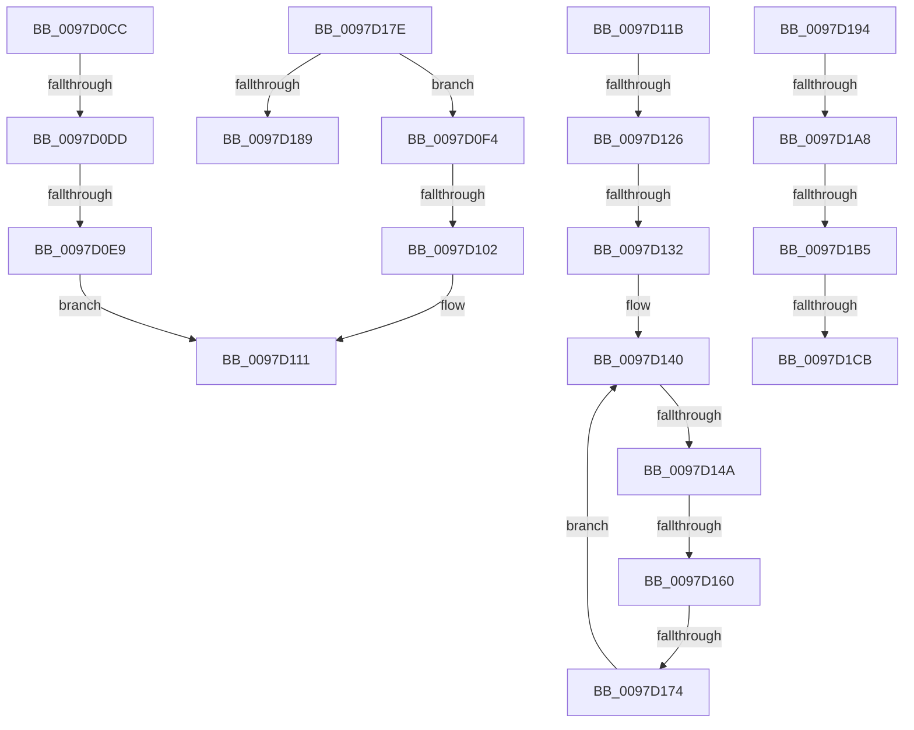

# sub_0097D0CC

- RVA: `0x0097D0CC`–`0x0097D1D3` (길이 `263` bytes)
- VA: `0x000000014097D0CC`
- 실행 섹션: `PAGE`
- PDB 이름 있음: `아니요`; PDB Function 태그: `아니요`
- unwind 정보 RVA: `0x00096F30`
- 디코드: `55`개 명령, `263/263` bytes 표시
- 미해석 바이트: `0` (있으면 어셈블리에 `.byte`로 보존)

> 이 문서는 커널 이미지의 기계어와 PDB 기호를 분석해 생성했습니다. 4번과 5번은 함수 원형과 자료형을 바이너리 사용 방식에서 추정한 C 해석이며 원본 소스 복구 결과는 아닙니다.

## 1. Dependencies

- 직접 호출 지점: **0**; 고유 호출 대상: **0**
- 직접 호출자로 확인된 함수: **0**
- RIP 상대 이미지 참조: **2**

### Outgoing calls
- 직접 디코드된 call 명령이 없습니다.

### Direct callers
- 이 함수 시작 RVA로 연결되는 직접 call은 확인되지 않았습니다. 간접 호출은 완전히 역산할 수 없습니다.

### Static image references
- `0x0097D1A8` → RVA `0x00FD8000` (`PAGEDATA`; read)
- `0x0097D1B5` → RVA `0x00FD8090` (`PAGEDATA`; read)

## 2. Other-region calls and transfers

- 다른 실행 섹션으로 향하는 call: **0**
- call이 아닌 외부 분기/꼬리 이동: **14**
  - `0x0097D0D7` → [sub_0097CDB6 + 0x174](Unknown_function_0097CDB6.md) (`tail-transfer`)
  - `0x0097D0E3` → [sub_0097CDB6 + 0x174](Unknown_function_0097CDB6.md) (`tail-transfer`)
  - `0x0097D0FC` → [sub_0097CDB6 + 0x219](Unknown_function_0097CDB6.md) (`tail-transfer`)
  - `0x0097D116` → [sub_0097CDB6 + 0x232](Unknown_function_0097CDB6.md) (`tail-transfer`)
  - `0x0097D120` → [sub_0097CDB6 + 0x270](Unknown_function_0097CDB6.md) (`tail-transfer`)
  - `0x0097D12C` → [sub_0097CDB6 + 0x270](Unknown_function_0097CDB6.md) (`tail-transfer`)
  - `0x0097D144` → [sub_0097D3A5 + 0x7B](Unknown_function_0097D3A5.md) (`tail-transfer`)
  - `0x0097D15A` → [sub_0097D1E2 + 0xE3](Unknown_function_0097D1E2.md) (`tail-transfer`)
  - `0x0097D16E` → [sub_0097CDB6 + 0x270](Unknown_function_0097CDB6.md) (`tail-transfer`)
  - `0x0097D18F` → [sub_0097CDB6 + 0x174](Unknown_function_0097CDB6.md) (`tail-transfer`)
  - `0x0097D1A2` → [sub_0097CDB6 + 0x1A8](Unknown_function_0097CDB6.md) (`tail-transfer`)
  - `0x0097D1AF` → [sub_0097CDB6 + 0x1A8](Unknown_function_0097CDB6.md) (`tail-transfer`)
  - `0x0097D1C5` → [sub_0097CDB6 + 0x1A8](Unknown_function_0097CDB6.md) (`tail-transfer`)
  - `0x0097D1CE` → [sub_0097CDB6 + 0x1C1](Unknown_function_0097CDB6.md) (`tail-transfer`)

## 3. Assembly (complete function range)

```asm
0097D0CC  80 7C 24 20 00                  cmp byte ptr [rsp + 0x20], 0
0097D0D1  41 B9 01 00 00 00               mov r9d, 1
0097D0D7  0F 85 4D FE FF FF               jne 0x14097cf2a
0097D0DD  66 83 7C 24 28 2E               cmp word ptr [rsp + 0x28], 0x2e
0097D0E3  0F 84 41 FE FF FF               je 0x14097cf2a
0097D0E9  8B C7                           mov eax, edi
0097D0EB  FF C7                           inc edi
0097D0ED  66 45 89 34 43                  mov word ptr [r11 + rax*2], r14w
0097D0F2  EB 1D                           jmp 0x14097d111
0097D0F4  8B 44 24 28                     mov eax, dword ptr [rsp + 0x28]
0097D0F8  66 83 F8 2E                     cmp ax, 0x2e
0097D0FC  0F 85 CD FE FF FF               jne 0x14097cfcf
0097D102  8B C7                           mov eax, edi
0097D104  FF C7                           inc edi
0097D106  66 45 89 34 43                  mov word ptr [r11 + rax*2], r14w
0097D10B  41 B9 01 00 00 00               mov r9d, 1
0097D111  0F B7 6C 24 22                  movzx ebp, word ptr [rsp + 0x22]
0097D116  E9 CD FE FF FF                  jmp 0x14097cfe8
0097D11B  80 7C 24 20 00                  cmp byte ptr [rsp + 0x20], 0
0097D120  0F 85 00 FF FF FF               jne 0x14097d026
0097D126  66 83 7C 24 28 2E               cmp word ptr [rsp + 0x28], 0x2e
0097D12C  0F 85 F4 FE FF FF               jne 0x14097d026
0097D132  4C 8B 44 24 40                  mov r8, qword ptr [rsp + 0x40]
0097D137  0F B7 54 24 24                  movzx edx, word ptr [rsp + 0x24]
0097D13C  45 0F B7 10                     movzx r10d, word ptr [r8]
0097D140  66 41 3B D2                     cmp dx, r10w
0097D144  0F 83 D6 02 00 00               jae 0x14097d420
0097D14A  44 0F B7 CA                     movzx r9d, dx
0097D14E  4D 03 48 08                     add r9, qword ptr [r8 + 8]
0097D152  45 0F BE 01                     movsx r8d, byte ptr [r9]
0097D156  41 80 F8 80                     cmp r8b, 0x80
0097D15A  0F 83 65 01 00 00               jae 0x14097d2c5
0097D160  45 0F B7 C8                     movzx r9d, r8w
0097D164  B8 01 00 00 00                  mov eax, 1
0097D169  66 41 83 F9 2E                  cmp r9w, 0x2e
0097D16E  0F 84 B2 FE FF FF               je 0x14097d026
0097D174  4C 8B 44 24 40                  mov r8, qword ptr [rsp + 0x40]
0097D179  66 03 D0                        add dx, ax
0097D17C  EB C2                           jmp 0x14097d140
0097D17E  80 7C 24 20 00                  cmp byte ptr [rsp + 0x20], 0
0097D183  0F 84 6B FF FF FF               je 0x14097d0f4
0097D189  41 B9 01 00 00 00               mov r9d, 1
0097D18F  E9 96 FD FF FF                  jmp 0x14097cf2a
0097D194  49 8B 44 24 08                  mov rax, qword ptr [r12 + 8]
0097D199  44 0F BE 04 03                  movsx r8d, byte ptr [rbx + rax]
0097D19E  41 80 F8 80                     cmp r8b, 0x80
0097D1A2  0F 82 B6 FD FF FF               jb 0x14097cf5e
0097D1A8  80 3D 51 AE 65 00 00            cmp byte ptr [rip + 0x65ae51], 0
0097D1AF  0F 84 A9 FD FF FF               je 0x14097cf5e
0097D1B5  48 8B 05 D4 AE 65 00            mov rax, qword ptr [rip + 0x65aed4]
0097D1BC  41 0F B6 C8                     movzx ecx, r8b
0097D1C0  66 83 3C 48 00                  cmp word ptr [rax + rcx*2], 0
0097D1C5  0F 84 93 FD FF FF               je 0x14097cf5e
0097D1CB  41 8B F1                        mov esi, r9d
0097D1CE  E9 A4 FD FF FF                  jmp 0x14097cf77
```

## 4. C-style interpretation (structured pseudocode)

```c
__int64 __fastcall sub_0097D0CC(__int64 a1, __int64 a2, __int64 a3, __int64 a4, unsigned __int16 a5)
{
    __int64 v_rdi;
    unsigned __int8 v_stack_p20;
    unsigned __int16 v_stack_p22;
    unsigned __int16 v_stack_p24;
    unsigned int v_stack_p28;
    unsigned __int64 v_stack_p40;

    v_rdi = (unsigned int)((v_rdi) + 1);
    *(unsigned __int16 *)(v_r11 + (unsigned int)((unsigned int)(v_rdi)) * 2) = (unsigned __int16)(v_r14);
    goto loc_0097D111;
loc_0097D111:
}
```

## 5. (Beta) C Style

```c
int64_t sub_0097D0CC(int64_t Arg1, int64_t Arg2, int64_t Arg3, int64_t Arg4, uint16_t Arg5)
{
    int64_t local_rdi;
    uint8_t v_stack_p20;
    uint16_t v_stack_p22;
    uint16_t v_stack_p24;
    uint32_t v_stack_p28;
    uint64_t v_stack_p40;

    local_rdi = (uint32_t)((local_rdi) + 1);
    *(uint16_t *)(local_r11 + (uint32_t)((uint32_t)(local_rdi)) * 2) = (uint16_t)(local_r14);
    goto loc_0097D111;
loc_0097D111:
}
```

## 6. Execution-region graph

[열기: 2D/3D 그래프와 함수 탐색 컨트롤 패널](../../../control-panel.html?section=page&rva=0x0097D0CC&view=graph)

- 2D 그래프는 위에서 아래로 흐르고, 3D 그래프는 빈 공간을 드래그해 회전합니다. Shift+드래그는 이동, 휠은 확대·축소, 함수 노드 선택은 대상 보고서 이동입니다.

### Static fallback


