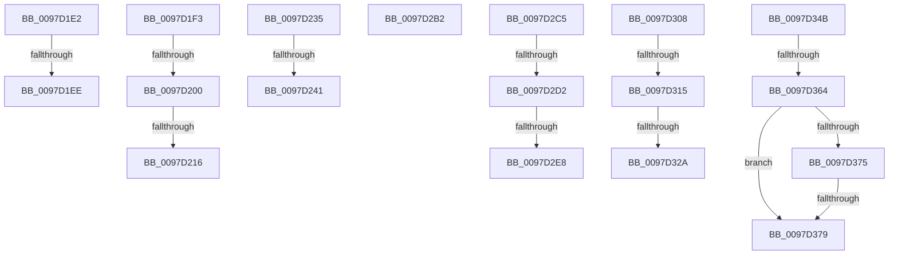

# sub_0097D1E2

- RVA: `0x0097D1E2`–`0x0097D390` (길이 `430` bytes)
- VA: `0x000000014097D1E2`
- 실행 섹션: `PAGE`
- PDB 이름 있음: `아니요`; PDB Function 태그: `아니요`
- unwind 정보 RVA: `0x00096F60`
- 디코드: `95`개 명령, `430/430` bytes 표시
- 미해석 바이트: `0` (있으면 어셈블리에 `.byte`로 보존)

> 이 문서는 커널 이미지의 기계어와 PDB 기호를 분석해 생성했습니다. 4번과 5번은 함수 원형과 자료형을 바이너리 사용 방식에서 추정한 C 해석이며 원본 소스 복구 결과는 아닙니다.

## 1. Dependencies

- 직접 호출 지점: **2**; 고유 호출 대상: **2**
- 직접 호출자로 확인된 함수: **0**
- RIP 상대 이미지 참조: **2**

### Outgoing calls
- `0x0097D259` → [ExAllocatePool2](../../poolcode/B8/ExAllocatePool2_function_00B820F0.md) (function, `0x00B820F0`)
- `0x0097D384` → [memcmp](../../text/6C/memcmp_function_006C6B10.md) (function, `0x006C6B10`)

### Direct callers
- 이 함수 시작 RVA로 연결되는 직접 call은 확인되지 않았습니다. 간접 호출은 완전히 역산할 수 없습니다.

### Static image references
- `0x0097D1F3` → RVA `0x00FD8000` (`PAGEDATA`; read)
- `0x0097D200` → RVA `0x00FD8090` (`PAGEDATA`; read)

## 2. Other-region calls and transfers

- 다른 실행 섹션으로 향하는 call: **2**
  - `0x0097D259` → [ExAllocatePool2](../../poolcode/B8/ExAllocatePool2_function_00B820F0.md) (`PAGE` → `POOLCODE`)
  - `0x0097D384` → [memcmp](../../text/6C/memcmp_function_006C6B10.md) (`PAGE` → `.text`)
- call이 아닌 외부 분기/꼬리 이동: **17**
  - `0x0097D1E8` → [sub_0097CDB6 + 0x2A0](Unknown_function_0097CDB6.md) (`tail-transfer`)
  - `0x0097D1EE` → [sub_0097CDB6 + 0x2AB](Unknown_function_0097CDB6.md) (`tail-transfer`)
  - `0x0097D1FA` → [sub_0097CDB6 + 0x1BC](Unknown_function_0097CDB6.md) (`tail-transfer`)
  - `0x0097D210` → [sub_0097CDB6 + 0x1BC](Unknown_function_0097CDB6.md) (`tail-transfer`)
  - `0x0097D230` → [sub_0097CDB6 + 0x1C5](Unknown_function_0097CDB6.md) (`tail-transfer`)
  - `0x0097D23B` → [sub_0097CDB6 + 0x1CE](Unknown_function_0097CDB6.md) (`tail-transfer`)
  - `0x0097D2AD` → [sub_0097CDB6 + 0x1CE](Unknown_function_0097CDB6.md) (`tail-transfer`)
  - `0x0097D2C0` → [sub_0097CDB6 + 0x232](Unknown_function_0097CDB6.md) (`tail-transfer`)
  - `0x0097D2CC` → [sub_0097D0CC + 0x94](Unknown_function_0097D0CC.md) (`tail-transfer`)
  - `0x0097D2E2` → [sub_0097D0CC + 0x94](Unknown_function_0097D0CC.md) (`tail-transfer`)
  - `0x0097D303` → [sub_0097D0CC + 0x9D](Unknown_function_0097D0CC.md) (`tail-transfer`)
  - `0x0097D30F` → [sub_0097CDB6 + 0x100](Unknown_function_0097CDB6.md) (`tail-transfer`)
  - `0x0097D324` → [sub_0097CDB6 + 0x100](Unknown_function_0097CDB6.md) (`tail-transfer`)
  - `0x0097D346` → [sub_0097CDB6 + 0x10A](Unknown_function_0097CDB6.md) (`tail-transfer`)
  - `0x0097D35E` → [sub_0097CDB6 + 0x132](Unknown_function_0097CDB6.md) (`tail-transfer`)
  - `0x0097D377` → [sub_0097D3A5](Unknown_function_0097D3A5.md) (`tail-transfer`)
  - `0x0097D38B` → [sub_0097CDB6 + 0x2D4](Unknown_function_0097CDB6.md) (`tail-transfer`)

## 3. Assembly (complete function range)

```asm
0097D1E2  41 FF C5                        inc r13d
0097D1E5  45 3B EE                        cmp r13d, r14d
0097D1E8  0F 82 68 FE FF FF               jb 0x14097d056
0097D1EE  E9 6E FE FF FF                  jmp 0x14097d061
0097D1F3  80 3D 06 AE 65 00 00            cmp byte ptr [rip + 0x65ae06], 0
0097D1FA  0F 84 72 FD FF FF               je 0x14097cf72
0097D200  48 8B 05 89 AE 65 00            mov rax, qword ptr [rip + 0x65ae89]
0097D207  41 0F B6 C8                     movzx ecx, r8b
0097D20B  66 83 3C 48 00                  cmp word ptr [rax + rcx*2], 0
0097D210  0F 84 5C FD FF FF               je 0x14097cf72
0097D216  43 0F BE 4C 0A 01               movsx ecx, byte ptr [r10 + r9 + 1]
0097D21C  B8 00 01 00 00                  mov eax, 0x100
0097D221  0F B7 E9                        movzx ebp, cx
0097D224  BE 02 00 00 00                  mov esi, 2
0097D229  0F AF E8                        imul ebp, eax
0097D22C  66 41 03 E8                     add bp, r8w
0097D230  E9 46 FD FF FF                  jmp 0x14097cf7b
0097D235  48 83 7C 24 48 00               cmp qword ptr [rsp + 0x48], 0
0097D23B  0F 85 43 FD FF FF               jne 0x14097cf84
0097D241  41 0F B7 14 24                  movzx edx, word ptr [r12]
0097D246  B9 22 01 00 00                  mov ecx, 0x122
0097D24B  41 B8 46 53 72 64               mov r8d, 0x64725346
0097D251  48 8D 14 D5 08 00 00 00         lea rdx, [rdx*8 + 8]
0097D259  E8 92 4E 20 00                  call 0x140b820f0
0097D25E  48 8B 4C 24 50                  mov rcx, qword ptr [rsp + 0x50]
0097D263  48 8B D0                        mov rdx, rax
0097D266  48 89 44 24 48                  mov qword ptr [rsp + 0x48], rax
0097D26B  4C 8B DA                        mov r11, rdx
0097D26E  48 8B 44 24 30                  mov rax, qword ptr [rsp + 0x30]
0097D273  48 89 54 24 30                  mov qword ptr [rsp + 0x30], rdx
0097D278  0F 10 00                        movups xmm0, xmmword ptr [rax]
0097D27B  0F 11 02                        movups xmmword ptr [rdx], xmm0
0097D27E  0F 10 48 10                     movups xmm1, xmmword ptr [rax + 0x10]
0097D282  0F 11 4A 10                     movups xmmword ptr [rdx + 0x10], xmm1
0097D286  41 0F B7 04 24                  movzx eax, word ptr [r12]
0097D28B  0F 10 01                        movups xmm0, xmmword ptr [rcx]
0097D28E  0F 11 44 82 04                  movups xmmword ptr [rdx + rax*4 + 4], xmm0
0097D293  0F 10 49 10                     movups xmm1, xmmword ptr [rcx + 0x10]
0097D297  0F 11 4C 82 14                  movups xmmword ptr [rdx + rax*4 + 0x14], xmm1
0097D29C  41 0F B7 04 24                  movzx eax, word ptr [r12]
0097D2A1  48 FF C0                        inc rax
0097D2A4  48 8D 04 82                     lea rax, [rdx + rax*4]
0097D2A8  48 89 44 24 50                  mov qword ptr [rsp + 0x50], rax
0097D2AD  E9 D2 FC FF FF                  jmp 0x14097cf84
0097D2B2  0F B7 6C 24 22                  movzx ebp, word ptr [rsp + 0x22]
0097D2B7  8B C7                           mov eax, edi
0097D2B9  FF C7                           inc edi
0097D2BB  66 41 89 2C 43                  mov word ptr [r11 + rax*2], bp
0097D2C0  E9 23 FD FF FF                  jmp 0x14097cfe8
0097D2C5  80 3D 34 AD 65 00 00            cmp byte ptr [rip + 0x65ad34], 0
0097D2CC  0F 84 8E FE FF FF               je 0x14097d160
0097D2D2  48 8B 05 B7 AD 65 00            mov rax, qword ptr [rip + 0x65adb7]
0097D2D9  41 0F B6 C8                     movzx ecx, r8b
0097D2DD  66 83 3C 48 00                  cmp word ptr [rax + rcx*2], 0
0097D2E2  0F 84 78 FE FF FF               je 0x14097d160
0097D2E8  41 0F BE 41 01                  movsx eax, byte ptr [r9 + 1]
0097D2ED  B9 00 01 00 00                  mov ecx, 0x100
0097D2F2  44 0F B7 C8                     movzx r9d, ax
0097D2F6  B8 02 00 00 00                  mov eax, 2
0097D2FB  44 0F AF C9                     imul r9d, ecx
0097D2FF  66 45 03 C8                     add r9w, r8w
0097D303  E9 61 FE FF FF                  jmp 0x14097d169
0097D308  80 3D F1 AC 65 00 00            cmp byte ptr [rip + 0x65acf1], 0
0097D30F  0F 84 A1 FB FF FF               je 0x14097ceb6
0097D315  48 8B 05 74 AD 65 00            mov rax, qword ptr [rip + 0x65ad74]
0097D31C  0F B6 CA                        movzx ecx, dl
0097D31F  66 83 3C 48 00                  cmp word ptr [rax + rcx*2], 0
0097D324  0F 84 8C FB FF FF               je 0x14097ceb6
0097D32A  41 0F BE 40 01                  movsx eax, byte ptr [r8 + 1]
0097D32F  44 0F B7 C0                     movzx r8d, ax
0097D333  0F B7 C7                        movzx eax, di
0097D336  0F B7 CE                        movzx ecx, si
0097D339  44 0F AF C1                     imul r8d, ecx
0097D33D  66 44 03 C2                     add r8w, dx
0097D341  44 89 44 24 28                  mov dword ptr [rsp + 0x28], r8d
0097D346  E9 75 FB FF FF                  jmp 0x14097cec0
0097D34B  48 8B 5C 24 40                  mov rbx, qword ptr [rsp + 0x40]
0097D350  41 0F B7 04 24                  movzx eax, word ptr [r12]
0097D355  66 FF C8                        dec ax
0097D358  0F B7 0B                        movzx ecx, word ptr [rbx]
0097D35B  66 3B C8                        cmp cx, ax
0097D35E  0F 82 84 FB FF FF               jb 0x14097cee8
0097D364  41 0F B7 C3                     movzx eax, r11w
0097D368  8B D1                           mov edx, ecx
0097D36A  2B D0                           sub edx, eax
0097D36C  44 38 3D 8D AC 65 00            cmp byte ptr [rip + 0x65ac8d], r15b
0097D373  74 04                           je 0x14097d379
0097D375  85 D2                           test edx, edx
0097D377  75 2C                           jne 0x14097d3a5
0097D379  48 03 53 08                     add rdx, qword ptr [rbx + 8]
0097D37D  49 8B C9                        mov rcx, r9
0097D380  45 0F B7 C3                     movzx r8d, r11w
0097D384  E8 87 97 D4 FF                  call 0x1406c6b10
0097D389  85 C0                           test eax, eax
0097D38B  E9 FA FC FF FF                  jmp 0x14097d08a
```

## 4. C-style interpretation (structured pseudocode)

```c
__int64 __fastcall sub_0097D1E2(__int64 a1, __int64 a2, unsigned __int16 a3, __int64 a4)
{
    __int64 v_r13;
    unsigned __int16 v_stack_p22;
    unsigned int v_stack_p28;
    unsigned __int64 v_stack_p30;
    unsigned __int64 v_stack_p40;
    unsigned __int64 v_stack_p48;
    unsigned __int64 v_stack_p50;

    v_r13 = (unsigned int)((v_r13) + 1);
}
```

## 5. (Beta) C Style

```c
int64_t sub_0097D1E2(int64_t Arg1, int64_t Arg2, uint16_t Arg3, int64_t Arg4)
{
    int64_t local_r13;
    uint16_t v_stack_p22;
    uint32_t v_stack_p28;
    uint64_t v_stack_p30;
    uint64_t v_stack_p40;
    uint64_t v_stack_p48;
    uint64_t v_stack_p50;

    local_r13 = (uint32_t)((local_r13) + 1);
}
```

## 6. Execution-region graph

[열기: 2D/3D 그래프와 함수 탐색 컨트롤 패널](../../../control-panel.html?section=page&rva=0x0097D1E2&view=graph)

- 2D 그래프는 위에서 아래로 흐르고, 3D 그래프는 빈 공간을 드래그해 회전합니다. Shift+드래그는 이동, 휠은 확대·축소, 함수 노드 선택은 대상 보고서 이동입니다.

### Static fallback


