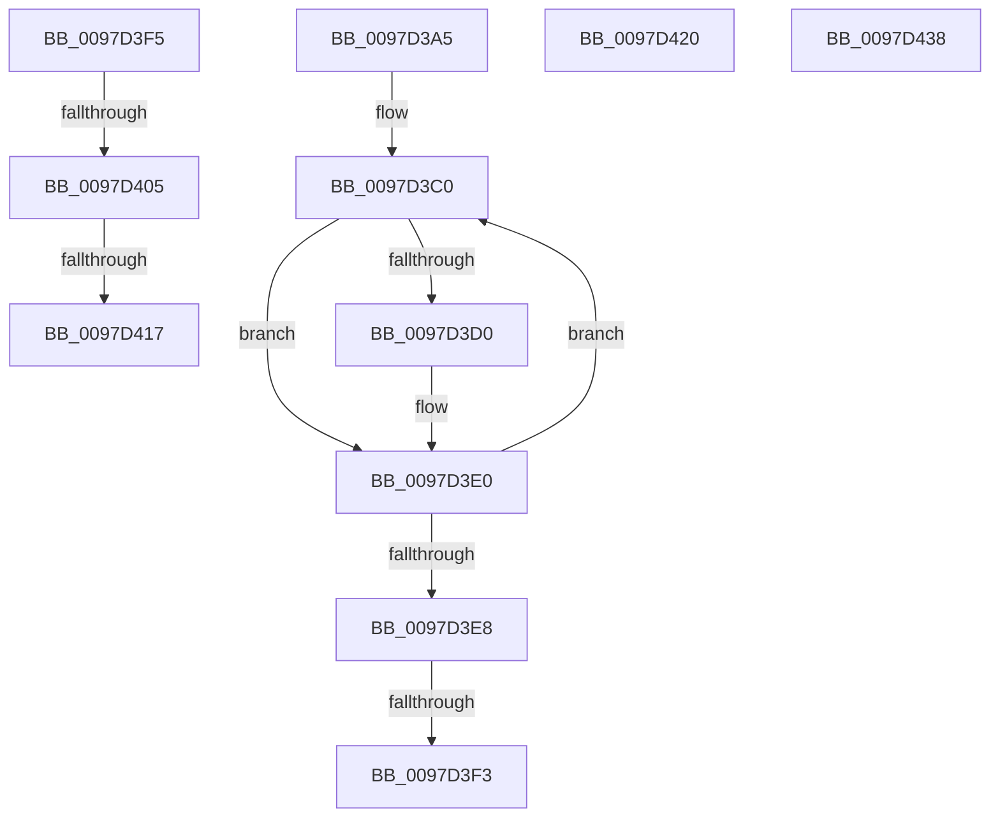

# sub_0097D3A5

- RVA: `0x0097D3A5`–`0x0097D447` (길이 `162` bytes)
- VA: `0x000000014097D3A5`
- 실행 섹션: `PAGE`
- PDB 이름 있음: `아니요`; PDB Function 태그: `아니요`
- unwind 정보 RVA: `0x00096F90`
- 디코드: `38`개 명령, `162/162` bytes 표시
- 미해석 바이트: `0` (있으면 어셈블리에 `.byte`로 보존)

> 이 문서는 커널 이미지의 기계어와 PDB 기호를 분석해 생성했습니다. 4번과 5번은 함수 원형과 자료형을 바이너리 사용 방식에서 추정한 C 해석이며 원본 소스 복구 결과는 아닙니다.

## 1. Dependencies

- 직접 호출 지점: **1**; 고유 호출 대상: **1**
- 직접 호출자로 확인된 함수: **0**
- RIP 상대 이미지 참조: **2**

### Outgoing calls
- `0x0097D43D` → [ExFreePoolWithTag](../../poolcode/B8/ExFreePoolWithTag_function_00B82870.md) (function, `0x00B82870`)

### Direct callers
- 이 함수 시작 RVA로 연결되는 직접 call은 확인되지 않았습니다. 간접 호출은 완전히 역산할 수 없습니다.

### Static image references
- `0x0097D3D0` → RVA `0x00FD8090` (`PAGEDATA`; read)
- `0x0097D3F5` → RVA `0x00FD8000` (`PAGEDATA`; read)

## 2. Other-region calls and transfers

- 다른 실행 섹션으로 향하는 call: **1**
  - `0x0097D43D` → [ExFreePoolWithTag](../../poolcode/B8/ExFreePoolWithTag_function_00B82870.md) (`PAGE` → `POOLCODE`)
- call이 아닌 외부 분기/꼬리 이동: **7**
  - `0x0097D3ED` → [sub_0097CDB6 + 0x132](Unknown_function_0097CDB6.md) (`tail-transfer`)
  - `0x0097D3F3` → [sub_0097D1E2 + 0x197](Unknown_function_0097D1E2.md) (`tail-transfer`)
  - `0x0097D3FF` → [sub_00B29D5E](../B2/Unknown_function_00B29D5E.md) (`tail-transfer`)
  - `0x0097D411` → [sub_00B29D5E](../B2/Unknown_function_00B29D5E.md) (`tail-transfer`)
  - `0x0097D41B` → [sub_0097CDB6 + 0x5A](Unknown_function_0097CDB6.md) (`tail-transfer`)
  - `0x0097D433` → [sub_0097CDB6 + 0x174](Unknown_function_0097CDB6.md) (`tail-transfer`)
  - `0x0097D442` → [sub_0097CDB6 + 0x132](Unknown_function_0097CDB6.md) (`tail-transfer`)

## 3. Assembly (complete function range)

```asm
0097D3A5  4C 8B 53 08                     mov r10, qword ptr [rbx + 8]
0097D3A9  BF 02 00 00 00                  mov edi, 2
0097D3AE  41 B9 01 00 00 00               mov r9d, 1
0097D3B4  0F 1F 40 00                     nop dword ptr [rax]
0097D3B8  0F 1F 84 00 00 00 00 00         nop dword ptr [rax + rax]
0097D3C0  41 8B C7                        mov eax, r15d
0097D3C3  45 8B C1                        mov r8d, r9d
0097D3C6  42 0F B6 0C 10                  movzx ecx, byte ptr [rax + r10]
0097D3CB  80 F9 80                        cmp cl, 0x80
0097D3CE  72 10                           jb 0x14097d3e0
0097D3D0  48 8B 05 B9 AC 65 00            mov rax, qword ptr [rip + 0x65acb9]
0097D3D7  66 83 3C 48 00                  cmp word ptr [rax + rcx*2], 0
0097D3DC  44 0F 45 C7                     cmovne r8d, edi
0097D3E0  45 03 F8                        add r15d, r8d
0097D3E3  44 3B FA                        cmp r15d, edx
0097D3E6  72 D8                           jb 0x14097d3c0
0097D3E8  4C 8B 4C 24 30                  mov r9, qword ptr [rsp + 0x30]
0097D3ED  0F 87 F5 FA FF FF               ja 0x14097cee8
0097D3F3  EB 84                           jmp 0x14097d379
0097D3F5  38 1D 05 AC 65 00               cmp byte ptr [rip + 0x65ac05], bl
0097D3FB  44 0F B6 D1                     movzx r10d, cl
0097D3FF  0F 84 59 C9 1A 00               je 0x140b29d5e
0097D405  48 8B 05 84 AC 65 00            mov rax, qword ptr [rip + 0x65ac84]
0097D40C  66 44 39 3C 48                  cmp word ptr [rax + rcx*2], r15w
0097D411  0F 84 47 C9 1A 00               je 0x140b29d5e
0097D417  FF C2                           inc edx
0097D419  FF C2                           inc edx
0097D41B  E9 F0 F9 FF FF                  jmp 0x14097ce10
0097D420  8B C7                           mov eax, edi
0097D422  66 41 FF C6                     inc r14w
0097D426  FF C7                           inc edi
0097D428  41 B9 01 00 00 00               mov r9d, 1
0097D42E  66 45 89 34 43                  mov word ptr [r11 + rax*2], r14w
0097D433  E9 F2 FA FF FF                  jmp 0x14097cf2a
0097D438  33 D2                           xor edx, edx
0097D43A  48 8B C8                        mov rcx, rax
0097D43D  E8 2E 54 20 00                  call 0x140b82870
0097D442  E9 A1 FA FF FF                  jmp 0x14097cee8
```

## 4. C-style interpretation (structured pseudocode)

```c
__int64 __fastcall sub_0097D3A5(__int64 a1, int a2, __int64 a3, __int64 a4, __int64 a5, __int64 a6)
{
    __int64 result;
    __int64 v_r15;

loc_0097D3C0:
    result = (unsigned int)((unsigned int)(v_r15));
    if (((unsigned __int8)(*(unsigned __int8 *)((unsigned int)((unsigned int)(v_r15)) + *(unsigned __int64 *)(v_rbx + 8) * 1))) >= 128) {
        result = *(unsigned __int64 *)(v_rip + 6663353);
        a3 = 1;
        if ((*(unsigned __int16 *)(result + *(unsigned __int8 *)((unsigned int)((unsigned int)(v_r15)) + *(unsigned __int64 *)(v_rbx + 8) * 1) * 2)) != 0) { a3 = 2; }
    }
    v_r15 = (unsigned int)((v_r15) + ((unsigned int)(a3)));
    if (((unsigned int)(v_r15)) < a2) goto loc_0097D3C0;
}
```

## 5. (Beta) C Style

```c
int64_t sub_0097D3A5(int64_t Arg1, int32_t Arg2, int64_t Arg3, int64_t Arg4, uint64_t Arg5, int64_t Arg6)
{
    int64_t result;
    int64_t local_r15;

loc_0097D3C0:
    result = (uint32_t)((uint32_t)(local_r15));
    if (((uint8_t)(*(uint8_t *)((uint32_t)((uint32_t)(local_r15)) + *(uint64_t *)(local_rbx + 0x8) * 1))) >= 128) {
        result = *(uint64_t *)(v_rip + 0x65ACB9);
        Arg3 = 1;
        if ((*(uint16_t *)(result + *(uint8_t *)((uint32_t)((uint32_t)(local_r15)) + *(uint64_t *)(local_rbx + 0x8) * 1) * 2)) != 0) { Arg3 = 2; }
    }
    local_r15 = (uint32_t)((local_r15) + ((uint32_t)(Arg3)));
    if (((uint32_t)(local_r15)) < Arg2) goto loc_0097D3C0;
}
```

## 6. Execution-region graph

[열기: 2D/3D 그래프와 함수 탐색 컨트롤 패널](../../../control-panel.html?section=page&rva=0x0097D3A5&view=graph)

- 2D 그래프는 위에서 아래로 흐르고, 3D 그래프는 빈 공간을 드래그해 회전합니다. Shift+드래그는 이동, 휠은 확대·축소, 함수 노드 선택은 대상 보고서 이동입니다.

### Static fallback


